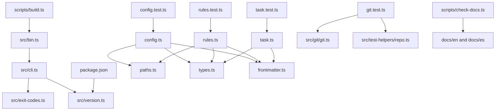

Part 2 · Page 3 of 20 · Previous: [Use code-audit today](../1-overview/20-usage.md) · Next: [Command line](20-cli.md) · [Index](../README.md)
# Architecture

Bun is the development toolkit: it installs dependencies, runs TypeScript tests and scripts, and bundles the CLI. Node.js runs the built JavaScript file, so running the CLI does not require Bun.

## Modules and connections

`src/bin.ts` passes the user's arguments to `main` in [`src/cli.ts`](../3-code/020-cli.md). The CLI imports [`src/exit-codes.ts`](../3-code/030-exit-codes-and-version.md) and [`src/version.ts`](../3-code/030-exit-codes-and-version.md). The version module reads `package.json`.

[`src/config/frontmatter.ts`](../3-code/040-config-frontmatter.md) parses a YAML header and body. `src/config/rules.ts` and [`src/config/task.ts`](../3-code/090-config-task.md) import it; their tests import their respective loaders.

The build script bundles the executable from [`src/bin.ts`](../3-code/010-bin.md) into a JavaScript module. A JavaScript module (ESM) is a file that uses `import` and `export`. The documentation checker validates the English and Spanish pages.

The Git tests import [`src/git/git.ts`](../3-code/100-git-git.md) and [`src/test-helpers/repo.ts`](../3-code/110-test-helpers-repo.md). The test helper runs Git only in temporary fixture repositories. No production file imports the Git interface or its helper today.
Part 2 · Page 3 of 20 · Previous: [Use code-audit today](../1-overview/20-usage.md) · Next: [Command line](20-cli.md) · [Index](../README.md)
