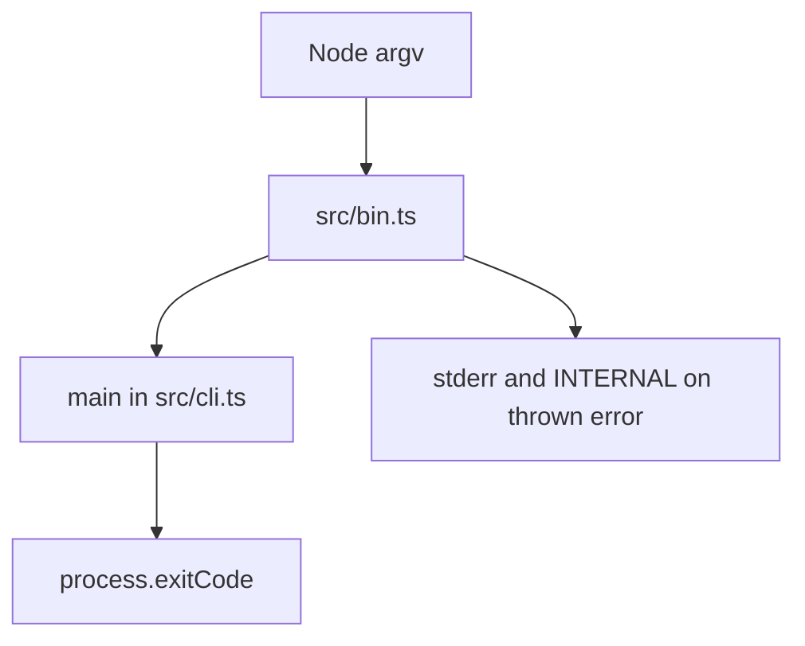

Part 3 · Page 5 of 20 · Previous: [Command line](../2-architecture/20-cli.md) · Next: [Command line](020-cli.md) · [Index](../README.md)
# Program entry point

**File:** `src/bin.ts` · 10 lines · **Status:** available

## Page index

- What is it and what is it for?
- Before reading the code
- How it fits
- The complete, commented code
- Examples with real data
- Behavior summary
- Where it is used
- Tests

## What is it and what is it for?

`src/bin.ts` is the executable entry point. Without it, the built command would have no place to turn Node's command-line arguments into a CLI call or set the process result. It passes the arguments to [`src/cli.ts`](020-cli.md), catches unexpected errors, and writes the exit code. Node invokes the file; it returns no value to a caller.

## Before reading the code


### Process arguments

`process.argv` contains the Node executable, the script path, and the user's arguments. `slice(2)` keeps only the user's arguments. Running the actual built command with `--version` printed:

```text
0.1.0
```

### Exit status

`process.exitCode` tells the shell whether the command succeeded. For this call, the CLI returned `0` and the process ended with status `0`:

Command: `node skills/code-audit/code-audit.mjs --version`

```text
// → 0.1.0
```

This matters because shell scripts can stop or branch based on that status.

## How it fits



1. Node loads the executable and supplies `process.argv`.
2. The entry point removes Node's first two arguments and awaits `main`.
3. The CLI result becomes `process.exitCode`.
4. If an exception escapes, the entry point prints its message and uses `ExitCode.INTERNAL`.

## The complete, commented code

```ts
import { main } from './cli.js';
import { ExitCode } from './exit-codes.js';

// Start the CLI with only the arguments supplied by the user.
try {
  process.exitCode = await main(process.argv.slice(2));
} catch (error) {
  // Keep useful error text even when a thrown value is not an Error.
  const message = error instanceof Error ? error.message : String(error);
  process.stderr.write(`${message}\n`);
  // Distinguish unexpected failures from command usage errors.
  process.exitCode = ExitCode.INTERNAL;
}
```

## Examples with real data

The following commands show the entry point's actual output.

### Normal case

Command: `node skills/code-audit/code-audit.mjs --version`.

Command: `node skills/code-audit/code-audit.mjs --version`

```text
// → 0.1.0
```

### Edge case

The current `main` reports an unknown command to stderr and returns the usage code:

Command: `node skills/code-audit/code-audit.mjs nope`

```text
// → Unknown command: nope
```

The process exits with code `1`.

### Without the key line

Without `process.argv.slice(2)`, `main` would receive Node's executable and script path before `--version`; its single-argument version check would not match. This follows from the actual `argv` use in `src/bin.ts:5` and the condition in [`src/cli.ts`](020-cli.md).

## Behavior summary

- **A CLI command returns a code:** the entry point assigns it to `process.exitCode`.
- **An unexpected value is thrown:** the entry point prints its text and sets code `10`.
- **The CLI succeeds:** Node exits normally with the code selected by `main`.

## Where it is used

- Node starts this file through the `#!/usr/bin/env node` banner emitted by [`scripts/build.ts`](../4-development/15-build-script.md), line 22.
- It calls [`src/cli.ts`](020-cli.md), line 5.
- It uses [`src/exit-codes.ts`](030-exit-codes-and-version.md), line 9.

## Tests

- `src/cli.test.ts`: `prints the version and returns success`, `rejects unknown commands`.

- `src/cli.test.ts`: `prints the version and returns success`, `rejects unknown commands`.
Part 3 · Page 5 of 20 · Previous: [Command line](../2-architecture/20-cli.md) · Next: [Command line](020-cli.md) · [Index](../README.md)
