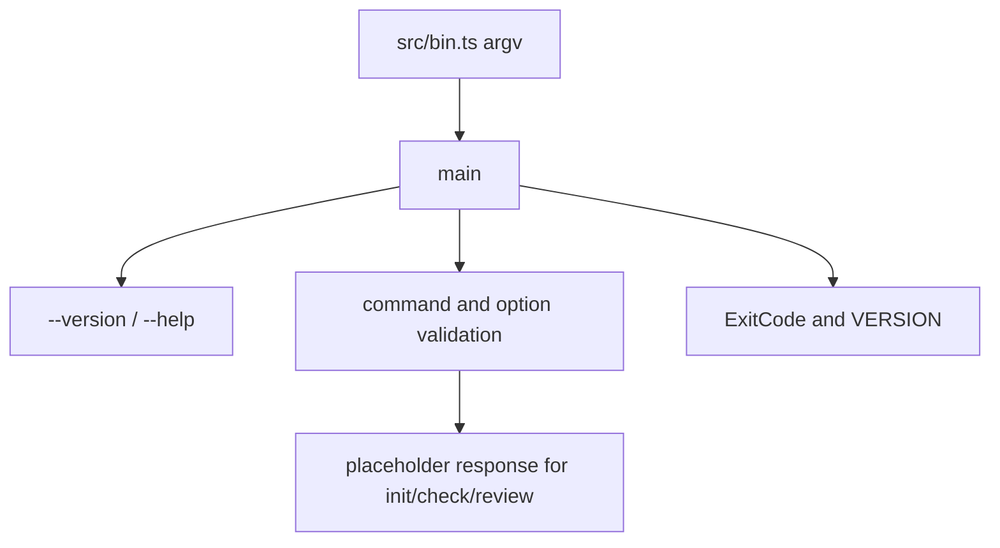

Part 3 · Page 6 of 17 · Previous: [Program entry point](010-bin.md) · Next: [Exit codes and version](030-exit-codes-and-version.md) · [Index](../README.md)
# Command line

**File:** `src/cli.ts` · 75 lines · **Status:** available

## Page index

- What is it and what is it for?
- Before reading the code
- How it fits
- The complete, commented code
- Examples with real data
- Behavior summary
- Where it is used
- Tests

## What is it and what is it for?

`src/cli.ts` parses arguments, writes help and version output, and returns an exit code. Without it, the executable could not distinguish supported options from errors. It receives `argv` and optional output functions; it returns a `Promise<number>`. [`src/bin.ts`](010-bin.md) calls it. At this stage, `init`, `check`, and `review` are placeholders.

## Before reading the code


### Injected output

`CliIO` lets a caller collect standard output and errors instead of writing to the terminal. The real version test captures the text `0.1.0` and verifies that `main` returns `0`.

### Exit code

`ExitCode.USAGE` is `1`. Running the built CLI with an unknown option produced:

Command: `node skills/code-audit/code-audit.mjs init --bogus`

```text
// → Unknown option: --bogus
```

This keeps usage mistakes distinct from internal errors.

### Recognized options

`--root` and `--language` consume the next argument. `--json` consumes none. When `--root` has no value, the built CLI printed:

Command: `node skills/code-audit/code-audit.mjs init --root`

```text
// → Missing value for --root
```

## How it fits



1. The entry point calls `main(argv)`.
2. `main` handles standalone `--version` or help.
3. It validates the command, then walks its options.
4. It returns a usage code for invalid input or unavailable commands.

## The complete, commented code

```ts
import { ExitCode } from './exit-codes.js';
import { VERSION } from './version.js';

/** Supplies output functions used by the CLI. */
export interface CliIO {
  stdout(s: string): void;
  stderr(s: string): void;
}

// Keep the help text in one place so all help paths print the same options.
const HELP = `code-audit ${VERSION}

Usage: code-audit <command> [options]

Commands:
  init    Create the project configuration
  check   Validate the project configuration
  review  Review the current branch

Options:
  --root <path>       Project root directory
  --language <code>   Language for generated files
  --json              Print machine-readable output
  --help              Show this help
  --version           Show the version`;

// Reject command names that are not part of the current CLI surface.
const COMMANDS = new Set(['init', 'check', 'review']);

/** Runs the CLI command and returns its process exit code. */
export async function main(argv: string[], io: CliIO = {
  stdout: (s) => process.stdout.write(s),
  stderr: (s) => process.stderr.write(s),
}): Promise<number> {
  // Handle version before requiring a command name.
  if (argv.length === 1 && argv[0] === '--version') {
    io.stdout(`${VERSION}\n`);
    return ExitCode.OK;
  }

  // Support both common help spellings when passed alone.
  if (argv.length === 1 && (argv[0] === '--help' || argv[0] === '-h')) {
    io.stdout(`${HELP}\n`);
    return ExitCode.OK;
  }

  // Separate the command from the options it may accept.
  const [command, ...options] = argv;
  if (!command || command.startsWith('-') || !COMMANDS.has(command)) {
    io.stderr(`Unknown command: ${command ?? ''}\n`);
    return ExitCode.USAGE;
  }

  // Check each option and skip the value consumed by valued options.
  for (let index = 0; index < options.length; index += 1) {
    const option = options[index];
    if (option === '--json') continue;
    if (option === '--root' || option === '--language') {
      if (!options[index + 1] || options[index + 1].startsWith('--')) {
        io.stderr(`Missing value for ${option}\n`);
        return ExitCode.USAGE;
      }
      index += 1;
      continue;
    }
    if (option === '--help' || option === '-h') {
      io.stdout(`${HELP}\n`);
      return ExitCode.OK;
    }
    io.stderr(`Unknown option: ${option}\n`);
    return ExitCode.USAGE;
  }

  // Review is listed for discoverability but has no implementation yet.
  if (command === 'review') {
    io.stderr('review is not available yet\n');
    return ExitCode.USAGE;
  }

  // Init and check are also placeholders in this version.
  io.stderr(`${command} is not available yet\n`);
  return ExitCode.USAGE;
}
```

## Examples with real data


### Normal case

Command: `node skills/code-audit/code-audit.mjs --version`.

Command: `node skills/code-audit/code-audit.mjs --version`

```text
// → 0.1.0
```

### Edge case

Command: `node skills/code-audit/code-audit.mjs init --root`.

Command: `node skills/code-audit/code-audit.mjs init --root`

```text
// → Missing value for --root
```

It exits with code `1`.

### Without the key line

Without `index += 1`, the value after `--root` would be treated as another option and reported as unknown. The current loop skips it at `src/cli.ts:57`.

## Behavior summary

- **Only `--version` is supplied:** print `0.1.0` and return `0`.
- **An unknown command or option is supplied:** write an error and return `1`.
- **A valued option has no value:** write `Missing value for ...` and return `1`.
- **`init`, `check`, or `review` is requested:** return `1` with an unavailable message.

## Where it is used

- Called by [`src/bin.ts`](010-bin.md), line 5.
- Reads [`src/exit-codes.ts`](030-exit-codes-and-version.md), lines 1–8, and [`src/version.ts`](030-exit-codes-and-version.md), line 4.

## Tests

- `src/cli.test.ts`: `prints the version and returns success`, `prints help with the available commands`, `rejects unknown commands`, `reports that review is not available yet`.
Part 3 · Page 6 of 17 · Previous: [Program entry point](010-bin.md) · Next: [Exit codes and version](030-exit-codes-and-version.md) · [Index](../README.md)
