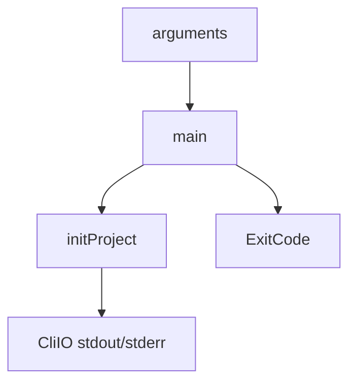

Part 3 · Page 6 of 26 · Previous: [Program entry point](010-bin.md) · Next: [Exit codes and version](030-exit-codes-and-version.md) · [Index](../README.md)
# Command line

**File:** `src/cli.ts` · 150 lines · **Status:** available

## Page index

- What is it and what is it for?
- Before reading the code
- How it fits
- The complete, commented code
- Examples with real data
- Behavior summary
- Where it is used
- Tests

## What is it and what is it for?

`main` checks commands and options, calls `initProject` or `checkProject`, writes the result, and returns its exit code. `check` uses the Git repository root and supports plain or JSON output; only `review` remains unavailable.

## Before reading the code

An exit code is the number returned to the shell. A usage error such as an invalid language returns `ExitCode.USAGE`, which has the value 1.

## How it fits



1. `main` validates the command and options.
2. For `init`, it reads `--root`, `--language`, and `--json`.
3. It calls `initProject`; invalid language returns 1, a path outside a repository returns 3, and unexpected failures return 10.
4. `check` returns 2 for configuration errors, 0 for warnings only or no problems, and 3 outside Git. `review` prints that it is not available yet.

## The complete, commented code

Complete source: 114 lines.

```ts
import { ExitCode } from './exit-codes.js';
import { findRepoRoot, GitError, NotARepoError } from './git/git.js';
import { initProject, InvalidLanguageError } from './init/init.js';
import { checkProject } from './check/check.js';
import { VERSION } from './version.js';

/** Supplies output functions used by the CLI. */
export interface CliIO {
  stdout(s: string): void;
  stderr(s: string): void;
}

const HELP = `code-audit ${VERSION}

Usage: code-audit <command> [options]

Commands:
  init    Create the project configuration
  check   Validate the project configuration
  review  Review the current branch

Options:
  --root <path>       Project root directory
  --language <code>   Language for generated files
  --json              Print machine-readable output
  --help              Show this help
  --version           Show the version`;

const COMMANDS = new Set(['init', 'check', 'review']);

/** Runs the CLI command and returns its process exit code. */
export async function main(argv: string[], io: CliIO = {
  stdout: (s) => process.stdout.write(s),
  stderr: (s) => process.stderr.write(s),
}): Promise<number> {
  if (argv.length === 1 && argv[0] === '--version') {
    io.stdout(`${VERSION}\n`);
    return ExitCode.OK;
  }

  if (argv.length === 1 && (argv[0] === '--help' || argv[0] === '-h')) {
    io.stdout(`${HELP}\n`);
    return ExitCode.OK;
  }

  const [command, ...options] = argv;
  if (!command || command.startsWith('-') || !COMMANDS.has(command)) {
    io.stderr(`Unknown command: ${command ?? ''}\n`);
    return ExitCode.USAGE;
  }

  for (let index = 0; index < options.length; index += 1) {
    const option = options[index];
    if (option === '--json') continue;
    if (option === '--root' || option === '--language') {
      if (!options[index + 1] || options[index + 1].startsWith('--')) {
        io.stderr(`Missing value for ${option}\n`);
        return ExitCode.USAGE;
      }
      index += 1;
      continue;
    }
    if (option === '--help' || option === '-h') {
      io.stdout(`${HELP}\n`);
      return ExitCode.OK;
    }
    io.stderr(`Unknown option: ${option}\n`);
    return ExitCode.USAGE;
  }

  if (command === 'init') {
    let root = process.cwd();
    let language = 'en';
    let json = false;
    for (let index = 0; index < options.length; index += 1) {
      const option = options[index];
      if (option === '--json') json = true;
      else if (option === '--root') root = options[++index]!;
      else if (option === '--language') language = options[++index]!;
    }
    try {
      const result = await initProject(root, { language });
      io.stdout(json ? `${JSON.stringify(result)}\n` : formatInitResult(result));
      return ExitCode.OK;
    } catch (error) {
      const message = error instanceof Error ? error.message : String(error);
      if (error instanceof InvalidLanguageError) {
        io.stderr(`${message}\n`);
        return ExitCode.USAGE;
      }
      if (error instanceof NotARepoError) {
        io.stderr(`${message}\n`);
        return ExitCode.NOT_A_REPO;
      }
      io.stderr(`init failed: ${message}\n`);
      return ExitCode.INTERNAL;
    }
  }

  if (command === 'review') {
    io.stderr('review is not available yet\n');
    return ExitCode.USAGE;
  }

  if (command === 'check') {
    let root = process.cwd();
    let json = false;
    for (let index = 0; index < options.length; index += 1) {
      const option = options[index];
      if (option === '--json') json = true;
      else if (option === '--root') root = options[++index]!;
      else if (option === '--language') index += 1;
    }
    try {
      const repoRoot = await findRepoRoot(root);
      const result = await checkProject(repoRoot);
      if (json) io.stdout(`${JSON.stringify(result)}\n`);
      else io.stdout(formatCheckResult(result));
      return result.problems.some((problem) => problem.level === 'error') ? ExitCode.CONFIG_INVALID : ExitCode.OK;
    } catch (error) {
      const message = error instanceof Error ? error.message : String(error);
      if (error instanceof NotARepoError || (error instanceof GitError && ['git-unavailable', 'directory'].includes(error.reason))) {
        io.stderr(`${message}\n`);
        return ExitCode.NOT_A_REPO;
      }
      io.stderr(`check failed: ${message}\n`);
      return ExitCode.INTERNAL;
    }
  }

  io.stderr(`${command} is not available yet\n`);
  return ExitCode.USAGE;
}

/** Formats a successful initialization for terminal output. */
function formatInitResult(result: { created: string[]; skipped: string[]; gitignoreUpdated: boolean }): string {
  const lines = [`Created ${result.created.length} file(s).`, `Skipped ${result.skipped.length} existing file(s).`];
  if (result.gitignoreUpdated) lines.push('Updated .gitignore.');
  else lines.push('.gitignore already contains the required entries.');
  return `${lines.join('\n')}\n`;
}

/** Formats validation problems and their summary for terminal output. */
function formatCheckResult(result: { problems: Array<{ level: 'error' | 'warning'; file: string; message: string }>; ruleCount: number; policyCount: number }): string {
  const errors = result.problems.filter((problem) => problem.level === 'error');
  const warnings = result.problems.filter((problem) => problem.level === 'warning');
  const lines = result.problems.map((problem) => `${problem.level.padEnd(7)} ${problem.file}: ${problem.message}`);
  lines.push(`${result.ruleCount} ${result.ruleCount === 1 ? 'rule' : 'rules'} (${result.policyCount} ${result.policyCount === 1 ? 'policy' : 'policies'}). ${errors.length} ${errors.length === 1 ? 'error' : 'errors'}, ${warnings.length} ${warnings.length === 1 ? 'warning' : 'warnings'}.`);
  return `${lines.join('\n')}\n`;
}
```

## Examples with real data

### Successful initialization

```text
Created 12 file(s).
Skipped 0 existing file(s).
Updated .gitignore.
```

### Invalid language

```text
$ node skills/code-audit/code-audit.mjs init --language "es: x"
invalid language: es: x
$ echo $?
1
```

## Behavior summary

- **Valid `--language`:** stores the exact value in `config.md`; `es`, `ES`, and `es-MX` select Spanish files.
- **Invalid `--language`:** prints `invalid language: <value>` and returns 1 before creating files.
- **`--json`:** prints the initialization result object.
- **Task loader:** the initializer recognizes valid language tags, preserves their exact spelling, and rejects invalid values before writing.
- **No working repository:** prints the Git diagnostic and returns 3.
- **`review`:** prints `review is not available yet` and returns 1. **`check`:** prints problems and a summary, or the complete result with `--json`.

## Where it is used

`src/bin.ts` calls `main`. The initializer is documented in [120-init-init.md](120-init-init.md).

## Tests

`src/cli.test.ts`: version, help, unknown command, check output in text and JSON, and exit codes. `src/init/init.test.ts`: JSON output, language variants, invalid values, and exit codes.

Part 3 · Page 6 of 26 · Previous: [Program entry point](010-bin.md) · Next: [Exit codes and version](030-exit-codes-and-version.md) · [Index](../README.md)

