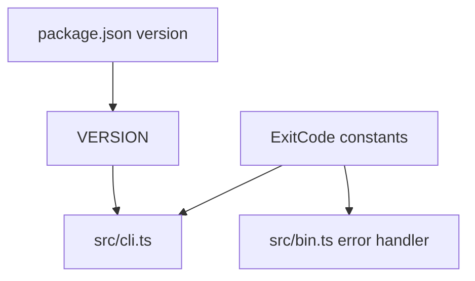

Part 3 · Page 7 of 27 · Previous: [Command line](020-cli.md) · Next: [Frontmatter reader](040-config-frontmatter.md) · [Index](../README.md)
# Exit codes and version

**File:** `src/exit-codes.ts`, `src/version.ts` · 16 lines · **Status:** available

## Page index

- What is it and what is it for?
- Before reading the code
- How it fits
- The complete, commented code
- Examples with real data
- Behavior summary
- Where it is used
- Tests

## What is it and what is it for?

[`src/exit-codes.ts`](030-exit-codes-and-version.md) defines stable process results; [`src/version.ts`](030-exit-codes-and-version.md) reads the package version. Without them, command handlers would have to repeat numeric codes and the CLI could display a version different from `package.json`. Both export constants; [`src/cli.ts`](020-cli.md) and [`src/bin.ts`](010-bin.md) use them.

## Before reading the code


### `as const`

This keeps object values as numeric literals, so `ExitCode.USAGE` has the type `1` rather than the broader `number`. The actual CLI returned this value for an unknown command:

Command: `node skills/code-audit/code-audit.mjs nope`

```text
// → Unknown command: nope
```

### JSON import

The version file imports `package.json` as JSON and exports its `version`. The built CLI printed:

Command: `node skills/code-audit/code-audit.mjs --version`

```text
// → 0.1.0
```

This avoids keeping a second version string in the CLI.

## How it fits



1. The package metadata supplies the version.
2. The CLI uses `VERSION` for help and version output.
3. The CLI and executable select named exit codes instead of raw numbers.

## The complete, commented code

`src/exit-codes.ts`:

```ts
/** Stable process exit codes returned by the command line interface. */
export const ExitCode = {
  OK: 0,
  USAGE: 1,
  CONFIG_INVALID: 2,
  NOT_A_REPO: 3,
  REVIEW_RANGE: 4,
  REPO_CHANGED: 5,
  FINDINGS_INVALID: 6,
  INTERNAL: 10,
} as const;
```

`src/version.ts`:

```ts
import packageJson from '../package.json' with { type: 'json' };

/** Package version embedded in the command line interface. */
export const VERSION: string = packageJson.version;
```

## Examples with real data


### Normal case

The current build reads the package's `0.1.0` version:

Command: `node skills/code-audit/code-audit.mjs --version`

```text
// → 0.1.0
```

### Edge case

An unknown command uses `USAGE`, whose actual numeric value is `1`; the built program returned process code `1`:

Command: `node skills/code-audit/code-audit.mjs nope`

```text
// → Unknown command: nope
```

### Without the key line

Without `as const`, TypeScript would widen the values and callers would lose their specific literal types. The runtime numbers would remain unchanged; this is a type-level consequence of the declaration at `src/exit-codes.ts:11`.

## Behavior summary

- **A command succeeds:** `ExitCode.OK` is `0`.
- **Arguments are invalid or a command is unavailable:** `ExitCode.USAGE` is `1`.
- **Codes `2` and `3`:** defined as `CONFIG_INVALID` and `NOT_A_REPO`.
- **Codes `4`, `5`, and `6`:** defined as `REVIEW_RANGE`, `REPO_CHANGED`, and `FINDINGS_INVALID`; currently no command returns them.
- **An exception escapes the CLI:** `ExitCode.INTERNAL` is `10`.
- **The CLI prints the version:** `VERSION` comes from `package.json`.

## Where it is used

- [`src/cli.ts`](020-cli.md) imports `ExitCode` at line 1 and `VERSION` at line 2.
- [`src/bin.ts`](010-bin.md) imports `ExitCode` at line 2.
- [`src/version.ts`](030-exit-codes-and-version.md) reads `package.json` at line 1.

## Tests

- `src/cli.test.ts`: `prints the version and returns success`, `rejects unknown commands`, `reports that review is not available yet`.
Part 3 · Page 7 of 27 · Previous: [Command line](020-cli.md) · Next: [Frontmatter reader](040-config-frontmatter.md) · [Index](../README.md)


