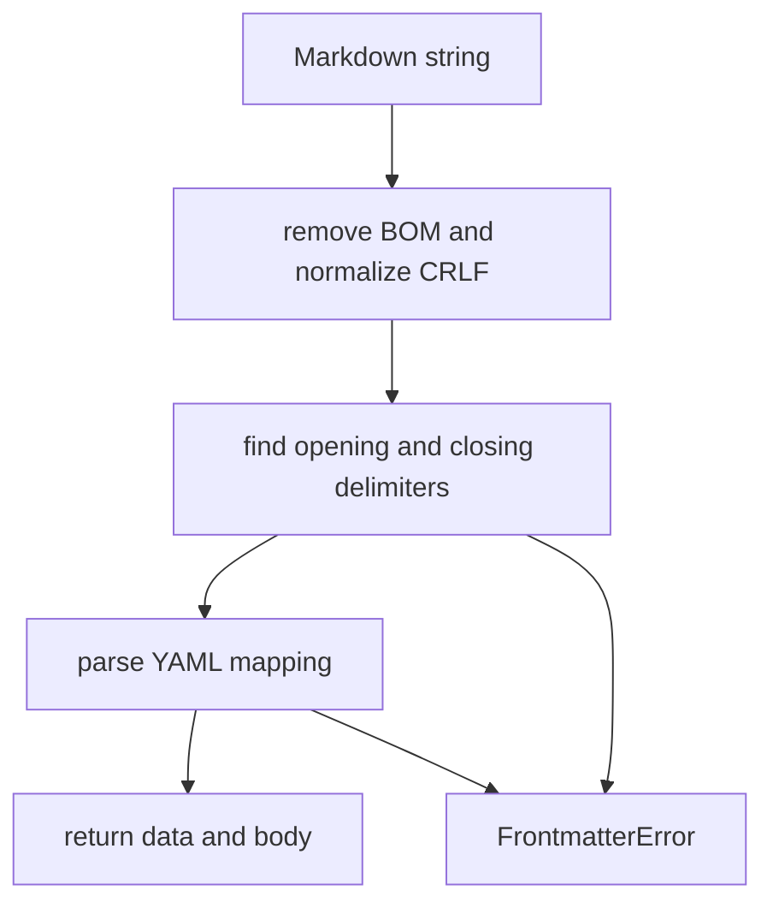

Part 3 · Page 8 of 27 · Previous: [Exit codes and version](030-exit-codes-and-version.md) · Next: [Configuration paths](050-config-paths.md) · [Index](../README.md)
# Frontmatter reader

**File:** `src/config/frontmatter.ts` · 53 lines · **Status:** available

`src/config/frontmatter.ts` parses metadata at the start of a Markdown file and returns that data with the remaining text.

## Page index

- What is it and what is it for?
- Before reading the code
- How it fits
- The complete, commented code
- Examples with real data
- Behavior summary
- Where it is used
- Tests

## What is it and what is it for?

The reader takes a string and returns `{ data, body }`. The data is a JavaScript object made from the YAML header; the body is the text after that header. `FrontmatterError` describes a missing delimiter, invalid YAML, or a non-object value. No production file imports this reader today; its test file calls it directly.

## Before reading the code


### YAML and frontmatter

YAML is a text format for named values and lists. Frontmatter is a YAML block at the start of a Markdown file, between lines containing `---`. The first example below parses a rule header into fields.

### BOM and CRLF

A byte order mark (BOM) is an invisible character some editors put at the start of a text file. Carriage return and line feed (CRLF) are the two characters Windows commonly uses to end a line. The reader removes a BOM and treats CRLF as ordinary newlines.

### Mapping

A mapping is a set of named keys. The reader requires one because it returns the header as a JavaScript object; a YAML list has no keys to return.

## How it fits



1. Normalize the input so a BOM or Windows line endings do not break parsing.
2. Require an opening delimiter on the first line and locate the next delimiter.
3. Parse the text between the delimiters as YAML.
4. Reject YAML values that are not mappings; otherwise return the mapping and body.

## The complete, commented code

```ts
import { parse as parseYaml, YAMLParseError } from 'yaml';

/** Error raised when a Markdown frontmatter block is missing or invalid. */
export class FrontmatterError extends Error {
  constructor(message: string) {
    super(message);
    this.name = 'FrontmatterError';
  }
}

/** Parses a YAML frontmatter block and returns its data and Markdown body. */
export function parseFrontmatter(text: string): {
  data: Record<string, unknown>;
  body: string;
} {
  // Normalize encodings that commonly appear in files from other platforms.
  const normalized = text.replace(/^\uFEFF/, '').replace(/\r\n/g, '\n');
  const lines = normalized.split('\n');
  // Accept a delimiter followed only by spaces or tabs.
  const isDelimiter = (line: string): boolean => /^---[ \t]*$/.test(line);

  // Metadata must begin at the first line, not later in the document.
  if (!isDelimiter(lines[0])) {
    throw new FrontmatterError('Frontmatter opening delimiter --- is missing');
  }

  // The first later delimiter ends the metadata block.
  const closingLine = lines.findIndex((line, index) => index > 0 && isDelimiter(line));
  if (closingLine === -1) {
    throw new FrontmatterError('Frontmatter closing delimiter --- is missing');
  }

  let parsed: unknown;
  try {
    // yaml parses only the text inside the two delimiter lines.
    parsed = parseYaml(lines.slice(1, closingLine).join('\n'), { logLevel: 'error' });
  } catch (error) {
    // YAML reports a line relative to its header-only input.
    const yamlLine = error instanceof YAMLParseError ? error.linePos?.[0]?.line : undefined;
    const fileLine = yamlLine === undefined ? undefined : yamlLine + 1;
    const rawDetail = error instanceof Error ? error.message : String(error);
    // Avoid repeating the location already formatted above.
    const detail = rawDetail.replace(/\s+at line \d+[\s\S]*$/i, '');
    const location = fileLine === undefined ? '' : ` at line ${fileLine}`;
    throw new FrontmatterError(`Invalid YAML${location}: ${detail}`);
  }

  // An empty YAML document represents an empty metadata mapping.
  if (parsed === null || parsed === undefined) {
    parsed = {};
  }
  // Arrays and primitive values cannot satisfy the mapping interface.
  if (typeof parsed !== 'object' || Array.isArray(parsed)) {
    throw new FrontmatterError('Frontmatter YAML must be a mapping');
  }

  // Preserve the text after the closing delimiter as the Markdown body.
  return {
    data: parsed as Record<string, unknown>,
    body: lines.slice(closingLine + 1).join('\n'),
  };
}
```

## Examples with real data

These examples show the reader's output for valid and invalid input.

### Normal case

This call passes a rule-shaped header and prints the parsed object:

```ts
const input = '---\nid: BIZ-003\ntitle: Handle cents\nseverity: critical\napplies_to:\n  - "src/billing/**"\n---\nBody';
console.log(JSON.stringify(parseFrontmatter(input)));
// → {"data":{"id":"BIZ-003","title":"Handle cents","severity":"critical","applies_to":["src/billing/**"]},"body":"Body"}
```

### BOM and CRLF

The sequence `\uFEFF` represents the BOM; `\r\n` shows the two line-ending characters explicitly.

```ts
const input = '\uFEFF---\r\nid: BIZ-003\r\ntitle: Handle cents\r\nseverity: critical\r\n---\r\nBody';
console.log(JSON.stringify(parseFrontmatter(input)));
// → {"data":{"id":"BIZ-003","title":"Handle cents","severity":"critical"},"body":"Body"}
```

### Broken YAML

The parser reports the header line where this incomplete list starts:

```ts
const input = '---\nid: [\n---\nBody';
try { console.log(JSON.stringify(parseFrontmatter(input))); }
catch (error) { console.log(error instanceof Error ? error.message : String(error)); }
// → Invalid YAML at line 2: Flow sequence in block collection must be sufficiently indented and end with a ]
```

### Delimiter with spaces and a tab

The opening line is written visibly as `--- \t`; trailing spaces and a tab are accepted:

```ts
const input = '--- \t\nid: BIZ-003\n---\nBody';
console.log(JSON.stringify(parseFrontmatter(input)));
// → {"data":{"id":"BIZ-003"},"body":"Body"}
```

### List instead of a mapping

A list has no named keys, so this input raises an error:

```ts
const input = '---\n- item\n---\nBody';
try { console.log(JSON.stringify(parseFrontmatter(input))); }
catch (error) { console.log(error instanceof Error ? error.message : String(error)); }
// → Frontmatter YAML must be a mapping
```

### Without the key line

Without BOM removal, the first delimiter check sees an invisible character before `---` and rejects the input. Without CRLF normalization, the `\r` remains at the end of each line and the delimiter check rejects it.

## Behavior summary

- **Opening delimiter is missing:** throw `FrontmatterError`.
- **Closing delimiter is missing:** throw `FrontmatterError`.
- **YAML is invalid:** include its header line in the error when the parser reports one.
- **YAML is empty:** return an empty object as `data`.
- **YAML is a list or primitive:** throw `FrontmatterError` because the result requires named keys.
- **Header is valid:** return its parsed data and the remaining body.

## Where it is used

- No production file imports this reader today.
- `src/config/frontmatter.test.ts` imports it to check real inputs and errors.

## Tests

- `src/config/frontmatter.test.ts`: `parses YAML metadata and returns the body`, `parses CRLF line endings`, `ignores an initial UTF-8 BOM`, `rejects text without a frontmatter delimiter`, `includes a line number when the YAML is invalid`, `does not emit warnings from YAML parsing`, `accepts delimiters followed by spaces or tabs`, `rejects an unclosed frontmatter block`, `rejects YAML that is not a mapping`, `returns an empty mapping for an empty frontmatter block`.
Part 3 · Page 8 of 27 · Previous: [Exit codes and version](030-exit-codes-and-version.md) · Next: [Configuration paths](050-config-paths.md) · [Index](../README.md)


