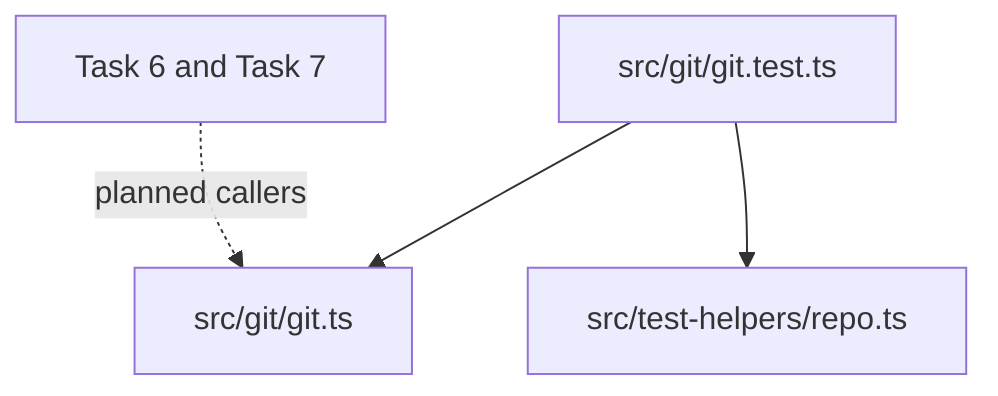

Part 3 · Page 14 of 29 · Previous: [Task loader](090-config-task.md) · Next: [Temporary repository test helpers](110-test-helpers-repo.md) · [Index](../README.md)
# Read-only Git interface

**File:** `src/git/git.ts` · 183 lines · **Status:** available

## Page index

- What is it and what is it for?
- Before reading the code
- How it fits
- The complete, commented code
- Examples with real data
- Behavior summary
- Where it is used
- Tests

## What is it and what is it for?

This module runs Git for later code-audit features. It accepts only ten read-only subcommands and checks all caller arguments before starting Git. Without those checks, an allowed command such as `diff` could write a file, or `grep` could launch a pager program.

`runGit(root, args, options?)` returns UTF-8 stdout. It throws `GitForbiddenError` before execution for a blocked command or option, and `GitError` for Git failures. `GitError` keeps `exitCode`, `stderr`, and a stable `reason`. The optional `{ maxBuffer }` parameter exists for focused tests; production calls use the 256 MiB default. `findRepoRoot(cwd)` returns Git's repository root without its trailing newline or throws `NotARepoError`.

No production file calls either exported function yet. The test file imports them directly; Task 6 and Task 7 are future consumers.

## Before reading the code

### Allowlist

An allowlist names every permitted command. Any command absent from it is rejected before Git starts.

```ts
['status'] // → allowed
['commit', '-m', 'x'] // → GitForbiddenError
```

### Option abbreviations

Git accepts unique prefixes of some long options. The module blocks each prefix of a dangerous option because Git versions and subcommands can differ.

```text
--open=program // → blocked as an abbreviation of --open-files-in-pager
--output-indicator-new=+ // → allowed; it only changes diff markers
```

## Allowed commands

| Command | What it reads |
|---|---|
| `diff`, `log`, `show` | Changes and commit details |
| `status`, `rev-parse`, `merge-base` | Working-tree and reference state |
| `ls-files`, `cat-file` | Tracked paths and stored objects |
| `grep`, `blame` | Tracked text and line history |

## Blocked options

| Option | Why it is blocked |
|---|---|
| `--output`, `-o` on diff/log/show | Writes command output into a file |
| `-O`, `--open-files-in-pager` | Starts an external pager program |
| `--ext-diff` | Starts a configured external diff program |
| `--textconv`, `--filters` | Runs configured text conversion or filter programs |
| `-c`, `--exec-path` | Changes Git configuration or executable lookup |
| `--git-dir`, `--work-tree` | Redirects Git to another repository or worktree |

The long options above are blocked in full and by every shorter prefix, in every argument position, including after `--`. Short option groups are checked too: any single-dash argument containing `O` is blocked for `grep`; one containing lowercase `o` is blocked for `diff`, `log`, and `show`. `--output-indicator-new` and its related options remain allowed. `--text` is blocked because it is a prefix of `--textconv`.

## How it fits



1. `runGit` checks the exact subcommand and scans all arguments.
2. It calls `execFile` with a fixed argument array, working directory, cleaned environment, and 256 MiB output limit.
3. It closes child stdin immediately, so commands that expect input settle without waiting for a person.
4. It adds no pager and stable quoting/color settings before the subcommand. It adds text conversion and external diff disables after relevant subcommands.
5. It returns stdout, handles `grep` exit code 1 with empty stderr as no matches, or throws a typed error.
6. `findRepoRoot` uses the same safe runner to read the top-level path and reject bare repositories.

## The complete, commented code

The source listing is the complete 182-line module. The JSDoc comments describe each exported API and named helper; the surrounding sections explain the safety checks and their effects.

```ts
import { execFile as execFileCallback } from 'node:child_process';
import { stat } from 'node:fs/promises';

/** Lists Git subcommands that this module permits. */
export const READ_ONLY_COMMANDS = [
  'diff', 'log', 'show', 'status', 'rev-parse', 'merge-base', 'ls-files', 'cat-file', 'grep', 'blame',
] as const;

const MAX_BUFFER = 256 * 1024 * 1024;
const DANGEROUS_LONG_OPTIONS = [
  'output', 'open-files-in-pager', 'ext-diff', 'textconv', 'exec-path', 'git-dir', 'work-tree', 'filters',
];

/** Reports a request to run a command or option outside the read-only policy. */
export class GitForbiddenError extends Error {
  constructor(message: string) {
    super(message);
    this.name = 'GitForbiddenError';
  }
}

/** Reports Git failures and keeps the process exit code and standard error. */
export class GitError extends Error {
  exitCode: number | null;
  stderr: string;
  reason: 'git-unavailable' | 'directory' | 'output-limit' | 'git-failed';

  constructor(
    message: string,
    exitCode: number | null,
    stderr: string,
    reason: 'git-unavailable' | 'directory' | 'output-limit' | 'git-failed' = 'git-failed',
  ) {
    super(message);
    this.name = 'GitError';
    this.exitCode = exitCode;
    this.stderr = stderr;
    this.reason = reason;
  }
}

/** Reports that a path is not inside a non-bare working repository. */
export class NotARepoError extends Error {
  constructor(message: string) {
    super(message);
    this.name = 'NotARepoError';
  }
}

/** Runs an allowlisted Git command; maxBuffer is exposed for focused tests. */
export async function runGit(
  root: string,
  args: string[],
  options: { maxBuffer?: number } = {},
): Promise<string> {
  validateArguments(args);
  await requireDirectory(root);
  const command = args[0]!;
  const commandArgs = args.slice(1);
  const safetyArgs = command === 'diff' || command === 'log' || command === 'show'
    ? ['--no-ext-diff', '--no-textconv']
    : command === 'blame' ? ['--no-textconv'] : [];
  const env = safeEnvironment();

  try {
    const result = await executeGit([
      '--no-pager', '-c', 'core.quotePath=false', '-c', 'color.ui=false', command,
      ...safetyArgs, ...commandArgs,
    ], root, env, options.maxBuffer ?? MAX_BUFFER);
    return result.stdout;
  } catch (error) {
    const failure = error as NodeJS.ErrnoException & { stdout?: string; stderr?: string; code?: number | string };
    if (failure.code === 'ENOENT') {
      if (!(await isDirectory(root))) throw directoryError(root);
      throw new GitError('git is not installed or not in PATH', null, failure.stderr ?? '', 'git-unavailable');
    }
    const stderr = failure.stderr ?? '';
    if (command === 'grep' && Number(failure.code) === 1 && stderr.length === 0) return '';
    if (failure.code === 'ENOBUFS' || failure.code === 'ERR_CHILD_PROCESS_STDIO_MAXBUFFER') {
      const limit = options.maxBuffer ?? MAX_BUFFER;
      const size = limit === MAX_BUFFER ? '256 MiB' : `${limit} bytes`;
      throw new GitError(`git output exceeded ${size}`, null, stderr, 'output-limit');
    }
    const exitCode = typeof failure.code === 'number' ? failure.code : null;
    const detail = stderr.trim();
    throw new GitError(detail || `git ${command} failed`, exitCode, stderr);
  }
}

/** Resolves the non-bare repository root containing the supplied path. */
export async function findRepoRoot(cwd: string): Promise<string> {
  try {
    const root = (await runGit(cwd, ['rev-parse', '--show-toplevel'])).replace(/\r?\n$/, '');
    const bare = (await runGit(cwd, ['rev-parse', '--is-bare-repository'])).trim();
    if (bare === 'true') throw new NotARepoError(`not a working Git repository: ${cwd}`);
    return root;
  } catch (error) {
    if (error instanceof NotARepoError) throw error;
    if (error instanceof GitError && error.reason === 'git-unavailable') {
      throw new NotARepoError('Git is not installed or not in PATH');
    }
    if (error instanceof GitError && error.reason === 'directory') throw new NotARepoError(error.message);
    throw new NotARepoError(`not a working Git repository: ${cwd}`);
  }
}

/** Rejects subcommands and dangerous options before starting a child process. */
function validateArguments(args: string[]): void {
  const command = args[0];
  if (!command || command.startsWith('-') || !(READ_ONLY_COMMANDS as readonly string[]).includes(command)) {
    throw new GitForbiddenError(`Git subcommand is not allowed: ${command ?? '(missing)'}`);
  }

  for (const argument of args.slice(1)) {
    if (isForbiddenArgument(command, argument)) {
      throw new GitForbiddenError(`Git option is not allowed for ${command}: ${argument}`);
    }
  }
}

/** Detects full options, their abbreviations, and dangerous short-option groups. */
function isForbiddenArgument(command: string, argument: string): boolean {
  if (argument.startsWith('--')) {
    const name = argument.slice(2).split('=', 1)[0]!;
    if (!name) return false;
    if (name.startsWith('output-indicator-')) return false;
    return DANGEROUS_LONG_OPTIONS.some((option) => option.startsWith(name));
  }

  if (!argument.startsWith('-') || argument.startsWith('--')) return false;
  if (argument === '-c' || argument.startsWith('-c')) return true;
  if (['diff', 'log', 'show'].includes(command) && argument.includes('o')) return true;
  if (command === 'grep' && argument.includes('O')) return true;
  return false;
}

/** Copies the process environment without inherited Git repository overrides. */
function safeEnvironment(): NodeJS.ProcessEnv {
  const env = Object.fromEntries(Object.entries(process.env).filter(([key]) => !key.toUpperCase().startsWith('GIT_')));
  return {
    ...env,
    GIT_OPTIONAL_LOCKS: '0',
    GIT_PAGER: 'cat',
    GIT_TERMINAL_PROMPT: '0',
  };
}

/** Verifies that a working directory exists before spawning Git. */
async function requireDirectory(path: string): Promise<void> {
  if (!(await isDirectory(path))) throw directoryError(path);
}

/** Checks whether a path exists and is a directory. */
async function isDirectory(path: string): Promise<boolean> {
  try { return (await stat(path)).isDirectory(); } catch { return false; }
}

/** Creates a GitError with the shared missing-directory message. */
function directoryError(path: string): GitError {
  return new GitError(`directory does not exist: ${path}`, null, '', 'directory');
}

/** Executes Git and closes its unused standard input immediately. */
function executeGit(
  args: string[],
  cwd: string,
  env: NodeJS.ProcessEnv,
  maxBuffer: number,
): Promise<{ stdout: string; stderr: string }> {
  return new Promise((resolve, reject) => {
    const child = execFileCallback('git', args, { cwd, env, encoding: 'utf8', maxBuffer }, (error, stdout, stderr) => {
      if (error) {
        const failure = error as NodeJS.ErrnoException & { stdout?: string; stderr?: string };
        failure.stdout = stdout;
        failure.stderr = stderr;
        reject(failure);
      } else {
        resolve({ stdout, stderr });
      }
    });
    child.stdin?.end();
  });
}
```

## Examples with real data

### Normal case

With the test repository containing `años.txt`, `runGit(root, ['ls-files'])` returns:

```text
años.txt
```

The unescaped `ñ` comes from `core.quotePath=false`.

### Edge case

This abbreviated option is rejected before Git can start its pager:

```ts
await runGit(root, ['grep', '--open=program', 'a']);
// → GitForbiddenError: Git option is not allowed for grep: --open=program
```

### Without the key safety flags

The tests configure a textconv program that creates a witness file. Running `diff`, `log -p`, `show`, or `blame` through `runGit` never creates it because the program adds `--no-textconv`; diff, log, and show also receive `--no-ext-diff`.

## What this barrier does not cover

The barrier validates arguments passed to `runGit`; it does not sanitize the repository's own configuration. Git may still run programs the repository owner configured. For example, clean filters from `.gitattributes` (including Git LFS) can take part in `status` or `diff`, `core.fsmonitor` can start a monitor, and `log.showSignature` can trigger signature verification.

## Legitimate options blocked for caution

Some valid uses match the conservative safety checks and are rejected. `--text` resembles `--textconv`, `rev-parse --git-dir` matches the blocked `--git-dir`, and `-c` has other meanings in `grep` and `diff`. Use `rev-parse --absolute-git-dir` or `--show-toplevel` instead; the tests confirm both alternatives are allowed.

## Behavior summary

- **Missing or unapproved subcommand:** throws `GitForbiddenError` before execution.
- **Dangerous option or abbreviation:** throws `GitForbiddenError` in any argument position.
- **No matches from grep:** returns an empty string only for exit code 1 with empty stderr.
- **Git process failure:** throws `GitError` with the numeric exit code where available and stderr.
- **Missing or non-directory working path:** throws `GitError` with `directory does not exist: <path>`; `findRepoRoot` reports the same text as `NotARepoError`.
- **Git missing from PATH:** throws `GitError` with reason `git-unavailable`; `findRepoRoot` uses that reason, not its message text.
- **Output over the configured limit:** maps both Bun's `ENOBUFS` and Node's `ERR_CHILD_PROCESS_STDIO_MAXBUFFER` to a size-limit `GitError`.
- **Windows environment names:** removes `GIT_` variables without regard to letter case.
- **Non-repository, bare repository, or path inside `.git`:** `findRepoRoot` throws `NotARepoError`.
- **Nested repository path:** `findRepoRoot` returns Git's top-level path without the final newline.

## Where it is used

### Uses

- [src/test-helpers/repo.ts](110-test-helpers-repo.md), imported by the Git tests to create isolated repositories.

### Used by

- [src/git/git.test.ts](../../../src/git/git.test.ts), which tests every exported API. No production file imports this module today.

## Tests

- `src/git/git.test.ts`: allowlist, forbidden commands, output options and abbreviations.
- `src/git/git.test.ts`: textconv, external diff, inherited environment, and index timestamp.
- `src/git/git.test.ts`: UTF-8 filenames, grep with no matches, Git errors, and missing Git.
- `src/git/git.test.ts`: nested root discovery, non-repository, bare repository, and `.git` path.
- `src/git/git.test.ts`: standard-input commands settle, invalid working directories, and test-only output limits.
- A temporary Node probe separately confirms Node's maxBuffer error is translated to `GitError`.

Part 3 · Page 14 of 29 · Previous: [Task loader](090-config-task.md) · Next: [Temporary repository test helpers](110-test-helpers-repo.md) · [Index](../README.md)


