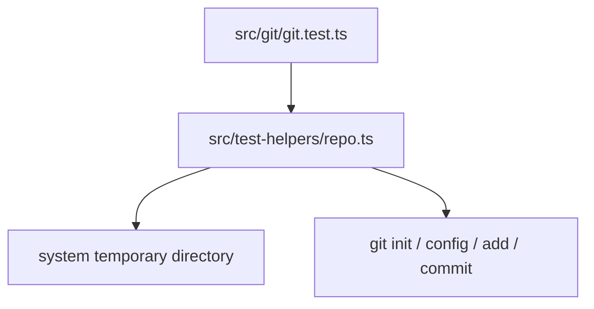

Part 3 · Page 15 of 28 · Previous: [Read-only Git interface](100-git-git.md) · Next: [Project initialization](120-init-init.md) · [Index](../README.md)
# Temporary repository test helpers

**File:** `src/test-helpers/repo.ts` · 41 lines · **Status:** available

## Page index

- What is it and what is it for?
- Before reading the code
- How it fits
- The complete, commented code
- Examples with real data
- Behavior summary
- Where it is used
- Tests

## What is it and what is it for?

This test-only module creates disposable Git repositories, writes their files, commits fixtures, and removes them. It keeps Git integration tests independent of the developer's global Git identity and default branch.

All commits made by these helpers happen in the temporary directory. Production code imports none of these helpers, and the build does not bundle them.

## Before reading the code

### Per-repository identity

Git reads `user.name` and `user.email` when making a commit. The helper writes both settings into the temporary repository's local `.git/config`.

```text
createRepo() → git init with main and local test identity
commitRepo() → git add --all, then git commit inside that temporary repository
```

## How it fits



1. `createRepo` makes a fresh temporary folder, initializes branch `main`, and sets local identity.
2. `writeRepoFile` creates parent folders and writes fixture content.
3. `commitRepo` stages and commits fixture files inside the temporary repository.
4. `removeRepo` recursively removes the folder. `createBareRepo` creates a bare fixture for rejection tests.

## The complete, commented code

The complete 41-line source follows. Git commands in this helper are for isolated test setup only and never call `runGit`.

```ts
import { execFile as execFileCallback } from 'node:child_process';
import { mkdtemp, mkdir, rm, writeFile } from 'node:fs/promises';
import { tmpdir } from 'node:os';
import { dirname, join } from 'node:path';
import { promisify } from 'node:util';

const execFile = promisify(execFileCallback);

/** Creates and initializes an isolated Git repository for tests. */
export async function createRepo(prefix = 'code-audit-git-'): Promise<string> {
  const root = await mkdtemp(join(tmpdir(), prefix));
  await execFile('git', ['-c', 'init.defaultBranch=main', 'init'], { cwd: root });
  await execFile('git', ['config', 'user.name', 'Code Audit Tests'], { cwd: root });
  await execFile('git', ['config', 'user.email', 'tests@example.invalid'], { cwd: root });
  return root;
}

/** Writes a file, creating its parent folders inside a test repository. */
export async function writeRepoFile(root: string, file: string, content: string): Promise<void> {
  const path = join(root, file);
  await mkdir(dirname(path), { recursive: true });
  await writeFile(path, content);
}

/** Stages and commits all files in a test repository. */
export async function commitRepo(root: string, message = 'test commit'): Promise<void> {
  await execFile('git', ['add', '--all'], { cwd: root });
  await execFile('git', ['commit', '-m', message], { cwd: root });
}

/** Removes a temporary repository after a test. */
export async function removeRepo(root: string): Promise<void> {
  await rm(root, { recursive: true, force: true });
}

/** Creates a bare repository for root-discovery tests. */
export async function createBareRepo(prefix = 'code-audit-bare-'): Promise<string> {
  const root = await mkdtemp(join(tmpdir(), prefix));
  await execFile('git', ['init', '--bare'], { cwd: root });
  return root;
}
```

## Examples with real data

### Normal case

The Git integration tests use this sequence to add one committed file:

```ts
const root = await createRepo();
await writeRepoFile(root, 'a.txt', 'hello\n');
await commitRepo(root, 'initial fixture');
// → a temporary repository on main with a local test identity and one commit
await removeRepo(root);
```

### Edge case

`createBareRepo` initializes without a working tree. It lets `findRepoRoot` verify that a bare repository is rejected.

### Without the local identity

The commit helper would depend on the machine-wide Git name and email. Setting both values locally makes fixture creation repeatable and avoids changing global Git configuration.

## Behavior summary

- **Repository creation:** uses the system temporary directory and initializes `main`.
- **Commit identity:** `user.name` and `user.email` are local to the fixture.
- **Fixture paths:** parent folders are created before writing a file.
- **Cleanup:** removes the temporary repository recursively and tolerates prior removal.
- **Bare fixture:** creates a repository with no working tree for negative tests.

## Where it is used

### Uses

- Node.js child processes run Git only with each temporary repository as `cwd`.

### Used by

- [src/git/git.test.ts](../../../src/git/git.test.ts), for read-only command and repository-root tests. No production file imports this helper.

## Tests

- `src/git/git.test.ts`: each test creates a temporary repository and removes it in `finally` cleanup.
- `src/git/git.test.ts`: repository identity, commits, nested files, and bare repository behavior.

Part 3 · Page 15 of 28 · Previous: [Read-only Git interface](100-git-git.md) · Next: [Project initialization](120-init-init.md) · [Index](../README.md)


