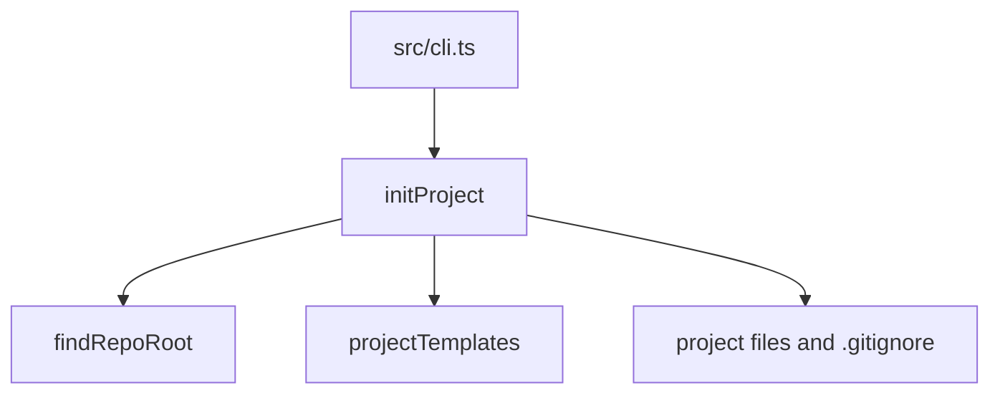

Part 3 · Page 17 of 34 · Previous: [Temporary repository test helpers](110-test-helpers-repo.md) · Next: [Initialization templates](130-init-templates.md) · [Index](../README.md)
# Project initialization

**File:** `src/init/init.ts` · 70 lines · **Status:** available

## Page index

- What is it and what is it for?
- Before reading the code
- How it fits
- The complete, commented code
- Examples with real data
- Behavior summary
- Where it is used
- Tests

## What is it and what is it for?

`init` saves teams from creating Code Audit files and folders by hand. It receives a repository path and language, then creates `config.md` for language and review settings, `project.md` for purpose and vocabulary, `structure.md` for code locations, a README that explains the folders, a reusable task form, and rule guides. It tells Git to leave task briefs and review results out of version control (`.gitignore`), reports created and skipped files, and never replaces files that already exist.

## Before reading the code

A file-creation option (`wx`) means “create only if this path does not exist.” For example, trying to create the same file again produces `EEXIST`; `init` reports that path in `skipped` and leaves its contents alone.

## How it fits



1. `findRepoRoot` finds the repository containing the requested path.
2. `projectTemplates` supplies the files and their translated contents.
3. New files are created; existing paths go to `skipped` and are not changed.
4. The Git ignore file (`.gitignore`) receives only missing entries and keeps its line ending style.

## The complete, commented code

The complete source is 70 lines.

```ts
import { mkdir, readFile, writeFile } from 'node:fs/promises';
import { join } from 'node:path';
import { CONFIG_DIR } from '../config/paths.js';
import { findRepoRoot } from '../git/git.js';
import { projectTemplates } from './templates.js';

/** Reports a language value that cannot be stored safely in config.md. */
export class InvalidLanguageError extends Error {
  /** Creates a diagnostic containing the rejected language value. */
  constructor(language: string) {
    super(`invalid language: ${language}`);
    this.name = 'InvalidLanguageError';
  }
}

/** Creates the project configuration without replacing existing files. */
export async function initProject(
  root: string,
  opts: { language: string },
): Promise<{ created: string[]; skipped: string[]; gitignoreUpdated: boolean }> {
  if (!/^[A-Za-z0-9]+(?:-[A-Za-z0-9]+)*$/.test(opts.language)) {
    throw new InvalidLanguageError(opts.language);
  }
  const repoRoot = await findRepoRoot(root);
  const created: string[] = [];
  const skipped: string[] = [];
  for (const [file, content] of projectTemplates(opts.language)) {
    const relative = `${CONFIG_DIR}/${file}`;
    const absolute = join(repoRoot, relative);
    await mkdir(join(absolute, '..'), { recursive: true });
    try {
      await writeFile(absolute, content, { flag: 'wx' });
      created.push(relative);
    } catch (error) {
      if ((error as NodeJS.ErrnoException).code !== 'EEXIST') throw error;
      skipped.push(relative);
    }
  }
  const gitignoreUpdated = await updateGitignore(repoRoot);
  return { created, skipped, gitignoreUpdated };
}

/** Ensures both generated runtime folders are ignored without duplicate entries. */
async function updateGitignore(root: string): Promise<boolean> {
  const path = join(root, '.gitignore');
  let content: string;
  let exists = true;
  try { content = await readFile(path, 'utf8'); }
  catch (error) {
    if ((error as NodeJS.ErrnoException).code !== 'ENOENT') throw error;
    exists = false;
    content = '';
  }
  const newline = content.includes('\r\n') ? '\r\n' : '\n';
  const existing = new Set(content.split(/\r?\n/).map(normalizeGitignoreLine));
  const missing = GITIGNORE_LINES.filter((line) => !existing.has(normalizeGitignoreLine(line)));
  if (missing.length === 0) return false;
  const prefix = content.length > 0 && !content.endsWith('\n') ? newline : '';
  const additions = `${prefix}${missing.join(newline)}${newline}`;
  await writeFile(path, additions, { flag: exists ? 'a' : 'wx' });
  return true;
}

/** Normalizes optional slashes around a generated ignore path. */
function normalizeGitignoreLine(line: string): string {
  return line.trim().replace(/^\/+|\/+$/g, '');
}

/** Paths added to a project's Git ignore file by init. */
export const GITIGNORE_LINES = ['.agents/code-audit/tasks/', '.agents/code-audit/runs/'];
```

## Examples with real data

### First run with JSON output

In an empty temporary repository, the compiled CLI returned:

```text
{"created":[".agents/code-audit/config.md",".agents/code-audit/project.md",".agents/code-audit/structure.md",".agents/code-audit/README.md",".agents/code-audit/task-template.md",".agents/code-audit/tasks/.gitkeep",".agents/code-audit/runs/.gitkeep",".agents/code-audit/policies/README.md",".agents/code-audit/rules/README.md",".agents/code-audit/business/README.md",".agents/code-audit/decisions/README.md",".agents/code-audit/templates/README.md"],"skipped":[],"gitignoreUpdated":true}
```

The resulting `.gitignore` contains:

```text
.agents/code-audit/tasks/
.agents/code-audit/runs/
```

### Existing project configuration

With an existing `.agents/code-audit/config.md` containing `owner config`, `init` returned:

```text
Created 11 file(s).
Skipped 1 existing file(s).
Updated .gitignore.
```

The existing file still contained:

```text
owner config
```

### Invalid language

The compiled CLI rejected `--language "es: x"` before creating project files:

```text
invalid language: es: x
1
.
..
```

The `1` is the process exit code printed by the shell; `ls -a` showed only the current and parent directory entries, with no `.agents` or `.gitignore`.

### Second run

A repeated initialization leaves the generated files intact and reports them as skipped:

```text
{"created":[],"skipped":[".agents/code-audit/config.md",".agents/code-audit/project.md",".agents/code-audit/structure.md",".agents/code-audit/README.md",".agents/code-audit/task-template.md",".agents/code-audit/tasks/.gitkeep",".agents/code-audit/runs/.gitkeep",".agents/code-audit/policies/README.md",".agents/code-audit/rules/README.md",".agents/code-audit/business/README.md",".agents/code-audit/decisions/README.md",".agents/code-audit/templates/README.md"],"gitignoreUpdated":false}
```

## Behavior summary

- **Working repository:** initialization proceeds from its discovered root.
- **Existing configuration file:** it remains unchanged and appears in `skipped`.
- **Language:** valid values are stored as entered; `es` and `es-` variants select Spanish, while other values select English. Invalid values fail with exit code 1 before writing.
- **Missing ignore entry:** it is appended once, preserving CRLF; a final lone CR gets a following LF before new entries.
- **Non-repository path:** `findRepoRoot` raises `NotARepoError` for the CLI to map to exit code 3.

## Where it is used

### Uses

- [src/config/paths.ts](050-config-paths.md), line 3, provides `CONFIG_DIR`.
- [src/git/git.ts](100-git-git.md), line 91, provides `findRepoRoot`.
- [src/init/templates.ts](130-init-templates.md), line 4, supplies generated files.

### Used by

- [src/cli.ts](020-cli.md), line 81, calls `initProject`.
- [src/init/init.test.ts](../../../src/init/init.test.ts), line 9, imports it for file creation and error tests.

## Tests

`src/init/init.test.ts`: language persistence and selection, invalid values before writes, generated task loading in both languages, non-overwriting repeat call, CRLF and lone-CR handling, README rule examples in both languages, normalized ignore entries, JSON CLI, and exit codes.

Part 3 · Page 17 of 34 · Previous: [Temporary repository test helpers](110-test-helpers-repo.md) · Next: [Initialization templates](130-init-templates.md) · [Index](../README.md)


