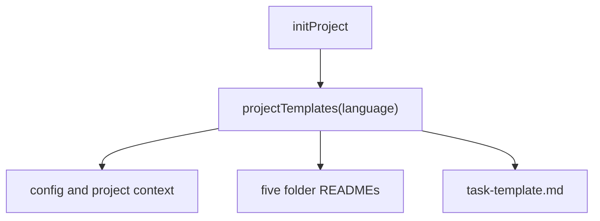

Part 3 · Page 17 of 23 · Previous: [Project initialization](120-init-init.md) · Next: [Project checker](140-check-check.md) · [Index](../README.md)
# Initialization templates

**File:** `src/init/templates.ts` · 78 lines · **Status:** available

## Page index

- What is it and what is it for?
- Before reading the code
- How it fits
- The complete, commented code
- Examples with real data
- Behavior summary
- Where it is used
- Tests

## What is it and what is it for?

Without this module, `init` would have no project files to create. It supplies `config.md` for language and review settings, `project.md` for purpose and vocabulary, `structure.md` for code locations, the folder overview, a reusable task form, and rule guides. It returns the relative file names and contents to `initProject`; that initializer leaves existing files intact. Text is Spanish for `es` or `es-` values (case-insensitive), and English for other valid values. Each rule folder gets a guide with a complete example; the loader skips README files.

## Before reading the code

A fenced example is a rule shown for people to copy; it does not take effect while it remains in the README. The test copies it to a temporary Markdown file and checks it with `loadRules`.

## How it fits



1. `projectTemplates` chooses a language bundle.
2. It maps root configuration, project context, task brief, and keep files.
3. It adds one localized README per key in `RULE_DIRS`.
4. `ruleReadme` generates a valid example with fields appropriate to that folder.

## The complete, commented code

```ts
import { RULE_DIRS } from '../config/paths.js';

/** Lists project configuration files and their localized contents. */
export function projectTemplates(language: string): Map<string, string> {
  const spanish = /^es(?:-|$)/i.test(language);
  const text = spanish ? ES : EN;
  const files = new Map<string, string>([
    ['config.md', text.config.replace(/language: (?:en|es)/, `language: ${language}`)],
    ['project.md', text.project],
    ['structure.md', text.structure],
    ['README.md', text.overview],
    ['task-template.md', text.task],
    ['tasks/.gitkeep', ''],
    ['runs/.gitkeep', ''],
  ]);
  for (const folder of Object.keys(RULE_DIRS) as (keyof typeof RULE_DIRS)[]) {
    files.set(`${folder}/README.md`, ruleReadme(folder, spanish, text.ruleBody[folder]));
  }
  return files;
}

interface LocalizedTemplates {
  config: string;
  project: string;
  structure: string;
  overview: string;
  task: string;
  ruleBody: Record<keyof typeof RULE_DIRS, string>;
}

/** Builds the per-folder rule guide with a valid example in a code block. */
function ruleReadme(folder: keyof typeof RULE_DIRS, spanish: boolean, body: string): string {
  const labels = spanish
    ? { policies: 'Políticas', rules: 'Reglas técnicas', business: 'Reglas de negocio', decisions: 'Decisiones de arquitectura', templates: 'Plantillas' }
    : { policies: 'Policies', rules: 'Technical rules', business: 'Business rules', decisions: 'Architecture decisions', templates: 'Templates' };
  const descriptions = spanish
    ? { policies: 'Reglas para todo el proyecto; se leen siempre.', rules: 'Reglas sobre tecnologías y prácticas técnicas.', business: 'Reglas sobre términos y comportamiento del negocio.', decisions: 'Decisiones de arquitectura y sus consecuencias.', templates: 'Criterios para los componentes nuevos.' }
    : { policies: 'Rules for the whole project; always read.', rules: 'Rules about technologies and technical practices.', business: 'Rules about business terms and behavior.', decisions: 'Architecture decisions and their consequences.', templates: 'Criteria for new components.' };
  const id = `EXAMPLE-${folder.toUpperCase()}`;
  const applies = folder === 'policies' ? '' : 'applies_to:\n  - "src/**"\n';
  const title = spanish ? 'Ejemplo completo de regla' : 'Complete example rule';
  const example = `---\nid: ${id}\ntitle: ${title}\nseverity: minor\n${applies}keywords: [example]\n---\n${body}`;
  const heading = labels[folder];
  const instructions = spanish
    ? ['# ' + heading, '', descriptions[folder] + ' Guarda cada regla en un archivo Markdown con encabezado YAML y cuerpo Markdown.', '', 'Ejemplo completo de regla:', '', '```markdown', example, '```', ''].join('\n')
    : ['# ' + heading, '', descriptions[folder] + ' Store each rule in a Markdown file with a YAML header and Markdown body.', '', 'Complete rule example:', '', '```markdown', example, '```', ''].join('\n');
  return instructions;
}

const EN: LocalizedTemplates = {
  config: `---\nstructure_version: 1\nlanguage: en\nmax_changed_lines: 1000\n---\n`,
  project: `# Project\n\nDescribe the project, its technologies, and business vocabulary.\n`,
  structure: `# Project structure\n\nDescribe where components, services, and utilities live and the folder conventions.\n`,
  overview: `# Code Audit configuration\n\nThis folder contains the team's project context and review rules.\n\n- config.md: report language and review settings.\n- project.md: project purpose, technologies, and vocabulary.\n- structure.md: code locations and folder conventions.\n- policies/: rules for the whole project; always read.\n- rules/: technical rules.\n- business/: business rules.\n- decisions/: architecture decisions.\n- templates/: expectations for new components.\n- tasks/: task briefs, ignored by Git.\n- runs/: review results, ignored by Git.\n\nFolder and severity are separate: the folder gives the rule type; each rule declares severity. Rule headers use YAML with id, title, severity, optional applies_to, and optional keywords.\n\n## How to fill a task brief\n\nCopy task-template.md to tasks/PAY-123.md. Fill in the objective and numbered acceptance criteria; both are required. The tasks/ folder is ignored by Git, so task briefs are not committed to the repository.\n`,
  task: `---\nsource: https://example.invalid/task\n---\n## Objective\nDescribe the desired outcome and why it matters.\n\n## Acceptance criteria\n1. Describe one verifiable result.\n\n## Out of scope\nDescribe excluded work.\n\n## Expected areas (optional)\nList likely files or folders.\n\n## Notes and decisions\nAdd relevant agreements or design links.\n`,
  ruleBody: {
    policies: 'Apply this requirement to every part of the project.',
    rules: 'Keep this technical behavior consistent across the project.',
    business: 'Use this business term and behavior consistently.',
    decisions: 'Record the decision, its context, and its consequences.',
    templates: 'Use this structure and quality bar for new components.',
  },
};

const ES: LocalizedTemplates = {
  config: `---\nstructure_version: 1\nlanguage: es\nmax_changed_lines: 1000\n---\n`,
  project: `# Proyecto\n\nDescribe el proyecto, sus tecnologías y el vocabulario del negocio.\n`,
  structure: `# Estructura del proyecto\n\nDescribe dónde viven los componentes, servicios y utilidades, y las convenciones de carpetas.\n`,
  overview: `# Configuración de Code Audit\n\nEsta carpeta contiene el contexto del proyecto y las reglas de revisión del equipo.\n\n- config.md: idioma del informe y opciones de revisión.\n- project.md: propósito, tecnologías y vocabulario.\n- structure.md: ubicación del código y convenciones.\n- policies/: reglas para todo el proyecto; se leen siempre.\n- rules/: reglas técnicas.\n- business/: reglas de negocio.\n- decisions/: decisiones de arquitectura.\n- templates/: expectativas para componentes nuevos.\n- tasks/: fichas de tarea, ignoradas por Git.\n- runs/: resultados de revisión, ignorados por Git.\n\nLa carpeta y la gravedad son distintas: la carpeta indica el tipo de regla y cada regla declara su gravedad. El encabezado YAML usa id, title, severity, applies_to opcional y keywords opcional.\n\n## Cómo llenar una ficha de tarea\n\nCopia task-template.md a tasks/PAY-123.md. Llena el objetivo y los criterios de aceptación numerados; ambos son obligatorios. La carpeta tasks/ está excluida de Git, así que las fichas no se suben al repositorio.\n`,
  task: `---\nsource: https://example.invalid/tarea\n---\n## Objetivo\nDescribe el resultado deseado y por qué importa.\n\n## Criterios de aceptación\n1. Describe un resultado que se pueda comprobar.\n\n## Fuera de alcance\nDescribe el trabajo excluido.\n\n## Áreas que se espera tocar (opcional)\nEnumera archivos o carpetas probables.\n\n## Notas y decisiones\nAgrega acuerdos o enlaces de diseño relevantes.\n`,
  ruleBody: {
    policies: 'Aplica este requisito en todas las partes del proyecto.',
    rules: 'Mantén este comportamiento técnico consistente en el proyecto.',
    business: 'Usa este término y comportamiento de negocio de forma consistente.',
    decisions: 'Registra la decisión, su contexto y sus consecuencias.',
    templates: 'Usa esta estructura y nivel de calidad para componentes nuevos.',
  },
};
```

## Examples with real data

### French language value

`projectTemplates("fr").get("config.md")` returns this complete file:

```text
---
structure_version: 1
language: fr
max_changed_lines: 1000
---
```

### Spanish language value

`projectTemplates("es").get("config.md")` returns this complete file:

```text
---
structure_version: 1
language: es
max_changed_lines: 1000
---
```

### Spanish business rules README

`projectTemplates("es").get("business/README.md")` returns:

````markdown
# Reglas de negocio

Reglas sobre términos y comportamiento del negocio. Guarda cada regla en un archivo Markdown con encabezado YAML y cuerpo Markdown.

Ejemplo completo de regla:

```markdown
---
id: EXAMPLE-BUSINESS
title: Ejemplo completo de regla
severity: minor
applies_to:
  - "src/**"
keywords: [example]
---
Usa este término y comportamiento de negocio de forma consistente.
```
````

### Rule examples

The generated `policies/README.md`, `rules/README.md`, `business/README.md`, `decisions/README.md`, and `templates/README.md` each include a full example that `loadRules` accepts when extracted.

## Behavior summary

- **Language is `es` or starts with `es-`, ignoring case:** guidance is Spanish and `config.md` preserves the value as entered.
- **Any other valid language:** guidance is English and `config.md` preserves the value as entered.
- **Rule folder:** its README states the folder purpose and includes a valid complete example.
- **Task template:** it has the required objective and numbered acceptance criteria.

## Where it is used

### Uses

- [src/config/paths.ts](050-config-paths.md), line 7, supplies the rule folder names.

### Used by

- [src/init/init.ts](120-init-init.md), line 5, imports `projectTemplates` and writes its files.
- [src/init/init.test.ts](../../../src/init/init.test.ts), line 9, imports the initializer to check localized files, task forms, and rule examples.

## Tests

`src/init/init.test.ts`: exact language persistence and Spanish selection for `ES` and `es-MX`; `loadRules` accepts all five README examples in English and Spanish; `loadTask` accepts both generated task templates with notes and no problems.

Part 3 · Page 17 of 23 · Previous: [Project initialization](120-init-init.md) · Next: [Project checker](140-check-check.md) · [Index](../README.md)
