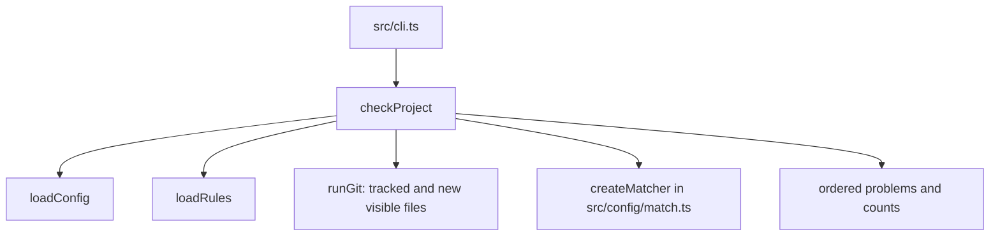

Part 3 · Page 18 of 29 · Previous: [Initialization templates](130-init-templates.md) · Next: [Pattern matcher](150-config-match.md) · [Index](../README.md)
# Project checker

**File:** `src/check/check.ts` · 67 lines · **Status:** available

## Page index

- What is it and what is it for?
- Before reading the code
- How it fits
- The complete, commented code
- Examples with real data
- Behavior summary
- Where it is used
- Tests

## What is it and what is it for?

This file checks whether the project's instruction cards can be used consistently. It reads the settings and rules, compares each rule's file patterns with files Git can see, and reports problems for a person to fix. Without it, a project could contain repeated rule IDs or patterns that never select a file. It returns the problems, the number of valid rules, and the number of policies.

## Before reading the code

A file pattern is a short description of paths such as `src/**`. [`src/config/match.ts`](150-config-match.md) creates a matcher function using `createMatcher` that compares that pattern with each repository path using `picomatch` and `{ dot: true }` to include hidden files such as `src/.env`.

Git's `-z` option separates file names with a zero byte. This keeps spaces, accents, and line breaks inside a file name intact.

## How it fits



1. The CLI finds the repository root and calls `checkProject`.
2. The checker loads configuration and rules and asks Git for tracked and non-ignored new files.
3. It finds duplicate IDs without case sensitivity and unmatched patterns using `createMatcher`.
4. It orders errors before warnings and returns the counts.

## The complete, commented code

```ts
import { createMatcher } from '../config/match.js';
import { CONFIG_DIR } from '../config/paths.js';
import { loadConfig } from '../config/config.js';
import { loadRules } from '../config/rules.js';
import type { Problem } from '../config/types.js';
import { runGit } from '../git/git.js';

/** Sets the maximum policy count before check reports a warning. */
export const POLICY_WARNING_THRESHOLD = 15;

/** Validates project configuration, rules, and their file patterns. */
export async function checkProject(root: string): Promise<{ problems: Problem[]; ruleCount: number; policyCount: number }> {
  const [{ problems: configProblems }, { rules, problems: ruleProblems }, fileOutput] = await Promise.all([
    loadConfig(root),
    loadRules(root),
    runGit(root, ['ls-files', '--cached', '--others', '--exclude-standard', '-z']),
  ]);
  const files = fileOutput.split('\0').filter(Boolean);
  const problems = [...configProblems, ...ruleProblems];
  const rulesById = new Map<string, { file: string; id: string }>();

  for (const rule of rules) {
    const normalizedId = rule.id.toLocaleLowerCase('en-US');
    const previous = rulesById.get(normalizedId);
    if (previous) {
      const duplicateMessage = rule.id === previous.id
        ? `duplicate rule id "${rule.id}" also appears in ${previous.file}`
        : `duplicate rule id "${rule.id}" also appears in ${previous.file} as "${previous.id}"`;
      problems.push({
        level: 'error',
        file: rule.file,
        message: duplicateMessage,
      });
    } else rulesById.set(normalizedId, { file: rule.file, id: rule.id });

    if (rule.kind === 'policy') continue;
    for (const pattern of rule.appliesTo) {
      const matcher = createMatcher([pattern]);
      const matches = files.some((file) => matcher(file) !== undefined);
      if (!matches) {
        problems.push({ level: 'warning', file: rule.file, message: `applies_to pattern matches no file: ${pattern}` });
      }
    }
  }

  const policyCount = rules.filter((rule) => rule.kind === 'policy').length;
  if (policyCount > POLICY_WARNING_THRESHOLD) {
    problems.push({
      level: 'warning',
      file: `${CONFIG_DIR}/policies`,
      message: `policies/ has ${policyCount} rules; they are read on every review, keep them few`,
    });
  }

  problems.sort((a, b) => compareProblems(a, b));
  return { problems, ruleCount: rules.length, policyCount };
}

/** Orders errors before warnings, then sorts each group by file and message. */
function compareProblems(a: Problem, b: Problem): number {
  const levelOrder = (a.level === 'error' ? 0 : 1) - (b.level === 'error' ? 0 : 1);
  if (levelOrder !== 0) return levelOrder;
  return compareText(a.file, b.file) || compareText(a.message, b.message);
}

/** Compares strings by Unicode code units for machine-independent ordering. */
function compareText(a: string, b: string): number { return a < b ? -1 : a > b ? 1 : 0; }
```

## Examples with real data

The CLI examples below were run with the built program in temporary Git repositories. The following outputs were captured from the standalone program copied to a folder without `node_modules`; the temporary paths are shortened here.

### Fresh project

```text
$ node <standalone .mjs> init --root <temporary Git repo> --language en
Created 12 file(s).
Skipped 0 existing file(s).
Updated .gitignore.
$ node <standalone .mjs> check --root <temporary Git repo>
0 rules (0 policies). 0 errors, 0 warnings.
$ echo $?
0
```

### Duplicate IDs, missing severity, and text structure version

These outputs were captured by running the standalone build copied to a directory without `node_modules`, in a newly initialized temporary Git repository. The two business rules use `biz-003` and `BIZ-003`; a third rule omits `severity`.

```text
$ node <standalone .mjs> check --root .
error   .agents/code-audit/business/b.md: duplicate rule id "BIZ-003" also appears in .agents/code-audit/business/a.md as "biz-003"
error   .agents/code-audit/business/c.md: severity is required
2 rules (0 policies). 2 errors, 0 warnings.
$ echo $?
2
$ node <standalone .mjs> check --root .
error   .agents/code-audit/business/b.md: duplicate rule id "BIZ-003" also appears in .agents/code-audit/business/a.md as "biz-003"
error   .agents/code-audit/business/c.md: severity is required
error   .agents/code-audit/config.md: structure_version must be an integer; received "1"
2 rules (0 policies). 3 errors, 0 warnings.
$ echo $?
2
```

### Outside a repository

```text
$ node <standalone .mjs> check --root <temporary non-repository folder>
not a working Git repository: <temporary path>
$ echo $?
3
```

## Behavior summary

- **Fresh configuration:** returns zero errors and warnings.
- **Repeated rule IDs:** reports the later file and both written ID forms when their letter case differs; comparison ignores case.
- **Unmatched pattern:** warns in the rule file and includes the pattern.
- **File set:** includes tracked and untracked, non-ignored paths, preserving unusual names.
- **Policies:** counts them among all rules and warns above 15.
- **Exit code:** 2 for errors, 0 for warnings only or no problems, and 3 outside Git.
- **JSON:** returns the complete result with problems in the same order as plain output.

## Where it is used

### Uses

- [`src/config/match.ts`](150-config-match.md), line 1, creates the pattern matcher.
- [`src/config/config.ts`](070-config-config.md), line 13, loads project settings.
- [`src/config/rules.ts`](080-config-rules.md), line 14, loads and validates rule files.
- [`src/git/git.ts`](100-git-git.md), line 16, runs the guarded Git command.

### Used by

- [`src/cli.ts`](020-cli.md), line 4 imports it and line 116 calls it.
- [`src/check/check.test.ts`](../../../src/check/check.test.ts), line 7, verifies its results.

## Tests

`src/check/check.test.ts`: bilingual initialization, duplicate IDs, tracked and untracked files, ignored files, spaces and accents, newline-containing names, unmatched patterns, policy threshold, and combined loader errors. `src/cli.test.ts`: text and JSON output, exit codes 0, 2, and 3.

Part 3 · Page 18 of 29 · Previous: [Initialization templates](130-init-templates.md) · Next: [Pattern matcher](150-config-match.md) · [Index](../README.md)


