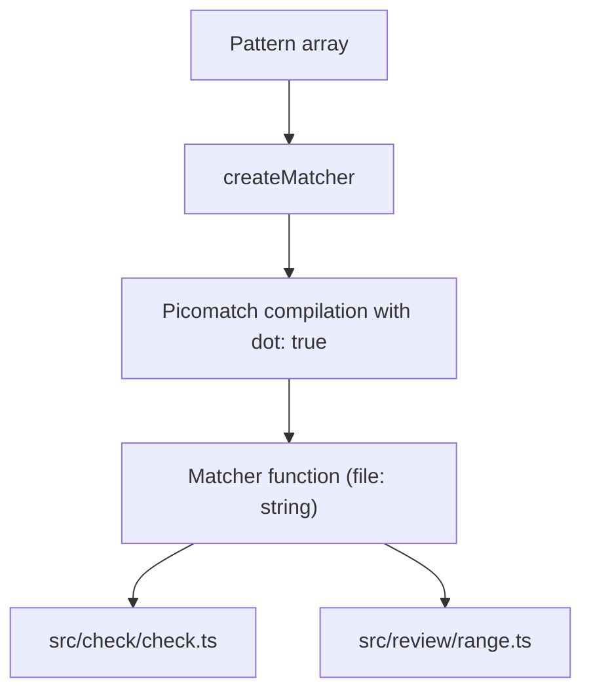

Part 3 · Page 19 of 29 · Previous: [Project checker](140-check-check.md) · Next: [Review types](160-review-types.md) · [Index](../README.md)
# Pattern matcher

**File:** `src/config/match.ts` · 28 lines · **Status:** available

## Page index

- What is it and what is it for?
- Before reading the code
- How it fits
- The complete, commented code
- Examples with real data
- Behavior summary
- Where it is used
- Tests

## What is it and what is it for?

This file accepts a list of path patterns and returns a function to test whether a file path matches any of them. When a match is found, it returns the first matching pattern string; otherwise, it returns undefined. Malformed patterns never match and do not throw runtime exceptions.

Without this file, different modules would duplicate regular expression compilations and error handling for malformed patterns found in configuration.

It takes an array of pattern strings and returns a matcher function that evaluates file paths. It is used by [`src/check/check.ts`](140-check-check.md) and [`src/review/range.ts`](170-review-range.md).

## Before reading the code

### Glob path patterns

A glob pattern describes a set of file paths using wildcard characters. For example, `src/**` matches any file inside the `src/` folder.

```ts
// input: 'src/**', file: 'src/main.ts'
// → 'src/**'
```

### Dotfiles

By default, many tools ignore files that start with a dot, such as `.env`. Enabling `dot: true` ensures that these files match wildcard expressions normally.

```ts
// input: 'src/**', file: 'src/.env' with dot: true
// → 'src/**'
```

## How it fits



1. `createMatcher` precompiles each pattern with `picomatch`, enabling hidden file matching.
2. If a pattern has invalid syntax, it is replaced with a fallback function that always returns false.
3. The returned function tests candidate paths against patterns in order and returns the first match.

## The complete, commented code

```ts
import picomatch from 'picomatch';

/**
 * Creates a matcher function returning the first glob pattern that matches a given file path.
 *
 * Patterns are evaluated with dotfile support enabled. Malformed patterns never match.
 */
export function createMatcher(patterns: string[]): (file: string) => string | undefined {
  // Precompile each pattern with dotfile support and catch compilation errors.
  const matchers = patterns.map((pattern) => {
    try {
      const match = picomatch(pattern, { dot: true });
      return { pattern, match };
    } catch {
      // An invalid pattern produces a function that never matches.
      return { pattern, match: () => false };
    }
  });

  // Return the function evaluating paths against compiled patterns.
  return (file: string): string | undefined => {
    for (const { pattern, match } of matchers) {
      try {
        // Return the first matching pattern string.
        if (match(file)) return pattern;
      } catch {
        // Ignore match-time evaluation errors for robustness.
      }
    }
    // No pattern matched the path.
    return undefined;
  };
}
```

## Examples with real data

### Normal case

Evaluates a path matching a wildcard pattern:

```ts
const matcher = createMatcher(['src/**']);
matcher('src/.env');
// → 'src/**'
```

### Boundary case

An empty pattern fails to compile in `picomatch`, but execution continues safely and the pattern never matches:

```ts
const matcher = createMatcher(['', '*.ts']);
matcher('test.js');
// → undefined
```

### Without the key line

Without `{ dot: true }`, hidden files like `src/.env` would not match patterns like `src/**`, causing rule checkers and range filters to overlook critical configuration files.

## Behavior summary

- **Pattern matches file:** returns the first matching pattern string.
- **Multiple patterns match:** returns the first pattern according to input array order.
- **No pattern matches:** returns `undefined`.
- **Empty pattern array:** returned function always returns `undefined`.
- **Invalid or empty pattern:** ignored safely and never matches any file path.

## Where it is used

### Uses

- `picomatch` to compile and evaluate glob expressions.

### Used by

- [`src/check/check.ts`](140-check-check.md), line 37, to validate `applies_to` rule patterns.
- [`src/review/range.ts`](170-review-range.md), line 203, to filter files listed in `config.ignore`.

## Tests

- `src/config/match.test.ts`: wildcard matching with dotfiles.
- `src/config/match.test.ts`: safe handling of malformed patterns without throwing.
- `src/config/match.test.ts`: precedence of earlier patterns.
- `src/config/match.test.ts`: undefined result on empty patterns or non-matching paths.
Part 3 · Page 19 of 29 · Previous: [Project checker](140-check-check.md) · Next: [Review types](160-review-types.md) · [Index](../README.md)


