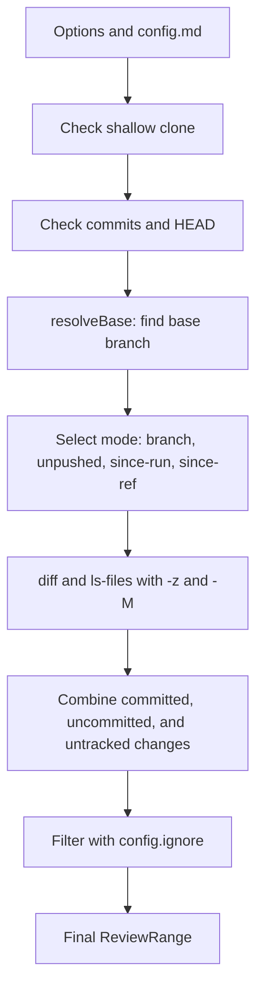

Part 3 · Page 22 of 32 · Previous: [Review types](160-review-types.md) · Next: [Changed lines](180-review-changes.md) · [Index](../README.md)
# Review range

**File:** `src/review/range.ts` · 380 lines · **Status:** available

## Page index

- What is it and what is it for?
- Before reading the code
- How it fits
- The complete, commented code
- Examples with real data
- Behavior summary
- Where it is used
- Tests

## What is it and what is it for?

This file determines the exact files, lines, and commits included in a code review.

Without this file, the system would not know what changes to compare against the main base branch, would mix committed changes with uncommitted local modifications, would report foreign remote commits as if they were deleted by the author, or would attempt to process incomplete repositories.

It takes the repository root path and configuration options, returning a [`ReviewRange`](160-review-types.md) object with changed files, added and removed line counts, and included commits. If an invalid review range cannot be computed, it throws a `ReviewRangeError` with a specific reason. Currently, no command line tool calls this module; it will provide the foundation for future review commands.

## Before reading the code

### Triple-dot comparisons in Git (`diff A...B`)

In Git, comparing two revisions using three dots finds their common merge base and reveals only the changes introduced on the right-hand branch since that divergence point. When using three dots (`upstream...HEAD`), commits fetched into the upstream branch that the author has not merged yet are not mistakenly reported as deleted files.

```text
git diff origin/main...HEAD
// → shows only commits unique to HEAD since the merge base
```

In contrast, a two-dot comparison (`upstream..HEAD`) compares the two trees directly. If the remote has new commits, a two-dot diff subtracts those files, making them appear as deleted in the local branch.

### Null delimiter (`-z`)

Git emits filenames delimited by a null byte (`\0`) rather than newlines. This preserves filenames containing spaces, accents, tabs, or special characters without quoting or escaping.

```text
git diff --numstat -z HEAD
// → 1\t0\tnuevo ñ.ts\0
```

## How it fits



### Base branch resolution rules

1. **Explicit configuration (`config.baseBranch`):** If `config.md` specifies a base branch, Git verifies its existence using `git rev-parse --verify <baseBranch>`. If it does not exist or is invalid, it throws `ReviewRangeError('base-not-found')` immediately with the message `base_branch "<baseBranch>" from config.md does not exist`. In this case, **no** fallbacks are attempted.
2. **Automatic fallbacks:** Only when `config.baseBranch` is unset or empty, the following are checked in order:
   - `origin/HEAD`: default branch of the configured remote repository.
   - `main`: standard local default branch.
   - `master`: legacy local default branch.
3. If none of the standard branches exists, it throws `ReviewRangeError('base-not-found')` instructing the user to configure `base_branch` in `config.md`.

### Mode selection rules

- **`since-ref`:** When `--since <ref>` is specified, it verifies that the reference exists. The comparison base (`baseSha`) is the `merge-base` between the reference and HEAD, the diff uses three dots (`<ref>...HEAD`), and the commits are `<ref>..HEAD`.
- **On the base branch (decision order):**
  1. *Configured upstream with changes:* If there are unpushed commits (`unpushedCount > 0`) or uncommitted working tree changes (`hasUncommitted`), the mode is `unpushed`. The base is the upstream reference (`baseLabel = upstreamRef`), `baseSha = merge-base(upstream, HEAD)`, the diff uses three dots (`upstream...HEAD`) to avoid subtracting remote commits, and commits are `upstream..HEAD`.
  2. *With last run recorded (`lastRunHead`):* If upstream has no pending changes but `lastRunHead` is provided, the mode is `since-run`. The base is `lastRunHead` (`baseLabel = opts.lastRunHead`), `baseSha = merge-base(lastRunHead, HEAD)`, the diff uses three dots (`lastRunHead...HEAD`), commits are `lastRunHead..HEAD`, and any uncommitted working tree changes are also included. This applies both with upstream up to date and without upstream.
  3. *Without upstream and with uncommitted changes:* If there is no upstream and no `lastRunHead`, but there are modified or untracked files (`hasUncommitted`), the mode is `unpushed`. The base is HEAD (`baseLabel = 'HEAD'`, `baseSha = headSha`), with zero commits (`commits = []`) and only uncommitted working tree changes.
  4. *Without changes and without starting point:* If there is no upstream, no `lastRunHead`, and no uncommitted changes, it throws `ReviewRangeError('needs-start')` requiring `--since <ref>`.
- **`branch`:** When working on any secondary feature branch or detached HEAD, compares against the resolved base using `merge-base` and a three-dot diff.

## The complete, commented code

The file contains 380 lines and is presented in consecutive blocks without omitting any lines.

### Block 1: Imports, error class, and base branch resolution

```ts
import { readFile } from 'node:fs/promises';
import { join } from 'node:path';
import { createMatcher } from '../config/match.js';
import type { Config } from '../config/types.js';
import { runGit } from '../git/git.js';
import type {
  ChangedFile,
  ReviewRange,
  ReviewRangeErrorReason,
} from './types.js';

/** Reports failures when computing the review range. */
export class ReviewRangeError extends Error {
  readonly reason: ReviewRangeErrorReason;

  constructor(reason: ReviewRangeErrorReason, message: string) {
    super(message);
    this.name = 'ReviewRangeError';
    this.reason = reason;
  }
}

/** Resolves the base Git reference using configuration and standard defaults. */
export async function resolveBase(
  root: string,
  config: Config,
): Promise<{ ref: string; source: 'config' | 'origin-head' | 'main' | 'master' }> {
  if (config.baseBranch) {
    try {
      await runGit(root, ['rev-parse', '--verify', config.baseBranch]);
      return { ref: config.baseBranch, source: 'config' };
    } catch {
      throw new ReviewRangeError(
        'base-not-found',
        `base_branch "${config.baseBranch}" from config.md does not exist`,
      );
    }
  }

  try {
    const originHead = (await runGit(root, ['rev-parse', '--abbrev-ref', 'origin/HEAD'])).trim();
    if (originHead && originHead !== 'origin/HEAD') {
      return { ref: originHead, source: 'origin-head' };
    }
  } catch {
    // origin/HEAD is not available or remote does not exist.
  }

  try {
    await runGit(root, ['rev-parse', '--verify', 'main']);
    return { ref: 'main', source: 'main' };
  } catch {
    // Local main branch does not exist.
  }

  try {
    await runGit(root, ['rev-parse', '--verify', 'master']);
    return { ref: 'master', source: 'master' };
  } catch {
    // Local master branch does not exist.
  }

  throw new ReviewRangeError(
    'base-not-found',
    'Cannot find a base branch (tried config, origin/HEAD, main, master). Set base_branch in config.md.',
  );
}
```

### Block 2: Initial checks and mode resolution in computeRange

```ts
/** Computes the changed files, commits, and lines for a code review range. */
export async function computeRange(
  root: string,
  opts: { config: Config; since?: string; lastRunHead?: string },
): Promise<ReviewRange> {
  const isShallow = (await runGit(root, ['rev-parse', '--is-shallow-repository'])).trim();
  if (isShallow === 'true') {
    throw new ReviewRangeError(
      'shallow',
      'Repository is a shallow clone; run git fetch --unshallow to review',
    );
  }

  let headSha: string;
  try {
    headSha = (await runGit(root, ['rev-parse', '--verify', 'HEAD'])).trim();
  } catch {
    throw new ReviewRangeError('no-commits', 'Repository has no commits');
  }

  const currentRef = (await runGit(root, ['rev-parse', '--abbrev-ref', 'HEAD'])).trim();
  const currentBranch = currentRef === 'HEAD' ? null : currentRef;

  const base = await resolveBase(root, opts.config);

  const isBase = currentBranch !== null && (
    currentBranch === base.ref
    || currentBranch === base.ref.replace(/^origin\//, '')
  );

  let mode: 'branch' | 'unpushed' | 'since-run' | 'since-ref';
  let baseLabel: string;
  let baseSha: string;
  let diffSpec: string | null = null;
  let commitsSpec: string | null = null;

  if (opts.since !== undefined) {
    let sinceSha: string;
    try {
      sinceSha = (await runGit(root, ['rev-parse', '--verify', `${opts.since}^{commit}`])).trim();
    } catch {
      throw new ReviewRangeError('bad-ref', `Reference "${opts.since}" does not exist`);
    }
    mode = 'since-ref';
    baseLabel = opts.since;
    baseSha = (await runGit(root, ['merge-base', sinceSha, 'HEAD'])).trim();
    diffSpec = `${sinceSha}...HEAD`;
    commitsSpec = `${sinceSha}..HEAD`;
  } else if (isBase) {
    let upstreamRef: string | undefined;
    let upstreamSha: string | undefined;
    try {
      upstreamRef = (await runGit(root, ['rev-parse', '--abbrev-ref', '--symbolic-full-name', '@{u}'])).trim();
      upstreamSha = (await runGit(root, ['rev-parse', '--verify', '@{u}'])).trim();
    } catch {
      // No upstream configured.
    }

    const numstatHead = await runGit(root, ['diff', '--numstat', '-z', 'HEAD']);
    const untracked = await runGit(root, ['ls-files', '--others', '--exclude-standard', '-z']);
    const hasUncommitted = numstatHead.trim().length > 0 || untracked.trim().length > 0;

    let unpushedCount = 0;
    if (upstreamRef && upstreamSha) {
      const unpushedCommitsRaw = await runGit(root, ['log', '--format=%H%x00%s', `${upstreamRef}..HEAD`]);
      unpushedCount = parseCommits(unpushedCommitsRaw).length;
    }

    if (upstreamRef && upstreamSha && (unpushedCount > 0 || hasUncommitted)) {
      mode = 'unpushed';
      baseLabel = upstreamRef;
      baseSha = (await runGit(root, ['merge-base', upstreamRef, 'HEAD'])).trim();
      diffSpec = `${upstreamRef}...HEAD`;
      commitsSpec = `${upstreamRef}..HEAD`;
    } else if (opts.lastRunHead !== undefined) {
      let lastRunSha: string;
      try {
        lastRunSha = (await runGit(root, ['rev-parse', '--verify', `${opts.lastRunHead}^{commit}`])).trim();
      } catch {
        throw new ReviewRangeError('bad-ref', `Reference "${opts.lastRunHead}" does not exist`);
      }
      mode = 'since-run';
      baseLabel = opts.lastRunHead;
      baseSha = (await runGit(root, ['merge-base', lastRunSha, 'HEAD'])).trim();
      diffSpec = `${lastRunSha}...HEAD`;
      commitsSpec = `${lastRunSha}..HEAD`;
    } else if (!upstreamRef && hasUncommitted) {
      mode = 'unpushed';
      baseLabel = 'HEAD';
      baseSha = headSha;
      diffSpec = null;
      commitsSpec = null;
    } else {
      throw new ReviewRangeError(
        'needs-start',
        'Working directly on base branch with no upstream changes; specify --since <ref> to choose a starting point',
      );
    }
  } else {
    mode = 'branch';
    baseLabel = base.ref;
    baseSha = (await runGit(root, ['merge-base', base.ref, 'HEAD'])).trim();
    diffSpec = `${base.ref}...HEAD`;
    commitsSpec = `${base.ref}..HEAD`;
  }
```

### Block 3: Collecting, merging, and filtering changed files

```ts
  const commits = commitsSpec !== null
    ? parseCommits(await runGit(root, ['log', '--format=%H%x00%s', commitsSpec]))
    : [];

  const [committedNumstat, committedNameStatus, uncommittedNumstat, uncommittedNameStatus, untrackedOutput] =
    await Promise.all([
      diffSpec !== null ? runGit(root, ['diff', '--numstat', '-z', '-M', diffSpec]) : Promise.resolve(''),
      diffSpec !== null ? runGit(root, ['diff', '--name-status', '-z', '-M', diffSpec]) : Promise.resolve(''),
      runGit(root, ['diff', '--numstat', '-z', '-M', 'HEAD']),
      runGit(root, ['diff', '--name-status', '-z', '-M', 'HEAD']),
      runGit(root, ['ls-files', '--others', '--exclude-standard', '-z']),
    ]);

  const filesMap = new Map<string, ChangedFile>();

  const committedEntries = parseNumstat(committedNumstat);
  const committedStatus = parseNameStatus(committedNameStatus);
  for (const entry of committedEntries) {
    const info = committedStatus.get(entry.path);
    filesMap.set(entry.path, {
      path: entry.path,
      oldPath: info?.oldPath ?? entry.oldPath,
      status: info?.status ?? (entry.oldPath ? 'renamed' : entry.added > 0 && entry.removed === 0 ? 'added' : 'modified'),
      added: entry.added,
      removed: entry.removed,
      binary: entry.binary,
      committed: true,
      uncommitted: false,
    });
  }

  const uncommittedEntries = parseNumstat(uncommittedNumstat);
  const uncommittedStatus = parseNameStatus(uncommittedNameStatus);
  for (const entry of uncommittedEntries) {
    const info = uncommittedStatus.get(entry.path);
    const existing = filesMap.get(entry.path);
    if (existing) {
      existing.uncommitted = true;
      existing.added += entry.added;
      existing.removed += entry.removed;
      if (entry.binary) existing.binary = true;
      if (info?.status === 'deleted') existing.status = 'deleted';
    } else {
      filesMap.set(entry.path, {
        path: entry.path,
        oldPath: info?.oldPath ?? entry.oldPath,
        status: info?.status ?? (entry.oldPath ? 'renamed' : entry.added > 0 && entry.removed === 0 ? 'added' : 'modified'),
        added: entry.added,
        removed: entry.removed,
        binary: entry.binary,
        committed: false,
        uncommitted: true,
      });
    }
  }

  const untrackedTokens = untrackedOutput.split('\0').filter(Boolean);
  for (const untrackedPath of untrackedTokens) {
    if (filesMap.has(untrackedPath)) continue;
    const fullPath = join(root, untrackedPath);
    let isBinary = false;
    let lines = 0;
    try {
      const buffer = await readFile(fullPath);
      isBinary = buffer.includes(0);
      lines = isBinary ? 0 : countFileLines(buffer.toString('utf8'));
    } catch {
      continue;
    }
    filesMap.set(untrackedPath, {
      path: untrackedPath,
      status: 'added',
      added: lines,
      removed: 0,
      binary: isBinary,
      committed: false,
      uncommitted: true,
    });
  }

  const ignoreMatcher = createMatcher(opts.config.ignore);
  const sortedCandidateFiles = Array.from(filesMap.values()).sort((a, b) => compareText(a.path, b.path));

  const files: ChangedFile[] = [];
  const ignoredByConfig: string[] = [];

  for (const file of sortedCandidateFiles) {
    if (ignoreMatcher(file.path) !== undefined) {
      ignoredByConfig.push(file.path);
    } else {
      files.push(file);
    }
  }

  if (files.length === 0) {
    throw new ReviewRangeError('empty', 'The review range has no changed files');
  }

  const totalAdded = files.reduce((sum, f) => sum + (f.binary ? 0 : f.added), 0);
  const totalRemoved = files.reduce((sum, f) => sum + (f.binary ? 0 : f.removed), 0);
  const large = (totalAdded + totalRemoved) > opts.config.maxChangedLines;

  return {
    mode,
    branch: currentBranch,
    baseLabel,
    baseSha,
    headSha,
    commits,
    files,
    ignoredByConfig,
    added: totalAdded,
    removed: totalRemoved,
    large,
  };
}
```

### Block 4: Git parsing helper functions

```ts
/** Parses null-delimited numstat output from Git diff into structured change records. */
function parseNumstat(
  output: string,
): { path: string; oldPath?: string; added: number; removed: number; binary: boolean }[] {
  if (!output) return [];
  const tokens = output.split('\0');
  if (tokens.length > 0 && tokens[tokens.length - 1] === '') tokens.pop();
  const results: { path: string; oldPath?: string; added: number; removed: number; binary: boolean }[] = [];
  let index = 0;
  while (index < tokens.length) {
    const token = tokens[index++];
    if (!token) continue;
    const tabParts = token.split('\t');
    if (tabParts.length >= 3) {
      const addedStr = tabParts[0]!;
      const removedStr = tabParts[1]!;
      const binary = addedStr === '-' || removedStr === '-';
      const added = binary ? 0 : Number(addedStr);
      const removed = binary ? 0 : Number(removedStr);
      let path = tabParts.slice(2).join('\t');
      let oldPath: string | undefined;
      if (path === '') {
        oldPath = tokens[index++];
        path = tokens[index++] ?? '';
      }
      results.push({ path, oldPath, added, removed, binary });
    }
  }
  return results;
}

/** Parses null-delimited name-status output from Git diff into a path lookup map. */
function parseNameStatus(
  output: string,
): Map<string, { status: 'added' | 'modified' | 'deleted' | 'renamed'; oldPath?: string }> {
  const map = new Map<string, { status: 'added' | 'modified' | 'deleted' | 'renamed'; oldPath?: string }>();
  if (!output) return map;
  const tokens = output.split('\0');
  if (tokens.length > 0 && tokens[tokens.length - 1] === '') tokens.pop();
  let index = 0;
  while (index < tokens.length) {
    const code = tokens[index++];
    if (!code) break;
    if (code.startsWith('R') || code.startsWith('C')) {
      const oldPath = tokens[index++];
      const newPath = tokens[index++];
      if (newPath) {
        map.set(newPath, { status: 'renamed', oldPath });
      }
    } else {
      const path = tokens[index++];
      if (path) {
        const status = code === 'A' ? 'added' : code === 'D' ? 'deleted' : 'modified';
        map.set(path, { status });
      }
    }
  }
  return map;
}

/** Parses newline-separated commit log lines containing null-separated sha and subject. */
function parseCommits(output: string): { sha: string; subject: string }[] {
  const lines = output.split('\n').filter((line) => line.trim() !== '');
  return lines.map((line) => {
    const nullIdx = line.indexOf('\0');
    if (nullIdx === -1) {
      return { sha: line.trim(), subject: '' };
    }
    return {
      sha: line.slice(0, nullIdx),
      subject: line.slice(nullIdx + 1),
    };
  });
}

/** Counts all lines in text while ignoring a trailing newline. */
function countFileLines(content: string): number {
  if (content.length === 0) return 0;
  const lines = content.split(/\r?\n/);
  if (lines.length > 0 && lines[lines.length - 1] === '') {
    lines.pop();
  }
  return lines.length;
}

/** Compares strings by Unicode code units for deterministic ordering. */
function compareText(a: string, b: string): number {
  return a < b ? -1 : a > b ? 1 : 0;
}
```

## Examples with real data

The following examples execute `computeRange` and `resolveBase` on real temporary repositories generated for this test.

### 1. Remote commits fetched into upstream without false deleted files

A repository where the `main` branch has a local unpushed commit (`local.ts`) and the remote `origin/main` advanced with another commit (`remoto.ts`) fetched via `git fetch`. With three-dot diffing (`upstream...HEAD`), the foreign remote file is not reported as deleted:

Input: branch `main` with diverged upstream `origin/main` after `git fetch origin main`.
Real output:

```json
{
  "mode": "unpushed",
  "branch": "main",
  "baseLabel": "origin/main",
  "baseSha": "ffe40ea709cf1b921ec55e31aeb513525f09c61e",
  "headSha": "2dc46d76d135a45e45b968ded17633866d06273f",
  "commits": [
    {
      "sha": "2dc46d76d135a45e45b968ded17633866d06273f",
      "subject": "commit local de bob"
    }
  ],
  "files": [
    {
      "path": "local.ts",
      "status": "added",
      "added": 1,
      "removed": 0,
      "binary": false,
      "committed": true,
      "uncommitted": false
    }
  ],
  "ignoredByConfig": [],
  "added": 1,
  "removed": 0,
  "large": false
}
```

### 2. Working on base branch without upstream, with last run (`lastRunHead`) and uncommitted changes

A repository working directly on `main` without a configured remote. After the last run recorded in `lastRunHead`, a commit was made adding `a.ts`, followed by an uncommitted edit to `b.ts` in the working tree. The resulting mode is `since-run`, reviewing both the intermediate commit and the uncommitted change:

Input: branch `main` without upstream, `lastRunHead` = `20858b8eb3276c70254a40d193ad69c7d364d26f`, subsequent commit adding `a.ts` (`a8db1231b115ee40fab31b40a9d7773feec5d467`), and uncommitted edit in `b.ts`.
Real output:

```json
{
  "mode": "since-run",
  "branch": "main",
  "baseLabel": "20858b8eb3276c70254a40d193ad69c7d364d26f",
  "baseSha": "20858b8eb3276c70254a40d193ad69c7d364d26f",
  "headSha": "a8db1231b115ee40fab31b40a9d7773feec5d467",
  "commits": [
    {
      "sha": "a8db1231b115ee40fab31b40a9d7773feec5d467",
      "subject": "add a.ts"
    }
  ],
  "files": [
    {
      "path": "a.ts",
      "status": "added",
      "added": 1,
      "removed": 0,
      "binary": false,
      "committed": true,
      "uncommitted": false
    },
    {
      "path": "b.ts",
      "status": "added",
      "added": 1,
      "removed": 0,
      "binary": false,
      "committed": false,
      "uncommitted": true
    }
  ],
  "ignoredByConfig": [],
  "added": 2,
  "removed": 0,
  "large": false
}
```

### 3. Working directly on base without upstream and with uncommitted changes

A repository working directly on `main` without a configured remote and without `lastRunHead`, containing one modified file and one untracked file:

Input: branch `main` without upstream, modified `existente.txt` in the working tree, and untracked `nuevo.ts`.
Real output:

```json
{
  "mode": "unpushed",
  "branch": "main",
  "baseLabel": "HEAD",
  "baseSha": "b9f5c2c997d824dabdba24b5c0ebd8fb59c1d7a9",
  "headSha": "b9f5c2c997d824dabdba24b5c0ebd8fb59c1d7a9",
  "commits": [],
  "files": [
    {
      "path": "existente.txt",
      "status": "modified",
      "added": 1,
      "removed": 0,
      "binary": false,
      "committed": false,
      "uncommitted": true
    },
    {
      "path": "nuevo.ts",
      "status": "added",
      "added": 1,
      "removed": 0,
      "binary": false,
      "committed": false,
      "uncommitted": true
    }
  ],
  "ignoredByConfig": [],
  "added": 2,
  "removed": 0,
  "large": false
}
```

### 4. Directly on base with `--since`

When working directly on the base branch and providing an explicit reference using the `--since <ref>` option, commits from that reference up to HEAD are selected alongside any uncommitted working tree changes:

Input: branch `main` on base, option `since: 'HEAD~1'`, commit adding `src/api.ts`, and uncommitted modification in the working tree.
Real output:

```json
{
  "mode": "since-ref",
  "branch": "main",
  "baseLabel": "HEAD~1",
  "baseSha": "7a347c489d707f49d71933fc0f5de0f06020522a",
  "headSha": "662b80c5580e8fbe48ad52ed9160d9544063afe2",
  "commits": [
    {
      "sha": "662b80c5580e8fbe48ad52ed9160d9544063afe2",
      "subject": "agrega api"
    }
  ],
  "files": [
    {
      "path": "src/api.ts",
      "status": "added",
      "added": 2,
      "removed": 1,
      "binary": false,
      "committed": true,
      "uncommitted": true
    }
  ],
  "ignoredByConfig": [],
  "added": 2,
  "removed": 1,
  "large": false
}
```

### 5. Error when configured base_branch does not exist in Git

When `config.md` specifies a base branch that does not exist in the repository (such as `base_branch: develop` or an invalid flag like `base_branch: -p`), the system halts immediately without falling back to defaults:

Input: `resolveBase(root, { baseBranch: 'develop', ... })`
Output:

```text
ReviewRangeError [base-not-found]: base_branch "develop" from config.md does not exist
```

Input: `resolveBase(root, { baseBranch: '-p', ... })`
Output:

```text
ReviewRangeError [base-not-found]: base_branch "-p" from config.md does not exist
```

### 6. Normal feature branch with commits and uncommitted modifications

A feature branch with a commit adding `src/auth.ts` and subsequent uncommitted modifications in the working tree:

Input: branch `feat/login` based on `main`.
Output:

```json
{
  "mode": "branch",
  "branch": "feat/login",
  "baseLabel": "main",
  "baseSha": "959f7a7857d6bba245e565020b7522395788f809",
  "headSha": "cb00bdead6979ede322f899e4d642715485444a1",
  "commits": [
    {
      "sha": "cb00bdead6979ede322f899e4d642715485444a1",
      "subject": "agrega login"
    }
  ],
  "files": [
    {
      "path": "src/auth.ts",
      "status": "added",
      "added": 2,
      "removed": 0,
      "binary": false,
      "committed": true,
      "uncommitted": true
    }
  ],
  "ignoredByConfig": [],
  "added": 2,
  "removed": 0,
  "large": false
}
```

### 7. Renamed file

A file `antiguo.ts` renamed to `nuevo.ts` with one added line on branch `feat/rename`:

Input: `git mv antiguo.ts nuevo.ts` with one line edited.
Output:

```json
{
  "mode": "branch",
  "branch": "feat/rename",
  "baseLabel": "main",
  "baseSha": "273b65b4978bc5ae8b06a0b76b1c4d55118f7b9f",
  "headSha": "3014fb00ad1d36618f666029ffe636e6fd162362",
  "commits": [
    {
      "sha": "3014fb00ad1d36618f666029ffe636e6fd162362",
      "subject": "renombra y agrega linea"
    }
  ],
  "files": [
    {
      "path": "nuevo.ts",
      "oldPath": "antiguo.ts",
      "status": "renamed",
      "added": 1,
      "removed": 0,
      "binary": false,
      "committed": true,
      "uncommitted": false
    }
  ],
  "ignoredByConfig": [],
  "added": 1,
  "removed": 0,
  "large": false
}
```

### 8. Real errors and messages

#### Error `needs-start`

Occurs when working directly on base without upstream, without uncommitted changes, and without a starting point:

- **Reason:** `needs-start`
- **Message:** `Working directly on base branch with no upstream changes; specify --since <ref> to choose a starting point`

#### Error `empty`

Occurs when a branch has no changes relative to the base or all modified files were ignored:

- **Reason:** `empty`
- **Message:** `The review range has no changed files`

#### Error `shallow`

Occurs when the repository is a shallow clone (`git clone --depth`):

- **Reason:** `shallow`
- **Message:** `Repository is a shallow clone; run git fetch --unshallow to review`

## Behavior summary

- **Feature branch:** computes the range against the common merge base using three dots and incorporates uncommitted changes.
- **Detached HEAD:** handled like a feature branch, setting `branch` to `null`.
- **Directly on base with diverged upstream:** selects `unpushed` mode with a three-dot diff (`upstream...HEAD`), preventing new upstream remote commits from appearing as deleted files.
- **Directly on base with last recorded run (`lastRunHead`):** selects `since-run` mode with a three-dot diff (`lastRunHead...HEAD`), merge base, intermediate commits, and uncommitted changes, even without a configured upstream.
- **Directly on base without upstream or last run but with uncommitted changes:** selects `unpushed` mode with base at HEAD (`baseLabel: 'HEAD'`), zero commits, and uncommitted working tree changes.
- **Directly on base with explicit reference (`--since`):** selects `since-ref` mode using a three-dot diff and merge base.
- **Directly on base without changes or starting point:** throws `ReviewRangeError` with reason `needs-start`.
- **Invalid reference in `--since` or `lastRunHead`:** throws `ReviewRangeError` with reason `bad-ref`.
- **Missing configured base branch:** throws `ReviewRangeError` with reason `base-not-found` without checking fallbacks.
- **Shallow clone:** detects shallow history and throws `ReviewRangeError` with reason `shallow`.
- **Repository with no commits:** throws `ReviewRangeError` with reason `no-commits`.
- **Range with no changed files:** throws `ReviewRangeError` with reason `empty`.
- **Ignored files in `config.md`:** collected in `ignoredByConfig` and excluded from line totals.
- **Large change set:** flags `large: true` when total added and removed lines exceed `maxChangedLines`.

## Where it is used

### Uses

- [`src/git/git.ts`](100-git-git.md), via `runGit` to execute read-only Git operations.
- [`src/config/match.ts`](150-config-match.md), to filter changed files against `config.ignore` patterns.
- [`src/review/types.ts`](160-review-types.md), for review range type definitions.

### Used by

- [`src/review/range.test.ts`](../../../src/review/range.test.ts), which thoroughly tests all range computations, base modes, and error conditions.

## Tests

- `src/review/range.test.ts`: base branch resolution with configuration, strict failure on missing base branch, remote, and local branches.
- `src/review/range.test.ts`: branch range computation with commits and uncommitted modifications.
- `src/review/range.test.ts`: exclusion of foreign remote commits in `unpushed` mode when upstream diverges after fetch.
- `src/review/range.test.ts`: support for `unpushed` mode on base without upstream when uncommitted changes exist.
- `src/review/range.test.ts`: renames, deletions, and line counts for untracked non-binary files.
- `src/review/range.test.ts`: complex filename preservation with spaces, accents, and brackets.
- `src/review/range.test.ts`: filtering matching patterns in `config.ignore` and populating `ignoredByConfig`.
- `src/review/range.test.ts`: `unpushed`, `since-run`, `since-ref`, and detached HEAD modes.
- `src/review/range.test.ts`: error detection for `needs-start`, `bad-ref`, `base-not-found`, `empty`, `no-commits`, and `shallow`.
Part 3 · Page 22 of 32 · Previous: [Review types](160-review-types.md) · Next: [Changed lines](180-review-changes.md) · [Index](../README.md)


