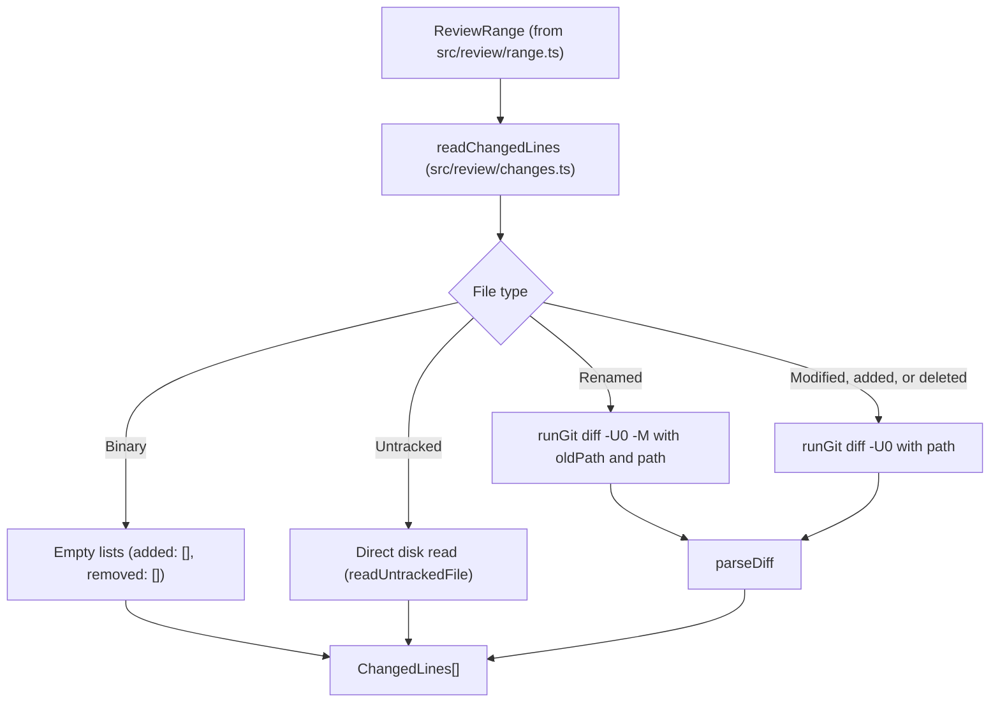

Part 3 · Page 23 of 32 · Previous: [Review range](170-review-range.md) · Next: [Rule selection](190-review-select.md) · [Index](../README.md)
# Changed lines

**File:** `src/review/changes.ts` · 118 lines · **Status:** available

## Page index

- What is it and what is it for?
- Before reading the code
- How it fits
- The complete, commented code
- Examples with real data
- Behavior summary
- Where it is used
- Tests

## What is it and what is it for?

This file reads exactly which lines were added and removed in each file within the scope of a code review.

Without this file, the system would know which files were touched relative to the base version, but not which specific lines changed. It would be impossible to check whether an added line violates a project rule or to quote the modified code in generated reports.

It receives the repository root path and the computed scope object ([`ReviewRange`](160-review-types.md)), and returns a list of line changes ([`ChangedLines`](#the-complete-commented-code)) for each file. Today no command line command uses it yet; it will form the foundation for rule selection and reporting in upcoming tasks.

## Before reading the code

### A single diff against the working tree instead of two

If two separate diffs were computed (one for committed changes between base and branch tip with `base...HEAD`, and another for uncommitted working changes with `HEAD`), the line numbers become out of sync when both parts interact.

For example, if a file modifies line 5 in a commit, and then an uncommitted change adds a new line at the top (before line 1):
- In the commit, the change took place at line 5.
- But in today's working file, that same change is located at line 6 because of the new line inserted above it.

By running a single diff from the range's base commit hash (`range.baseSha`) directly against the current working folder:

```text
git diff -U0 <baseSha> -- ':(literal)<path>'
// → returns the actual line numbers of today's file in a single pass
```

### Unified diff format with zero context (`-U0`)

The `-U0` flag asks Git to emit only added and removed lines without surrounding context lines. Each hunk begins with a header delimited by `@@`:

```text
@@ -2 +2 @@
-old line
+new line
// → in the current file, line 2 contains "new line"
```

The `+` sign indicates an addition in the current version and advances the line counter. The `-` sign indicates that the line existed in the base version but was removed.

### Git file headers versus content looking like headers

Before the first `@@` hunk header, Git writes metadata such as `diff --git`, `index`, `--- a/file`, and `+++ b/file`. These file headers must be skipped.

In contrast, after the first `@@`, any line starting with `---` or `+++` is actual file content. For example, deleting the line `-- comment` in a SQL file causes Git to prefix it with `-`, emitting `--- comment`. Removing the diff prefix recovers the deleted text `-- comment`.

## How it fits



1. `readChangedLines` iterates over `range.files`.
2. If the file is binary, it records empty lists for both additions and removals without calling Git.
3. If the file is uncommitted (`committed: false`) and unknown to the Git index, it calls `readUntrackedFile` to read the file from disk and mark every line as added starting from line 1.
4. If the file was renamed, it passes `-M` and both literal path arguments (`oldPath` and `path`) to `runGit diff -U0`.
5. For standard tracked files, it runs `diff -U0` from `range.baseSha` against the working path.
6. `parseDiff` skips headers prior to the first `@@`, updates line counters per hunk, and collects added and removed lines.
7. It returns the array of line changes for all evaluated files.

## The complete, commented code

```ts
import { readFile } from 'node:fs/promises';
import { join } from 'node:path';
import { runGit } from '../git/git.js';
import type { ReviewRange } from './types.js';

/** Detailed line-level additions and removals for a changed file. */
export interface ChangedLines {
  path: string;
  added: { line: number; text: string }[];
  removed: string[];
}

/** Parses raw unified diff output (-U0) into added and removed lines. */
function parseDiff(diffOutput: string): { added: { line: number; text: string }[]; removed: string[] } {
  const added: { line: number; text: string }[] = [];
  const removed: string[] = [];
  // Ignore empty diffs.
  if (!diffOutput) {
    return { added, removed };
  }

  const rawLines = diffOutput.split('\n');
  let inHunk = false;
  let seenHunk = false;
  let currentLine = 0;

  for (const raw of rawLines) {
    // Strip trailing carriage return when files use CRLF line endings.
    const line = raw.replace(/\r$/, '');

    // If the header marks the file as binary before the first hunk, discard lines.
    if (!seenHunk && line.startsWith('Binary files ')) {
      return { added: [], removed: [] };
    }

    // Reset hunk state when encountering a new file header.
    if (line.startsWith('diff --git ')) {
      inHunk = false;
      continue;
    }

    // Detect hunk start and extract the starting line number in the new file.
    if (line.startsWith('@@')) {
      seenHunk = true;
      inHunk = true;
      const match = line.match(/^@@\s+-[0-9]+(?:,[0-9]+)?\s+\+([0-9]+)(?:,[0-9]+)?\s+@@/);
      if (match) {
        currentLine = parseInt(match[1]!, 10);
      }
      continue;
    }

    // Discard file headers preceding the first @@ block.
    if (!inHunk) {
      continue;
    }

    // Discard newline-at-end-of-file indicators.
    if (line.startsWith('\\')) {
      continue;
    }

    // Record added line with current line number and advance the line count.
    if (line.startsWith('+')) {
      added.push({ line: currentLine, text: line.slice(1) });
      currentLine++;
    // Record removed line without advancing the current new file line count.
    } else if (line.startsWith('-')) {
      removed.push(line.slice(1));
    }
  }

  return { added, removed };
}

/** Reads all lines from an untracked file as newly added lines. */
async function readUntrackedFile(root: string, relativePath: string): Promise<ChangedLines> {
  const fullPath = join(root, relativePath);
  try {
    const content = await readFile(fullPath, 'utf8');
    if (content.length === 0) {
      return { path: relativePath, added: [], removed: [] };
    }
    const lines = content.split(/\r?\n/);
    // Discard empty trailing entry caused by a final newline.
    if (lines.length > 0 && lines[lines.length - 1] === '') {
      lines.pop();
    }
    // Number each line starting from 1 and strip carriage returns.
    const added = lines.map((text, index) => ({
      line: index + 1,
      text: text.replace(/\r$/, ''),
    }));
    return { path: relativePath, added, removed: [] };
  } catch {
    return { path: relativePath, added: [], removed: [] };
  }
}

/** Reads changed lines for every file in a review range using unified diffs against the working tree. */
export async function readChangedLines(root: string, range: ReviewRange): Promise<ChangedLines[]> {
  const results: ChangedLines[] = [];

  for (const file of range.files) {
    // Binary files do not contribute added or removed text lines.
    if (file.binary) {
      results.push({ path: file.path, added: [], removed: [] });
      continue;
    }

    // When uncommitted and untracked in Git index, read directly from disk.
    if (!file.committed && file.status !== 'deleted') {
      const tracked = await runGit(root, ['ls-files', '--', `:(literal)${file.path}`]);
      if (tracked.trim().length === 0) {
        const untracked = await readUntrackedFile(root, file.path);
        results.push(untracked);
        continue;
      }
    }

    // For renames, supply -M with both paths; for other files, supply path alone.
    const args = file.status === 'renamed' && file.oldPath
      ? ['diff', '-U0', '-M', range.baseSha, '--', `:(literal)${file.oldPath}`, `:(literal)${file.path}`]
      : ['diff', '-U0', range.baseSha, '--', `:(literal)${file.path}`];

    const diffOutput = await runGit(root, args);
    const { added, removed } = parseDiff(diffOutput);
    results.push({ path: file.path, added, removed });
  }

  return results;
}
```

## Examples with real data

### Mixture of parts (line 5 shifting to 6)

The base file contained the numbers 1 through 10 on separate lines. A commit modified line 5 to `5 edited`. Subsequently, in the uncommitted working file, line `0` was added before line 1.

Input in current working file:

```text
0
1
2
3
4
5 edited
6
7
8
9
10
```

Output from `readChangedLines`:

```json
{
  "path": "mixed.ts",
  "added": [
    {
      "line": 1,
      "text": "0"
    },
    {
      "line": 6,
      "text": "5 edited"
    }
  ],
  "removed": [
    "5"
  ]
}
```

### Renamed file

The base file `original.ts` contained six lines of text (`line1` through `line6`). On the branch it was renamed to `renamed.ts` and line 3 was modified to say `line3 edited`.

Input in current working file:

```text
line1
line2
line3 edited
line4
line5
line6
```

Output from `readChangedLines`:

```json
{
  "path": "renamed.ts",
  "added": [
    {
      "line": 3,
      "text": "line3 edited"
    }
  ],
  "removed": [
    "line3"
  ]
}
```

### Untracked file

A new file named `nuevo ñ.ts` created in the working tree without staging or committing in Git, containing three lines.

Input in current working file:

```text
primera
segunda
tercera
```

Output from `readChangedLines`:

```json
{
  "path": "nuevo ñ.ts",
  "added": [
    {
      "line": 1,
      "text": "primera"
    },
    {
      "line": 2,
      "text": "segunda"
    },
    {
      "line": 3,
      "text": "tercera"
    }
  ],
  "removed": []
}
```

### SQL file with comment

The base file `query.sql` contained a query with a `-- comentario` comment. On the branch, that comment line was replaced with the expression `++c++`.

Input in current working file:

```sql
SELECT 1;
++c++
SELECT 2;
```

Output from `readChangedLines`:

```json
{
  "path": "query.sql",
  "added": [
    {
      "line": 2,
      "text": "++c++"
    }
  ],
  "removed": [
    "-- comentario"
  ]
}
```

## Behavior summary

- **Binary file:** returns empty lists of added and removed lines without executing a diff.
- **File containing text that says "Binary files":** is processed as ordinary text content and retains its added lines, recognizing Git's binary notice only in the header before the first `@@` hunk.
- **Untracked file:** reads the file from disk and numbers all lines as added starting at line 1.
- **Renamed file:** runs `diff -U0 -M` passing both literal paths and reports only lines that changed.
- **File with committed and uncommitted changes:** executes a single diff against `baseSha` to determine accurate current line numbers.
- **Removed line beginning with hyphens:** preserves textual content, removing only the diff `-` prefix.
- **Added line beginning with plus signs:** preserves textual content, removing only the diff `+` prefix.
- **File with CRLF or missing trailing newline:** removes any residual `\r` and includes the final line.
- **Deleted file:** assigns an empty list to `added` and collects all deleted lines in `removed`.

## Where it is used

- **Uses:**
  - [`src/git/git.ts`](100-git-git.md), line 51 (`runGit`).
  - [`src/review/types.ts`](160-review-types.md), line 23 (`ReviewRange`).
- **Used by:**
  - Today no command line command uses it yet.

## Tests

- `src/review/changes.test.ts`:
  - `single changed line on line 2 returns added line and removed text`
  - `mixture of committed change and uncommitted edit gives line numbers of current version`
  - `line endings: CRLF strips trailing \r and file without final newline counts last line`
  - `difficult filename: *.ts does not include lines from other .ts files`
  - `renamed file with one change returns only changed line not whole file`
  - `untracked file with non-ASCII name returns all lines as added with lines 1, 2, 3`
  - `deleted file has empty added and all lines in removed`
  - `binary file returns empty lists for added and removed`
  - `text file mentioning Binary files retains added line`
  - `SQL comment removal and line addition starting with ++ are parsed as content`
  - `unpushed mode on base branch with HEAD base only reflects uncommitted changes`

Part 3 · Page 23 of 32 · Previous: [Review range](170-review-range.md) · Next: [Rule selection](190-review-select.md) · [Index](../README.md)


