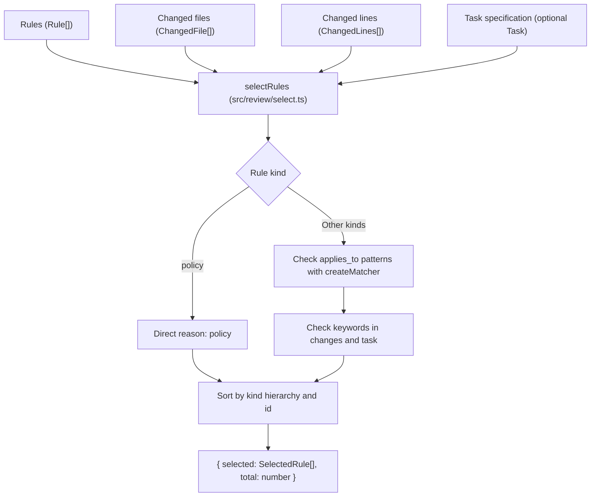

Part 3 · Page 24 of 34 · Previous: [Changed lines](180-review-changes.md) · Next: [Repository snapshot](200-review-snapshot.md) · [Index](../README.md)
# Rule selection

**File:** `src/review/select.ts` · 173 lines · **Status:** available

## Page index

- What is it and what is it for?
- Before reading the code
- How it fits
- The complete, commented code
- Examples with real data
- Behavior summary
- Where it is used
- Tests

## What is it and what is it for?

This file selects which project rules must be evaluated during a code review based on the modified files, added or removed lines, and task objectives.

Without this file, a code review would have to evaluate every single repository rule on every change (wasting computing resources and time) or rely on the unpredictable judgment of an AI model. With this deterministic selector, a project with hundreds of rules only evaluates the few that actually match the affected paths or concepts.

It receives the full list of project rules, the modified files ([`ChangedFile`](160-review-types.md)), the changed lines ([`ChangedLines`](180-review-changes.md)), and optionally the task specification ([`Task`](090-config-task.md)). It returns the list of chosen rules ([`SelectedRule`](#the-complete-commented-code)) with the reasons for their selection ([`SelectionReason`](#the-complete-commented-code)) and the total number of rules examined. Today no CLI command uses it yet; it will form the foundation of the review command in future tasks.

## Before reading the code

### Policies versus conditional rules

A policy is a global rule (`kind === 'policy'`) that applies across the entire repository regardless of what files or text were changed. In contrast, technical rules, business rules, decisions, and templates are only selected when their path patterns or keywords match.

```ts
// Rule with kind: 'policy' and no patterns
// → Always included with reason { type: 'policy' }
```

Ensures mandatory project guidelines are never omitted, while saving computation by skipping pattern and keyword searches on policies.

### Pattern matching with renamed files

Rules declare wildcard glob patterns in `applies_to`. When evaluating applicability, a renamed file can match via its old path or its new path.

```ts
// File renamed from 'src/billing/invoice.ts' to 'lib/billing/invoice.ts'
// → Matches 'src/billing/**' and records new path 'lib/billing/invoice.ts' in reasons
```

If a file moves between directories but alters logic governed by a rule, the rule still applies, always reporting the current file location.

### Keyword matching for whole words without accents

Each keyword is matched as an autonomous whole word ignoring case and diacritics (via NFD decomposition and Unicode mark removal), requiring that adjacent characters are not Unicode letters or digits (`\p{L}` and `\p{N}`).

```ts
normalizeForKeywords('PRÉCIO');
// → 'precio' (matches 'precio', but 'nin' does not match 'niño')
```

Prevents false positives such as matching keyword `iva` inside identifier `derivada`, while still finding relevant domain terms regardless of spelling accents.

### Deterministic ordering by kind and identifier

Results are sorted first by category (`policy`, `rule`, `business`, `decision`, `template`) and then by rule identifier in Unicode code unit order.

```ts
// Rules ['TMPL-001', 'POL-001', 'RULE-001']
// → ['POL-001', 'RULE-001', 'TMPL-001']
```

Guarantees identical audits produce exactly the same output and report regardless of file system read order.

## How it fits



1. `selectRules` receives loaded rules, changed files, changed lines, and optional task specification.
2. Pre-normalizes all added and removed lines from changes, as well as task objective and acceptance criteria.
3. For each policy rule (`kind === 'policy'`), adds `{ type: 'policy' }` reason directly without scanning patterns or keywords.
4. For other rules, evaluates each pattern in `appliesTo` using `createMatcher`. If the current or old path of a renamed file matches, adds an `applies_to` reason listing up to five matching paths.
5. Evaluates each term in `keywords` with Unicode word boundaries. If found in changed lines, adds a `keyword` reason with location `changes`. If found in task objective or criteria, adds another `keyword` reason with location `task`.
6. If a rule accumulated at least one reason, it is added to the selected rules list.
7. Sorts selected rules by kind hierarchy (`policy` < `rule` < `business` < `decision` < `template`) and deterministic identifier comparison.
8. Returns an object containing selected rules and the total number of rules analyzed.

## The complete, commented code

The file contains 173 lines and is presented in consecutive blocks without omitting any lines.

### Block 1: Imports, types, and helper functions

```ts
import { createMatcher } from '../config/match.js';
import type { Task } from '../config/task.js';
import type { Rule, RuleKind } from '../config/types.js';
import type { ChangedLines } from './changes.js';
import type { ChangedFile } from './types.js';

/** Describes why a rule was selected for the review. */
export type SelectionReason =
  | { type: 'policy' }
  | { type: 'applies_to'; pattern: string; files: string[] }
  | { type: 'keyword'; keyword: string; where: 'changes' | 'task' };

/** Represents a selected rule and all reasons why it matched. */
export interface SelectedRule {
  rule: Rule;
  reasons: SelectionReason[];
}

// Establishes the category hierarchy for deterministic rule sorting.
const KIND_ORDER: Record<RuleKind, number> = {
  policy: 0,
  rule: 1,
  business: 2,
  decision: 3,
  template: 4,
};

/** Compares strings by Unicode code units for deterministic ordering. */
function compareText(a: string, b: string): number {
  return a < b ? -1 : a > b ? 1 : 0;
}

/** Escapes regular expression special characters in a literal string. */
function escapeRegex(text: string): string {
  return text.replace(/[.*+?^${}()|[\]\\]/g, '\\$&');
}

/** Creates a Unicode word-bounded regular expression for a normalized keyword term. */
function createKeywordRegex(keyword: string): RegExp | undefined {
  // Trim outer whitespace from the normalized keyword.
  const normalized = normalizeForKeywords(keyword).trim();
  // A keyword that is empty or contained only combining marks never matches.
  if (normalized === '') {
    return undefined;
  }
  // Split into individual tokens and escape each to permit arbitrary intervening whitespace.
  const words = normalized.split(/\s+/);
  const pattern = words.map(escapeRegex).join('\\s+');
  // Require word boundaries rejecting adjacent Unicode letters or digits.
  return new RegExp(`(?<![\\p{L}\\p{N}])${pattern}(?![\\p{L}\\p{N}])`, 'u');
}

/** Normalizes text for keyword matching by converting to lowercase and stripping combining marks. */
export function normalizeForKeywords(text: string): string {
  // Convert accented characters into base letters and separate marks, then remove marks.
  return text.normalize('NFD').replace(/\p{M}/gu, '').toLowerCase();
}
```

### Block 2: Main selectRules function

```ts
/** Evaluates project rules against changed files, changed lines, and task definitions. */
export function selectRules(
  rules: Rule[],
  files: ChangedFile[],
  lines: ChangedLines[],
  task?: Task,
): { selected: SelectedRule[]; total: number } {
  // Pre-normalize all modified lines to accelerate keyword searches.
  const normalizedChanges: string[] = [];
  for (const fileLines of lines) {
    for (const added of fileLines.added) {
      normalizedChanges.push(normalizeForKeywords(added.text));
    }
    for (const removed of fileLines.removed) {
      normalizedChanges.push(normalizeForKeywords(removed));
    }
  }

  // Pre-normalize task objective and acceptance criteria when provided.
  const normalizedTask: string[] = [];
  if (task) {
    normalizedTask.push(normalizeForKeywords(task.objective));
    for (const criterion of task.criteria) {
      normalizedTask.push(normalizeForKeywords(criterion));
    }
  }

  const selected: SelectedRule[] = [];

  for (const rule of rules) {
    // Policies apply repository-wide and skip pattern and keyword matching.
    if (rule.kind === 'policy') {
      selected.push({
        rule,
        reasons: [{ type: 'policy' }],
      });
      continue;
    }

    const reasons: SelectionReason[] = [];

    // Evaluate each pattern deduplicating identical entries.
    const seenPatterns = new Set<string>();
    for (const pattern of rule.appliesTo) {
      if (seenPatterns.has(pattern)) {
        continue;
      }
      seenPatterns.add(pattern);

      const matcher = createMatcher([pattern]);
      const matchedFiles: string[] = [];

      for (const file of files) {
        const matchesPath = matcher(file.path) !== undefined;
        const matchesOldPath = file.oldPath ? matcher(file.oldPath) !== undefined : false;
        // When either the current path or old path matches, record the new path.
        if (matchesPath || matchesOldPath) {
          if (!matchedFiles.includes(file.path)) {
            matchedFiles.push(file.path);
            // Cap matches to at most five files per pattern reason.
            if (matchedFiles.length === 5) {
              break;
            }
          }
        }
      }

      if (matchedFiles.length > 0) {
        reasons.push({
          type: 'applies_to',
          pattern,
          files: matchedFiles,
        });
      }
    }

    // Evaluate whole-word keywords across changes and task specifications.
    const seenKeywords = new Set<string>();
    for (const keyword of rule.keywords) {
      const norm = normalizeForKeywords(keyword).trim();
      if (norm === '' || seenKeywords.has(norm)) {
        continue;
      }
      seenKeywords.add(norm);

      const regex = createKeywordRegex(keyword);
      if (!regex) {
        continue;
      }

      // Add changes reason if the whole term appears in added or removed lines.
      if (normalizedChanges.some((line) => regex.test(line))) {
        reasons.push({
          type: 'keyword',
          keyword,
          where: 'changes',
        });
      }

      // Add task reason if the whole term appears in task objective or criteria.
      if (normalizedTask.some((text) => regex.test(text))) {
        reasons.push({
          type: 'keyword',
          keyword,
          where: 'task',
        });
      }
    }

    if (reasons.length > 0) {
      selected.push({
        rule,
        reasons,
      });
    }
  }

  // Sort by category hierarchy and break ties using rule identifier.
  selected.sort((a, b) => {
    const kindDiff = KIND_ORDER[a.rule.kind] - KIND_ORDER[b.rule.kind];
    if (kindDiff !== 0) {
      return kindDiff;
    }
    return compareText(a.rule.id, b.rule.id);
  });

  return {
    selected,
    total: rules.length,
  };
}
```

## Examples with real data

### A policy

Input for `selectRules`:

```json
{
  "rules": [
    {
      "id": "POL-001",
      "title": "Todas las llamadas a la API deben usar HTTPS",
      "severity": "critical",
      "appliesTo": [],
      "keywords": [],
      "kind": "policy",
      "file": "policies/POL-001.md",
      "body": "Todas las conexiones a servicios externos deben usar HTTPS."
    }
  ],
  "files": [
    {
      "path": "src/api/client.ts",
      "status": "added",
      "added": 1,
      "removed": 0,
      "binary": false,
      "committed": true,
      "uncommitted": false
    }
  ],
  "lines": [
    {
      "path": "src/api/client.ts",
      "added": [
        {
          "line": 1,
          "text": "export const apiUrl = \"https://api.example.com\";"
        }
      ],
      "removed": []
    }
  ]
}
```

Output of `selectRules`:

```json
{
  "selected": [
    {
      "rule": {
        "id": "POL-001",
        "title": "Todas las llamadas a la API deben usar HTTPS",
        "severity": "critical",
        "appliesTo": [],
        "keywords": [],
        "kind": "policy",
        "file": "policies/POL-001.md",
        "body": "Todas las conexiones a servicios externos deben usar HTTPS."
      },
      "reasons": [
        {
          "type": "policy"
        }
      ]
    }
  ],
  "total": 1
}
```

### Pattern rule with a renamed file

Input for `selectRules`:

```json
{
  "rules": [
    {
      "id": "RULE-002",
      "title": "Estructura modular de facturación",
      "severity": "major",
      "appliesTo": [
        "src/billing/**"
      ],
      "keywords": [],
      "kind": "rule",
      "file": "rules/RULE-002.md",
      "body": "Los módulos de facturación deben mantenerse desacoplados."
    }
  ],
  "files": [
    {
      "path": "lib/billing/invoice.ts",
      "oldPath": "src/billing/invoice.ts",
      "status": "renamed",
      "added": 1,
      "removed": 1,
      "binary": false,
      "committed": true,
      "uncommitted": false
    }
  ],
  "lines": [
    {
      "path": "lib/billing/invoice.ts",
      "added": [
        {
          "line": 5,
          "text": "export function generateInvoice() {"
        }
      ],
      "removed": [
        "export function makeInvoice() {"
      ]
    }
  ]
}
```

Output of `selectRules`:

```json
{
  "selected": [
    {
      "rule": {
        "id": "RULE-002",
        "title": "Estructura modular de facturación",
        "severity": "major",
        "appliesTo": [
          "src/billing/**"
        ],
        "keywords": [],
        "kind": "rule",
        "file": "rules/RULE-002.md",
        "body": "Los módulos de facturación deben mantenerse desacoplados."
      },
      "reasons": [
        {
          "type": "applies_to",
          "pattern": "src/billing/**",
          "files": [
            "lib/billing/invoice.ts"
          ]
        }
      ]
    }
  ],
  "total": 1
}
```

### Keyword rule with accent (`IVA` and `iva`)

Input for `selectRules`:

```json
{
  "rules": [
    {
      "id": "BIZ-003",
      "title": "Desglose obligatorio de IVA",
      "severity": "critical",
      "appliesTo": [
        "src/legacy/**"
      ],
      "keywords": [
        "IVA"
      ],
      "kind": "business",
      "file": "business/BIZ-003.md",
      "body": "Los cobros deben desglosar el IVA correspondiente."
    }
  ],
  "files": [
    {
      "path": "src/checkout/total.ts",
      "status": "modified",
      "added": 1,
      "removed": 0,
      "binary": false,
      "committed": true,
      "uncommitted": false
    }
  ],
  "lines": [
    {
      "path": "src/checkout/total.ts",
      "added": [
        {
          "line": 12,
          "text": "const iva = subtotal * 0.16;"
        }
      ],
      "removed": []
    }
  ]
}
```

Output of `selectRules`:

```json
{
  "selected": [
    {
      "rule": {
        "id": "BIZ-003",
        "title": "Desglose obligatorio de IVA",
        "severity": "critical",
        "appliesTo": [
          "src/legacy/**"
        ],
        "keywords": [
          "IVA"
        ],
        "kind": "business",
        "file": "business/BIZ-003.md",
        "body": "Los cobros deben desglosar el IVA correspondiente."
      },
      "reasons": [
        {
          "type": "keyword",
          "keyword": "IVA",
          "where": "changes"
        }
      ]
    }
  ],
  "total": 1
}
```

### Rule that matches for two reasons

Input for `selectRules`:

```json
{
  "rules": [
    {
      "id": "RULE-004",
      "title": "Gestión segura de tokens de autenticación",
      "severity": "critical",
      "appliesTo": [
        "src/auth/**"
      ],
      "keywords": [
        "token"
      ],
      "kind": "rule",
      "file": "rules/RULE-004.md",
      "body": "Los tokens nunca deben almacenarse en texto plano."
    }
  ],
  "files": [
    {
      "path": "src/auth/session.ts",
      "status": "modified",
      "added": 1,
      "removed": 0,
      "binary": false,
      "committed": true,
      "uncommitted": false
    }
  ],
  "lines": [
    {
      "path": "src/auth/session.ts",
      "added": [
        {
          "line": 8,
          "text": "const token = createSecureToken(user);"
        }
      ],
      "removed": []
    }
  ]
}
```

Output of `selectRules`:

```json
{
  "selected": [
    {
      "rule": {
        "id": "RULE-004",
        "title": "Gestión segura de tokens de autenticación",
        "severity": "critical",
        "appliesTo": [
          "src/auth/**"
        ],
        "keywords": [
          "token"
        ],
        "kind": "rule",
        "file": "rules/RULE-004.md",
        "body": "Los tokens nunca deben almacenarse en texto plano."
      },
      "reasons": [
        {
          "type": "applies_to",
          "pattern": "src/auth/**",
          "files": [
            "src/auth/session.ts"
          ]
        },
        {
          "type": "keyword",
          "keyword": "token",
          "where": "changes"
        }
      ]
    }
  ],
  "total": 1
}
```

## Behavior summary

- **Rule with policy kind (`policy`):** always selected unconditionally with `{ type: 'policy' }`, skipping pattern and keyword checks.
- **Rule with matching applies_to pattern:** evaluates each pattern independently and produces an `applies_to` reason with up to five matching files in input order.
- **Renamed file:** evaluates pattern against `oldPath` and current `path`; if either matches, records the current `path` in the reason's file list.
- **Keyword in modified lines:** searches whole terms (case- and accent-insensitively) across added or removed lines and adds a reason with `where: 'changes'`.
- **Keyword in task specification:** searches whole terms only in task objective and criteria, adding a reason with `where: 'task'`.
- **Keyword in both changes and task:** produces two separate reasons in order: first `changes`, then `task`.
- **Multiple reasons for a rule:** lists all pattern reasons (`applies_to`) first, followed by all keyword reasons (`keyword`).
- **Keyword that normalizes to empty string:** ignored and never produces a match.
- **Special characters in keywords:** escaped and compared literally, so `c++` matches in `usa c++ aquí` and `a.b` does not match `axb`.
- **Deterministic final ordering:** sorted by category hierarchy (`policy`, `rule`, `business`, `decision`, `template`) and ties broken by rule identifier in Unicode code unit order.

## Where it is used

- **Uses:**
  - [`src/config/match.ts`](150-config-match.md), line 8 (`createMatcher`).
  - [`src/config/types.ts`](060-config-types.md), lines 7 and 29 (`RuleKind`, `Rule`).
  - [`src/config/task.ts`](090-config-task.md), line 7 (`Task`).
  - [`src/review/types.ts`](160-review-types.md), line 2 (`ChangedFile`).
  - [`src/review/changes.ts`](180-review-changes.md), line 7 (`ChangedLines`).
- **Used by:**
  - Today no CLI command uses it yet.

## Tests

- `src/review/select.test.ts`:
  - `patrones: una regla con src/billing/** entra si cambió src/billing/total.ts y queda fuera si solo cambió docs/x.md`
  - `políticas: una política entra sin cambios relacionados`
  - `acentos: la palabra clave IVA entra con la línea agregada const iva = 16; precio entra con Precio y con précio`
  - `palabra completa: la palabra clave iva no entra con derivada`
  - `varias palabras: la palabra clave forma de pago entra con forma  de pago`
  - `ficha: una palabra clave que solo está en la ficha entra con where: "task"`
  - `renombrado: si src/billing/a.ts pasó a lib/a.ts, la regla con src/billing/** entra`
  - `total es el número de reglas cargadas`
  - `varios motivos: una regla que entra por patrón y por palabra clave aparece una sola vez, con los dos motivos en orden`
  - `varios patrones que coinciden dan un motivo cada uno`
  - `el límite de 5: con 7 archivos que coinciden, el motivo lista los 5 primeros`
  - `caracteres especiales: c++ y a.b`
  - `la misma palabra en los cambios y en la ficha da dos motivos`
  - `nin no coincide con niño`
  - `líneas quitadas: una palabra que solo está en una línea quitada entra con where: "changes"`
  - `otras secciones de la ficha: una palabra que solo está en las notas no entra`
  - `orden final: con reglas de los cinco tipos, desordenadas, salen en el orden de la precisión 5`
  - `políticas: una política lleva solo motivo policy aunque tenga applies_to o keywords coincidentes`
  - `palabra clave vacía: una palabra clave vacía o con solo marcas al normalizarla nunca coincide`
  - `converts uppercase to lowercase and strips accents via NFD`
  - `preserves whitespace and punctuation unchanged`

Part 3 · Page 24 of 34 · Previous: [Changed lines](180-review-changes.md) · Next: [Repository snapshot](200-review-snapshot.md) · [Index](../README.md)

