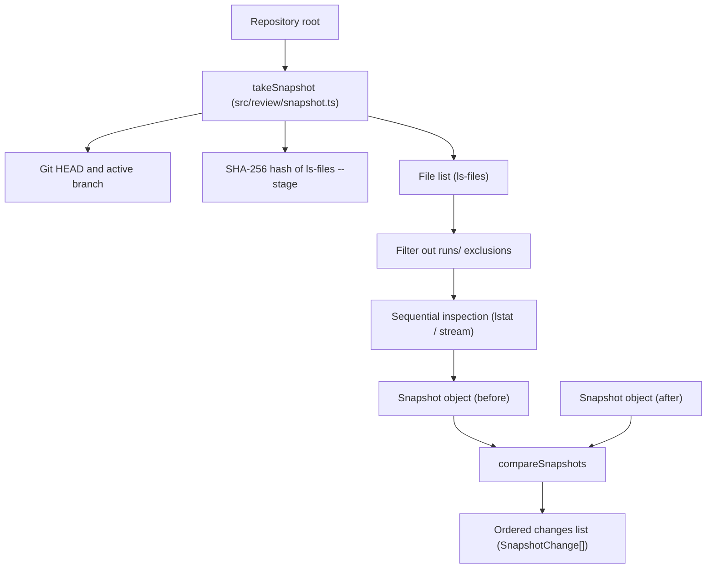

Part 3 · Page 25 of 34 · Previous: [Rule selection](190-review-select.md) · Next: [Findings schema](210-findings-schema.md) · [Index](../README.md)
# Repository snapshot

**File:** `src/review/snapshot.ts` · 154 lines · **Status:** available

## Page index

- What is it and what is it for?
- Before reading the code
- How it fits
- The complete, commented code
- Examples with real data
- Behavior summary
- Where it is used
- Tests

## What is it and what is it for?

This file captures a "snapshot" (an exact state record) of the codebase repository before starting a review and compares it afterward to determine whether anything changed.

Without this file, an automated audit would have no way to know whether analyzed files were altered, whether changes were staged (`git add`), or whether commits were made while AI models were working. If the repository changes during the review, the findings would no longer match the actual code and the report would lose validity; thanks to this comparison snapshot, the review is immediately annulled, ensuring result trustworthiness.

It receives the root directory of the repository. It returns the structured snapshot ([`Snapshot`](#the-complete-commented-code)) containing the current commit reference (`head`), the active branch (`branch`), the Git index fingerprint (`index`), and the cryptographic fingerprint of every tracked or untracked file ([`files`](#the-complete-commented-code)). It also provides the comparison function ([`compareSnapshots`](#the-complete-commented-code)) that contrasts two snapshots and produces ordered differences ([`SnapshotChange`](#the-complete-commented-code)). Currently no CLI command uses it yet; it will serve as the foundation for the preparation and finish review steps in future tasks.

## Before reading the code

### Git index fingerprint

The Git index (staging area) holds changes prepared for commit. By calculating a SHA-256 fingerprint over the output of `git ls-files --stage -z`, any `git add` operation alters this hash.

```ts
// Index state before and after 'git add file.ts'
// → The 'index' property changes, reporting { kind: 'index' }
```

It detects if a user or tool staged changes in Git between taking the initial snapshot and running the final check.

### Symbolic link handling without traversal

A symbolic link (an operating system shortcut) points to another path. It is inspected using `lstat` and read with `readlink` without opening or resolving the target file.

```ts
// Symlink 'sym.txt' pointing to 'src/index.ts'
// → Recorded in files as 'link:src/index.ts'
```

It avoids computing incorrect hashes by following links and immediately detects if the symlink destination was redirected.

### Missing tracked files

A file recorded in the Git index that was deleted from disk via file system calls without using `git rm`.

```ts
// File 'deleted.ts' removed via unlink or rm
// → Stored in the snapshot with value 'missing', detected by compareSnapshots as 'removed'
```

It guarantees that deleted files do not crash the inspection process and are cleanly classified as removals.

### Run directory exclusion

The `.agents/code-audit/runs/` folder stores review run logs, temporary data, and generated reports.

```ts
// Writing to '.agents/code-audit/runs/run-1/data.json'
// → Path is completely ignored and compareSnapshots returns []
```

The tool writes its own execution data during a review without modifying the snapshot or annulling the process.

## How it fits



1. `takeSnapshot` queries Git for the current `HEAD` commit hash and active branch name. If HEAD is detached, it sets `branch` to `null`.
2. Runs `git ls-files --stage -z` and hashes its complete output with SHA-256 to record the exact staging area state.
3. Lists tracked and non-ignored untracked files via `git ls-files --cached --others --exclude-standard -z`.
4. Normalizes paths by removing trailing slashes from nested repositories and discards any path inside `.agents/code-audit/runs/`.
5. Iterates sequentially over sorted paths, inspecting attributes with `lstat`. Symbolic links are recorded with their destination (`link:<target>`), directories as `dir`, missing files as `missing`, and normal files with their SHA-256 content hash streamed in chunks.
6. When finishing the review, `compareSnapshots` accepts both snapshots (`before` and `after`).
7. Compares `head`, `branch`, and `index`, emitting individual change records if they differ.
8. Compares file entries, treating `missing` as nonexistent, and groups differences into additions (`added`), removals (`removed`), and modifications (`modified`).
9. Returns all detected differences in strict category order, sorted by path within each file change category.

## The complete, commented code

The file contains 154 lines and is presented in consecutive blocks without omitting any line.

### Block 1: Imports, types, and takeSnapshot function

```ts
import { createHash } from 'node:crypto';
import { createReadStream } from 'node:fs';
import { lstat, readlink } from 'node:fs/promises';
import { join } from 'node:path';
import { CONFIG_DIR } from '../config/paths.js';
import { runGit } from '../git/git.js';

/** Represents a lightweight cryptographic and structural snapshot of a repository. */
export interface Snapshot {
  head: string;
  branch: string | null;
  index: string;
  files: Record<string, string>;
}

/** Represents a single detected difference between two repository snapshots. */
export type SnapshotChange =
  | { kind: 'head' | 'branch' | 'index' }
  | { kind: 'added' | 'removed' | 'modified'; path: string };

/** Takes a snapshot of Git HEAD, current branch, index state, and non-ignored files. */
export async function takeSnapshot(root: string): Promise<Snapshot> {
  // Retrieves the current commit hash at HEAD.
  const head = (await runGit(root, ['rev-parse', '--verify', 'HEAD'])).trim();

  // Resolves the current branch; sets null if HEAD is detached.
  const currentRef = (await runGit(root, ['rev-parse', '--abbrev-ref', 'HEAD'])).trim();
  const branch = currentRef === 'HEAD' ? null : currentRef;

  // Hashes the complete staging area state from ls-files --stage.
  const stageOutput = await runGit(root, ['ls-files', '--stage', '-z']);
  const index = createHash('sha256').update(stageOutput).digest('hex');

  // Lists tracked and non-ignored untracked files delimited by null characters.
  const rawFiles = await runGit(root, ['ls-files', '--cached', '--others', '--exclude-standard', '-z']);
  const tokens = rawFiles.split('\0').filter((token) => token.length > 0);

  const runsPrefix = `${CONFIG_DIR}/runs/`;
  const uniquePaths = new Set<string>();

  // Normalizes paths by stripping trailing slashes and excluding tool runs directories.
  for (const token of tokens) {
    const normalized = token.endsWith('/') ? token.slice(0, -1) : token;
    if (!normalized) continue;
    if (normalized === `${CONFIG_DIR}/runs` || normalized.startsWith(runsPrefix)) continue;
    uniquePaths.add(normalized);
  }

  // Sorts paths to ensure deterministic iteration and record insertion.
  const sortedPaths = Array.from(uniquePaths).sort(compareText);
  const files: Record<string, string> = {};

  // Reads each file sequentially to avoid exhausting open file descriptors.
  for (const path of sortedPaths) {
    const fullPath = join(root, path);
    try {
      const stat = await lstat(fullPath);
      if (stat.isSymbolicLink()) {
        try {
          // Records symbolic link destination without resolving its target content.
          const target = await readlink(fullPath);
          files[path] = `link:${target}`;
        } catch (error) {
          const code = (error as NodeJS.ErrnoException).code;
          if (code === 'ENOENT' || code === 'ENOTDIR') {
            files[path] = 'missing';
          } else {
            throw error;
          }
        }
      } else if (stat.isDirectory()) {
        // Records untracked nested repositories or submodules as directories.
        files[path] = 'dir';
      } else {
        try {
          // Computes SHA-256 hash by streaming file contents in chunks.
          files[path] = await hashFileStream(fullPath);
        } catch (error) {
          const code = (error as NodeJS.ErrnoException).code;
          if (code === 'ENOENT' || code === 'ENOTDIR') {
            files[path] = 'missing';
          } else {
            throw error;
          }
        }
      }
    } catch (error) {
      // Handles files deleted or non-directory path components encountered during stat.
      const code = (error as NodeJS.ErrnoException).code;
      if (code === 'ENOENT' || code === 'ENOTDIR') {
        files[path] = 'missing';
      } else {
        throw error;
      }
    }
  }

  return { head, branch, index, files };
}
```

### Block 2: compareSnapshots function and helpers

```ts
/** Compares two snapshots and returns ordered differences in Git and file states. */
export function compareSnapshots(before: Snapshot, after: Snapshot): SnapshotChange[] {
  const changes: SnapshotChange[] = [];

  // Emits a change if the HEAD commit hash changed between snapshots.
  if (before.head !== after.head) {
    changes.push({ kind: 'head' });
  }

  // Emits a change if the active branch changed or detached.
  if (before.branch !== after.branch) {
    changes.push({ kind: 'branch' });
  }

  // Emits a change if the staged index fingerprint changed.
  if (before.index !== after.index) {
    changes.push({ kind: 'index' });
  }

  // Gathers all paths from both snapshots for comprehensive comparison.
  const allPaths = new Set<string>([
    ...Object.keys(before.files),
    ...Object.keys(after.files),
  ]);
  const sortedPaths = Array.from(allPaths).sort(compareText);

  const added: SnapshotChange[] = [];
  const removed: SnapshotChange[] = [];
  const modified: SnapshotChange[] = [];

  // Categorizes file changes, treating missing as nonexistent.
  for (const path of sortedPaths) {
    const valBefore = before.files[path];
    const valAfter = after.files[path];

    const existsBefore = valBefore !== undefined && valBefore !== 'missing';
    const existsAfter = valAfter !== undefined && valAfter !== 'missing';

    if (!existsBefore && existsAfter) {
      added.push({ kind: 'added', path });
    } else if (existsBefore && !existsAfter) {
      removed.push({ kind: 'removed', path });
    } else if (existsBefore && existsAfter && valBefore !== valAfter) {
      modified.push({ kind: 'modified', path });
    }
  }

  // Returns ordered changes: head, branch, index, added, removed, and modified.
  return [
    ...changes,
    ...added,
    ...removed,
    ...modified,
  ];
}

/** Computes the SHA-256 hexadecimal hash of a file by streaming its content in chunks. */
async function hashFileStream(filePath: string): Promise<string> {
  // Streams file chunks into the cryptographic hash accumulator.
  return new Promise((resolve, reject) => {
    const hash = createHash('sha256');
    const stream = createReadStream(filePath);
    stream.on('data', (chunk) => hash.update(chunk));
    stream.on('end', () => resolve(hash.digest('hex')));
    stream.on('error', (err) => reject(err));
  });
}

/** Compares strings by Unicode code units for deterministic ordering. */
function compareText(a: string, b: string): number {
  // Sorts strings deterministically by Unicode code points.
  return a < b ? -1 : a > b ? 1 : 0;
}
```

## Examples with real data

### Small repository snapshot with symlink and runs/ file

A small repository containing a symbolic link (`link.txt`) pointing to `src/index.ts` and a temporary file inside `.agents/code-audit/runs/run-1/temp.json`.

Complete output of `takeSnapshot`:

```json
{
  "head": "db55baae00321503c1c24434be97144f5d174835",
  "branch": "main",
  "index": "ffe54b0374734a604f47baaeabe13ce7d09fc24c6905a6ec6dba20d797841497",
  "files": {
    "link.txt": "link:src/index.ts",
    "src/index.ts": "6f31f78fd8f03d186c9953c0c3b400042a520b268673e3647bfbcd028920e972"
  }
}
```

The file in `.agents/code-audit/runs/` is completely excluded from the snapshot, and the symlink records its textual destination without following it.

### Editing, creating, and deleting files

Starting from the previous snapshot, `src/index.ts` is edited, `src/utils.ts` is created, and `link.txt` is deleted.

Complete output of `compareSnapshots`:

```json
[
  {
    "kind": "added",
    "path": "src/utils.ts"
  },
  {
    "kind": "removed",
    "path": "link.txt"
  },
  {
    "kind": "modified",
    "path": "src/index.ts"
  }
]
```

### Staging changes with git add and committing

After committing the changes above with `git add --all` and `git commit`, a new snapshot is taken and compared with the previous one.

Complete output of `compareSnapshots`:

```json
[
  {
    "kind": "head"
  },
  {
    "kind": "index"
  }
]
```

### Changing modification time (touch) and writing to runs/

The modification time (`touch`) of `src/index.ts` is updated without changing its content, and a report file is written to `.agents/code-audit/runs/run-2/data.json`.

Complete output of `compareSnapshots`:

```json
[]
```

## Behavior summary

- **Identical snapshots:** returns an empty list `[]`.
- **File modification:** records `{ kind: 'modified', path: '...' }`.
- **New file creation:** records `{ kind: 'added', path: '...' }`.
- **File deletion:** records `{ kind: 'removed', path: '...' }` and records `'missing'` in the snapshot.
- **Folder replaced by file with the same name:** the new file is recorded as added (`added`) and previous folder contents are recorded as removed (`removed`) with value `'missing'` in the snapshot.
- **Staging changes (`git add`):** updates the index fingerprint and records `{ kind: 'index' }`.
- **New commit:** records `{ kind: 'head' }` (plus `{ kind: 'index' }` or modified files if applicable).
- **Touching a file (`touch`) without content changes:** preserves the snapshot and compareSnapshots returns `[]`.
- **Writing to `.agents/code-audit/runs/`:** excluded from the snapshot and compareSnapshots returns `[]`.
- **Symbolic link:** recorded as `link:<target>`; updating target yields `{ kind: 'modified', path: '...' }`.
- **Untracked nested repository:** recorded without trailing slash with value `'dir'`.
- **File ignored by `.gitignore`:** omitted from snapshot; editing it returns `[]`.
- **Switching branch at same commit:** returns only `{ kind: 'branch' }`; detached HEAD sets branch to `null`.
- **Multiple simultaneous changes:** ordered strictly by `head`, `branch`, `index`, `added`, `removed`, and `modified`, with paths sorted alphabetically within each file change category.

## Where it is used

- **Uses:**
  - [`src/config/paths.ts`](050-config-paths.md), line 3 (`CONFIG_DIR`).
  - [`src/git/git.ts`](100-git-git.md), line 51 (`runGit`).
- **Used by:**
  - Currently no command-line command uses it yet.

## Tests

- `src/review/snapshot.test.ts`:
  - `two consecutive snapshots without changes return an empty list`
  - `editing a file returns modified`
  - `creating a new file returns added`
  - `deleting a tracked file returns removed and records missing in the snapshot`
  - `git add of a file already edited before the first snapshot returns only index`
  - `a commit returns head`
  - `touch without changing content returns an empty list`
  - `writing in CONFIG_DIR/runs returns an empty list and is excluded from files`
  - `replacing a tracked folder with a file with the same name reports added and removed`
  - `symlink is recorded as link:<target> and changing target returns modified`
  - `untracked nested git repository is stored with key nested and value dir`
  - `editing a file ignored by .gitignore returns an empty list`
  - `switching branch on same commit yields only branch; detached HEAD yields branch: null`
  - `difficult filenames *.ts, [x].ts, tab names, and spaces with accents are preserved exactly`
  - `multiple simultaneous changes are ordered by head, branch, index, added, removed, modified with paths sorted`

Part 3 · Page 25 of 34 · Previous: [Rule selection](190-review-select.md) · Next: [Findings schema](210-findings-schema.md) · [Index](../README.md)

