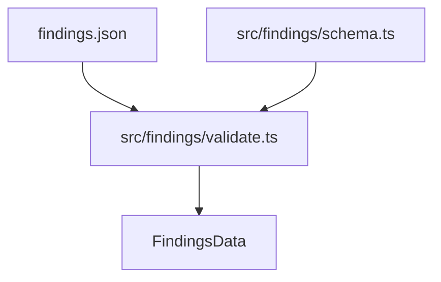

Part 3 · Page 26 of 32 · Previous: [Repository snapshot](200-review-snapshot.md) · Next: [Findings validator](220-findings-validate.md) · [Index](../README.md)
# Findings schema

**File:** `src/findings/schema.ts` · 65 lines · **Status:** available

## Page index

- What is it and what is it for?
- Before reading the code
- How it fits
- The complete, commented code
- Examples with real data
- Behavior summary
- Where it is used
- Tests

## What is it and what is it for?

Defines the schema version and normalized data structures representing review findings.

Without this file, different modules would parse finding property names inconsistently, increasing integration errors.

It receives base types such as rule severity and produces typed models in standard casing (camelCase) for validation and reporting.

Today no command-line interface command uses it directly in the main execution flow; it is only consumed by the findings validation module and associated unit tests.

## Before reading the code

### Casing translation from snake_case to camelCase

Review sessions author finding artifacts using lowercase terms separated by underscores (snake_case), whereas TypeScript interfaces follow capitalized property conventions (camelCase).

```ts
// external input: schema_version
// → typed property: schemaVersion
```

This boundary cleanly decouples external data exchange payloads from internal codebase types.

### Optional fields versus empty collections

In normalized models, collections such as related findings always resolve to typed arrays rather than null or undefined values.

```ts
// without related findings
// → relatedFindings: []
```

This guarantees predictable iteration throughout downstream reporting logic.

## How it fits



1. External review sessions output findings data.
2. The validator imports types from this file to assemble verified data models.
3. The resulting normalized structures drive markdown and HTML report generation.

## The complete, commented code

```ts
// Imports severity definitions shared across rule configurations.
import type { Severity } from '../config/types.js';

// Defines the fixed schema version accepted by this program release.
/** Expected schema version for findings files. */
export const FINDINGS_SCHEMA_VERSION = 1;

// Models a single verified and categorized review finding.
/** Represents a single validated and normalized review finding. */
export interface Finding {
  id: string;
  title: string;
  severity: Severity;
  file: string;
  quote: string;
  impact: string;
  verified: boolean;
  wholeFile: boolean;
  line?: number;
  endLine?: number;
  suggestion?: { startLine: number; code: string };
  ruleId?: string;
  relatedFindings: string[];
  relatedCriteria: number[];
  relatedNote?: string;
  existing?: { file: string; line?: number; note: string };
}

// Represents the evaluation status of one acceptance criterion from a task.
/** Describes the evaluation status and reason for one task criterion. */
export interface CriterionResult {
  number: number;
  text: string;
  status: 'met' | 'partial' | 'not_met' | 'not_evaluated';
  reason?: string;
}

// Records modifications noticed outside the requested task scope.
/** Identifies an unrequested modification considered out of scope. */
export interface OutOfScope {
  file: string;
  line?: number;
  note: string;
}

// Describes a newly suggested rule derived from code inspection.
/** Describes a suggested new rule proposed by a review session. */
export interface SuggestedRule {
  text: string;
  fromFinding?: string;
}

// Records an unverified or discarded finding along with its discard cause.
/** Records an unverified or discarded finding and the reason for rejection. */
export interface DiscardedFinding {
  id: string;
  title: string;
  reason: string;
}

// Encapsulates the entire normalized output dataset from validation.
/** Normalized and validated findings dataset produced from findings input. */
export interface FindingsData {
  schemaVersion: 1;
  summary: string;
  criteria: CriterionResult[];
  findings: Finding[];
  outOfScope: OutOfScope[];
  ideas: string[];
  suggestedRules: SuggestedRule[];
  impact: string[];
  discarded: DiscardedFinding[];
}
```

## Examples with real data

### Normal case

A verified finding populated with location, severity, and verification flags:

```ts
const finding: Finding = {
  id: 'F1',
  title: 'El total se calcula con decimales y puede cobrar mal',
  severity: 'critical',
  file: 'src/billing/total.ts',
  quote: 'const total = price * 1.16',
  impact: 'Qué pasaría en la práctica.',
  verified: true,
  wholeFile: false,
  line: 41,
  endLine: 41,
  suggestion: { startLine: 40, code: 'const priceCents = item.priceCents\n…' },
  ruleId: 'BIZ-003',
  relatedFindings: [],
  relatedCriteria: [2],
  relatedNote: 'Se resuelve también con el problema 3.',
  existing: { file: 'src/ui/Button.tsx', line: 1, note: 'Botón con estado «cargando».' },
};
```

### Boundary case

A whole-file finding omitting specific line range numbers:

```ts
const wholeFileFinding: Finding = {
  id: 'F2',
  title: 'Archivo sin encabezado de licencia',
  severity: 'minor',
  file: 'src/legacy.ts',
  quote: '// legacy code',
  impact: 'Incumple estándar de autoría',
  verified: false,
  wholeFile: true,
  relatedFindings: [],
  relatedCriteria: [],
};
```

### Without the key line

Without `export const FINDINGS_SCHEMA_VERSION = 1`, the validator lacks a unified constant for format checks.

## Behavior summary

- **Schema version:** Fixed to literal 1 via exported constant.
- **Finding identifiers:** Normalized to non-empty strings.
- **Relationships:** Maintained as non-null arrays on the `Finding` interface.
- **Unverified criteria:** Allowable status `'not_evaluated'`.

## Where it is used

- Uses: `src/config/types.ts:3` (`Severity`).
- Used by: `src/findings/validate.ts:10-18`.
- Today no command line interface command uses it directly.

## Tests

- `src/findings/validate.test.ts`: validates that `FINDINGS_SCHEMA_VERSION` matches accepted findings data.

Part 3 · Page 26 of 32 · Previous: [Repository snapshot](200-review-snapshot.md) · Next: [Findings validator](220-findings-validate.md) · [Index](../README.md)

