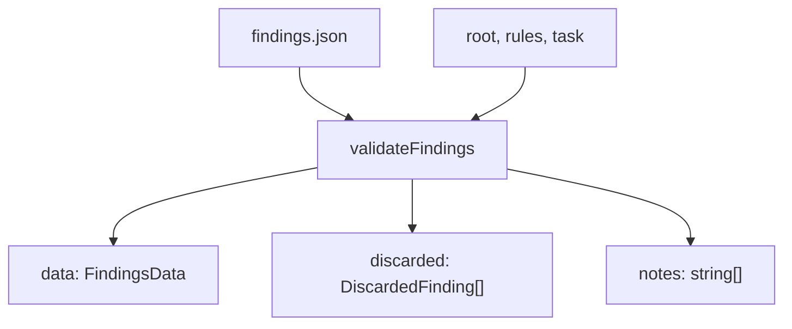

Part 3 · Page 27 of 32 · Previous: [Findings schema](210-findings-schema.md) · Next: [Development](../4-development/10-development.md) · [Index](../README.md)
# Findings validator

**File:** `src/findings/validate.ts` · 654 lines · **Status:** available

## Page index

- What is it and what is it for?
- Before reading the code
- How it fits
- The complete, commented code
- Examples with real data
- Behavior summary
- Where it is used
- Tests

## What is it and what is it for?

Validates and normalizes the findings file produced by isolated review sessions before compiling final reports.

Without this function, malformed file paths, out-of-range line numbers, or fabricated code quotes would cause broken links and incorrect metrics in reports.

It receives raw text or pre-parsed data (JSON) along with the execution context: the repository root, selected project rules, and an optional task specification. It returns a normalized dataset with sorted findings, a list of findings discarded with exact reasons, and diagnostic notes on adjusted optional fields.

Today no command line interface command uses it directly; it will be invoked by the review finish command in subsequent stages.

## Before reading the code

### Filesystem boundary verification

To prevent symbolic links or relative traversals from referencing files outside the project, the resolved canonical path (realpath) is compared against the repository root.

```ts
// path escaping repository root
// → '../outside.ts' discarded with invalid path
```

This prevents information disclosure and invalid cross-repository links.

### Multi-line quote normalization

Before matching quotes, redundant whitespace sequences and tabs are collapsed on both the file source and the incoming quote string.

```ts
// file: '	const total = 1.16;
'
// quote: 'const total = 1.16;'
// → exact match after normalization
```

Ensures minor whitespace differences or Windows carriage returns (CRLF) do not discard legitimate findings.

## How it fits



1. Receives findings text and parses JSON after stripping leading UTF-8 BOM marks if present.
2. Asserts mandatory root structure (version 1, object, findings array, string summary).
3. Inspects each individual finding, confirming file presence, line bounds, and quote fidelity.
4. Resolves cross-references between verified findings and task criteria numbers.
5. Sorts retained findings by severity, file path, and line number, returning the normalized record.

## The complete, commented code

The file contains 653 lines and is presented in consecutive blocks without omitting any line.

### Block 1: Imports, error class, and text utilities

```ts
import { readFile, realpath, stat } from 'node:fs/promises';
import { isAbsolute, relative, resolve, sep } from 'node:path';
import { SEVERITIES } from '../config/rules.js';
import type { Task } from '../config/task.js';
import type { Severity } from '../config/types.js';
import type { SelectedRule } from '../review/select.js';
import {
  FINDINGS_SCHEMA_VERSION,
  type CriterionResult,
  type DiscardedFinding,
  type Finding,
  type FindingsData,
  type OutOfScope,
  type SuggestedRule,
} from './schema.js';

/** Error thrown when a findings file cannot be parsed or accepted as a whole. */
export class FindingsInvalidError extends Error {
  constructor(message: string) {
    super(message);
    this.name = 'FindingsInvalidError';
  }
}

const SEVERITY_ORDER: Record<Severity, number> = {
  critical: 0,
  major: 1,
  minor: 2,
};

/** Compares strings by Unicode code units for deterministic ordering. */
function compareText(a: string, b: string): number {
  return a < b ? -1 : a > b ? 1 : 0;
}

/** Parses raw file content into separate lines without trailing carriage returns. */
function parseLines(content: string): string[] {
  if (content === '') return [];
  const normalized = content.endsWith('\n') ? content.slice(0, -1) : content;
  if (normalized === '') return [];
  return normalized.split('\n').map((line) => line.replace(/\r$/, ''));
}

/** Checks whether a path is safely repository-relative without invalid segments or backslashes. */
function isValidRelativePath(path: string): boolean {
  if (typeof path !== 'string' || path.trim() === '') return false;
```

### Block 2: Path security and repository file verification

```ts
  if (path.includes('\\')) return false;
  if (isAbsolute(path) || path.startsWith('/')) return false;
  const segments = path.split('/');
  for (const seg of segments) {
    if (seg === '' || seg === '.' || seg === '..' || seg.toLowerCase() === '.git') {
      return false;
    }
  }
  return true;
}

/** Validates that a path exists as a regular file and does not escape the repository root. */
async function checkRepoFile(
  root: string,
  relPath: string,
): Promise<{ valid: boolean; reason?: string; fullPath?: string }> {
  if (!isValidRelativePath(relPath)) {
    return { valid: false, reason: `invalid path: ${relPath}` };
  }
  const full = resolve(root, relPath);
  let realRoot: string;
  try {
    realRoot = await realpath(root);
  } catch (err) {
    throw err;
  }
  let realFile: string;
  let fileStat;
  try {
    fileStat = await stat(full);
    realFile = await realpath(full);
  } catch (err: unknown) {
    const code = (err as { code?: string })?.code;
    if (code === 'ENOENT' || code === 'ENOTDIR') {
      return { valid: false, reason: `file not found: ${relPath}` };
    }
    throw err;
  }
  if (!fileStat.isFile()) {
    return { valid: false, reason: `file not found: ${relPath}` };
  }
  const relToRealRoot = relative(realRoot, realFile);
  if (relToRealRoot === '..' || relToRealRoot.startsWith(`..${sep}`) || isAbsolute(relToRealRoot)) {
    return { valid: false, reason: `invalid path: ${relPath}` };
  }
  return { valid: true, fullPath: full };
}

/** Constructs a normalized DiscardedFinding entry with positional fallback values. */
function makeDiscardedFinding(item: unknown, position: number, reason: string): DiscardedFinding {
  if (item !== null && typeof item === 'object') {
    const rec = item as Record<string, unknown>;
    const id = typeof rec.id === 'string' && rec.id.trim().length > 0 ? rec.id.trim() : `#${position}`;
    const title = typeof rec.title === 'string' ? rec.title.trim() : '';
    return { id, title, reason };
  }
  return { id: `#${position}`, title: '', reason };
}

interface IntermediateFinding {
  finding: Finding;
  rawRelatedFindings: string[];
  rawRelatedCriteria: number[];
```

### Block 3: Discarded record construction and global schema validation

```ts
  inputIndex: number;
}

/** Validates, normalizes, and filters findings dataset against repository files, rules, and task. */
export async function validateFindings(
  raw: unknown,
  ctx: { root: string; rules: SelectedRule[]; task?: Task },
): Promise<{ data: FindingsData; discarded: DiscardedFinding[]; notes: string[] }> {
  let parsed: unknown = raw;
  if (typeof raw === 'string') {
    const stripped = raw.replace(/^\uFEFF/, '');
    try {
      parsed = JSON.parse(stripped);
    } catch (error) {
      const detail = error instanceof Error ? error.message : String(error);
      throw new FindingsInvalidError(`findings content is not valid JSON: ${detail}`);
    }
  }

  if (parsed === null || typeof parsed !== 'object' || Array.isArray(parsed)) {
    throw new FindingsInvalidError('findings data must be an object');
  }

  const record = parsed as Record<string, unknown>;
  if (record.schema_version !== 1) {
    throw new FindingsInvalidError('schema_version must be 1');
  }
  if (!Array.isArray(record.findings)) {
    throw new FindingsInvalidError('findings must be an array');
  }
  if (typeof record.summary !== 'string') {
    throw new FindingsInvalidError('summary must be a string');
  }

  const notes: string[] = [];
  const programDiscarded: DiscardedFinding[] = [];
  const fileCache = new Map<string, string[]>();
  const seenIds = new Set<string>();
  const intermediateFindings: IntermediateFinding[] = [];

  for (let i = 0; i < record.findings.length; i++) {
    const position = i + 1;
    const rawItem = record.findings[i];
    if (rawItem === null || typeof rawItem !== 'object' || Array.isArray(rawItem)) {
      programDiscarded.push(makeDiscardedFinding(rawItem, position, 'finding is not an object'));
      continue;
    }

    const item = rawItem as Record<string, unknown>;

    if (typeof item.id !== 'string' || item.id.trim().length === 0) {
      programDiscarded.push(makeDiscardedFinding(item, position, 'missing or invalid field: id'));
      continue;
    }

    const trimmedId = item.id.trim();
    const lowerId = trimmedId.toLowerCase();
    if (seenIds.has(lowerId)) {
      programDiscarded.push(makeDiscardedFinding(item, position, `duplicate id: ${trimmedId}`));
      continue;
    }
    seenIds.add(lowerId);

    if (typeof item.title !== 'string' || item.title.trim().length === 0) {
      programDiscarded.push(makeDiscardedFinding(item, position, 'missing or invalid field: title'));
      continue;
    }

    if (typeof item.file !== 'string' || item.file.trim().length === 0) {
      programDiscarded.push(makeDiscardedFinding(item, position, 'missing or invalid field: file'));
      continue;
    }

    if (typeof item.impact !== 'string' || item.impact.trim().length === 0) {
      programDiscarded.push(makeDiscardedFinding(item, position, 'missing or invalid field: impact'));
      continue;
    }

    if (item.severity === undefined || typeof item.severity !== 'string') {
```

### Block 4: Findings loop: identifiers, mandatory fields, and rule resolution

```ts
      programDiscarded.push(makeDiscardedFinding(item, position, 'missing or invalid field: severity'));
      continue;
    }

    const mappedSeverity = SEVERITIES[item.severity.trim().toLowerCase()];
    if (!mappedSeverity) {
      programDiscarded.push(makeDiscardedFinding(item, position, `invalid severity: ${item.severity.trim()}`));
      continue;
    }

    const wholeFile = item.whole_file === true;
    let line: number | undefined;
    let endLine: number | undefined;

    if (!wholeFile) {
      if (item.line === undefined || typeof item.line !== 'number' || !Number.isInteger(item.line) || item.line < 1) {
        programDiscarded.push(makeDiscardedFinding(item, position, 'missing or invalid field: line'));
        continue;
      }
      line = item.line;

      if (item.end_line === undefined || item.end_line === null) {
        endLine = line;
      } else if (typeof item.end_line !== 'number' || !Number.isInteger(item.end_line) || item.end_line < 1) {
        programDiscarded.push(makeDiscardedFinding(item, position, 'missing or invalid field: end_line'));
        continue;
      } else {
        endLine = item.end_line;
      }

      if (endLine < line) {
        programDiscarded.push(makeDiscardedFinding(item, position, 'end_line is before line'));
        continue;
      }

      if (typeof item.quote !== 'string' || item.quote.trim().length === 0) {
        programDiscarded.push(makeDiscardedFinding(item, position, 'missing or invalid field: quote'));
        continue;
      }
    } else {
      if (typeof item.quote !== 'string' || item.quote.trim().length === 0) {
        programDiscarded.push(makeDiscardedFinding(item, position, 'missing or invalid field: quote'));
        continue;
      }
    }

    let canonicalRuleId: string | undefined;
    if (item.rule_id !== undefined && item.rule_id !== null) {
      if (typeof item.rule_id !== 'string') {
        programDiscarded.push(makeDiscardedFinding(item, position, `rule ${item.rule_id} is not among the selected rules`));
        continue;
      }
      const trimmedRuleId = item.rule_id.trim();
      const matched = ctx.rules.find((r) => r.rule.id.toLowerCase() === trimmedRuleId.toLowerCase());
      if (!matched) {
        programDiscarded.push(makeDiscardedFinding(item, position, `rule ${trimmedRuleId} is not among the selected rules`));
        continue;
      }
      canonicalRuleId = matched.rule.id;
    }

    const fileCheck = await checkRepoFile(ctx.root, item.file.trim());
    if (!fileCheck.valid) {
      programDiscarded.push(makeDiscardedFinding(item, position, fileCheck.reason!));
      continue;
    }

    let fileLines = fileCache.get(item.file.trim());
    if (fileLines === undefined) {
      const content = await readFile(fileCheck.fullPath!, 'utf8');
      fileLines = parseLines(content);
      fileCache.set(item.file.trim(), fileLines);
    }
    const totalLines = fileLines.length;

    if (!wholeFile && line !== undefined && endLine !== undefined) {
      if (line > totalLines) {
        programDiscarded.push(
          makeDiscardedFinding(item, position, `line ${line} is outside ${item.file.trim()} (${totalLines} lines)`),
        );
        continue;
      }
      if (endLine > totalLines) {
        programDiscarded.push(
          makeDiscardedFinding(item, position, `line ${endLine} is outside ${item.file.trim()} (${totalLines} lines)`),
        );
        continue;
      }

      const quoteLinesRaw = (item.quote as string).split('\n');
      while (quoteLinesRaw.length > 0 && quoteLinesRaw[0].trim() === '') {
        quoteLinesRaw.shift();
      }
      while (quoteLinesRaw.length > 0 && quoteLinesRaw[quoteLinesRaw.length - 1].trim() === '') {
        quoteLinesRaw.pop();
      }
      if (quoteLinesRaw.length === 0) {
        programDiscarded.push(makeDiscardedFinding(item, position, 'missing or invalid field: quote'));
        continue;
      }
      const normQuote = quoteLinesRaw.map((l) => l.trim().replace(/[ \t]+/g, ' ')).join('\n');
      const fileSlice = fileLines.slice(line - 1, endLine);
      const normFile = fileSlice.map((l) => l.trim().replace(/[ \t]+/g, ' ')).join('\n');
      if (!normFile.includes(normQuote)) {
        programDiscarded.push(
          makeDiscardedFinding(item, position, `quote not found in ${item.file.trim()} at lines ${line}-${endLine}`),
        );
        continue;
      }
    }

    let suggestion: { startLine: number; code: string } | undefined;
    if (item.suggestion !== undefined && item.suggestion !== null) {
      if (typeof item.suggestion === 'object' && !Array.isArray(item.suggestion)) {
        const sug = item.suggestion as Record<string, unknown>;
        const startLine = sug.start_line;
        const code = sug.code;
        if (
          typeof startLine === 'number'
          && Number.isInteger(startLine)
          && startLine >= 1
          && startLine <= totalLines
          && typeof code === 'string'
        ) {
          suggestion = { startLine, code };
        } else {
          notes.push(`invalid suggestion in finding ${trimmedId}, removed`);
        }
      } else {
        notes.push(`invalid suggestion in finding ${trimmedId}, removed`);
      }
    }
```

### Block 5: Findings loop: line bounds, quote verification, and optional fields

```ts

    let existing: { file: string; line?: number; note: string } | undefined;
    if (item.existing !== undefined && item.existing !== null) {
      if (typeof item.existing === 'object' && !Array.isArray(item.existing)) {
        const ex = item.existing as Record<string, unknown>;
        if (typeof ex.file === 'string' && typeof ex.note === 'string') {
          const exCheck = await checkRepoFile(ctx.root, ex.file.trim());
          let exLineValid = true;
          let exLine: number | undefined;
          if (exCheck.valid) {
            let exLines = fileCache.get(ex.file.trim());
            if (exLines === undefined) {
              const exContent = await readFile(exCheck.fullPath!, 'utf8');
              exLines = parseLines(exContent);
              fileCache.set(ex.file.trim(), exLines);
            }
            if (ex.line !== undefined && ex.line !== null) {
              if (
                typeof ex.line === 'number'
                && Number.isInteger(ex.line)
                && ex.line >= 1
                && ex.line <= exLines.length
              ) {
                exLine = ex.line;
              } else {
                exLineValid = false;
              }
            }
          } else {
            exLineValid = false;
          }
          if (exCheck.valid && exLineValid) {
            existing = { file: ex.file.trim(), line: exLine, note: ex.note };
          } else {
            notes.push(`invalid existing reference in finding ${trimmedId}, removed`);
          }
        } else {
          notes.push(`invalid existing reference in finding ${trimmedId}, removed`);
        }
      } else {
        notes.push(`invalid existing reference in finding ${trimmedId}, removed`);
      }
    }

    let verified = false;
    if (item.verified !== undefined && item.verified !== null) {
      if (typeof item.verified === 'boolean') {
        verified = item.verified;
      } else {
        verified = false;
        notes.push(`invalid type for verified in finding ${trimmedId}, defaulting to false`);
      }
    }

    let relatedNote: string | undefined;
    if (item.related_note !== undefined && item.related_note !== null) {
      if (typeof item.related_note === 'string') {
        relatedNote = item.related_note;
      } else {
        notes.push(`invalid related_note in finding ${trimmedId}, removed`);
      }
    }

    let rawRelatedFindings: string[] = [];
    if (item.related_findings !== undefined && item.related_findings !== null) {
      if (Array.isArray(item.related_findings) && item.related_findings.every((rf) => typeof rf === 'string')) {
        rawRelatedFindings = item.related_findings;
      } else {
        notes.push(`invalid related_findings in finding ${trimmedId}, removed`);
      }
    }

    let rawRelatedCriteria: number[] = [];
    if (item.related_criteria !== undefined && item.related_criteria !== null) {
      if (Array.isArray(item.related_criteria) && item.related_criteria.every((rc) => typeof rc === 'number' && Number.isInteger(rc))) {
        rawRelatedCriteria = item.related_criteria;
      } else {
        notes.push(`invalid related_criteria in finding ${trimmedId}, removed`);
      }
    }

    const finding: Finding = {
      id: trimmedId,
      title: item.title.trim(),
      severity: mappedSeverity,
      file: item.file.trim(),
      quote: item.quote as string,
      impact: item.impact.trim(),
      verified,
      wholeFile,
      line,
      endLine,
      suggestion,
      ruleId: canonicalRuleId,
      relatedFindings: [],
      relatedCriteria: [],
      relatedNote,
      existing,
    };

    intermediateFindings.push({
      finding,
      rawRelatedFindings,
      rawRelatedCriteria,
      inputIndex: i,
    });
  }

  const keptIds = new Map<string, string>();
  for (const entry of intermediateFindings) {
    keptIds.set(entry.finding.id.toLowerCase(), entry.finding.id);
  }

  for (const entry of intermediateFindings) {
    const resolvedFindings: string[] = [];
    for (const ref of entry.rawRelatedFindings) {
      const canonical = keptIds.get(ref.trim().toLowerCase());
      if (
        canonical !== undefined
        && canonical.toLowerCase() !== entry.finding.id.toLowerCase()
        && !resolvedFindings.includes(canonical)
      ) {
        resolvedFindings.push(canonical);
      }
    }
    entry.finding.relatedFindings = resolvedFindings;

    const resolvedCriteria: number[] = [];
    if (ctx.task) {
      for (const num of entry.rawRelatedCriteria) {
        if (num >= 1 && num <= ctx.task.criteria.length && !resolvedCriteria.includes(num)) {
          resolvedCriteria.push(num);
        }
      }
    }
    entry.finding.relatedCriteria = resolvedCriteria;
  }

  intermediateFindings.sort((a, b) => {
    const sevDiff = SEVERITY_ORDER[a.finding.severity] - SEVERITY_ORDER[b.finding.severity];
    if (sevDiff !== 0) return sevDiff;
    const fileDiff = compareText(a.finding.file, b.finding.file);
    if (fileDiff !== 0) return fileDiff;
    if (a.finding.wholeFile && !b.finding.wholeFile) return -1;
    if (!a.finding.wholeFile && b.finding.wholeFile) return 1;
    const lineDiff = (a.finding.line ?? 0) - (b.finding.line ?? 0);
    if (lineDiff !== 0) return lineDiff;
    return a.inputIndex - b.inputIndex;
  });

  const sortedFindings = intermediateFindings.map((entry) => entry.finding);

  const criteriaResults: CriterionResult[] = [];
  if (ctx.task) {
    const rawCriteriaMap = new Map<number, { status: 'met' | 'partial' | 'not_met'; reason?: string }>();
    if (record.criteria !== undefined && record.criteria !== null) {
      if (!Array.isArray(record.criteria)) {
```

### Block 6: Cross-reference resolution and deterministic finding ordering

```ts
        notes.push('criteria must be an array, ignored');
      } else {
        for (const rawCriterion of record.criteria) {
          if (rawCriterion === null || typeof rawCriterion !== 'object' || Array.isArray(rawCriterion)) {
            notes.push('criterion entry must be an object, ignored');
            continue;
          }
          const c = rawCriterion as Record<string, unknown>;
          const num = c.number;
          const status = c.status;
          const reason = typeof c.reason === 'string' ? c.reason : undefined;
          if (
            typeof num !== 'number'
            || !Number.isInteger(num)
            || num < 1
            || num > ctx.task.criteria.length
            || (status !== 'met' && status !== 'partial' && status !== 'not_met')
            || (c.reason !== undefined && c.reason !== null && typeof c.reason !== 'string')
          ) {
            notes.push(`invalid criterion entry ${JSON.stringify(c)}, ignored`);
            continue;
          }
          if (rawCriteriaMap.has(num)) {
            notes.push(`duplicate criterion number ${num}, first entry retained`);
            continue;
          }
          rawCriteriaMap.set(num, { status, reason });
        }
      }
    }

    for (let idx = 0; idx < ctx.task.criteria.length; idx++) {
      const num = idx + 1;
      const text = ctx.task.criteria[idx];
      const match = rawCriteriaMap.get(num);
      if (match) {
        const item: CriterionResult = { number: num, text, status: match.status };
        if (match.reason !== undefined) item.reason = match.reason;
        criteriaResults.push(item);
      } else {
        criteriaResults.push({ number: num, text, status: 'not_evaluated' });
      }
    }
  }

  const outOfScope: OutOfScope[] = [];
  if (record.out_of_scope !== undefined && record.out_of_scope !== null) {
    if (!Array.isArray(record.out_of_scope)) {
      notes.push('out_of_scope must be an array, ignored');
    } else {
      for (const item of record.out_of_scope) {
        if (item === null || typeof item !== 'object' || Array.isArray(item)) {
          notes.push('out_of_scope entry must be an object, ignored');
          continue;
        }
        const oos = item as Record<string, unknown>;
        if (typeof oos.file !== 'string' || typeof oos.note !== 'string') {
          notes.push(`invalid out_of_scope entry ${JSON.stringify(oos)}, ignored`);
          continue;
        }
        const oosCheck = await checkRepoFile(ctx.root, oos.file.trim());
```

### Block 7: Acceptance criteria normalization

```ts
        if (!oosCheck.valid) {
          notes.push(`invalid out_of_scope file "${oos.file}": ${oosCheck.reason}, ignored`);
          continue;
        }
        let oosLine: number | undefined;
        if (oos.line !== undefined && oos.line !== null) {
          let oosLines = fileCache.get(oos.file.trim());
          if (oosLines === undefined) {
            const oosContent = await readFile(oosCheck.fullPath!, 'utf8');
            oosLines = parseLines(oosContent);
            fileCache.set(oos.file.trim(), oosLines);
          }
          if (
            typeof oos.line === 'number'
            && Number.isInteger(oos.line)
            && oos.line >= 1
            && oos.line <= oosLines.length
          ) {
            oosLine = oos.line;
          } else {
            notes.push(`line ${oos.line} is outside ${oos.file} in out_of_scope, ignored`);
            continue;
          }
        }
        outOfScope.push({ file: oos.file.trim(), line: oosLine, note: oos.note });
      }
    }
  }

  let ideas: string[] = [];
  if (record.ideas !== undefined && record.ideas !== null) {
    if (!Array.isArray(record.ideas)) {
      notes.push('ideas must be an array, ignored');
    } else {
      const validIdeas = record.ideas.filter((i): i is string => typeof i === 'string');
      if (validIdeas.length > 5) {
        ideas = validIdeas.slice(0, 5);
        notes.push(`retained first 5 ideas (received ${validIdeas.length})`);
      } else {
        ideas = validIdeas;
      }
    }
  }

  let impact: string[] = [];
  if (record.impact !== undefined && record.impact !== null) {
    if (!Array.isArray(record.impact)) {
```

### Block 8: Auxiliary collections normalization and return statement

```ts
      notes.push('impact must be an array, ignored');
    } else {
      impact = record.impact.filter((i): i is string => typeof i === 'string');
    }
  }

  const suggestedRules: SuggestedRule[] = [];
  if (record.suggested_rules !== undefined && record.suggested_rules !== null) {
    if (!Array.isArray(record.suggested_rules)) {
      notes.push('suggested_rules must be an array, ignored');
    } else {
      for (const item of record.suggested_rules) {
        if (item === null || typeof item !== 'object' || Array.isArray(item)) {
          notes.push('suggested_rules entry must be an object, ignored');
          continue;
        }
        const sr = item as Record<string, unknown>;
        if (typeof sr.text !== 'string') {
          notes.push('suggested_rules entry missing text, ignored');
          continue;
        }
        const ruleEntry: SuggestedRule = { text: sr.text };
        if (typeof sr.from_finding === 'string') {
          const matchedTarget = keptIds.get(sr.from_finding.trim().toLowerCase());
          if (matchedTarget) {
            ruleEntry.fromFinding = matchedTarget;
          }
        }
        suggestedRules.push(ruleEntry);
      }
    }
  }

  const inputDiscarded: DiscardedFinding[] = [];
  if (record.discarded !== undefined && record.discarded !== null) {
    if (!Array.isArray(record.discarded)) {
      notes.push('discarded must be an array, ignored');
    } else {
      for (let i = 0; i < record.discarded.length; i++) {
        const item = record.discarded[i];
        if (item !== null && typeof item === 'object' && !Array.isArray(item)) {
          const d = item as Record<string, unknown>;
          const id = typeof d.id === 'string' && d.id.trim().length > 0 ? d.id.trim() : `#${i + 1}`;
          const title = typeof d.title === 'string' ? d.title.trim() : '';
          const reason = typeof d.reason === 'string' ? d.reason : '';
          inputDiscarded.push({ id, title, reason });
        } else {
          inputDiscarded.push({ id: `#${i + 1}`, title: '', reason: '' });
        }
      }
    }
  }

  return {
    data: {
      schemaVersion: FINDINGS_SCHEMA_VERSION,
      summary: record.summary as string,
      criteria: criteriaResults,
      findings: sortedFindings,
      outOfScope,
      ideas,
      suggestedRules,
      impact,
      discarded: inputDiscarded,
    },
    discarded: programDiscarded,
    notes,
  };
}

```

## Examples with real data

### Example 1: Plan example with 0 discarded findings

Input:

```json
{
  "schema_version": 1,
  "summary": "Tres líneas como máximo: qué hizo el cambio y qué está mal.",
  "criteria": [
    {
      "number": 2,
      "status": "not_met",
      "reason": "Lo calcula con decimales."
    }
  ],
  "findings": [
    {
      "id": "F1",
      "title": "El total se calcula con decimales y puede cobrar mal",
      "severity": "critical",
      "file": "src/billing/total.ts",
      "line": 41,
      "end_line": 41,
      "whole_file": false,
      "quote": "const total = price * 1.16",
      "impact": "Qué pasaría en la práctica.",
      "suggestion": {
        "start_line": 40,
        "code": "const priceCents = item.priceCents\n…"
      },
      "rule_id": "BIZ-003",
      "related_findings": [],
      "related_criteria": [
        2
      ],
      "related_note": "Se resuelve también con el problema 3.",
      "existing": {
        "file": "src/ui/Button.tsx",
        "line": 1,
        "note": "Botón con estado «cargando»."
      },
      "verified": true
    }
  ],
  "out_of_scope": [
    {
      "file": "src/auth/session.ts",
      "line": 88,
      "note": "Sesiones de usuario."
    }
  ],
  "ideas": [
    "El cálculo del IVA está repetido en dos lugares."
  ],
  "suggested_rules": [
    {
      "text": "Todo botón que cobre se desactiva mientras espera.",
      "from_finding": "F1"
    }
  ],
  "impact": [
    "El total también lo usan las facturas y los reembolsos."
  ],
  "discarded": [
    {
      "id": "F7",
      "title": "…",
      "reason": "El verificador encontró la validación en la línea 12."
    }
  ]
}
```

Output:

```json
{
  "data": {
    "schemaVersion": 1,
    "summary": "Tres líneas como máximo: qué hizo el cambio y qué está mal.",
    "criteria": [
      {
        "number": 1,
        "text": "Botón «Pagar» visible en el checkout.",
        "status": "not_evaluated"
      },
      {
        "number": 2,
        "text": "Total con IVA calculado en centavos.",
        "status": "not_met",
        "reason": "Lo calcula con decimales."
      },
      {
        "number": 3,
        "text": "Mensaje si el cobro falla, con opción de reintentar.",
        "status": "not_evaluated"
      }
    ],
    "findings": [
      {
        "id": "F1",
        "title": "El total se calcula con decimales y puede cobrar mal",
        "severity": "critical",
        "file": "src/billing/total.ts",
        "quote": "const total = price * 1.16",
        "impact": "Qué pasaría en la práctica.",
        "verified": true,
        "wholeFile": false,
        "line": 41,
        "endLine": 41,
        "suggestion": {
          "startLine": 40,
          "code": "const priceCents = item.priceCents\n…"
        },
        "ruleId": "BIZ-003",
        "relatedFindings": [],
        "relatedCriteria": [
          2
        ],
        "relatedNote": "Se resuelve también con el problema 3.",
        "existing": {
          "file": "src/ui/Button.tsx",
          "line": 1,
          "note": "Botón con estado «cargando»."
        }
      }
    ],
    "outOfScope": [
      {
        "file": "src/auth/session.ts",
        "line": 88,
        "note": "Sesiones de usuario."
      }
    ],
    "ideas": [
      "El cálculo del IVA está repetido en dos lugares."
    ],
    "suggestedRules": [
      {
        "text": "Todo botón que cobre se desactiva mientras espera.",
        "fromFinding": "F1"
      }
    ],
    "impact": [
      "El total también lo usan las facturas y los reembolsos."
    ],
    "discarded": [
      {
        "id": "F7",
        "title": "…",
        "reason": "El verificador encontró la validación en la línea 12."
      }
    ]
  },
  "discarded": [],
  "notes": []
}
```

### Example 2: Incorrect code quote in finding

Input:

```json
{
  "schema_version": 1,
  "summary": "Revisión con cita incorrecta.",
  "findings": [
    {
      "id": "F1",
      "title": "Error de cálculo",
      "severity": "critical",
      "file": "src/billing/total.ts",
      "line": 41,
      "end_line": 41,
      "quote": "const total = price * 1.15",
      "impact": "Cálculo incorrecto"
    }
  ]
}
```

Output:

```json
{
  "data": {
    "schemaVersion": 1,
    "summary": "Revisión con cita incorrecta.",
    "criteria": [
      {
        "number": 1,
        "text": "Botón «Pagar» visible en el checkout.",
        "status": "not_evaluated"
      },
      {
        "number": 2,
        "text": "Total con IVA calculado en centavos.",
        "status": "not_evaluated"
      },
      {
        "number": 3,
        "text": "Mensaje si el cobro falla, con opción de reintentar.",
        "status": "not_evaluated"
      }
    ],
    "findings": [],
    "outOfScope": [],
    "ideas": [],
    "suggestedRules": [],
    "impact": [],
    "discarded": []
  },
  "discarded": [
    {
      "id": "F1",
      "title": "Error de cálculo",
      "reason": "quote not found in src/billing/total.ts at lines 41-41"
    }
  ],
  "notes": []
}
```

### Example 3: Path outside repository boundary

Input:

```json
{
  "schema_version": 1,
  "summary": "Revisión con ruta fuera del repositorio.",
  "findings": [
    {
      "id": "F1",
      "title": "Ruta no válida",
      "severity": "major",
      "file": "../outside.ts",
      "line": 1,
      "quote": "const x = 1;",
      "impact": "Ruta que escapa del proyecto"
    }
  ]
}
```

Output:

```json
{
  "data": {
    "schemaVersion": 1,
    "summary": "Revisión con ruta fuera del repositorio.",
    "criteria": [
      {
        "number": 1,
        "text": "Botón «Pagar» visible en el checkout.",
        "status": "not_evaluated"
      },
      {
        "number": 2,
        "text": "Total con IVA calculado en centavos.",
        "status": "not_evaluated"
      },
      {
        "number": 3,
        "text": "Mensaje si el cobro falla, con opción de reintentar.",
        "status": "not_evaluated"
      }
    ],
    "findings": [],
    "outOfScope": [],
    "ideas": [],
    "suggestedRules": [],
    "impact": [],
    "discarded": []
  },
  "discarded": [
    {
      "id": "F1",
      "title": "Ruta no válida",
      "reason": "invalid path: ../outside.ts"
    }
  ],
  "notes": []
}
```

### Example 4: Criteria resulting in not_evaluated

Input:

```json
{
  "schema_version": 1,
  "summary": "Revisión con evaluación parcial de criterios.",
  "criteria": [
    {
      "number": 1,
      "status": "met"
    }
  ],
  "findings": []
}
```

Output:

```json
{
  "data": {
    "schemaVersion": 1,
    "summary": "Revisión con evaluación parcial de criterios.",
    "criteria": [
      {
        "number": 1,
        "text": "Botón «Pagar» visible en el checkout.",
        "status": "met"
      },
      {
        "number": 2,
        "text": "Total con IVA calculado en centavos.",
        "status": "not_evaluated"
      },
      {
        "number": 3,
        "text": "Mensaje si el cobro falla, con opción de reintentar.",
        "status": "not_evaluated"
      }
    ],
    "findings": [],
    "outOfScope": [],
    "ideas": [],
    "suggestedRules": [],
    "impact": [],
    "discarded": []
  },
  "discarded": [],
  "notes": []
}
```

### Example 5: Seven ideas received

Input:

```json
{
  "schema_version": 1,
  "summary": "Revisión con siete ideas de mejora.",
  "findings": [],
  "ideas": [
    "Centralizar el cálculo del IVA en una sola función.",
    "Agregar validación estricta de esquemas antes del procesamiento.",
    "Documentar los tipos de moneda admitidos en el módulo de facturación.",
    "Separar la lógica de negocio de los componentes de interfaz.",
    "Incorporar pruebas de integración para reembolsos parciales.",
    "Configurar alertas automáticas para discrepancias en decimales.",
    "Añadir telemetría para medir la latencia del proceso de pago."
  ]
}
```

Output:

```json
{
  "data": {
    "schemaVersion": 1,
    "summary": "Revisión con siete ideas de mejora.",
    "criteria": [
      {
        "number": 1,
        "text": "Botón «Pagar» visible en el checkout.",
        "status": "not_evaluated"
      },
      {
        "number": 2,
        "text": "Total con IVA calculado en centavos.",
        "status": "not_evaluated"
      },
      {
        "number": 3,
        "text": "Mensaje si el cobro falla, con opción de reintentar.",
        "status": "not_evaluated"
      }
    ],
    "findings": [],
    "outOfScope": [],
    "ideas": [
      "Centralizar el cálculo del IVA en una sola función.",
      "Agregar validación estricta de esquemas antes del procesamiento.",
      "Documentar los tipos de moneda admitidos en el módulo de facturación.",
      "Separar la lógica de negocio de los componentes de interfaz.",
      "Incorporar pruebas de integración para reembolsos parciales."
    ],
    "suggestedRules": [],
    "impact": [],
    "discarded": []
  },
  "discarded": [],
  "notes": [
    "retained first 5 ideas (received 7)"
  ]
}
```

## Behavior summary

- **Non-JSON input or schema version other than 1:** Throws `FindingsInvalidError`.
- **Quote differing from disk content:** Discards finding with `quote not found in <file> at lines <line>-<end_line>`.
- **Path escaping repository root or symlink pointing outside:** Discards with `invalid path: <file>`.
- **Files starting with double dots (`..`):** Valid files whose names start with `..` (such as `..foo.ts`) inside the repository are accepted, restricting invalid path discards to paths actually escaping the repository root or external symlinks.
- **Missing file or directory component where file expected:** Discards with `file not found: <file>`.
- **Line number exceeding total file lines:** Discards with `line <n> is outside <file> (<total> lines)`.
- **Optional fields set to `null`:** Across any optional field (finding level, top level, or list items), `null` is interpreted identically to omitting the field without discards or notes; only `line: null` without `whole_file` produces a discard for missing `line`.
- **Duplicate finding identifier:** Discards subsequent entry with `duplicate id: <id>`.
- **Rule missing from selected rules:** Discards with `rule <rule_id> is not among the selected rules`.
- **Unaddressed criteria:** Assigned status `not_evaluated` with original task text.
- **More than five ideas:** Retains first five and adds notification in notes.

## Where it is used

- Uses: `node:fs/promises:1`, `node:path:2`, `src/config/rules.ts:9`, `src/config/task.ts:7`, `src/config/types.ts:3`, `src/review/select.ts:14`, and `src/findings/schema.ts:4`.
- Used by: `src/findings/validate.test.ts:9`.
- Today no command line interface command uses it directly.

## Tests

- `src/findings/validate.test.ts`: validates the plan example with zero discards, total file rejection, quote mismatches, CRLF and tab normalization, path escapes, unselected rules, severity aliases, multi-line quotes, idea limits, BOM headers, external symlinks, ENOTDIR errors, deterministic ordering, and positional discard identifiers.

Part 3 · Page 27 of 32 · Previous: [Findings schema](210-findings-schema.md) · Next: [Development](../4-development/10-development.md) · [Index](../README.md)

