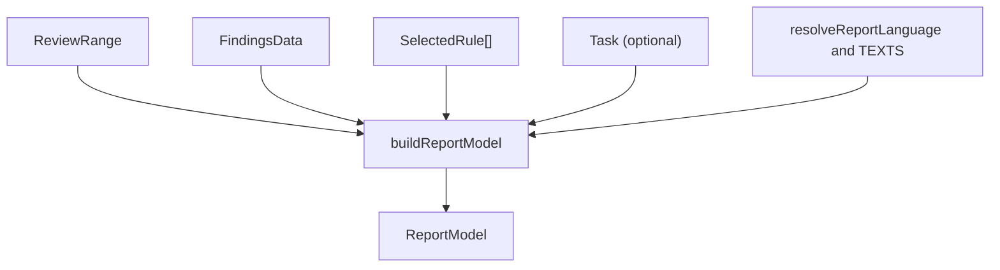

Part 3 · Page 28 of 34 · Previous: [Findings validator](220-findings-validate.md) · Next: [Fixed texts and language](240-report-i18n.md) · [Index](../README.md)
# Report model

**File:** `src/report/model.ts` · 573 lines · **Status:** available

## Page index

- What is it and what is it for?
- Before reading the code
- How it fits
- The complete, commented code
- Examples with real data
- Behavior summary
- Where it is used
- Tests

## What is it and what is it for?

Builds the unified data structure (view model) feeding the final reports in HTML and Markdown formats. Without this module, each output view would need to independently resolve context lines, verdicts, applied rules, and file statuses, risking discrepancy where the web report and pull request summary say different things.

It receives validated review data: repository root, run identifier and creation timestamp, Git scope range, selected rules, optional task brief, validated findings, and discarded records. It returns a `ReportModel` instance containing all resolved data (titles, formatted dates, "Today" code excerpts, suggestion diffs, links, and operational details) without applying HTML or Markdown markup, leaving escaping and presentation to the respective views. Currently no command line entry point consumes it directly; upcoming tasks will connect report renderers and the `review --finish` command.

## Before reading the code

### Review verdict

Determines whether the reviewed changes can be approved. If there is at least one critical or major finding, the review is considered not approved; if only minor findings remain or the list is empty, it is approved.

```ts
// input: [{ severity: 'minor' }, { severity: 'major' }]
// → 'not_approved'
```

### Context lines and highlighting

For each code issue, two lines before and two lines after the affected section are extracted directly from the actual repository file. Lines spanning from start line to end line are flagged as marked for visual highlighting.

```ts
// 50-line file, finding at line 41
// → lines 39 to 43, with 41 marked
```

### Task objective clipping for title

The report title is extracted from the first sentence of the task objective. If that sentence exceeds 80 characters, it is truncated at the last whitespace boundary and an ellipsis is appended.

```ts
// input: "Botón de pago en el checkout. Usa el componente."
// → "Botón de pago en el checkout"
```

## How it fits



1. `buildReportModel` determines the user interface language (`ui`) and string catalog via `resolveReportLanguage`.
2. Computes the overall verdict by invoking `computeVerdict`.
3. Reads and caches repository files to assemble "Today" code blocks, whole-file views, and suggestion line markers.
4. Resolves cross-references between finding IDs, task criteria, and suggested rules.
5. Groups operational audit details (Git range, commits, rule matching reasons, discarded records, and file statuses).

## The complete, commented code

```ts
import { readFile } from 'node:fs/promises';
import { isAbsolute, resolve } from 'node:path';
import type { Task } from '../config/task.js';
import type { Problem, RuleKind, Severity } from '../config/types.js';
import type {
  CriterionResult,
  DiscardedFinding,
  Finding,
  FindingsData,
  OutOfScope,
} from '../findings/schema.js';
import type { ReviewRange } from '../review/types.js';
import type { SelectedRule } from '../review/select.js';
import {
  type RangeDescriptionParams,
  type ReportDateParts,
  type ReportTexts,
  resolveReportLanguage,
  TEXTS,
} from './i18n.js';

/** Final code review evaluation verdict. */
export type Verdict = 'approved' | 'not_approved';

/** One line of code with display line number and highlighting flag. */
export interface CodeLine {
  number: number;
  text: string;
  marked: boolean;
}

/** Normalized finding representation prepared for report templates. */
export interface ReportFinding {
  number: number;
  id: string;
  title: string;
  severity: Severity;
  file: string;
  line?: number;
  endLine?: number;
  wholeFile: boolean;
  impact: string;
  today?: CodeLine[];
  wholeFileView?: {
    lines: CodeLine[];
    total: number;
    truncated: boolean;
  };
  suggestion?: CodeLine[];
  rule?: {
    id: string;
    title: string;
    kind: RuleKind;
    severity: Severity;
    file: string;
  };
  suggestedRuleBelow: boolean;
  related: {
    findings: { number: number; title: string }[];
    criteria: { number: number; status: 'met' | 'partial' | 'not_met' | 'not_evaluated' }[];
    note?: string;
  };
  existing?: {
    file: string;
    line?: number;
    note: string;
  };
  verified: boolean;
  certainty: string;
}

/** Suggested rule with optional reference finding number. */
export interface ReportSuggestedRule {
  text: string;
  fromNumber?: number;
}

/** Detailed description of a selected rule in the report details section. */
export interface ReportRuleDetails {
  id: string;
  title: string;
  kind: RuleKind;
  severity: Severity;
  file: string;
  reasons: string[];
}

/** Formatted range metrics and description. */
export interface ReportRangeDetails {
  mode: 'branch' | 'unpushed' | 'since-run' | 'since-ref';
  baseLabel: string;
  baseShort: string;
  headShort: string;
  commits: number;
  uncommitted: number;
  files: number;
  added: number;
  removed: number;
  text: string;
}

/** Reviewed file entry with diagnostic status and problem references. */
export interface ReportFileDetails {
  path: string;
  oldPath?: string;
  status: 'added' | 'modified' | 'deleted' | 'renamed';
  problems: number[];
  outOfScope: boolean;
}

/** Supplementary operational details included in the report footer. */
export interface ReportDetails {
  range: ReportRangeDetails;
  commits: { sha: string; subject: string }[];
  rules: {
    selected: number;
    total: number;
    summary: string;
    items: ReportRuleDetails[];
  };
  sessions: string[];
  discardedBySession: DiscardedFinding[];
  discardedByValidation: DiscardedFinding[];
  validationNotes: string[];
  configProblems: Problem[];
  ignoredByConfig: string[];
  languageFallback: string | null;
  files: ReportFileDetails[];
}

/** Complete normalized view model backing HTML and Markdown report generation. */
export interface ReportModel {
  ui: 'en' | 'es';
  texts: ReportTexts;
  root: string;
  runId: string;
  title: string;
  taskId?: string;
  branch: string | null;
  headShort: string;
  date: string;
  verdict: Verdict;
  summary: string;
  large: boolean;
  criteria: {
    evaluated: boolean;
    items: CriterionResult[];
    met: number;
    total: number;
  };
  findings: ReportFinding[];
  impact: string[];
  outOfScope: OutOfScope[];
  ideas: string[];
  suggestedRules: ReportSuggestedRule[];
  details: ReportDetails;
}

/** Input parameters required to assemble the report view model. */
export interface BuildReportModelInput {
  root: string;
  runId: string;
  createdAt: string;
  timeZone?: string;
  language: string;
  range: ReviewRange;
  rules: { selected: SelectedRule[]; total: number };
  task?: Task;
  data: FindingsData;
  discarded: DiscardedFinding[];
  notes: string[];
  configProblems: Problem[];
  sessions: string[];
}

/** Evaluates overall review verdict based on finding severities. */
export function computeVerdict(findings: Array<{ severity: Severity }>): Verdict {
  const hasBlocker = findings.some((f) => f.severity === 'critical' || f.severity === 'major');
  return hasBlocker ? 'not_approved' : 'approved';
}

/** Computes report title from task objective or fallback branch label. */
export function computeTitle(
  task: Task | undefined,
  branch: string | null,
  headShort: string,
  texts: ReportTexts,
): string {
  if (task && task.objective) {
    const collapsed = task.objective.replace(/\s+/g, ' ').trim();
    if (collapsed !== '') {
      const match = collapsed.match(/^(.*?[.!?])(?:\s|$)/);
      let sentence = (match ? match[1]! : collapsed).trim();
      if (sentence.endsWith('.')) {
        sentence = sentence.slice(0, -1).trim();
      }
      if (sentence !== '') {
        const chars = Array.from(sentence);
        if (chars.length > 80) {
          const slice80 = chars.slice(0, 80);
          const lastSpaceIndex = slice80.lastIndexOf(' ');
          if (lastSpaceIndex !== -1) {
            return `${chars.slice(0, lastSpaceIndex).join('')}…`;
          }
          return `${chars.slice(0, 79).join('')}…`;
        }
        return sentence;
      }
    }
  }
  const target = branch ?? headShort;
  return texts.titleWithoutTask(target);
}

/** Formats ISO timestamp into localized display date string. */
export function formatReportDate(
  isoDate: string,
  timeZone: string | undefined,
  ui: 'en' | 'es',
  texts: ReportTexts,
): string {
  const d = new Date(isoDate);
  const formatter = new Intl.DateTimeFormat(ui === 'es' ? 'es' : 'en', {
    day: 'numeric',
    month: 'long',
    year: 'numeric',
    hour: '2-digit',
    minute: '2-digit',
    hourCycle: 'h23',
    ...(timeZone ? { timeZone } : {}),
  });
  const parts = formatter.formatToParts(d);
  const map: Record<string, string> = {};
  for (const p of parts) {
    map[p.type] = p.value;
  }
  const dateParts: ReportDateParts = {
    day: map.day ?? '',
    month: map.month ?? '',
    year: map.year ?? '',
    hour: map.hour ?? '',
    minute: map.minute ?? '',
  };
  return texts.formatDate(dateParts);
}

/** Parses raw file content into line strings stripping trailing carriage returns. */
function parseLines(content: string): string[] {
  if (content === '') return [];
  const normalized = content.endsWith('\n') ? content.slice(0, -1) : content;
  if (normalized === '') return [];
  return normalized.split('\n').map((line) => line.replace(/\r$/, ''));
}

/** Builds the full ReportModel data structure from review inputs. */
export async function buildReportModel(input: BuildReportModelInput): Promise<ReportModel> {
  const { ui, fallback } = resolveReportLanguage(input.language);
  const texts = TEXTS[ui];
  const root = isAbsolute(input.root) ? input.root : resolve(input.root);
  const headShort = input.range.headSha.slice(0, 7);
  const baseShort = input.range.baseSha.slice(0, 7);
  const branch = input.range.branch;
  const date = formatReportDate(input.createdAt, input.timeZone, ui, texts);
  const title = computeTitle(input.task, branch, headShort, texts);

  let taskId: string | undefined;
  if (input.task) {
    const filename = input.task.file.split(/[/\\]/).pop() ?? input.task.file;
    taskId = filename.replace(/\.md$/i, '');
  }

  const verdict = computeVerdict(input.data.findings);
  const fileCache = new Map<string, string[]>();

  /** Reads and caches file contents parsed as lines. */
  const getFileLines = async (relativePath: string): Promise<string[]> => {
    const cached = fileCache.get(relativePath);
    if (cached !== undefined) {
      return cached;
    }
    const fullPath = resolve(root, relativePath);
    const content = await readFile(fullPath, 'utf8');
    const lines = parseLines(content);
    fileCache.set(relativePath, lines);
    return lines;
  };

  const findingIdMap = new Map<string, { number: number; title: string }>();
  input.data.findings.forEach((f, idx) => {
    findingIdMap.set(f.id.toLowerCase(), { number: idx + 1, title: f.title });
  });

  const criteriaMap = new Map<number, CriterionResult>();
  input.data.criteria.forEach((c) => criteriaMap.set(c.number, c));

  const reportFindings: ReportFinding[] = [];

  for (let idx = 0; idx < input.data.findings.length; idx++) {
    const finding = input.data.findings[idx]!;
    const findingNum = idx + 1;
    let today: CodeLine[] | undefined;
    let wholeFileView: { lines: CodeLine[]; total: number; truncated: boolean } | undefined;
    let suggestion: CodeLine[] | undefined;

    if (finding.severity !== 'minor') {
      if (finding.wholeFile) {
        const fileLines = await getFileLines(finding.file);
        const total = fileLines.length;
        const truncated = total > 400;
        const count = Math.min(400, total);
        const lines: CodeLine[] = [];
        for (let i = 0; i < count; i++) {
          lines.push({
            number: i + 1,
            text: fileLines[i] ?? '',
            marked: false,
          });
        }
        wholeFileView = { lines, total, truncated };
      } else {
        const fileLines = await getFileLines(finding.file);
        const line = finding.line ?? 1;
        const endLine = finding.endLine ?? line;
        const start = Math.max(1, line - 2);
        const end = Math.min(fileLines.length, endLine + 2);
        const lines: CodeLine[] = [];
        for (let n = start; n <= end; n++) {
          lines.push({
            number: n,
            text: fileLines[n - 1] ?? '',
            marked: n >= line && n <= endLine,
          });
        }
        today = lines;

        if (finding.suggestion) {
          const sugLines = parseLines(finding.suggestion.code);
          const sugCodeLines: CodeLine[] = [];
          for (let i = 0; i < sugLines.length; i++) {
            const lineNum = finding.suggestion.startLine + i;
            const sugText = sugLines[i] ?? '';
            const currentText =
              lineNum >= 1 && lineNum <= fileLines.length ? fileLines[lineNum - 1] : undefined;
            const marked = currentText !== sugText;
            sugCodeLines.push({
              number: lineNum,
              text: sugText,
              marked,
            });
          }
          suggestion = sugCodeLines;
        }
      }
    }

    let rule:
      | { id: string; title: string; kind: RuleKind; severity: Severity; file: string }
      | undefined;
    if (finding.ruleId) {
      const targetId = finding.ruleId.toLowerCase();
      const match = input.rules.selected.find((r) => r.rule.id.toLowerCase() === targetId);
      if (match) {
        rule = {
          id: match.rule.id,
          title: match.rule.title,
          kind: match.rule.kind,
          severity: match.rule.severity,
          file: match.rule.file,
        };
      }
    }

    const findingIdLower = finding.id.toLowerCase();
    const suggestedRuleBelow = input.data.suggestedRules.some(
      (sr) => sr.fromFinding !== undefined && sr.fromFinding.toLowerCase() === findingIdLower,
    );

    const relatedFindings = finding.relatedFindings
      .map((id) => findingIdMap.get(id.toLowerCase()))
      .filter((f): f is { number: number; title: string } => f !== undefined);

    const relatedCriteria = finding.relatedCriteria.map((num) => {
      const match = criteriaMap.get(num);
      return {
        number: num,
        status: match ? match.status : ('not_evaluated' as const),
      };
    });

    const certainty = texts.certainty(finding.verified, finding.wholeFile);

    const existing = finding.existing
      ? { file: finding.existing.file, line: finding.existing.line, note: finding.existing.note }
      : undefined;

    reportFindings.push({
      number: findingNum,
      id: finding.id,
      title: finding.title,
      severity: finding.severity,
      file: finding.file,
      line: finding.line,
      endLine: finding.endLine,
      wholeFile: finding.wholeFile,
      impact: finding.impact,
      today,
      wholeFileView,
      suggestion,
      rule,
      suggestedRuleBelow,
      related: {
        findings: relatedFindings,
        criteria: relatedCriteria,
        ...(finding.relatedNote ? { note: finding.relatedNote } : {}),
      },
      existing,
      verified: finding.verified,
      certainty,
    });
  }

  const suggestedRules: ReportSuggestedRule[] = input.data.suggestedRules.map((sr) => {
    let fromNumber: number | undefined;
    if (sr.fromFinding) {
      const found = findingIdMap.get(sr.fromFinding.toLowerCase());
      if (found) {
        fromNumber = found.number;
      }
    }
    return {
      text: sr.text,
      ...(fromNumber !== undefined ? { fromNumber } : {}),
    };
  });

  const criteria = input.task
    ? {
        evaluated: true,
        items: input.data.criteria,
        met: input.data.criteria.filter((c) => c.status === 'met').length,
        total: input.task.criteria.length,
      }
    : {
        evaluated: false,
        items: [],
        met: 0,
        total: 0,
      };

  const rangeParams: RangeDescriptionParams = {
    branch,
    baseLabel: input.range.baseLabel,
    baseShort,
    headShort,
    commitsCount: input.range.commits.length,
    uncommittedFilesCount: input.range.files.filter((f) => f.uncommitted).length,
    filesCount: input.range.files.length,
    added: input.range.added,
    removed: input.range.removed,
  };

  let rangeText: string;
  switch (input.range.mode) {
    case 'branch':
      rangeText = texts.rangeBranch(rangeParams);
      break;
    case 'unpushed':
      rangeText = texts.rangeUnpushed(rangeParams);
      break;
    case 'since-run':
      rangeText = texts.rangeSinceRun(rangeParams);
      break;
    case 'since-ref':
      rangeText = texts.rangeSinceRef(rangeParams);
      break;
  }

  const commits = input.range.commits.map((c) => ({
    sha: c.sha.slice(0, 7),
    subject: c.subject,
  }));

  const ruleItems: ReportRuleDetails[] = input.rules.selected.map((sr) => {
    const reasons = sr.reasons.map((r) => {
      switch (r.type) {
        case 'policy':
          return texts.reasonPolicy;
        case 'applies_to':
          return texts.reasonAppliesTo(r.pattern, r.files);
        case 'keyword':
          return texts.reasonKeyword(r.keyword, r.where);
      }
    });
    return {
      id: sr.rule.id,
      title: sr.rule.title,
      kind: sr.rule.kind,
      severity: sr.rule.severity,
      file: sr.rule.file,
      reasons,
    };
  });

  const fileDetails: ReportFileDetails[] = input.range.files.map((file) => {
    const problems: number[] = [];
    reportFindings.forEach((f) => {
      if (f.file === file.path) {
        problems.push(f.number);
      }
    });
    const inOutOfScope = input.data.outOfScope.some((o) => o.file === file.path);
    const outOfScope = problems.length === 0 && inOutOfScope;
    return {
      path: file.path,
      ...(file.oldPath ? { oldPath: file.oldPath } : {}),
      status: file.status,
      problems,
      outOfScope,
    };
  });

  const details: ReportDetails = {
    range: {
      mode: input.range.mode,
      baseLabel: input.range.baseLabel,
      baseShort,
      headShort,
      commits: input.range.commits.length,
      uncommitted: input.range.files.filter((f) => f.uncommitted).length,
      files: input.range.files.length,
      added: input.range.added,
      removed: input.range.removed,
      text: rangeText,
    },
    commits,
    rules: {
      selected: input.rules.selected.length,
      total: input.rules.total,
      summary: texts.rulesUsed(input.rules.selected.length, input.rules.total),
      items: ruleItems,
    },
    sessions: input.sessions,
    discardedBySession: input.data.discarded,
    discardedByValidation: input.discarded,
    validationNotes: input.notes,
    configProblems: input.configProblems,
    ignoredByConfig: input.range.ignoredByConfig,
    languageFallback: fallback ? input.language : null,
    files: fileDetails,
  };

  return {
    ui,
    texts,
    root,
    runId: input.runId,
    title,
    ...(taskId !== undefined ? { taskId } : {}),
    branch,
    headShort,
    date,
    verdict,
    summary: input.data.summary,
    large: input.range.large,
    criteria,
    findings: reportFindings,
    impact: input.data.impact,
    outOfScope: input.data.outOfScope,
    ideas: input.data.ideas,
    suggestedRules,
    details,
  };
}
```

## Examples with real data

### Normal case: full model generation

Execution of `buildReportModel` inside a temporary test repository with two findings (one `major` with a suggestion and one `minor`) and a task specification with three acceptance criteria:

Input:

```json
{
  "root": "/repositorio",
  "runId": "20261019-153200-9f8e7d6",
  "createdAt": "2026-10-18T21:32:00Z",
  "timeZone": "America/Mexico_City",
  "language": "es",
  "range": {
    "mode": "branch",
    "branch": "feature/PAY-123-boton-pago",
    "baseLabel": "main",
    "baseSha": "a1b2c3d4e5f60000000000000000000000000000",
    "headSha": "9f8e7d65c4b30000000000000000000000000000",
    "commits": [
      {
        "sha": "9f8e7d65c4b30000000000000000000000000000",
        "subject": "feat: checkout button"
      }
    ],
    "files": [
      {
        "path": "src/billing/total.ts",
        "status": "modified",
        "added": 6,
        "removed": 1,
        "binary": false,
        "committed": true,
        "uncommitted": false
      },
      {
        "path": "src/billing/naming.ts",
        "status": "modified",
        "added": 1,
        "removed": 1,
        "binary": false,
        "committed": true,
        "uncommitted": false
      }
    ],
    "ignoredByConfig": [],
    "added": 7,
    "removed": 2,
    "large": false
  },
  "rules": {
    "selected": [
      {
        "rule": {
          "id": "BIZ-001",
          "title": "Los montos siempre se manejan en centavos",
          "severity": "critical",
          "appliesTo": [
            "src/billing/**"
          ],
          "keywords": [
            "total",
            "iva"
          ],
          "kind": "business",
          "file": ".agents/code-audit/rules/business/BIZ-001.md",
          "body": "body"
        },
        "reasons": [
          {
            "type": "applies_to",
            "pattern": "src/billing/**",
            "files": [
              "src/billing/total.ts"
            ]
          }
        ]
      },
      {
        "rule": {
          "id": "STY-002",
          "title": "Nombres en camelCase",
          "severity": "minor",
          "appliesTo": [
            "src/**"
          ],
          "keywords": [],
          "kind": "rule",
          "file": ".agents/code-audit/rules/rule/STY-002.md",
          "body": "body"
        },
        "reasons": [
          {
            "type": "applies_to",
            "pattern": "src/**",
            "files": [
              "src/billing/naming.ts"
            ]
          }
        ]
      }
    ],
    "total": 15
  },
  "task": {
    "file": "tasks/PAY-123.md",
    "objective": "Botón de pago en el checkout. Usa el componente del proyecto.",
    "criteria": [
      "Botón visible en el checkout",
      "Total con IVA calculado en centavos",
      "Mensaje si el cobro falla"
    ]
  },
  "data": {
    "schemaVersion": 1,
    "summary": "Agrega cálculo del total y constantes de cobro.",
    "criteria": [
      {
        "number": 1,
        "text": "Botón visible en el checkout",
        "status": "met"
      },
      {
        "number": 2,
        "text": "Total con IVA calculado en centavos",
        "status": "not_met",
        "reason": "Lo calcula con decimales."
      },
      {
        "number": 3,
        "text": "Mensaje si el cobro falla",
        "status": "partial",
        "reason": "Lo muestra pero no deja reintentar."
      }
    ],
    "findings": [
      {
        "id": "F1",
        "title": "El total se calcula con decimales y puede cobrar mal",
        "severity": "major",
        "file": "src/billing/total.ts",
        "line": 4,
        "endLine": 4,
        "quote": "const total = price * rate;",
        "impact": "Con decimales el cobro puede diferir por centavos.",
        "verified": true,
        "wholeFile": false,
        "ruleId": "BIZ-001",
        "relatedFindings": [],
        "relatedCriteria": [
          2
        ],
        "suggestion": {
          "startLine": 3,
          "code": "  const rateCents = 116;\n  const totalCents = Math.round(priceCents * rateCents / 100);\n  return totalCents;"
        }
      },
      {
        "id": "F2",
        "title": "Total_amount debería llamarse totalAmount",
        "severity": "minor",
        "file": "src/billing/naming.ts",
        "line": 1,
        "endLine": 1,
        "quote": "export const Total_amount = 100;",
        "impact": "Rompe la convención de nombres.",
        "verified": false,
        "wholeFile": false,
        "ruleId": "STY-002",
        "relatedFindings": [],
        "relatedCriteria": []
      }
    ],
    "outOfScope": [],
    "ideas": [
      "Centralizar las tasas de IVA en un módulo de constantes."
    ],
    "suggestedRules": [],
    "impact": [
      "El total también lo usan facturas y reembolsos."
    ],
    "discarded": []
  },
  "discarded": [],
  "notes": [],
  "configProblems": [],
  "sessions": [
    "hallazgos importados de findings.json"
  ]
}
```

Output:

```json
{
  "ui": "es",
  "texts": "…",
  "root": "/repositorio",
  "runId": "20261019-153200-9f8e7d6",
  "title": "Botón de pago en el checkout",
  "taskId": "PAY-123",
  "branch": "feature/PAY-123-boton-pago",
  "headShort": "9f8e7d6",
  "date": "18 de octubre de 2026, 15:32",
  "verdict": "not_approved",
  "summary": "Agrega cálculo del total y constantes de cobro.",
  "large": false,
  "criteria": {
    "evaluated": true,
    "items": [
      {
        "number": 1,
        "text": "Botón visible en el checkout",
        "status": "met"
      },
      {
        "number": 2,
        "text": "Total con IVA calculado en centavos",
        "status": "not_met",
        "reason": "Lo calcula con decimales."
      },
      {
        "number": 3,
        "text": "Mensaje si el cobro falla",
        "status": "partial",
        "reason": "Lo muestra pero no deja reintentar."
      }
    ],
    "met": 1,
    "total": 3
  },
  "findings": [
    {
      "number": 1,
      "id": "F1",
      "title": "El total se calcula con decimales y puede cobrar mal",
      "severity": "major",
      "file": "src/billing/total.ts",
      "line": 4,
      "endLine": 4,
      "wholeFile": false,
      "impact": "Con decimales el cobro puede diferir por centavos.",
      "today": [
        {
          "number": 2,
          "text": "export function calculateTotal(price: number): number {",
          "marked": false
        },
        {
          "number": 3,
          "text": "  const rate = 1.16;",
          "marked": false
        },
        {
          "number": 4,
          "text": "  const total = price * rate;",
          "marked": true
        },
        {
          "number": 5,
          "text": "  return total;",
          "marked": false
        },
        {
          "number": 6,
          "text": "}",
          "marked": false
        }
      ],
      "suggestion": [
        {
          "number": 3,
          "text": "  const rateCents = 116;",
          "marked": true
        },
        {
          "number": 4,
          "text": "  const totalCents = Math.round(priceCents * rateCents / 100);",
          "marked": true
        },
        {
          "number": 5,
          "text": "  return totalCents;",
          "marked": true
        }
      ],
      "rule": {
        "id": "BIZ-001",
        "title": "Los montos siempre se manejan en centavos",
        "kind": "business",
        "severity": "critical",
        "file": ".agents/code-audit/rules/business/BIZ-001.md"
      },
      "suggestedRuleBelow": false,
      "related": {
        "findings": [],
        "criteria": [
          {
            "number": 2,
            "status": "not_met"
          }
        ]
      },
      "verified": true,
      "certainty": "Confirmado por el verificador. La línea citada existe y dice esto."
    },
    {
      "number": 2,
      "id": "F2",
      "title": "Total_amount debería llamarse totalAmount",
      "severity": "minor",
      "file": "src/billing/naming.ts",
      "line": 1,
      "endLine": 1,
      "wholeFile": false,
      "impact": "Rompe la convención de nombres.",
      "rule": {
        "id": "STY-002",
        "title": "Nombres en camelCase",
        "kind": "rule",
        "severity": "minor",
        "file": ".agents/code-audit/rules/rule/STY-002.md"
      },
      "suggestedRuleBelow": false,
      "related": {
        "findings": [],
        "criteria": []
      },
      "verified": false,
      "certainty": "Sin verificar. La línea citada existe y dice esto."
    }
  ],
  "impact": [
    "El total también lo usan facturas y reembolsos."
  ],
  "outOfScope": [],
  "ideas": [
    "Centralizar las tasas de IVA en un módulo de constantes."
  ],
  "suggestedRules": [],
  "details": {
    "range": {
      "mode": "branch",
      "baseLabel": "main",
      "baseShort": "a1b2c3d",
      "headShort": "9f8e7d6",
      "commits": 1,
      "uncommitted": 0,
      "files": 2,
      "added": 7,
      "removed": 2,
      "text": "Revisado desde donde la rama se separó de main (a1b2c3d) hasta 9f8e7d6: 1 commit, 2 archivos, 7 líneas agregadas y 2 quitadas."
    },
    "commits": [
      {
        "sha": "9f8e7d6",
        "subject": "feat: checkout button"
      }
    ],
    "rules": {
      "selected": 2,
      "total": 15,
      "summary": "Se usaron 2 de las 15 reglas del proyecto.",
      "items": [
        {
          "id": "BIZ-001",
          "title": "Los montos siempre se manejan en centavos",
          "kind": "business",
          "severity": "critical",
          "file": ".agents/code-audit/rules/business/BIZ-001.md",
          "reasons": [
            "aplica a src/billing/total.ts (patrón src/billing/**)"
          ]
        },
        {
          "id": "STY-002",
          "title": "Nombres en camelCase",
          "kind": "rule",
          "severity": "minor",
          "file": ".agents/code-audit/rules/rule/STY-002.md",
          "reasons": [
            "aplica a src/billing/naming.ts (patrón src/**)"
          ]
        }
      ]
    },
    "sessions": [
      "hallazgos importados de findings.json"
    ],
    "discardedBySession": [],
    "discardedByValidation": [],
    "validationNotes": [],
    "configProblems": [],
    "ignoredByConfig": [],
    "languageFallback": null,
    "files": [
      {
        "path": "src/billing/total.ts",
        "status": "modified",
        "problems": [
          1
        ],
        "outOfScope": false
      },
      {
        "path": "src/billing/naming.ts",
        "status": "modified",
        "problems": [
          2
        ],
        "outOfScope": false
      }
    ]
  }
}
```

### Edge case: review without a task brief or branch

When no task brief is supplied and the repository has a detached HEAD (`branch: null`), the title uses the abbreviated commit sha and criteria remain unevaluated:

```ts
// Input: task = undefined, branch = null, headSha = '9f8e7d65...'
// Output: title = "Review of 9f8e7d6", criteria.evaluated = false, taskId = undefined
```

### Without the key line

Without case-insensitive finding identifier matching (`finding.id.toLowerCase()`), a suggested rule referencing `F2` would fail to link if the finding recorded lowercase `f2`, losing the visual cue "A new rule is suggested below" in the issue card.

## Behavior summary

- **Verdict with critical or major issues:** returns `'not_approved'`.
- **Verdict with only minor issues or empty findings:** returns `'approved'`.
- **Minor severity finding:** omits both `today` and `suggestion` code blocks.
- **Whole-file issue (`wholeFile: true`):** omits `today`, producing `wholeFileView` capped at 400 lines and certainty "The file exists."
- **Suggestion code lines:** marks only lines that differ from the current file version or exceed the file length.
- **Cross-finding relationships:** maps text identifiers into the assigned 1-based finding number and title.
- **Reviewed files list:** reports finding numbers for each file, or sets `outOfScope: true` when unmentioned in findings but declared out of scope.
- **Title with question or exclamation mark:** preserves the closing punctuation `?` or `!` when clipping the first sentence (only removes trailing `.`).
- **Strict 80-character title cap:** truncates at the last space before 80 characters, or at exactly 79 characters if no whitespace exists, ensuring it never exceeds 80 characters counting the ellipsis `…`.
- **Task with empty criteria (`criteria: []`):** evaluates with `total: 0`, enabling views to present `criteriaNone` ("The task has no criteria.") instead of `criteriaNoTask`.

## Where it is used

### Uses

- [`src/report/i18n.ts`](240-report-i18n.md), lines 13-19, to resolve language and format static texts and dates.
- [`src/config/types.ts`](060-config-types.md), line 3, for severity and problem types.
- [`src/config/task.ts`](090-config-task.md), line 2, for task brief structures.
- [`src/findings/schema.ts`](210-findings-schema.md), lines 4-10, for normalized findings types.
- [`src/review/types.ts`](160-review-types.md), line 11, for review range definitions.
- [`src/review/select.ts`](190-review-select.md), line 12, for selected rules and selection reasons.

### Used by

Currently no CLI entry point consumes it directly; upcoming tasks will connect report renderers and the `review --finish` command.

## Tests

- `src/report/model.test.ts`: approval verdict for minor findings and rejection for major or critical findings.
- `src/report/model.test.ts`: extraction and 80-character boundary truncation of task objective titles.
- `src/report/model.test.ts`: fallback title using branch name or commit sha.
- `src/report/model.test.ts`: localized timestamp formatting for Mexico City time zone in Spanish and English.
- `src/report/model.test.ts`: "Today" code block slicing at initial, middle, and ending file lines with CRLF carriage return removal.
- `src/report/model.test.ts`: whole-file view generation with 400-line cap and truncation flag.
- `src/report/model.test.ts`: omission of code snippets for minor issues and differential line marking in suggestions.
- `src/report/model.test.ts`: cross-finding reference resolution and detailed reviewed file status accounting.
Part 3 · Page 28 of 34 · Previous: [Findings validator](220-findings-validate.md) · Next: [Fixed texts and language](240-report-i18n.md) · [Index](../README.md)
