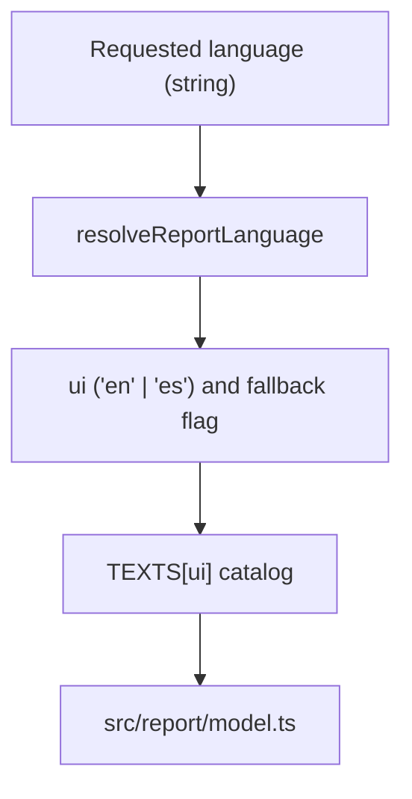

Part 3 · Page 29 of 34 · Previous: [Report model](230-report-model.md) · Next: [Development](../4-development/10-development.md) · [Index](../README.md)
# Fixed texts and language

**File:** `src/report/i18n.ts` · 409 lines · **Status:** available

## Page index

- What is it and what is it for?
- Before reading the code
- How it fits
- The complete, commented code
- Examples with real data
- Behavior summary
- Where it is used
- Tests

## What is it and what is it for?

Defines and centralizes all static UI copy and language formatting functions for HTML and Markdown reports in English and Spanish. Without this module, output templates would hardcode strings directly, leading to phrasing inconsistencies across formats, untranslated messages, and duplicated formatting logic for dates, Git ranges, and rule selection reasons.

It provides `resolveReportLanguage` to interpret user language configuration with safe English fallback, and `TEXTS`, a strictly typed bilingual dictionary where each entry is either a static string or a formatting function taking primitive parameters. Currently no CLI command invokes it directly; it is consumed by [`src/report/model.ts`](230-report-model.md) when assembling report view data.

## Before reading the code

### Language resolution and fallback

Normalizes arbitrary language tags into one of the two supported codes (`es` or `en`). When an unsupported language such as French (`fr`) or German (`de`) is requested, the system defaults to English while raising the `fallback: true` flag to record a notice in the report details.

```ts
// input: 'es-MX'
// → { ui: 'es', fallback: false }
// input: 'fr'
// → { ui: 'en', fallback: true }
```

### Localized date formatting

Decomposes dates via `Intl.DateTimeFormat` into component parts and reassembles them using language-specific order templates to maintain deterministic output across different Node.js runtime versions.

```ts
// input: { day: '18', month: 'October', year: '2026', hour: '15', minute: '32' }
// → "October 18, 2026, 15:32"
```

## How it fits



1. `resolveReportLanguage` trims whitespace and converts the requested language string to lowercase.
2. If it matches Spanish (`es` or an `es-` prefix), it returns `ui: 'es'`. If it matches English (`en` or an `en-` prefix), it returns `ui: 'en'`. For all other tags, it returns `ui: 'en'` with `fallback: true`.
3. `src/report/model.ts` selects the resolved `TEXTS` catalog and formats dates, scope sentences, rule reasons, and status badges.

## The complete, commented code

```ts
/** Components of a date used to format localized report timestamps. */
export interface ReportDateParts {
  day: string;
  month: string;
  year: string;
  hour: string;
  minute: string;
}

/** Parameters describing a review scope for formatted text sentences. */
export interface RangeDescriptionParams {
  branch: string | null;
  baseLabel: string;
  baseShort: string;
  headShort: string;
  commitsCount: number;
  uncommittedFilesCount: number;
  filesCount: number;
  added: number;
  removed: number;
}

/** Explicit catalog of all static and parameterized text strings for reports. */
export interface ReportTexts {
  stampApproved: string;
  stampNotApproved: string;
  verdictAria: (approved: boolean) => string;
  headerMeta: (taskId: string | undefined, branch: string | null, date: string) => string;
  titleWithoutTask: (target: string) => string;
  formatDate: (parts: ReportDateParts) => string;
  largeChangeWarning: string;
  sectionTaskTitle: string;
  criteriaMet: (met: number, total: number) => string;
  criteriaNoTask: string;
  criteriaNone: string;
  statusMet: string;
  statusNotMet: string;
  statusPartial: string;
  statusNotEvaluated: string;
  sectionIssuesTitle: string;
  issuesSub: (count: number) => string;
  severityCritical: string;
  severityCriticalDetail: string;
  severityMajor: string;
  severityMinor: string;
  markReviewed: string;
  codeToday: string;
  codeSuggestion: string;
  codeSuggestionDetail: string;
  codeSuggestionDetailShort: string;
  labelRule: string;
  labelOrigin: string;
  labelExisting: string;
  labelRelated: string;
  labelCertainty: string;
  ruleKindPolicy: string;
  ruleKindRule: string;
  ruleKindBusiness: string;
  ruleKindDecision: string;
  ruleKindTemplate: string;
  noRuleDefect: string;
  suggestedRuleBelowNote: string;
  confirmedByVerifier: string;
  unverified: string;
  quotedLineExists: string;
  fileExists: string;
  certainty: (verified: boolean, wholeFile: boolean) => string;
  wholeFileSummary: (lines: number) => string;
  fileLineLabel: (file: string, line?: number) => string;
  wholeFileLabel: (status: string, lines: number) => string;
  relatedCriterion: (num: number, statusText: string) => string;
  relatedFinding: (num: number, title: string) => string;
  sectionImpactTitle: string;
  sectionOutOfScopeTitle: string;
  outOfScopeNote: (file: string, line: number | undefined, note: string) => string;
  sectionIdeasTitle: string;
  ideasSub: string;
  sectionSuggestedRulesTitle: string;
  suggestedRuleText: (text: string, fromNumber?: number) => string;
  sectionDetailsTitle: string;
  editorSelectorLabel: string;
  editorOptions: {
    vscode: string;
    cursor: string;
    windsurf: string;
    jetbrains: string;
    zed: string;
    none: string;
  };
  rangeBranch: (params: RangeDescriptionParams) => string;
  rangeUnpushed: (params: RangeDescriptionParams) => string;
  rangeSinceRun: (params: RangeDescriptionParams) => string;
  rangeSinceRef: (params: RangeDescriptionParams) => string;
  rulesUsed: (selected: number, total: number) => string;
  reasonPolicy: string;
  reasonAppliesTo: (pattern: string, files: string[]) => string;
  reasonKeyword: (keyword: string, where: 'changes' | 'task') => string;
  importedSession: (file: string) => string;
  repoUnchanged: string;
  discardedByVerifier: (count: number) => string;
  discardedByValidation: (count: number) => string;
  languageFallbackNote: (lang: string) => string;
  fileStatusNew: string;
  fileStatusModified: string;
  fileStatusDeleted: string;
  fileStatusRenamed: string;
  fileProblems: (problems: number[]) => string;
  fileOutOfScope: string;
  fileNoProblems: string;
}

/** Resolves requested language into a supported UI code and fallback status. */
export function resolveReportLanguage(language: string): { ui: 'en' | 'es'; fallback: boolean } {
  const normalized = language.trim().toLowerCase();
  if (normalized === 'es' || normalized.startsWith('es-')) {
    return { ui: 'es', fallback: false };
  }
  if (normalized === 'en' || normalized.startsWith('en-')) {
    return { ui: 'en', fallback: false };
  }
  return { ui: 'en', fallback: true };
}

/** Formats uncommitted file clause in Spanish. */
function formatUncommittedEs(count: number): string {
  if (count <= 0) return '';
  return ` y ${count} archivo${count === 1 ? '' : 's'} sin commit`;
}

/** Formats uncommitted file clause in English. */
function formatUncommittedEn(count: number): string {
  if (count <= 0) return '';
  return ` and ${count} uncommitted file${count === 1 ? '' : 's'}`;
}

/** Formats added and removed line counts in Spanish. */
function formatLinesEs(added: number, removed: number): string {
  const addedText = added === 1 ? '1 línea agregada' : `${added} líneas agregadas`;
  const removedText = removed === 1 ? '1 quitada' : `${removed} quitadas`;
  return `${addedText} y ${removedText}.`;
}

/** Formats added and removed line counts in English. */
function formatLinesEn(added: number, removed: number): string {
  const addedText = added === 1 ? '1 line added' : `${added} lines added`;
  return `${addedText} and ${removed} removed.`;
}

const TEXTS_ES: ReportTexts = {
  stampApproved: 'Aprobado',
  stampNotApproved: 'No aprobado',
  verdictAria: (approved) => `Veredicto: ${approved ? 'aprobado' : 'no aprobado'}`,
  headerMeta: (taskId, branch, date) =>
    taskId
      ? `Tarea ${taskId}${branch ? `, rama ${branch}` : ''}. Revisado el ${date}.`
      : `${branch ? `Rama ${branch}. ` : ''}Revisado el ${date}.`,
  titleWithoutTask: (target) => `Revisión de ${target}`,
  formatDate: ({ day, month, year, hour, minute }) => `${day} de ${month} de ${year}, ${hour}:${minute}`,
  largeChangeWarning: 'cambio grande: conviene dividirlo en el futuro',
  sectionTaskTitle: '¿Hizo lo que pedía la tarea?',
  criteriaMet: (met, total) =>
    `${met} de ${total} ${total === 1 ? 'criterio cumplido' : 'criterios cumplidos'}.`,
  criteriaNoTask: 'sin tarea: no evaluado',
  criteriaNone: 'La tarea no tiene criterios.',
  statusMet: 'Cumplido',
  statusNotMet: 'No cumplido',
  statusPartial: 'A medias',
  statusNotEvaluated: 'No evaluado',
  sectionIssuesTitle: 'Lo que tienes que revisar',
  issuesSub: (count) =>
    `${count} problema${count === 1 ? '' : 's'}. Marca cada uno cuando lo hayas visto; la marca se guarda en este navegador.`,
  severityCritical: 'Grave',
  severityCriticalDetail: 'Grave, impide aprobar',
  severityMajor: 'Importante',
  severityMinor: 'Menor',
  markReviewed: 'Ya lo revisé',
  codeToday: 'Hoy',
  codeSuggestion: 'Podría quedar así',
  codeSuggestionDetail: '(sugerencia, el revisor no cambia nada)',
  codeSuggestionDetailShort: '(sugerencia)',
  labelRule: 'Regla',
  labelOrigin: 'Origen',
  labelExisting: 'Ya existe',
  labelRelated: 'Relacionado',
  labelCertainty: 'Certeza',
  ruleKindPolicy: 'políticas, nunca se rompe',
  ruleKindRule: 'regla',
  ruleKindBusiness: 'negocio',
  ruleKindDecision: 'decisión',
  ruleKindTemplate: 'plantilla',
  noRuleDefect: 'Error de funcionamiento; ninguna regla lo cubre.',
  suggestedRuleBelowNote: 'Abajo se sugiere una regla nueva.',
  confirmedByVerifier: 'Confirmado por el verificador.',
  unverified: 'Sin verificar.',
  quotedLineExists: 'La línea citada existe y dice esto.',
  fileExists: 'El archivo existe.',
  certainty: (verified, wholeFile) =>
    `${verified ? 'Confirmado por el verificador.' : 'Sin verificar.'} ${
      wholeFile ? 'El archivo existe.' : 'La línea citada existe y dice esto.'
    }`,
  wholeFileSummary: (lines) => `Ver el archivo completo (${lines} líneas)`,
  fileLineLabel: (file, line) => (line !== undefined ? `${file}, línea ${line}` : file),
  wholeFileLabel: (status, lines) => `archivo completo (${status ? `${status}, ` : ''}${lines} líneas)`,
  relatedCriterion: (num, statusText) => `Criterio ${num} de la tarea, ${statusText.toLowerCase()}.`,
  relatedFinding: (num, title) => `Problema ${num}: ${title}`,
  sectionImpactTitle: 'Qué más puede romperse',
  sectionOutOfScopeTitle: 'Cambios fuera de la tarea',
  outOfScopeNote: (file, line, note) =>
    `Modificó ${file}${line !== undefined ? ` en la línea ${line}` : ''} (${note}). Decide si se queda en esta rama o va en una aparte.`,
  sectionIdeasTitle: 'Ideas para mejorar',
  ideasSub: 'Opcionales. No cuentan para el veredicto.',
  sectionSuggestedRulesTitle: 'Regla nueva sugerida',
  suggestedRuleText: (text, fromNumber) =>
    fromNumber !== undefined ? `«${text}». Sale del problema ${fromNumber}.` : `«${text}».`,
  sectionDetailsTitle: 'Detalles de la revisión',
  editorSelectorLabel: 'Editor:',
  editorOptions: {
    vscode: 'VS Code',
    cursor: 'Cursor',
    windsurf: 'Windsurf',
    jetbrains: 'JetBrains',
    zed: 'Zed',
    none: 'Ninguno',
  },
  rangeBranch: (params) =>
    `Revisado desde donde la rama se separó de ${params.baseLabel} (${params.baseShort}) hasta ${params.headShort}: ${
      params.commitsCount
    } commit${params.commitsCount === 1 ? '' : 's'}${formatUncommittedEs(params.uncommittedFilesCount)}, ${
      params.filesCount
    } archivo${params.filesCount === 1 ? '' : 's'}, ${formatLinesEs(params.added, params.removed)}`,
  rangeUnpushed: (params) =>
    `Revisado lo que no se ha subido de la rama ${params.branch ?? params.baseLabel}, desde ${params.baseLabel} (${
      params.baseShort
    }) hasta ${params.headShort}: ${params.commitsCount} commit${
      params.commitsCount === 1 ? '' : 's'
    }${formatUncommittedEs(params.uncommittedFilesCount)}, ${params.filesCount} archivo${
      params.filesCount === 1 ? '' : 's'
    }, ${formatLinesEs(params.added, params.removed)}`,
  rangeSinceRun: (params) =>
    `Revisado desde la última revisión (${params.baseShort}) hasta ${params.headShort}: ${params.commitsCount} commit${
      params.commitsCount === 1 ? '' : 's'
    }${formatUncommittedEs(params.uncommittedFilesCount)}, ${params.filesCount} archivo${
      params.filesCount === 1 ? '' : 's'
    }, ${formatLinesEs(params.added, params.removed)}`,
  rangeSinceRef: (params) =>
    `Revisado desde ${params.baseLabel} (${params.baseShort}) hasta ${params.headShort}: ${
      params.commitsCount
    } commit${params.commitsCount === 1 ? '' : 's'}${formatUncommittedEs(params.uncommittedFilesCount)}, ${
      params.filesCount
    } archivo${params.filesCount === 1 ? '' : 's'}, ${formatLinesEs(params.added, params.removed)}`,
  rulesUsed: (selected, total) => `Se usaron ${selected} de las ${total} reglas del proyecto.`,
  reasonPolicy: 'política del proyecto (aplica siempre)',
  reasonAppliesTo: (pattern, files) => `aplica a ${files.join(', ')} (patrón ${pattern})`,
  reasonKeyword: (keyword, where) =>
    `palabra clave «${keyword}» en ${where === 'changes' ? 'los cambios' : 'la tarea'}`,
  importedSession: (file) => `hallazgos importados de ${file}`,
  repoUnchanged: 'El repositorio quedó sin cambios.',
  discardedByVerifier: (count) =>
    `El verificador descartó ${count} hallazgo${count === 1 ? '' : 's'}.`,
  discardedByValidation: (count) =>
    `La validación descartó ${count} hallazgo${count === 1 ? '' : 's'}.`,
  languageFallbackNote: (lang) =>
    `Los textos fijos usan inglés porque el idioma «${lang}» no tiene traducción.`,
  fileStatusNew: 'nuevo',
  fileStatusModified: 'modificado',
  fileStatusDeleted: 'borrado',
  fileStatusRenamed: 'renombrado',
  fileProblems: (problems) => {
    if (problems.length === 0) return 'sin problemas';
    if (problems.length === 1) return `problema ${problems[0]}`;
    return `problemas ${problems.slice(0, -1).join(', ')} y ${problems[problems.length - 1]}`;
  },
  fileOutOfScope: 'fuera de la tarea',
  fileNoProblems: 'sin problemas',
};

const TEXTS_EN: ReportTexts = {
  stampApproved: 'Approved',
  stampNotApproved: 'Not approved',
  verdictAria: (approved) => `Verdict: ${approved ? 'approved' : 'not approved'}`,
  headerMeta: (taskId, branch, date) =>
    taskId
      ? `Task ${taskId}${branch ? `, branch ${branch}` : ''}. Reviewed on ${date}.`
      : `${branch ? `Branch ${branch}. ` : ''}Reviewed on ${date}.`,
  titleWithoutTask: (target) => `Review of ${target}`,
  formatDate: ({ day, month, year, hour, minute }) => `${month} ${day}, ${year}, ${hour}:${minute}`,
  largeChangeWarning: 'large change: consider splitting in the future',
  sectionTaskTitle: 'Did it meet the task requirements?',
  criteriaMet: (met, total) =>
    `${met} of ${total} ${total === 1 ? 'criterion' : 'criteria'} met.`,
  criteriaNoTask: 'no task: not evaluated',
  criteriaNone: 'The task has no criteria.',
  statusMet: 'Met',
  statusNotMet: 'Not met',
  statusPartial: 'Partial',
  statusNotEvaluated: 'Not evaluated',
  sectionIssuesTitle: 'What you need to review',
  issuesSub: (count) =>
    `${count} issue${count === 1 ? '' : 's'}. Mark each one when reviewed; checkmarks are saved in this browser.`,
  severityCritical: 'Critical',
  severityCriticalDetail: 'Critical, prevents approval',
  severityMajor: 'Major',
  severityMinor: 'Minor',
  markReviewed: 'Reviewed',
  codeToday: 'Today',
  codeSuggestion: 'Could look like this',
  codeSuggestionDetail: '(suggestion, reviewer does not change code)',
  codeSuggestionDetailShort: '(suggestion)',
  labelRule: 'Rule',
  labelOrigin: 'Origin',
  labelExisting: 'Already exists',
  labelRelated: 'Related',
  labelCertainty: 'Certainty',
  ruleKindPolicy: 'policy, never broken',
  ruleKindRule: 'rule',
  ruleKindBusiness: 'business',
  ruleKindDecision: 'decision',
  ruleKindTemplate: 'template',
  noRuleDefect: 'Functional defect; no rule covers it.',
  suggestedRuleBelowNote: 'A new rule is suggested below.',
  confirmedByVerifier: 'Confirmed by verifier.',
  unverified: 'Unverified.',
  quotedLineExists: 'The quoted line exists and says this.',
  fileExists: 'The file exists.',
  certainty: (verified, wholeFile) =>
    `${verified ? 'Confirmed by verifier.' : 'Unverified.'} ${
      wholeFile ? 'The file exists.' : 'The quoted line exists and says this.'
    }`,
  wholeFileSummary: (lines) => `View whole file (${lines} lines)`,
  fileLineLabel: (file, line) => (line !== undefined ? `${file}, line ${line}` : file),
  wholeFileLabel: (status, lines) => `whole file (${status ? `${status}, ` : ''}${lines} lines)`,
  relatedCriterion: (num, statusText) => `Task criterion ${num}, ${statusText.toLowerCase()}.`,
  relatedFinding: (num, title) => `Issue ${num}: ${title}`,
  sectionImpactTitle: 'What else could break',
  sectionOutOfScopeTitle: 'Changes outside task',
  outOfScopeNote: (file, line, note) =>
    `Modified ${file}${line !== undefined ? ` at line ${line}` : ''} (${note}). Decide whether it stays in this branch or moves to a separate one.`,
  sectionIdeasTitle: 'Ideas for improvement',
  ideasSub: 'Optional. Do not affect verdict.',
  sectionSuggestedRulesTitle: 'Suggested new rule',
  suggestedRuleText: (text, fromNumber) =>
    fromNumber !== undefined ? `"${text}". Derived from issue ${fromNumber}.` : `"${text}".`,
  sectionDetailsTitle: 'Review details',
  editorSelectorLabel: 'Editor:',
  editorOptions: {
    vscode: 'VS Code',
    cursor: 'Cursor',
    windsurf: 'Windsurf',
    jetbrains: 'JetBrains',
    zed: 'Zed',
    none: 'None',
  },
  rangeBranch: (params) =>
    `Reviewed from where the branch split from ${params.baseLabel} (${params.baseShort}) to ${params.headShort}: ${
      params.commitsCount
    } commit${params.commitsCount === 1 ? '' : 's'}${formatUncommittedEn(params.uncommittedFilesCount)}, ${
      params.filesCount
    } file${params.filesCount === 1 ? '' : 's'}, ${formatLinesEn(params.added, params.removed)}`,
  rangeUnpushed: (params) =>
    `Reviewed the unpushed work on branch ${params.branch ?? params.baseLabel}, from ${params.baseLabel} (${
      params.baseShort
    }) to ${params.headShort}: ${params.commitsCount} commit${
      params.commitsCount === 1 ? '' : 's'
    }${formatUncommittedEn(params.uncommittedFilesCount)}, ${params.filesCount} file${
      params.filesCount === 1 ? '' : 's'
    }, ${formatLinesEn(params.added, params.removed)}`,
  rangeSinceRun: (params) =>
    `Reviewed since last run (${params.baseShort}) to ${params.headShort}: ${params.commitsCount} commit${
      params.commitsCount === 1 ? '' : 's'
    }${formatUncommittedEn(params.uncommittedFilesCount)}, ${params.filesCount} file${
      params.filesCount === 1 ? '' : 's'
    }, ${formatLinesEn(params.added, params.removed)}`,
  rangeSinceRef: (params) =>
    `Reviewed since ${params.baseLabel} (${params.baseShort}) to ${params.headShort}: ${
      params.commitsCount
    } commit${params.commitsCount === 1 ? '' : 's'}${formatUncommittedEn(params.uncommittedFilesCount)}, ${
      params.filesCount
    } file${params.filesCount === 1 ? '' : 's'}, ${formatLinesEn(params.added, params.removed)}`,
  rulesUsed: (selected, total) => `Used ${selected} of ${total} project rules.`,
  reasonPolicy: 'project policy (always applies)',
  reasonAppliesTo: (pattern, files) => `applies to ${files.join(', ')} (pattern ${pattern})`,
  reasonKeyword: (keyword, where) =>
    `keyword "${keyword}" in ${where === 'changes' ? 'changes' : 'task'}`,
  importedSession: (file) => `findings imported from ${file}`,
  repoUnchanged: 'The repository remained unchanged.',
  discardedByVerifier: (count) =>
    `The verifier discarded ${count} finding${count === 1 ? '' : 's'}.`,
  discardedByValidation: (count) =>
    `Validation discarded ${count} finding${count === 1 ? '' : 's'}.`,
  languageFallbackNote: (lang) =>
    `Fixed texts use English because language "${lang}" is not supported.`,
  fileStatusNew: 'new',
  fileStatusModified: 'modified',
  fileStatusDeleted: 'deleted',
  fileStatusRenamed: 'renamed',
  fileProblems: (problems) => {
    if (problems.length === 0) return 'no issues';
    if (problems.length === 1) return `issue ${problems[0]}`;
    return `issues ${problems.slice(0, -1).join(', ')} and ${problems[problems.length - 1]}`;
  },
  fileOutOfScope: 'out of scope',
  fileNoProblems: 'no issues',
};

/** Static dictionary containing all report UI texts for supported languages. */
export const TEXTS: Record<'en' | 'es', ReportTexts> = {
  en: TEXTS_EN,
  es: TEXTS_ES,
};
```

## Examples with real data

### Normal case

Language resolution for standard Spanish and English locale tags:

```ts
resolveReportLanguage('es-MX');
// → { ui: 'es', fallback: false }

resolveReportLanguage('en-GB');
// → { ui: 'en', fallback: false }
```

### Edge case

Language resolution for an unsupported language triggering English fallback:

```ts
resolveReportLanguage('fr');
// → { ui: 'en', fallback: true }

TEXTS.en.languageFallbackNote('fr');
// → 'Fixed texts use English because language "fr" is not supported.'
```

### Without the key line

Without the condition `normalized.startsWith('es-')`, common regional configuration variants such as `es-CO` or `es-AR` would not match Spanish and would undesirably trigger English fallback, producing English reports for Spanish projects.

## Behavior summary

- **Spanish locale code (`es`, `es-MX`, uppercase or with surrounding whitespace):** returns `{ ui: 'es', fallback: false }`.
- **English locale code (`en`, `en-US`, uppercase or with surrounding whitespace):** returns `{ ui: 'en', fallback: false }`.
- **Any other tag or empty value:** returns `{ ui: 'en', fallback: true }`.
- **Text dictionary:** ensures complete key parity between English and Spanish without empty strings.
- **Dynamic formatters:** produce full sentences adapted for singular and plural commits, uncommitted files, and issue counts.
- **Criterion agreement in `criteriaMet`:** plural follows the total (`criterion met` for total 1, `criteria met` for others; e.g., `1 of 3 criteria met.`).
- **Empty criteria task brief (`criteriaNone`):** provides explicit copy ("The task has no criteria.") distinct from missing task briefs (`criteriaNoTask`).
- **Line count plurals in range descriptions:** distinguishes singular and plural across all four range functions ("1 line added and 1 removed." vs. "7 lines added and 2 removed.").
- **Range description phrasing:** `rangeUnpushed` removes duplicate colons and `rangeBranch` uses "where the branch split from".
- **File problems clause (`fileProblems`):** returns "no issues" on empty arrays, "issue X" for a single problem, and "issues X, Y and Z" for multiples.

## Where it is used

### Uses

Does not import any external dependencies or local modules (defines self-contained types, string constants, and formatters).

### Used by

- [`src/report/model.ts`](230-report-model.md), lines 13-19, to resolve the report language and format static labels, dates, and range sentences. Currently no CLI command invokes it directly.

## Tests

- `src/report/i18n.test.ts`: resolution of Spanish and English locale variants without fallback.
- `src/report/i18n.test.ts`: activation of English fallback with flag for unsupported language tags.
- `src/report/i18n.test.ts`: key parity and absence of empty strings across `en` and `es` catalogs.
- `src/report/i18n.test.ts`: validation of non-empty return values across all formatting functions.
Part 3 · Page 29 of 34 · Previous: [Report model](230-report-model.md) · Next: [Development](../4-development/10-development.md) · [Index](../README.md)
