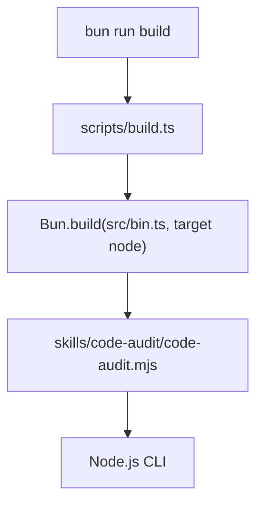

Part 4 · Page 19 of 22 · Previous: [Development](10-development.md) · Next: [Documentation checker](17-docs-check.md) · [Index](../README.md)
# Build script

**File:** `scripts/build.ts` · 40 lines · **Status:** available

## Page index

- What is it and what is it for?
- Before reading the code
- How it fits
- The complete, commented code
- Examples with real data
- Behavior summary
- Where it is used
- Tests

## What is it and what is it for?

`scripts/build.ts` creates the standalone `skills/code-audit/code-audit.mjs` executable. Without it, contributors would not have the bundled file that can run in Node.js. `buildArtifact` accepts an optional output directory and returns the built file path; the script also runs the default build when executed directly. Bun calls this development script.

## Before reading the code


### Entry point and output directory

An entry point is the source file from which a build starts. Here it is `src/bin.ts`; by default the output directory is `skills/code-audit`. The actual command `bun run build` exited with code `0` and the produced CLI printed:

```text
// → 0.1.0
```

### Restore process state

`process.chdir(root)` makes relative entry paths resolve from the repository root. A `finally` block restores the caller's original directory even if the build throws. This matters when another script imports `buildArtifact`.

## How it fits



1. Resolve the project root from the location of the build script.
2. Create the output folder if it is missing.
3. Build `src/bin.ts` as ESM for Node with a Node shebang.
4. Fail on build logs, set executable permissions, and restore the working directory.

## The complete, commented code

```ts
import { chmod, mkdir } from 'node:fs/promises';
import { dirname, resolve } from 'node:path';
import { fileURLToPath } from 'node:url';

// Resolve the checkout from this file so the command works from any directory.
const root = resolve(dirname(fileURLToPath(import.meta.url)), '..');

/** Builds the standalone Node.js CLI artifact into the output directory. */
export async function buildArtifact(
  outputDirectory = resolve(root, 'skills/code-audit'),
): Promise<string> {
  // Save the caller's directory because this function temporarily changes it.
  const originalDirectory = process.cwd();
  const outdir = resolve(outputDirectory);
  const outfile = resolve(outdir, 'code-audit.mjs');

  // Bun requires the destination directory to exist before writing the artifact.
  await mkdir(dirname(outfile), { recursive: true });
  try {
    // Resolve the relative entrypoint from the checkout root.
    process.chdir(root);
    const result = await Bun.build({
      entrypoints: ['src/bin.ts'],
      target: 'node',
      format: 'esm',
      banner: '#!/usr/bin/env node',
      outdir,
      naming: { entry: 'code-audit.mjs' },
    });

    // Surface Bun's diagnostics instead of leaving a partial build unnoticed.
    if (!result.success) {
      throw new AggregateError(result.logs, 'Failed to build code-audit');
    }

    // Allow the generated file to be invoked as an executable.
    await chmod(outfile, 0o755);
    return outfile;
  } finally {
    // Restore process state for callers that keep running after the build.
    process.chdir(originalDirectory);
  }
}

// Run a build only when Bun executes this module as the entry script.
if (import.meta.main) {
  await buildArtifact();
}
```

## Examples with real data

These examples show the built command and the build test's result.

### Normal case

`bun run build` printed `$ bun scripts/build.ts`, exited `0`, and the artifact printed:

```text
// → 0.1.0
```

### Edge case

`buildArtifact` accepts a different output directory and creates its parent recursively. The real test `does not contain absolute local paths` calls it with a temporary directory and reads the generated artifact.

### Without the key line

Without the `finally` block, callers importing `buildArtifact` would remain in the repository directory after it returns or throws. `src/build.test.ts` verifies artifact contents; the working-directory restoration is visible in `scripts/build.ts:33–34`.

## Behavior summary

- **No output directory is supplied:** build into `skills/code-audit`.
- **The output folder is absent:** create it recursively.
- **Bun reports a failed build:** throw `AggregateError` with the build logs.
- **The build succeeds:** make the `.mjs` executable and return its path.
- **The build succeeds or throws:** restore the original working directory.

## Where it is used

- `package.json` runs this script for `bun run build`.
- It bundles [`src/bin.ts`](../3-code/010-bin.md), which delegates to [`src/cli.ts`](../3-code/020-cli.md).
- The artifact is `skills/code-audit/code-audit.mjs`.

## Tests

- `src/build.test.ts`: `does not contain absolute local paths`.
Part 4 · Page 19 of 22 · Previous: [Development](10-development.md) · Next: [Documentation checker](17-docs-check.md) · [Index](../README.md)
