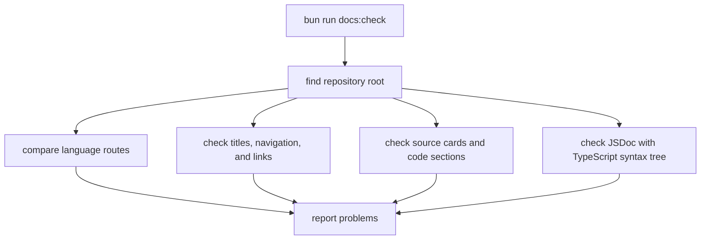

Part 4 · Page 15 of 17 · Previous: [Build script](15-build-script.md) · Next: [Documentation standard](20-documentation-standard.md) · [Index](../README.md)
# Documentation checker

**File:** `scripts/check-docs.ts` · 430 lines · **Status:** available


`scripts/check-docs.ts` checks the English and Spanish indexes, pages, source cards, nonempty headings, and code comments. It returns a list of `{ file, message }` problems.

## Page index

- What is it and what is it for?
- Before reading the code
- How it fits
- The complete, commented code
- Examples with real data
- Behavior summary
- Where it is used
- Tests

## What is it and what is it for?

The checker takes a repository root and reports documentation problems. Without it, broken links, mismatched reading routes, missing source pages, or outdated line counts could pass unnoticed. The `docs:check` package command runs it and exits with an error when it finds a problem.

## Before reading the code

A section heading has content when its next heading is deeper. Type-only files use the dedicated type-page template.


### Markdown links and titles

Markdown is the plain-text format used for these pages. The checker follows links in each index to get the reading order, then checks page titles and navigation labels against the pages they point to.

### JSDoc and TypeScript syntax tree

JSDoc is a short comment immediately above a TypeScript declaration. A syntax tree is TypeScript's structured view of source code; the checker uses it to find exported declarations and named functions that need JSDoc.

### Source card

A source card names a real `.ts` file and its line count. The checker compares the stated count with the file on disk so the guide stays in sync.

## How it fits



1. Read the two indexes and collect page links in order.
2. Check that linked pages exist, have titles, and use navigation labels matching the destination titles.
3. Check local links, source cards, source files, line counts, and code-page sections.
4. Parse TypeScript declarations and report missing JSDoc.
5. Print every problem and exit `1`, or print a success message and exit `0`.

## The complete, commented code

The following five consecutive blocks contain every line of `scripts/check-docs.ts` in order.

Block 1 of 5:

```ts
import { readdir, readFile, stat } from 'node:fs/promises';
import { dirname, join, relative, resolve, sep } from 'node:path';
import { fileURLToPath } from 'node:url';
import ts from 'typescript';

/** Describes one documentation rule violation. */
export interface DocProblem {
  file: string;
  message: string;
}

type Page = { path: string; part: number; number: number };

const LANGUAGES = ['en', 'es'] as const;
const PARTS = ['1-overview', '2-architecture', '3-code', '4-development'];

/** Checks bilingual documentation structure and code coverage under root. */
export async function checkDocs(root: string): Promise<DocProblem[]> {
  const base = resolve(root);
  const problems: DocProblem[] = [];
  /** Adds one problem to the report. */
  const add = (file: string, message: string): void => { problems.push({ file, message }); };
  const docsRoot = join(base, 'docs');
  const sequences = new Map<string, string[]>();
  const documentationFiles = await listMarkdown(docsRoot);
  await checkEmptyHeadings([join(base, 'README.md'), ...documentationFiles], base, add);

  for (const lang of LANGUAGES) {
    const langRoot = join(docsRoot, lang);
    const indexPath = join(langRoot, 'README.md');
    const index = await readText(indexPath);
    if (index === undefined) {
      add(toPosix(relative(base, indexPath)), 'language index is missing');
      continue;
    }
    const sequence = [...index.matchAll(/^\s*\d+\.\s+\[[^\]]+\]\(([^)]+\.md)(?:#[^)]*)?\)/gm)]
      .map((match) => resolveLink(indexPath, match[1]));
    sequences.set(lang, sequence);

    const markdown = await listMarkdown(langRoot);
    const pages = new Map<string, Page>();
    for (const file of markdown.filter((path) => path !== indexPath)) {
      const rel = toPosix(relative(langRoot, file));
      const parsed = parsePage(rel);
      if (!parsed) {
        add(toPosix(relative(base, file)), 'page filename must start with a numeric order');
        continue;
      }
      pages.set(rel, parsed);
    }
    for (const target of sequence) {
      if (!(await exists(target))) add(toPosix(relative(base, indexPath)), `linked page is missing: ${target}`);
    }
    const listed = new Set(sequence.map((path) => toPosix(relative(langRoot, path))));
    for (const page of pages.keys()) {
      if (!listed.has(page)) add(toPosix(relative(base, langRoot)), `orphan page: ${page}`);
    }
    checkSequenceOrder(sequence, langRoot, add, toPosix(relative(base, indexPath)));
    const uniquePageIds = new Set<string>();
    for (const page of pages.values()) {
      const key = `${page.part}:${page.number}`;
      if (uniquePageIds.has(key)) add(toPosix(relative(base, langRoot)), `duplicate page number ${key}`);
      uniquePageIds.add(key);
    }
    await checkNavigation(sequence, indexPath, lang, add, base);
    await checkLocalLinks([...(lang === 'en' ? [join(base, 'README.md')] : []), indexPath, ...markdown], docsRoot, base, add);
  }

  const english = (sequences.get('en') ?? []).map((path) => toPosix(relative(join(docsRoot, 'en'), path)));
  const spanish = (sequences.get('es') ?? []).map((path) => toPosix(relative(join(docsRoot, 'es'), path)));
  if (JSON.stringify(english) !== JSON.stringify(spanish)) {
    add('docs', 'English and Spanish page sequences must have identical paths and order');
  }

  await checkSourcePages(base, sequences, add);
  await checkJSDoc(base, add);
  return problems;
}

/** Finds headings with no body before the next heading or page end. */
async function checkEmptyHeadings(
  files: string[], root: string, add: (file: string, message: string) => void,
): Promise<void> {
  for (const file of files) {
    const content = await readText(file);
    if (content === undefined) continue;
    const lines = content.split(/\r?\n/);
    let heading: string | undefined;
    let hasContent = false;
    let fence: string | undefined;
    /** Reports a heading that has no body text. */
    const reportEmpty = (): void => {
      if (heading && !hasContent) {
        add(toPosix(relative(root, file)), `heading has no content: ${heading}`);
      }
    };
    for (const line of lines) {
      const marker = line.match(/^\s*(```+|~~~+)/)?.[1];
      if (fence) {
        if (marker?.[0] === fence) fence = undefined;
        else if (line.trim() !== '') hasContent = true;
        continue;
      }
      if (marker) {
        fence = marker[0];
        continue;
      }
      if (/^(?:Part \d+ · Page \d+ of \d+|Parte \d+ · Página \d+ de \d+)/.test(line)) continue;
      const match = line.match(/^(#{2,6})\s+.+$/);
      if (match) {
        const previousDepth = heading?.match(/^#+/)?.[0].length ?? 0;
        if (heading && match[1].length > previousDepth) hasContent = true;
        reportEmpty();
        heading = line;
        hasContent = false;
      } else if (heading && line.trim() !== '') {
        hasContent = true;
      }
    }
    reportEmpty();
  }
}

/** Parses the part and numeric order from a documentation page path. */
function parsePage(path: string): Page | undefined {
  const match = path.match(/^([1-4]-[^/]+)\/(\d+)-[^/]+\.md$/);
  if (!match) return undefined;
  const part = Number(match[1][0]);
  if (match[1] !== PARTS[part - 1]) return undefined;
  return {
    path,
    part,
    number: Number(match[2]),
  };
}

/** Reports numbering and part-order violations in an index sequence. */
function checkSequenceOrder(
  sequence: string[], langRoot: string, add: (file: string, message: string) => void, reportFile: string,
): void {
  let lastPart = 0;
  const numbers = new Map<string, number>();
  for (const absolute of sequence) {
    const rel = toPosix(relative(langRoot, absolute));
    const parsed = parsePage(rel);
    if (!parsed) continue;
    if (parsed.part < lastPart) add(reportFile, 'parts must appear in order 1 through 4');
    lastPart = parsed.part;
    const folder = dirname(rel);
    const previous = numbers.get(folder) ?? 0;
    if (parsed.number <= previous) add(reportFile, `page numbers must increase within ${folder}`);
    numbers.set(folder, parsed.number);
  }
}

/** Validates the navigation bars on each page in a reading sequence. */
async function checkNavigation(
  sequence: string[], indexPath: string, lang: string,
  add: (file: string, message: string) => void, root: string,
): Promise<void> {
  const total = sequence.length;
  for (let i = 0; i < total; i += 1) {
    const file = sequence[i];
    const text = await readText(file);
    if (text === undefined) continue;
    const first = text.split(/\r?\n/, 1)[0];
    const lines = text.split(/\r?\n/);
    const titleLine = lines.slice(1).find((line) => line.trim() !== '');
    if (!titleLine?.startsWith('# ')) {
      add(toPosix(relative(root, file)), 'page title must follow the navigation bar');
    }
    const last = text.trimEnd().split(/\r?\n/).at(-1) ?? '';
    const navPattern = lang === 'es' ? /Parte (\d+) · Página (\d+) de (\d+)/ : /Part (\d+) · Page (\d+) of (\d+)/;
    for (const [position, line] of [['first', first], ['last', last]] as const) {
      const match = line.match(navPattern);
      const report = toPosix(relative(root, file));
      if (!match || Number(match[2]) !== i + 1 || Number(match[3]) !== total) {
        add(report, `${position} navigation line must show page ${i + 1} of ${total}`);
        continue;
      }
      const links = [...line.matchAll(/\[([^\]]+)\]\(([^)]+)\)/g)];
      const previous = links.find((link) => /Anterior:|Previous:/i.test(line.slice(0, link.index)));
      const nextLabel = lang === 'es' ? 'Siguiente:' : 'Next:';
      const prevLabel = lang === 'es' ? 'Anterior:' : 'Previous:';
      const next = links.find((link) => line.slice(0, link.index).includes(nextLabel));
      const index = links.find((link) => /Índice|Index/i.test(link[1]));
      if (i > 0) {
        if (!previous || resolveLink(file, previous[2]) !== sequence[i - 1]) add(report, `${position} previous link must point to the prior page`);
        else if (previous[1] !== await pageTitle(sequence[i - 1])) add(report, `${position} previous link label must match destination title`);
      }
      if (i === 0 && line.includes(prevLabel)) add(report, `${position} first page must omit the previous link`);
      if (i < total - 1) {
        if (!next || resolveLink(file, next[2]) !== sequence[i + 1]) add(report, `${position} next link must point to the next page`);
        else if (next[1] !== await pageTitle(sequence[i + 1])) add(report, `${position} next link label must match destination title`);
      }
      if (i === total - 1 && !/\((?:última|last)\)/i.test(line)) add(report, `${position} last page must be marked last`);
      if (!index || resolveLink(file, index[2]) !== indexPath) add(report, `${position} index link must point to the language README`);
    }
  }
}

/** Checks relative Markdown links in public documentation files. */
async function checkLocalLinks(
  markdownFiles: string[], docsRoot: string, root: string,
  add: (file: string, message: string) => void,
): Promise<void> {
  for (const file of markdownFiles) {
    const content = await readText(file);
    if (!content) continue;
    for (const match of stripCodeFences(content).matchAll(/\[[^\]]*\]\(([^)]+)\)/g)) {
      const href = match[1];
      if (/^(?:https?:|mailto:|#)/i.test(href)) continue;
      const target = resolveLink(file, href);
      if ((file.startsWith(docsRoot) || file === join(root, 'README.md')) && !(await exists(target))) {
        add(toPosix(relative(root, file)), `relative link target does not exist: ${href}`);
      }
    }
  }
}

/** Removes fenced examples so their sample links are not treated as page links. */
function stripCodeFences(content: string): string {
  let fence: string | undefined;
  return content.split(/\r?\n/).filter((line) => {
    const marker = line.match(/^\s*(```+|~~~+)/)?.[1];
    if (!marker && !fence) return true;
    if (marker) {
      if (!fence) fence = marker[0];
      else if (marker[0] === fence) fence = undefined;
    }
    return false;
  }).join('\n');
}

/** Checks that TypeScript source files have one accurate documentation card. */
async function checkSourcePages(
  root: string, sequences: Map<string, string[]>, add: (file: string, message: string) => void,
): Promise<void> {
  const sourceFiles = (await Promise.all(['src', 'scripts'].map((folder) => listTypeScript(join(root, folder)))))
    .flat().filter((file) => !file.endsWith('.test.ts'));
  for (const lang of LANGUAGES) {
    const seq = sequences.get(lang) ?? [];
    const declarations = new Map<string, string[]>();
    for (const pagePath of seq) {
      const text = await readText(pagePath);
      if (!text) continue;
      const langRoot = join(root, 'docs', lang);
      const pageRel = toPosix(relative(langRoot, pagePath));
      const card = text.match(/\*\*(?:File|Archivo):\*\*\s*`([^`]+)`(?:\s*,\s*`([^`]+)`)?\s*·\s*(\d+)\s+(?:lines|líneas)\s*·\s*\*\*(?:Status|Estado):\*\*\s*(available|disponible)/i);
      const hasFileCard = text.split(/\r?\n/).slice(0, 6)
        .some((line) => /^\*\*(?:File|Archivo):\*\*/i.test(line));
      const isCodePage = pageRel.startsWith('3-code/')
        || (pageRel.startsWith('4-development/') && hasFileCard);
      if (!isCodePage) continue;
      if (!card) {
        add(toPosix(relative(root, pagePath)), 'code page must declare its file, line count, and available status');
        continue;
      }
      const declaredFiles = [card[1], card[2]].filter(Boolean) as string[];
      for (const declared of declaredFiles) {
        declarations.set(declared, [...(declarations.get(declared) ?? []), pagePath]);
        const source = join(root, declared);
        if (!(await exists(source))) add(toPosix(relative(root, pagePath)), `available source file is missing: ${declared}`);
      }
      const sourceExists = await Promise.all(declaredFiles.map((declared) => exists(join(root, declared))));
      const reportFile = toPosix(relative(root, pagePath));
      const typePage = sourceExists.every(Boolean) && await areTypeFiles(root, declaredFiles);
      if (typePage) checkTypeSections(text, lang, reportFile, add);
      else checkCodeSections(text, lang, reportFile, add);
      if (sourceExists.every(Boolean)) {
        const actualLines = (await Promise.all(declaredFiles.map(async (declared) => lineCount((await readText(join(root, declared)))!))))
          .reduce((sum, count) => sum + count, 0);
        if (Number(card[3]) !== actualLines) add(toPosix(relative(root, pagePath)), `declared line count does not match ${declaredFiles.join(', ')}`);
      }
    }
    for (const source of sourceFiles) {
      const rel = toPosix(relative(root, source));
      const matching = declarations.get(rel) ?? [];
      if (matching.length !== 1) add(`docs/${lang}/3-code`, `${rel} must appear in exactly one code page; found ${matching.length}`);
    }
  }
}

/** Checks whether every declared source file contains only type declarations. */
async function areTypeFiles(root: string, files: string[]): Promise<boolean> {
  for (const file of files) {
    const path = join(root, file);
    const source = ts.createSourceFile(path, (await readText(path)) ?? '', ts.ScriptTarget.Latest, true, ts.ScriptKind.TS);
    if (source.statements.length === 0 || source.statements.some((statement) =>
      !ts.isInterfaceDeclaration(statement) && !ts.isTypeAliasDeclaration(statement))) return false;
  }
  return true;
}

/** Checks the required sections on a page documenting type declarations. */
function checkTypeSections(
  content: string, lang: string, file: string, add: (file: string, message: string) => void,
): void {
  const sections = lang === 'es'
    ? ['## Índice de la página', '## ¿Qué es y para qué sirve?', '## Tipos', '## Dónde se usa', '## Pruebas']
    : ['## Page index', '## What is it and what is it for?', '## Types', '## Where it is used', '## Tests'];
  const headings = [...content.matchAll(/^## .+$/gm)].map((match) => match[0]);
  let cursor = -1;
  for (const section of sections) {
    const position = headings.indexOf(section);
    if (position === -1) add(file, `missing type-page section: ${section}`);
    else if (position <= cursor) add(file, `type-page sections are out of order at: ${section}`);
    else cursor = position;
  }
}

/** Checks exported declarations and named functions for JSDoc comments. */
async function checkJSDoc(root: string, add: (file: string, message: string) => void): Promise<void> {
  const sourceFiles = (await Promise.all(['src', 'scripts'].map((folder) => listTypeScript(join(root, folder)))))
    .flat().filter((file) => !file.endsWith('.test.ts'));
  for (const file of sourceFiles) {
    const source = ts.createSourceFile(file, (await readText(file)) ?? '', ts.ScriptTarget.Latest, true, ts.ScriptKind.TS);
    /** Reports a declaration that has no JSDoc comment. */
    const check = (node: ts.Node, label: string): void => {
      const docs = (node as ts.Node & { jsDoc?: ts.JSDoc[] }).jsDoc;
      if (!docs?.length) add(toPosix(relative(root, file)), `${label} is missing JSDoc`);
    };
    /** Checks whether a declaration is exported from its module. */
    const exported = (node: ts.Node): boolean => ts.canHaveModifiers(node)
      && !!ts.getModifiers(node)?.some((modifier) => modifier.kind === ts.SyntaxKind.ExportKeyword);
    /** Walks declarations recursively and checks required comments. */
    const visit = (node: ts.Node): void => {
      if (ts.isFunctionDeclaration(node) && node.name) check(node, `function ${node.name.text}`);
      if (ts.isClassDeclaration(node) && node.name && exported(node)) check(node, `class ${node.name.text}`);
      if (ts.isInterfaceDeclaration(node) && exported(node)) check(node, `interface ${node.name.text}`);
      if (ts.isTypeAliasDeclaration(node) && exported(node)) check(node, `type ${node.name.text}`);
      if (ts.isVariableStatement(node)) {
        for (const declaration of node.declarationList.declarations) {
          if (!ts.isIdentifier(declaration.name)) continue;
          if (exported(node)) check(node, `constant ${declaration.name.text}`);
          else if (declaration.initializer && (ts.isArrowFunction(declaration.initializer)
            || ts.isFunctionExpression(declaration.initializer))) {
            check(node, `function ${declaration.name.text}`);
          }
        }
      }
      ts.forEachChild(node, visit);
    };
    visit(source);
  }
}

/** Checks the ordered section headings on an available code page. */
function checkCodeSections(
  content: string, lang: string, file: string, add: (file: string, message: string) => void,
): void {
  const sections = lang === 'es'
    ? [
      '## Índice de la página', '## ¿Qué es y para qué sirve?', '## Antes de leer el código',
      '## Cómo encaja', '## El código completo, comentado', '## Ejemplos con datos reales',
      '## Resumen de comportamientos', '## Dónde se usa', '## Pruebas',
    ]
    : [
      '## Page index', '## What is it and what is it for?', '## Before reading the code',
      '## How it fits', '## The complete, commented code', '## Examples with real data',
      '## Behavior summary', '## Where it is used', '## Tests',
    ];
  const headings = [...content.matchAll(/^## .+$/gm)].map((match) => match[0]);
  let cursor = -1;
  for (const section of sections) {
    const position = headings.indexOf(section);
    if (position === -1) add(file, `available code page is missing section: ${section}`);
    else if (position <= cursor) add(file, `code page sections are out of order at: ${section}`);
    else cursor = position;
  }
}

/** Lists Markdown files below a directory. */
async function listMarkdown(folder: string): Promise<string[]> {
  return (await walk(folder)).filter((file) => file.endsWith('.md'));
}

/** Lists TypeScript files below a directory. */
async function listTypeScript(folder: string): Promise<string[]> {
  return (await walk(folder)).filter((file) => file.endsWith('.ts'));
}

/** Recursively lists files beneath a directory. */
async function walk(folder: string): Promise<string[]> {
  if (!(await exists(folder))) return [];
  const result: string[] = [];
  for (const entry of await readdir(folder, { withFileTypes: true })) {
    const path = join(folder, entry.name);
    if (entry.isDirectory()) result.push(...await walk(path));
    else if (entry.isFile()) result.push(path);
  }
  return result;
}

/** Reads a UTF-8 file, returning undefined when it cannot be read. */
async function readText(path: string): Promise<string | undefined> {
  try { return await readFile(path, 'utf8'); } catch { return undefined; }
}

/** Reads a page's first level-one heading for navigation-label checks. */
async function pageTitle(path: string): Promise<string | undefined> {
  const text = await readText(path);
  return text?.match(/^# (.+)$/m)?.[1];
}

/** Reports whether a filesystem path exists. */
async function exists(path: string): Promise<boolean> {
  try { await stat(path); return true; } catch { return false; }
}

/** Resolves a Markdown link relative to its containing file. */
function resolveLink(from: string, href: string): string {
  return resolve(dirname(from), decodeURIComponent(href.split('#')[0]));
}

/** Converts a platform path to slash-separated form. */
function toPosix(path: string): string { return path.split(sep).join('/'); }

/** Counts source lines without counting a final line terminator as a line. */
function lineCount(text: string): number {
  return text.split(/\r?\n/).length - (text.endsWith('\n') || text.endsWith('\r') ? 1 : 0);
}

if (import.meta.main) {
  const root = resolve(dirname(fileURLToPath(import.meta.url)), '..');
  const problems = await checkDocs(root);
  for (const problem of problems) process.stderr.write(`${problem.file}: ${problem.message}\n`);
  if (problems.length === 0) process.stdout.write('Documentation check passed: 0 problems.\n');
  else process.exitCode = 1;
}
```

Block 2 of 5:

```ts
async function checkEmptyHeadings(
  files: string[], root: string, add: (file: string, message: string) => void,
): Promise<void> {
  for (const file of files) {
    const content = await readText(file);
    if (content === undefined) continue;
    const lines = content.split(/\r?\n/);
    let heading: string | undefined;
    let hasContent = false;
    let fence: string | undefined;
    /** Reports a heading that has no body text. */
    const reportEmpty = (): void => {
      if (heading && !hasContent) {
        add(toPosix(relative(root, file)), `heading has no content: ${heading}`);
      }
    };
    for (const line of lines) {
      const marker = line.match(/^\s*(```+|~~~+)/)?.[1];
      if (fence) {
        if (marker?.[0] === fence) fence = undefined;
        else if (line.trim() !== '') hasContent = true;
        continue;
      }
      if (marker) {
        fence = marker[0];
        continue;
      }
      if (/^(?:Part \d+ · Page \d+ of \d+|Parte \d+ · Página \d+ de \d+)/.test(line)) continue;
      const match = line.match(/^(#{2,6})\s+.+$/);
      if (match) {
        reportEmpty();
        heading = line;
        hasContent = false;
      } else if (heading && line.trim() !== '') {
        hasContent = true;
      }
    }
    reportEmpty();
  }
}

/** Parses the part and numeric order from a documentation page path. */
function parsePage(path: string): Page | undefined {
  const match = path.match(/^([1-4]-[^/]+)\/(\d+)-[^/]+\.md$/);
  if (!match) return undefined;
  const part = Number(match[1][0]);
  if (match[1] !== PARTS[part - 1]) return undefined;
  return {
    path,
    part,
    number: Number(match[2]),
  };
}

/** Reports numbering and part-order violations in an index sequence. */
function checkSequenceOrder(
  sequence: string[], langRoot: string, add: (file: string, message: string) => void, reportFile: string,
): void {
  let lastPart = 0;
  const numbers = new Map<string, number>();
  for (const absolute of sequence) {
    const rel = toPosix(relative(langRoot, absolute));
    const parsed = parsePage(rel);
    if (!parsed) continue;
    if (parsed.part < lastPart) add(reportFile, 'parts must appear in order 1 through 4');
    lastPart = parsed.part;
    const folder = dirname(rel);
    const previous = numbers.get(folder) ?? 0;
    if (parsed.number <= previous) add(reportFile, `page numbers must increase within ${folder}`);
    numbers.set(folder, parsed.number);
  }
}

/** Validates the navigation bars on each page in a reading sequence. */
async function checkNavigation(
  sequence: string[], indexPath: string, lang: string,
  add: (file: string, message: string) => void, root: string,
): Promise<void> {
  const total = sequence.length;
  for (let i = 0; i < total; i += 1) {
```

Block 3 of 5:

```ts
    const file = sequence[i];
    const text = await readText(file);
    if (text === undefined) continue;
    const first = text.split(/\r?\n/, 1)[0];
    const lines = text.split(/\r?\n/);
    const titleLine = lines.slice(1).find((line) => line.trim() !== '');
    if (!titleLine?.startsWith('# ')) {
      add(toPosix(relative(root, file)), 'page title must follow the navigation bar');
    }
    const last = text.trimEnd().split(/\r?\n/).at(-1) ?? '';
    const navPattern = lang === 'es' ? /Parte (\d+) · Página (\d+) de (\d+)/ : /Part (\d+) · Page (\d+) of (\d+)/;
    for (const [position, line] of [['first', first], ['last', last]] as const) {
      const match = line.match(navPattern);
      const report = toPosix(relative(root, file));
      if (!match || Number(match[2]) !== i + 1 || Number(match[3]) !== total) {
        add(report, `${position} navigation line must show page ${i + 1} of ${total}`);
        continue;
      }
      const links = [...line.matchAll(/\[([^\]]+)\]\(([^)]+)\)/g)];
      const previous = links.find((link) => /Anterior:|Previous:/i.test(line.slice(0, link.index)));
      const nextLabel = lang === 'es' ? 'Siguiente:' : 'Next:';
      const prevLabel = lang === 'es' ? 'Anterior:' : 'Previous:';
      const next = links.find((link) => line.slice(0, link.index).includes(nextLabel));
      const index = links.find((link) => /Índice|Index/i.test(link[1]));
      if (i > 0) {
        if (!previous || resolveLink(file, previous[2]) !== sequence[i - 1]) add(report, `${position} previous link must point to the prior page`);
        else if (previous[1] !== await pageTitle(sequence[i - 1])) add(report, `${position} previous link label must match destination title`);
      }
      if (i === 0 && line.includes(prevLabel)) add(report, `${position} first page must omit the previous link`);
      if (i < total - 1) {
        if (!next || resolveLink(file, next[2]) !== sequence[i + 1]) add(report, `${position} next link must point to the next page`);
        else if (next[1] !== await pageTitle(sequence[i + 1])) add(report, `${position} next link label must match destination title`);
      }
      if (i === total - 1 && !/\((?:última|last)\)/i.test(line)) add(report, `${position} last page must be marked last`);
      if (!index || resolveLink(file, index[2]) !== indexPath) add(report, `${position} index link must point to the language README`);
    }
  }
}

/** Checks relative Markdown links in public documentation files. */
async function checkLocalLinks(
  markdownFiles: string[], docsRoot: string, root: string,
  add: (file: string, message: string) => void,
): Promise<void> {
  for (const file of markdownFiles) {
    const content = await readText(file);
    if (!content) continue;
    for (const match of stripCodeFences(content).matchAll(/\[[^\]]*\]\(([^)]+)\)/g)) {
      const href = match[1];
      if (/^(?:https?:|mailto:|#)/i.test(href)) continue;
      const target = resolveLink(file, href);
      if ((file.startsWith(docsRoot) || file === join(root, 'README.md')) && !(await exists(target))) {
        add(toPosix(relative(root, file)), `relative link target does not exist: ${href}`);
      }
    }
  }
}

/** Removes fenced examples so their sample links are not treated as page links. */
function stripCodeFences(content: string): string {
  let fence: string | undefined;
  return content.split(/\r?\n/).filter((line) => {
    const marker = line.match(/^\s*(```+|~~~+)/)?.[1];
    if (!marker && !fence) return true;
    if (marker) {
      if (!fence) fence = marker[0];
      else if (marker[0] === fence) fence = undefined;
    }
    return false;
  }).join('\n');
}

/** Checks that TypeScript source files have one accurate documentation card. */
async function checkSourcePages(
  root: string, sequences: Map<string, string[]>, add: (file: string, message: string) => void,
): Promise<void> {
  const sourceFiles = (await Promise.all(['src', 'scripts'].map((folder) => listTypeScript(join(root, folder)))))
    .flat().filter((file) => !file.endsWith('.test.ts'));
  for (const lang of LANGUAGES) {
    const seq = sequences.get(lang) ?? [];
```

Block 4 of 5:

```ts
    const declarations = new Map<string, string[]>();
    for (const pagePath of seq) {
      const text = await readText(pagePath);
      if (!text) continue;
      const langRoot = join(root, 'docs', lang);
      const pageRel = toPosix(relative(langRoot, pagePath));
      const card = text.match(/\*\*(?:File|Archivo):\*\*\s*`([^`]+)`(?:\s*,\s*`([^`]+)`)?\s*·\s*(\d+)\s+(?:lines|líneas)\s*·\s*\*\*(?:Status|Estado):\*\*\s*(available|disponible)/i);
      const hasFileCard = text.split(/\r?\n/).slice(0, 6)
        .some((line) => /^\*\*(?:File|Archivo):\*\*/i.test(line));
      const isCodePage = pageRel.startsWith('3-code/')
        || (pageRel.startsWith('4-development/') && hasFileCard);
      if (!isCodePage) continue;
      if (!card) {
        add(toPosix(relative(root, pagePath)), 'code page must declare its file, line count, and available status');
        continue;
      }
      checkCodeSections(text, lang, toPosix(relative(root, pagePath)), add);
      const declaredFiles = [card[1], card[2]].filter(Boolean) as string[];
      for (const declared of declaredFiles) {
        declarations.set(declared, [...(declarations.get(declared) ?? []), pagePath]);
        const source = join(root, declared);
        if (!(await exists(source))) add(toPosix(relative(root, pagePath)), `available source file is missing: ${declared}`);
      }
      const sourceExists = await Promise.all(declaredFiles.map((declared) => exists(join(root, declared))));
      if (sourceExists.every(Boolean)) {
        const actualLines = (await Promise.all(declaredFiles.map(async (declared) => lineCount((await readText(join(root, declared)))!))))
          .reduce((sum, count) => sum + count, 0);
        if (Number(card[3]) !== actualLines) add(toPosix(relative(root, pagePath)), `declared line count does not match ${declaredFiles.join(', ')}`);
      }
    }
    for (const source of sourceFiles) {
      const rel = toPosix(relative(root, source));
      const matching = declarations.get(rel) ?? [];
      if (matching.length !== 1) add(`docs/${lang}/3-code`, `${rel} must appear in exactly one code page; found ${matching.length}`);
    }
  }
}

/** Checks exported declarations and named functions for JSDoc comments. */
async function checkJSDoc(root: string, add: (file: string, message: string) => void): Promise<void> {
  const sourceFiles = (await Promise.all(['src', 'scripts'].map((folder) => listTypeScript(join(root, folder)))))
    .flat().filter((file) => !file.endsWith('.test.ts'));
  for (const file of sourceFiles) {
    const source = ts.createSourceFile(file, (await readText(file)) ?? '', ts.ScriptTarget.Latest, true, ts.ScriptKind.TS);
    /** Reports a declaration that has no JSDoc comment. */
    const check = (node: ts.Node, label: string): void => {
      const docs = (node as ts.Node & { jsDoc?: ts.JSDoc[] }).jsDoc;
      if (!docs?.length) add(toPosix(relative(root, file)), `${label} is missing JSDoc`);
    };
    /** Checks whether a declaration is exported from its module. */
    const exported = (node: ts.Node): boolean => ts.canHaveModifiers(node)
      && !!ts.getModifiers(node)?.some((modifier) => modifier.kind === ts.SyntaxKind.ExportKeyword);
    /** Walks declarations recursively and checks required comments. */
    const visit = (node: ts.Node): void => {
      if (ts.isFunctionDeclaration(node) && node.name) check(node, `function ${node.name.text}`);
      if (ts.isClassDeclaration(node) && node.name && exported(node)) check(node, `class ${node.name.text}`);
      if (ts.isInterfaceDeclaration(node) && exported(node)) check(node, `interface ${node.name.text}`);
      if (ts.isTypeAliasDeclaration(node) && exported(node)) check(node, `type ${node.name.text}`);
      if (ts.isVariableStatement(node)) {
        for (const declaration of node.declarationList.declarations) {
          if (!ts.isIdentifier(declaration.name)) continue;
          if (exported(node)) check(node, `constant ${declaration.name.text}`);
          else if (declaration.initializer && (ts.isArrowFunction(declaration.initializer)
            || ts.isFunctionExpression(declaration.initializer))) {
            check(node, `function ${declaration.name.text}`);
          }
        }
      }
      ts.forEachChild(node, visit);
    };
    visit(source);
  }
}

/** Checks the ordered section headings on an available code page. */
function checkCodeSections(
  content: string, lang: string, file: string, add: (file: string, message: string) => void,
): void {
  const sections = lang === 'es'
    ? [
```

Block 5 of 5:

```ts
      '## Índice de la página', '## ¿Qué es y para qué sirve?', '## Antes de leer el código',
      '## Cómo encaja', '## El código completo, comentado', '## Ejemplos con datos reales',
      '## Resumen de comportamientos', '## Dónde se usa', '## Pruebas',
    ]
    : [
      '## Page index', '## What is it and what is it for?', '## Before reading the code',
      '## How it fits', '## The complete, commented code', '## Examples with real data',
      '## Behavior summary', '## Where it is used', '## Tests',
    ];
  const headings = [...content.matchAll(/^## .+$/gm)].map((match) => match[0]);
  let cursor = -1;
  for (const section of sections) {
    const position = headings.indexOf(section);
    if (position === -1) add(file, `available code page is missing section: ${section}`);
    else if (position <= cursor) add(file, `code page sections are out of order at: ${section}`);
    else cursor = position;
  }
}

/** Lists Markdown files below a directory. */
async function listMarkdown(folder: string): Promise<string[]> {
  return (await walk(folder)).filter((file) => file.endsWith('.md'));
}

/** Lists TypeScript files below a directory. */
async function listTypeScript(folder: string): Promise<string[]> {
  return (await walk(folder)).filter((file) => file.endsWith('.ts'));
}

/** Recursively lists files beneath a directory. */
async function walk(folder: string): Promise<string[]> {
  if (!(await exists(folder))) return [];
  const result: string[] = [];
  for (const entry of await readdir(folder, { withFileTypes: true })) {
    const path = join(folder, entry.name);
    if (entry.isDirectory()) result.push(...await walk(path));
    else if (entry.isFile()) result.push(path);
  }
  return result;
}

/** Reads a UTF-8 file, returning undefined when it cannot be read. */
async function readText(path: string): Promise<string | undefined> {
  try { return await readFile(path, 'utf8'); } catch { return undefined; }
}

/** Reads a page's first level-one heading for navigation-label checks. */
async function pageTitle(path: string): Promise<string | undefined> {
  const text = await readText(path);
  return text?.match(/^# (.+)$/m)?.[1];
}

/** Reports whether a filesystem path exists. */
async function exists(path: string): Promise<boolean> {
  try { await stat(path); return true; } catch { return false; }
}

/** Resolves a Markdown link relative to its containing file. */
function resolveLink(from: string, href: string): string {
  return resolve(dirname(from), decodeURIComponent(href.split('#')[0]));
}

/** Converts a platform path to slash-separated form. */
function toPosix(path: string): string { return path.split(sep).join('/'); }

/** Counts source lines without counting a final line terminator as a line. */
function lineCount(text: string): number {
  return text.split(/\r?\n/).length - (text.endsWith('\n') || text.endsWith('\r') ? 1 : 0);
}

if (import.meta.main) {
  const root = resolve(dirname(fileURLToPath(import.meta.url)), '..');
  const problems = await checkDocs(root);
  for (const problem of problems) process.stderr.write(`${problem.file}: ${problem.message}\n`);
  if (problems.length === 0) process.stdout.write('Documentation check passed: 0 problems.\n');
  else process.exitCode = 1;
}
```

## Examples with real data

These examples show the checker's real success and failure output.

### Normal case

From the checkout root, `bun run docs:check` produced:

```text
// → Documentation check passed: 0 problems.
```

### Edge case

This temporary input creates matching English and Spanish indexes that each link to a page that does not exist:

```ts
const root = '/tmp/code-audit-d2r2-checker-example';
await rm(root, { recursive: true, force: true });
for (const lang of ['en', 'es']) {
  await mkdir(join(root, 'docs', lang), { recursive: true });
  await writeFile(join(root, 'docs', lang, 'README.md'),
    '# Index\n\n1. [Missing](3-code/020-missing.md)\n');
}
const [problem] = await checkDocs(root);
console.log(`${problem.file}: ${problem.message}`);
// → docs/en/README.md: linked page is missing: /tmp/code-audit-d2r2-checker-example/docs/en/3-code/020-missing.md
await rm(root, { recursive: true, force: true });
```

### Without the key line

If the entry point used `process.cwd()`, running the checker from `/tmp` would search there instead of checking this repository. The entry point derives the root from its own file URL.

## Behavior summary

- **Both language routes match:** continue to page, link, and source checks.
- **A page title or navigation label is wrong:** report the page and mismatch.
- **A level-two through level-six heading has no content:** report the page and heading.
- **A source file is missing or its line count is wrong:** report its card.
- **A declaration needs JSDoc:** report its file and declaration name.
- **No problem is found:** print the success message and exit `0`.

## Where it is used

- `package.json` runs the checker as `bun run docs:check`.
- It checks the public pages linked from the two language indexes.

## Tests

- `scripts/check-docs.test.ts`: `accepts the real repository with no documentation problems`, `rejects different English and Spanish reading sequences`, `rejects missing linked pages and orphan Markdown pages`, `rejects duplicate numbers and decreasing page numbers within a folder`, `rejects incorrect page counts and navigation neighbors`, `requires a page title immediately after its navigation bar`, `requires previous and next navigation labels to match destination titles`, `rejects broken relative links in docs and the root README`, `rejects a missing source page and an incorrect available line count`, `rejects documentation cards with an unsupported status`, `rejects source files declared more than once or missing from disk`, `rejects undocumented declarations and named functions using the TypeScript AST`, `rejects missing or out-of-order code page sections`, `checks any development page that contains a file card`, `rejects headings with no content before the next heading or page end`, `accepts a section heading followed directly by a deeper subheading`, `validates type-only source pages against the type-page template`, `finds the repository root from its own file when run outside the repository`.
Part 4 · Page 15 of 17 · Previous: [Build script](15-build-script.md) · Next: [Documentation standard](20-documentation-standard.md) · [Index](../README.md)
