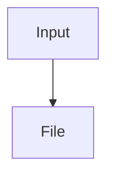

Part 4 · Page 31 of 32 · Previous: [Documentation checker](17-docs-check.md) · Next: [Roadmap](30-roadmap.md) · [Index](../README.md)
# Documentation standard

Rules and templates for maintaining this documentation.

## Page index

1. Purpose and reading layers
2. Truth and evidence
3. One page per code file
4. Type pages
5. Current state and history
6. Links, diagrams, and tables
7. JSDoc comments in code
8. Coordinated updates
9. Templates

## 1. Purpose and reading layers

The documentation moves from a plain explanation to the detail needed to maintain the program. Each paragraph belongs to one layer: plain language for any reader or technical detail for developers. Explain a technical term in one sentence the first time it appears.

## 2. Truth and evidence

Every claim about behavior must come from current code and give exact paths, names, lines, and values where relevant. Examples use real repository data; do not invent inputs, outputs, or capabilities. Only document behavior that exists. Keep missing work in the roadmap; each task adds pages for behavior after it is built.

## 3. One page per code file

Each code file has its own page in `3-code/`, in execution order. The page contains these sections in this order:

1. Navigation bar.
2. File card with path, line count, and status.
3. Page index.
4. **What is it and what is it for?** Explain what would fail without the file, what it receives and returns, and who uses it.
5. **Before reading the code.** For each concept, explain what it is, give a minimal example with its result in a `// →` comment, and say why it matters here.
6. **How it fits.** Mermaid diagram and a numbered walkthrough.
7. **The complete, commented code.** Include the entire file; explain in comments what every logical line does and why. Omit imports and obvious lines. Keep comments under 100 characters. Split files over about 150 lines into consecutive blocks without skipping any line.
8. **Examples with real data.** Include a normal case, an edge case, and what would happen without the key line.
9. **Behavior summary.** Bold each situation, followed by its result.
10. **Where it is used.** Cite file and line.
11. **Tests.** Name the test file and every relevant test.

## 4. Type pages

The type page has one section per type. Give each field a block with its type, whether it is required or its default, purpose, effect of each value, who fills it, who reads it, and an example.

## 5. Current state and history

Describe each file as it exists today. Do not narrate tasks or historical changes. Keep project history in `CHANGELOG.md`; missing work lives only in the roadmap.

## 6. Links, diagrams, and tables

Link every mentioned file to its documentation page. Use Mermaid for diagrams. Give every level-two through level-six heading content before the next heading or page end. Tables have at most three columns, one line per cell, and no code.

## 7. JSDoc comments in code

In repository code, every exported function, class, and constant has a short one or two sentence JSDoc in English. Add one to every named function even when it is not exported. Put long explanations in `docs/`, not in code.

## 8. Coordinated updates

Only document existing behavior; keep missing work in the roadmap; each task adds or updates the pages for what it builds, in both languages on the same branch. The automated check must pass.

## 9. Templates

Use these starting points when adding a code page or a type page.

### Template: code page

````markdown
Part N · Page X of M · Previous: [Title](../README.md) · Next: [Title](../README.md) · [Index](../README.md)


**File:** `src/path/file.ts` · N lines · **Status:** available

## Page index

## What is it and what is it for?

## Before reading the code

### Concept

What it is. Minimal example:

```ts
// input
// → result
```

Why it matters in this file.

## How it fits



1. Flow walkthrough.

## The complete, commented code

```ts
// Complete code with concise explanations.
```

## Examples with real data

### Normal case

### Edge case

### Without the key line

## Behavior summary

- **Situation:** result.

## Where it is used

- [src/cli.ts](../3-code/020-cli.md), line N.

## Tests

- `src/file.test.ts`: test name.
````

### Template: type page

```markdown
Part N · Page X of M · Previous: [Title](../README.md) · Next: [Title](../README.md) · [Index](../README.md)


**File:** `src/path/types.ts` · N lines · **Status:** available

## Page index

## What is it and what is it for?

## Types

### `TypeName`

#### `field` — `Type`

- **Required or default:** condition.
- **Purpose:** field effect.
- **Values:** effect of each valid value.
- **Filled by:** file and line.
- **Read by:** file and line.
- **Example:** `{ field: value }`.

## Where it is used

## Tests
```
Part 4 · Page 31 of 32 · Previous: [Documentation checker](17-docs-check.md) · Next: [Roadmap](30-roadmap.md) · [Index](../README.md)


