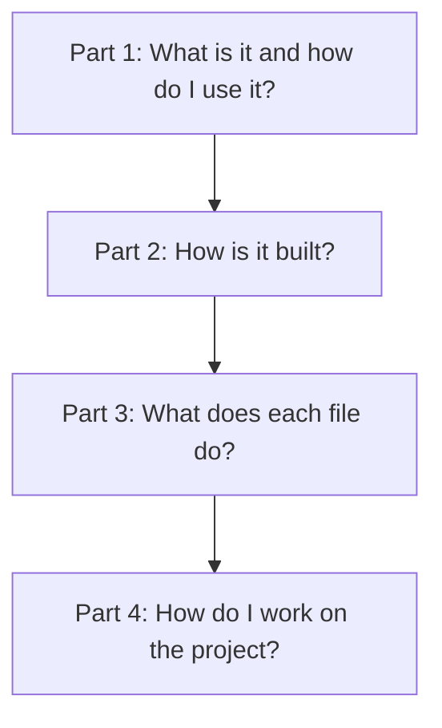

# code-audit documentation

Start here: [page 1](1-overview/10-what-is-code-audit.md).

code-audit checks branch changes against project rules and reports the result.

## Part 1: Overview

1. [What is code-audit](1-overview/10-what-is-code-audit.md) — The purpose and the tools that exist today.
2. [Use code-audit today](1-overview/20-usage.md) — Build and run the command line program.

By the end of this part, you will know what the project contains and how to run its current command line program.

## Part 2: Architecture

3. [Architecture](2-architecture/10-architecture.md) — Current modules and their actual connections.
4. [Command line](2-architecture/20-cli.md) — Current commands, options, and exit codes.

By the end of this part, you will understand how the existing modules work together and what the CLI does today.

## Part 3: Code

5. [Program entry point](3-code/010-bin.md) — Starts the CLI and sets the process exit code.
6. [Command line](3-code/020-cli.md) — Parses command-line arguments and writes output.
7. [Exit codes and version](3-code/030-exit-codes-and-version.md) — Defines process codes and reads the package version.
8. [Frontmatter reader](3-code/040-config-frontmatter.md) — Parses a YAML header and Markdown body.
9. [Configuration paths](3-code/050-config-paths.md) — Names the configuration folders and kinds.
10. [Configuration types](3-code/060-config-types.md) — Defines shared config, rule, and problem shapes.
11. [Project configuration loader](3-code/070-config-config.md) — Reads and validates config.md.
12. [Rule loader](3-code/080-config-rules.md) — Loads and validates Markdown rules.

By the end of this part, you will be able to follow each current source file and its tests.

## Part 4: Development

13. [Development](4-development/10-development.md) — Requirements, checks, and pull request workflow.
14. [Build script](4-development/15-build-script.md) — Creates the standalone Node.js CLI.
15. [Documentation checker](4-development/17-docs-check.md) — Validates the public documentation and code references.
16. [Documentation standard](4-development/20-documentation-standard.md) — Rules for maintaining these pages.
17. [Roadmap](4-development/30-roadmap.md) — Work that remains for the project.

By the end of this part, you will know how to build, check, and maintain the current project.
