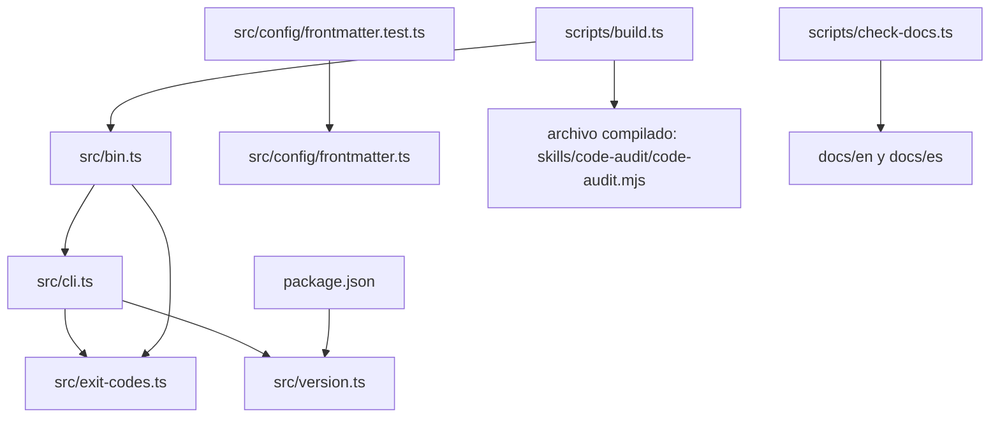

Parte 2 · Página 3 de 13 · Anterior: [Uso de code-audit hoy](../1-overview/20-usage.md) · Siguiente: [Línea de comandos](20-cli.md) · [Índice](../README.md)
# Arquitectura

Bun es la herramienta de desarrollo: instala dependencias, ejecuta pruebas y scripts TypeScript, y empaqueta el CLI. Node.js ejecuta el archivo JavaScript compilado, así que el CLI no requiere Bun al usarse.

## Módulos y conexiones

`src/bin.ts` pasa los argumentos a `main` en [`src/cli.ts`](../3-code/020-cli.md). El CLI importa [`src/exit-codes.ts`](../3-code/030-exit-codes-and-version.md) y [`src/version.ts`](../3-code/030-exit-codes-and-version.md). El módulo de versión lee `package.json`.

[`src/config/frontmatter.ts`](../3-code/040-config-frontmatter.md) interpreta un encabezado YAML y el cuerpo. Hoy ningún archivo de producción lo importa; solo lo importa su archivo de pruebas.

El script de compilación agrupa el ejecutable que comienza en [`src/bin.ts`](../3-code/010-bin.md) dentro de un módulo JavaScript. Un módulo JavaScript (ESM) es un archivo que usa `import` y `export`. El comprobador valida las páginas en inglés y español.
Parte 2 · Página 3 de 13 · Anterior: [Uso de code-audit hoy](../1-overview/20-usage.md) · Siguiente: [Línea de comandos](20-cli.md) · [Índice](../README.md)
