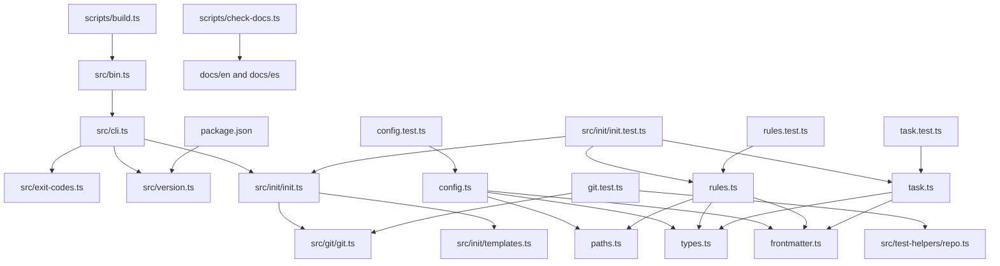

Parte 2 · Página 3 de 22 · Anterior: [Uso de code-audit hoy](../1-overview/20-usage.md) · Siguiente: [Línea de comandos](20-cli.md) · [Índice](../README.md)
# Arquitectura

Bun es la herramienta de desarrollo: instala dependencias, ejecuta pruebas y scripts TypeScript, y empaqueta el CLI. Node.js ejecuta el archivo JavaScript compilado, así que el CLI no requiere Bun al usarse.

## Módulos y conexiones

`src/bin.ts` pasa los argumentos a `main` en [`src/cli.ts`](../3-code/020-cli.md). El CLI importa [`src/exit-codes.ts`](../3-code/030-exit-codes-and-version.md), [`src/version.ts`](../3-code/030-exit-codes-and-version.md) y [`src/init/init.ts`](../3-code/120-init-init.md). El módulo de versión lee `package.json`. El inicializador importa [`src/git/git.ts`](../3-code/100-git-git.md), [`src/config/paths.ts`](../3-code/050-config-paths.md) y [`src/init/templates.ts`](../3-code/130-init-templates.md).

[`src/config/frontmatter.ts`](../3-code/040-config-frontmatter.md) interpreta un encabezado YAML y el cuerpo. Lo importan `src/config/rules.ts` y [`src/config/task.ts`](../3-code/090-config-task.md); las pruebas importan sus respectivos cargadores.

El script de compilación agrupa el ejecutable que comienza en [`src/bin.ts`](../3-code/010-bin.md) dentro de un módulo JavaScript. Un módulo JavaScript (ESM) es un archivo que usa `import` y `export`. El comprobador valida las páginas en inglés y español.

Las pruebas de Git e inicialización importan `src/git/git.ts` y [`src/test-helpers/repo.ts`](../3-code/110-test-helpers-repo.md). `src/init/init.test.ts` también comprueba los ejemplos generados con los cargadores de reglas y tareas. El ayudante ejecuta Git solo dentro de repositorios temporales de prueba.
Parte 2 · Página 3 de 22 · Anterior: [Uso de code-audit hoy](../1-overview/20-usage.md) · Siguiente: [Línea de comandos](20-cli.md) · [Índice](../README.md)
