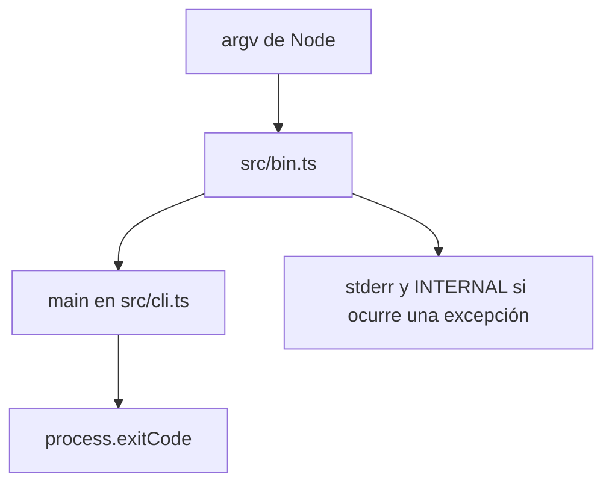

Parte 3 · Página 5 de 22 · Anterior: [Línea de comandos](../2-architecture/20-cli.md) · Siguiente: [Línea de comandos](020-cli.md) · [Índice](../README.md)
# Entrada del programa

**Archivo:** `src/bin.ts` · 10 líneas · **Estado:** disponible

## Índice de la página

- ¿Qué es y para qué sirve?
- Antes de leer el código
- Cómo encaja
- El código completo, comentado
- Ejemplos con datos reales
- Resumen de comportamientos
- Dónde se usa
- Pruebas

## ¿Qué es y para qué sirve?

`src/bin.ts` es el punto de entrada ejecutable. Sin él, el comando compilado no tendría dónde convertir los argumentos de Node en una llamada al CLI ni fijar el resultado del proceso. Pasa los argumentos a [`src/cli.ts`](020-cli.md), captura errores inesperados y escribe el código de salida. Si ocurre un error, lo imprime por `stderr`, el canal que muestra mensajes de error. Node inicia el archivo; este no devuelve un valor a quien lo llama.

## Antes de leer el código


### Argumentos del proceso

`process.argv` contiene el ejecutable de Node, la ruta del script y los argumentos del usuario. `slice(2)` conserva solo los últimos. Al ejecutar el comando compilado con `--version`, la salida real fue:

```text
0.1.0
```

### Código de salida

`process.exitCode` informa al shell si el comando tuvo éxito. En esa llamada el CLI devolvió `0` y el proceso terminó con estado `0`:

Comando: `node skills/code-audit/code-audit.mjs --version`

```text
// → 0.1.0
```

Esto permite que otros scripts reaccionen al resultado.

## Cómo encaja



1. Node carga el ejecutable y proporciona `process.argv`.
2. El punto de entrada quita los dos primeros argumentos de Node y espera `main`.
3. El resultado del CLI se asigna a `process.exitCode`.
4. Si escapa una excepción, imprime su mensaje y usa `ExitCode.INTERNAL`.

## El código completo, comentado

```ts
import { main } from './cli.js';
import { ExitCode } from './exit-codes.js';

// Inicia el CLI solo con los argumentos escritos por el usuario.
try {
  process.exitCode = await main(process.argv.slice(2));
} catch (error) {
  // Conserva texto útil aunque lo lanzado no sea una instancia de Error.
  const message = error instanceof Error ? error.message : String(error);
  process.stderr.write(`${message}\n`);
  // Distingue fallos inesperados de errores de uso.
  process.exitCode = ExitCode.INTERNAL;
}
```

## Ejemplos con datos reales


### Caso normal

Comando: `node skills/code-audit/code-audit.mjs --version`.

Comando: `node skills/code-audit/code-audit.mjs --version`

```text
// → 0.1.0
```

### Caso límite

`main` informa los comandos desconocidos por stderr y devuelve el código de uso:

Comando: `node skills/code-audit/code-audit.mjs nope`

```text
// → Unknown command: nope
```

El proceso termina con código `1`.

### Sin la línea clave

Sin `process.argv.slice(2)`, `main` recibiría primero el ejecutable de Node y la ruta del script; su comprobación de un único argumento `--version` no coincidiría. Se deduce del uso de `argv` en `src/bin.ts:5` y la condición en [`src/cli.ts`](020-cli.md).

## Resumen de comportamientos

- **El CLI devuelve un código:** el punto de entrada lo asigna a `process.exitCode`.
- **Se lanza un valor inesperado:** imprime el texto y establece el código `10`.
- **El CLI termina sin error:** Node sale con el código elegido por `main`.

## Dónde se usa

- Node inicia este archivo mediante el banner `#!/usr/bin/env node` que emite [`scripts/build.ts`](../4-development/15-build-script.md), línea 22.
- Llama a [`src/cli.ts`](020-cli.md), línea 5.
- Usa [`src/exit-codes.ts`](030-exit-codes-and-version.md), línea 9.

## Pruebas

- `src/cli.test.ts`: `prints the version and returns success`, `rejects unknown commands`.
Parte 3 · Página 5 de 22 · Anterior: [Línea de comandos](../2-architecture/20-cli.md) · Siguiente: [Línea de comandos](020-cli.md) · [Índice](../README.md)
