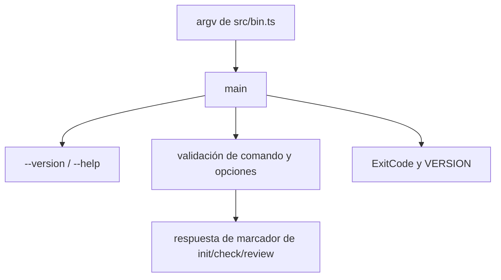

Parte 3 · Página 6 de 20 · Anterior: [Entrada del programa](010-bin.md) · Siguiente: [Códigos de salida y versión](030-exit-codes-and-version.md) · [Índice](../README.md)
# Línea de comandos

**Archivo:** `src/cli.ts` · 75 líneas · **Estado:** disponible

## Índice de la página

- ¿Qué es y para qué sirve?
- Antes de leer el código
- Cómo encaja
- El código completo, comentado
- Ejemplos con datos reales
- Resumen de comportamientos
- Dónde se usa
- Pruebas

## ¿Qué es y para qué sirve?

`src/cli.ts` analiza argumentos, imprime ayuda y versión, y devuelve un código de salida. Sin este archivo, el ejecutable no podría distinguir opciones admitidas de errores. Recibe `argv` y funciones de salida opcionales; devuelve `Promise<number>`, una promesa cuyo resultado será un número. Lo llama [`src/bin.ts`](010-bin.md). Por ahora `init`, `check` y `review` son marcadores de posición.

## Antes de leer el código


### Salida inyectada

`CliIO` permite capturar salida normal y errores en vez de escribirlos en la terminal. La prueba real de versión captura `0.1.0` y verifica que `main` devuelva `0`.

### Código de salida

`ExitCode.USAGE` vale `1`. El CLI compilado produjo esta salida con una opción desconocida:

Comando: `node skills/code-audit/code-audit.mjs init --bogus`

```text
// → Unknown option: --bogus
```

Así se distinguen errores de uso de errores internos.

### Opciones reconocidas

`--root` y `--language` consumen el siguiente argumento; `--json` no consume ninguno. Si `--root` no recibe valor, el CLI imprimió:

Comando: `node skills/code-audit/code-audit.mjs init --root`

```text
// → Missing value for --root
```

## Cómo encaja



1. El punto de entrada llama a `main(argv)`.
2. `main` atiende `--version` o ayuda cuando se pasan solos.
3. Valida el comando y recorre sus opciones.
4. Devuelve el código de uso para entradas inválidas o comandos no disponibles.

## El código completo, comentado

```ts
import { ExitCode } from './exit-codes.js';
import { VERSION } from './version.js';

/** Proporciona funciones para escribir la salida del CLI. */
export interface CliIO {
  stdout(s: string): void;
  stderr(s: string): void;
}

// Mantiene la ayuda en un solo lugar para que todas las rutas impriman lo mismo.
const HELP = `code-audit ${VERSION}

Usage: code-audit <command> [options]

Commands:
  init    Create the project configuration
  check   Validate the project configuration
  review  Review the current branch

Options:
  --root <path>       Project root directory
  --language <code>   Language for generated files
  --json              Print machine-readable output
  --help              Show this help
  --version           Show the version`;

// Rechaza nombres de comandos fuera de la superficie actual del CLI.
const COMMANDS = new Set(['init', 'check', 'review']);

/** Ejecuta el comando del CLI y devuelve el código de salida. */
export async function main(argv: string[], io: CliIO = {
  stdout: (s) => process.stdout.write(s),
  stderr: (s) => process.stderr.write(s),
}): Promise<number> {
  // Atiende la versión sin requerir un nombre de comando.
  if (argv.length === 1 && argv[0] === '--version') {
    io.stdout(`${VERSION}\n`);
    return ExitCode.OK;
  }

  // Admite las dos formas comunes de ayuda cuando se pasan solas.
  if (argv.length === 1 && (argv[0] === '--help' || argv[0] === '-h')) {
    io.stdout(`${HELP}\n`);
    return ExitCode.OK;
  }

  // Separa el comando de las opciones que puede aceptar.
  const [command, ...options] = argv;
  if (!command || command.startsWith('-') || !COMMANDS.has(command)) {
    io.stderr(`Unknown command: ${command ?? ''}\n`);
    return ExitCode.USAGE;
  }

  // Revisa cada opción y salta el valor que consumen las opciones con valor.
  for (let index = 0; index < options.length; index += 1) {
    const option = options[index];
    if (option === '--json') continue;
    if (option === '--root' || option === '--language') {
      if (!options[index + 1] || options[index + 1].startsWith('--')) {
        io.stderr(`Missing value for ${option}\n`);
        return ExitCode.USAGE;
      }
      index += 1;
      continue;
    }
    if (option === '--help' || option === '-h') {
      io.stdout(`${HELP}\n`);
      return ExitCode.OK;
    }
    io.stderr(`Unknown option: ${option}\n`);
    return ExitCode.USAGE;
  }

  // review aparece en la ayuda, pero todavía no tiene implementación.
  if (command === 'review') {
    io.stderr('review is not available yet\n');
    return ExitCode.USAGE;
  }

  // init y check también son marcadores de posición en esta versión.
  io.stderr(`${command} is not available yet\n`);
  return ExitCode.USAGE;
}
```

## Ejemplos con datos reales


### Caso normal

Comando: `node skills/code-audit/code-audit.mjs --version`.

Comando: `node skills/code-audit/code-audit.mjs --version`

```text
// → 0.1.0
```

### Caso límite

Comando: `node skills/code-audit/code-audit.mjs init --root`.

Comando: `node skills/code-audit/code-audit.mjs init --root`

```text
// → Missing value for --root
```

Termina con código `1`.

### Sin la línea clave

Sin `index += 1`, el argumento siguiente a `--root` se trataría como otra opción y se marcaría como desconocida. El ciclo actual lo salta en `src/cli.ts:58`.

## Resumen de comportamientos

- **Solo se pasa `--version`:** imprime `0.1.0` y devuelve `0`.
- **Se pasa un comando u opción desconocidos:** escribe un error y devuelve `1`.
- **Una opción con valor no recibe valor:** escribe `Missing value for ...` y devuelve `1`.
- **Se solicita `init`, `check` o `review`:** devuelve `1` con un mensaje de no disponible.

## Dónde se usa

- Lo llama [`src/bin.ts`](010-bin.md), línea 5.
- Lee [`src/exit-codes.ts`](030-exit-codes-and-version.md), líneas 1–8, y [`src/version.ts`](030-exit-codes-and-version.md), línea 4.

## Pruebas

El archivo de pruebas verifica las respuestas y los códigos que devuelve el CLI.
Parte 3 · Página 6 de 20 · Anterior: [Entrada del programa](010-bin.md) · Siguiente: [Códigos de salida y versión](030-exit-codes-and-version.md) · [Índice](../README.md)
