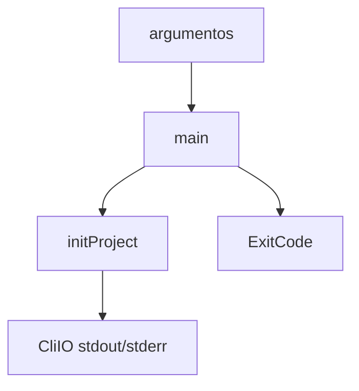

Parte 3 · Página 6 de 22 · Anterior: [Entrada del programa](010-bin.md) · Siguiente: [Códigos de salida y versión](030-exit-codes-and-version.md) · [Índice](../README.md)
# Línea de comandos

**Archivo:** `src/cli.ts` · 114 líneas · **Estado:** disponible

## Índice de la página

- ¿Qué es y para qué sirve?
- Antes de leer el código
- Cómo encaja
- El código completo, comentado
- Ejemplos con datos reales
- Resumen de comportamientos
- Dónde se usa
- Pruebas

## ¿Qué es y para qué sirve?

`main` valida el comando y las opciones, llama al inicializador y devuelve el código de salida correspondiente. Un idioma inválido produce un mensaje directo y el código 1. `check` y `review` siguen pendientes.

## Antes de leer el código

El código de salida es el número que devuelve al shell. Un error de uso, como un idioma inválido, devuelve `ExitCode.USAGE`, cuyo valor es 1.

## Cómo encaja



1. `main` valida el comando y las opciones.
2. Para `init`, lee `--root`, `--language` y `--json`.
3. Llama a `initProject`; un idioma inválido devuelve 1, una ruta fuera del repositorio devuelve 3 y un fallo inesperado devuelve 10.
4. `check` y `review` dicen que aún no están disponibles.

## El código completo, comentado

Código fuente completo: 114 líneas.

```ts
import { ExitCode } from './exit-codes.js';
import { NotARepoError } from './git/git.js';
import { initProject, InvalidLanguageError } from './init/init.js';
import { VERSION } from './version.js';

/** Supplies output functions used by the CLI. */
export interface CliIO {
  stdout(s: string): void;
  stderr(s: string): void;
}

const HELP = `code-audit ${VERSION}

Usage: code-audit <command> [options]

Commands:
  init    Create the project configuration
  check   Validate the project configuration
  review  Review the current branch

Options:
  --root <path>       Project root directory
  --language <code>   Language for generated files
  --json              Print machine-readable output
  --help              Show this help
  --version           Show the version`;

const COMMANDS = new Set(['init', 'check', 'review']);

/** Runs the CLI command and returns its process exit code. */
export async function main(argv: string[], io: CliIO = {
  stdout: (s) => process.stdout.write(s),
  stderr: (s) => process.stderr.write(s),
}): Promise<number> {
  if (argv.length === 1 && argv[0] === '--version') {
    io.stdout(`${VERSION}\n`);
    return ExitCode.OK;
  }

  if (argv.length === 1 && (argv[0] === '--help' || argv[0] === '-h')) {
    io.stdout(`${HELP}\n`);
    return ExitCode.OK;
  }

  const [command, ...options] = argv;
  if (!command || command.startsWith('-') || !COMMANDS.has(command)) {
    io.stderr(`Unknown command: ${command ?? ''}\n`);
    return ExitCode.USAGE;
  }

  for (let index = 0; index < options.length; index += 1) {
    const option = options[index];
    if (option === '--json') continue;
    if (option === '--root' || option === '--language') {
      if (!options[index + 1] || options[index + 1].startsWith('--')) {
        io.stderr(`Missing value for ${option}\n`);
        return ExitCode.USAGE;
      }
      index += 1;
      continue;
    }
    if (option === '--help' || option === '-h') {
      io.stdout(`${HELP}\n`);
      return ExitCode.OK;
    }
    io.stderr(`Unknown option: ${option}\n`);
    return ExitCode.USAGE;
  }

  if (command === 'init') {
    let root = process.cwd();
    let language = 'en';
    let json = false;
    for (let index = 0; index < options.length; index += 1) {
      const option = options[index];
      if (option === '--json') json = true;
      else if (option === '--root') root = options[++index]!;
      else if (option === '--language') language = options[++index]!;
    }
    try {
      const result = await initProject(root, { language });
      io.stdout(json ? `${JSON.stringify(result)}\n` : formatInitResult(result));
      return ExitCode.OK;
    } catch (error) {
      const message = error instanceof Error ? error.message : String(error);
      if (error instanceof InvalidLanguageError) {
        io.stderr(`${message}\n`);
        return ExitCode.USAGE;
      }
      if (error instanceof NotARepoError) {
        io.stderr(`${message}\n`);
        return ExitCode.NOT_A_REPO;
      }
      io.stderr(`init failed: ${message}\n`);
      return ExitCode.INTERNAL;
    }
  }

  if (command === 'review') {
    io.stderr('review is not available yet\n');
    return ExitCode.USAGE;
  }

  io.stderr(`${command} is not available yet\n`);
  return ExitCode.USAGE;
}

/** Formats a successful initialization for terminal output. */
function formatInitResult(result: { created: string[]; skipped: string[]; gitignoreUpdated: boolean }): string {
  const lines = [`Created ${result.created.length} file(s).`, `Skipped ${result.skipped.length} existing file(s).`];
  if (result.gitignoreUpdated) lines.push('Updated .gitignore.');
  else lines.push('.gitignore already contains the required entries.');
  return `${lines.join('\n')}\n`;
}
```

## Ejemplos con datos reales

### Inicialización correcta

```text
Created 12 file(s).
Skipped 0 existing file(s).
Updated .gitignore.
```

### Idioma inválido

```text
$ node skills/code-audit/code-audit.mjs init --language "es: x"
invalid language: es: x
$ echo $?
1
```

## Resumen de comportamientos

- **`--language` válido:** guarda el valor exacto en `config.md`; `es`, `ES` y `es-MX` seleccionan archivos en español.
- **`--language` inválido:** muestra `invalid language: <valor>` y devuelve 1 antes de crear archivos.
- **`--json`:** imprime el objeto de resultado.
- **Inicializador:** conserva el idioma escrito, elige español para `es` y `es-` sin distinguir mayúsculas, y rechaza valores inválidos antes de escribir.
- **Sin repositorio de trabajo:** muestra el diagnóstico de Git y devuelve 3.
- **`check` o `review`:** muestra `is not available yet` y devuelve 1.

## Dónde se usa

`src/bin.ts` llama a `main`. El inicializador está documentado en [120-init-init.md](120-init-init.md).

## Pruebas

`src/cli.test.ts`: versión, ayuda, comando desconocido y review pendiente. `src/init/init.test.ts`: salida JSON, variantes de idioma, valores inválidos y códigos de salida.

Parte 3 · Página 6 de 22 · Anterior: [Entrada del programa](010-bin.md) · Siguiente: [Códigos de salida y versión](030-exit-codes-and-version.md) · [Índice](../README.md)
