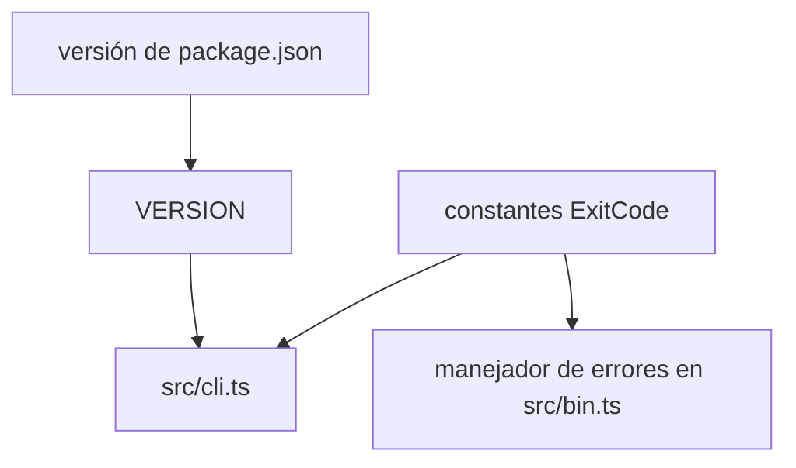

Parte 3 · Página 7 de 20 · Anterior: [Línea de comandos](020-cli.md) · Siguiente: [Lector de frontmatter](040-config-frontmatter.md) · [Índice](../README.md)
# Códigos de salida y versión

**Archivo:** `src/exit-codes.ts`, `src/version.ts` · 12 líneas · **Estado:** disponible

## Índice de la página

- ¿Qué es y para qué sirve?
- Antes de leer el código
- Cómo encaja
- El código completo, comentado
- Ejemplos con datos reales
- Resumen de comportamientos
- Dónde se usa
- Pruebas

## ¿Qué es y para qué sirve?

[`src/exit-codes.ts`](030-exit-codes-and-version.md) define resultados estables del proceso; [`src/version.ts`](030-exit-codes-and-version.md) lee la versión del paquete. Sin ellos, cada comando repetiría códigos numéricos y el CLI podría mostrar una versión distinta de `package.json`. Ambos exportan constantes que usan [`src/cli.ts`](020-cli.md) y [`src/bin.ts`](010-bin.md).

## Antes de leer el código


### `as const`

Conserva los valores del objeto como números literales: `ExitCode.USAGE` tiene tipo `1`, no el tipo más amplio `number`. El CLI devolvió este valor real para un comando desconocido:

Comando: `node skills/code-audit/code-audit.mjs nope`

```text
// → Unknown command: nope
```

### Importación JSON

El archivo de versión importa `package.json` como JSON, un formato de texto para datos estructurados, y exporta su campo `version`. El CLI compilado imprimió:

Comando: `node skills/code-audit/code-audit.mjs --version`

```text
// → 0.1.0
```

Así se evita mantener otra cadena de versión en el CLI.

## Cómo encaja



1. Los metadatos del paquete proporcionan la versión.
2. El CLI usa `VERSION` para la ayuda y la salida de versión.
3. El CLI y el ejecutable eligen códigos nombrados en vez de números sueltos.

## El código completo, comentado

`src/exit-codes.ts`:

```ts
/** Códigos de salida estables que devuelve la interfaz de línea de comandos. */
export const ExitCode = {
  OK: 0,
  USAGE: 1,
  CONFIG_INVALID: 2,
  NOT_A_REPO: 3,
  INTERNAL: 10,
} as const;
```

`src/version.ts`:

```ts
import packageJson from '../package.json' with { type: 'json' };

/** Versión del paquete incluida en la interfaz de línea de comandos. */
export const VERSION: string = packageJson.version;
```

## Ejemplos con datos reales


### Caso normal

La compilación actual lee la versión `0.1.0` del paquete:

Comando: `node skills/code-audit/code-audit.mjs --version`

```text
// → 0.1.0
```

### Caso límite

Un comando desconocido usa `USAGE`, cuyo valor numérico real es `1`; el programa compilado devolvió código de proceso `1`:

Comando: `node skills/code-audit/code-audit.mjs nope`

```text
// → Unknown command: nope
```

### Sin la línea clave

Sin `as const`, TypeScript ampliaría los valores y los consumidores perderían sus tipos literales específicos. Los números en tiempo de ejecución no cambiarían; es un efecto de tipos de la declaración en `src/exit-codes.ts:8`.

## Resumen de comportamientos

- **Un comando termina bien:** `ExitCode.OK` vale `0`.
- **Los argumentos son inválidos o un comando no está disponible:** `ExitCode.USAGE` vale `1`.
- **Códigos `2` y `3`:** están definidos como `CONFIG_INVALID` y `NOT_A_REPO`; ningún comando actual los devuelve.
- **Una excepción escapa del CLI:** `ExitCode.INTERNAL` vale `10`.
- **El CLI imprime la versión:** `VERSION` proviene de `package.json`.

## Dónde se usa

- [`src/cli.ts`](020-cli.md) importa `ExitCode` en la línea 1 y `VERSION` en la línea 2.
- [`src/bin.ts`](010-bin.md) importa `ExitCode` en la línea 2.
- [`src/version.ts`](030-exit-codes-and-version.md) lee `package.json` en la línea 1.

## Pruebas

El archivo de pruebas comprueba la versión y las respuestas del CLI.
Parte 3 · Página 7 de 20 · Anterior: [Línea de comandos](020-cli.md) · Siguiente: [Lector de frontmatter](040-config-frontmatter.md) · [Índice](../README.md)
