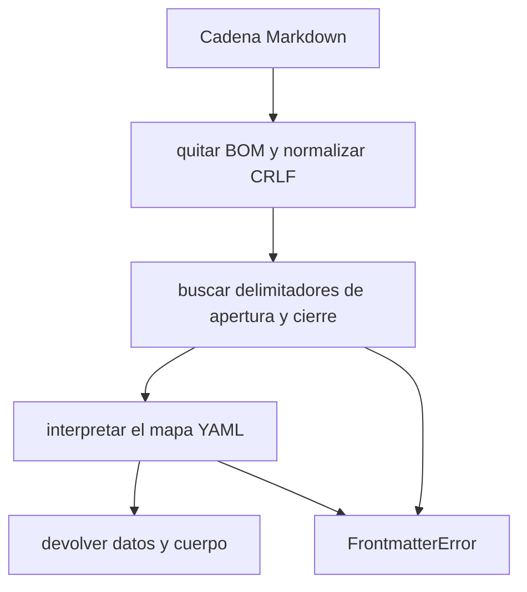

Parte 3 · Página 8 de 28 · Anterior: [Códigos de salida y versión](030-exit-codes-and-version.md) · Siguiente: [Rutas de configuración](050-config-paths.md) · [Índice](../README.md)
# Lector de frontmatter

**Archivo:** `src/config/frontmatter.ts` · 53 líneas · **Estado:** disponible

`src/config/frontmatter.ts` interpreta los metadatos al inicio de un archivo Markdown y devuelve esos datos junto con el texto restante.

## Índice de la página

- ¿Qué es y para qué sirve?
- Antes de leer el código
- Cómo encaja
- El código completo, comentado
- Ejemplos con datos reales
- Resumen de comportamientos
- Dónde se usa
- Pruebas

## ¿Qué es y para qué sirve?

El lector recibe una cadena y devuelve `{ data, body }`. Markdown es un formato de texto sencillo para documentos. `data` es un objeto JavaScript formado a partir del encabezado YAML; `body` es el texto Markdown que aparece después. `FrontmatterError` describe un delimitador ausente, YAML inválido o un valor que no es objeto. Hoy ningún archivo de producción importa este lector; su archivo de pruebas lo llama directamente.

## Antes de leer el código


### YAML y frontmatter

YAML es un formato de texto para valores con nombre y listas. Frontmatter es un bloque YAML al inicio de un archivo Markdown, entre líneas que contienen `---`. El primer ejemplo de abajo interpreta un encabezado de regla como campos.

### BOM y CRLF

La marca de orden de bytes (BOM) es un carácter invisible que algunos editores ponen al inicio del texto. Retorno de carro y salto de línea (CRLF) son los dos caracteres que Windows suele usar al terminar cada línea. El lector quita el BOM y normaliza CRLF.

### Mapa

Un mapa es un conjunto de claves con nombre. El lector lo exige porque devuelve el encabezado como un objeto JavaScript; una lista YAML no tiene claves que pueda devolver.

## Cómo encaja



1. Normaliza la entrada para que el BOM o los finales de línea de Windows no impidan leerla.
2. Exige un delimitador inicial en la primera línea y busca el siguiente.
3. Interpreta como YAML el texto entre ambos delimitadores.
4. Rechaza valores que no sean mapas; si es válido, devuelve los datos y el cuerpo.

## El código completo, comentado

```ts
import { parse as parseYaml, YAMLParseError } from 'yaml';

/** Error por falta de un bloque frontmatter o porque no es válido. */
export class FrontmatterError extends Error {
  constructor(message: string) {
    super(message);
    this.name = 'FrontmatterError';
  }
}

/** Interpreta el bloque frontmatter YAML y devuelve sus datos y el cuerpo Markdown. */
export function parseFrontmatter(text: string): {
  data: Record<string, unknown>;
  body: string;
} {
  // Normaliza codificaciones comunes en archivos de otras plataformas.
  const normalized = text.replace(/^\uFEFF/, '').replace(/\r\n/g, '\n');
  const lines = normalized.split('\n');
  // Acepta un delimitador seguido solo de espacios o tabuladores.
  const isDelimiter = (line: string): boolean => /^---[ \t]*$/.test(line);

  // Exige metadatos en la primera línea, no más adelante en el documento.
  if (!isDelimiter(lines[0])) {
    throw new FrontmatterError('Frontmatter opening delimiter --- is missing');
  }

  // El primer delimitador posterior cierra el bloque de metadatos.
  const closingLine = lines.findIndex((line, index) => index > 0 && isDelimiter(line));
  if (closingLine === -1) {
    throw new FrontmatterError('Frontmatter closing delimiter --- is missing');
  }

  let parsed: unknown;
  try {
    // Interpreta solo el texto entre las dos líneas delimitadoras.
    parsed = parseYaml(lines.slice(1, closingLine).join('\n'), { logLevel: 'error' });
  } catch (error) {
    // YAML cuenta la línea desde el texto aislado del encabezado.
    const yamlLine = error instanceof YAMLParseError ? error.linePos?.[0]?.line : undefined;
    const fileLine = yamlLine === undefined ? undefined : yamlLine + 1;
    const rawDetail = error instanceof Error ? error.message : String(error);
    // Evita repetir la ubicación que ya se formateó arriba.
    const detail = rawDetail.replace(/\s+at line \d+[\s\S]*$/i, '');
    const location = fileLine === undefined ? '' : ` at line ${fileLine}`;
    throw new FrontmatterError(`Invalid YAML${location}: ${detail}`);
  }

  // Un documento YAML vacío representa un mapa de metadatos vacío.
  if (parsed === null || parsed === undefined) {
    parsed = {};
  }
  // Las listas y los valores simples no cumplen la forma de un mapa.
  if (typeof parsed !== 'object' || Array.isArray(parsed)) {
    throw new FrontmatterError('Frontmatter YAML must be a mapping');
  }

  // Conserva como cuerpo Markdown el texto posterior al delimitador final.
  return {
    data: parsed as Record<string, unknown>,
    body: lines.slice(closingLine + 1).join('\n'),
  };
}
```

## Ejemplos con datos reales

Estos ejemplos muestran la salida del lector con entradas válidas e inválidas.

### Caso normal

Esta llamada recibe un encabezado de regla y muestra el objeto interpretado:

```ts
const input = '---\nid: BIZ-003\ntitle: Handle cents\nseverity: critical\napplies_to:\n  - "src/billing/**"\n---\nBody';
console.log(JSON.stringify(parseFrontmatter(input)));
// → {"data":{"id":"BIZ-003","title":"Handle cents","severity":"critical","applies_to":["src/billing/**"]},"body":"Body"}
```

### BOM y CRLF

La secuencia `\uFEFF` representa el BOM; `\r\n` muestra los dos caracteres que terminan cada línea.

```ts
const input = '\uFEFF---\r\nid: BIZ-003\r\ntitle: Handle cents\r\nseverity: critical\r\n---\r\nBody';
console.log(JSON.stringify(parseFrontmatter(input)));
// → {"data":{"id":"BIZ-003","title":"Handle cents","severity":"critical"},"body":"Body"}
```

### YAML roto

El analizador YAML informa la línea del encabezado donde comienza esta lista incompleta:

```ts
const input = '---\nid: [\n---\nBody';
try { console.log(JSON.stringify(parseFrontmatter(input))); }
catch (error) { console.log(error instanceof Error ? error.message : String(error)); }
// → Invalid YAML at line 2: Flow sequence in block collection must be sufficiently indented and end with a ]
```

### Delimitador con espacios y tabulador

La línea inicial se representa como `--- \t`; se aceptan espacios y un tabulador al final:

```ts
const input = '--- \t\nid: BIZ-003\n---\nBody';
console.log(JSON.stringify(parseFrontmatter(input)));
// → {"data":{"id":"BIZ-003"},"body":"Body"}
```

### Lista en lugar de mapa

Una lista no tiene claves con nombre, por eso esta entrada produce un error:

```ts
const input = '---\n- item\n---\nBody';
try { console.log(JSON.stringify(parseFrontmatter(input))); }
catch (error) { console.log(error instanceof Error ? error.message : String(error)); }
// → Frontmatter YAML must be a mapping
```

### Sin la línea clave

Sin quitar el BOM, el primer delimitador ve el carácter invisible antes de `---` y rechaza la entrada. Sin normalizar CRLF, `\r` queda al final de cada línea y la comprobación del delimitador falla.

## Resumen de comportamientos

- **Falta el delimitador inicial:** lanza `FrontmatterError`.
- **Falta el delimitador de cierre:** lanza `FrontmatterError`.
- **El YAML es inválido:** incluye la línea del encabezado que informa el analizador.
- **El YAML está vacío:** devuelve un objeto vacío en `data`.
- **El YAML es lista o valor simple:** lanza `FrontmatterError` porque el resultado requiere claves con nombre.
- **El encabezado es válido:** devuelve los datos interpretados y el cuerpo restante.

## Dónde se usa

- Ningún archivo de producción importa este lector hoy.
- `src/config/frontmatter.test.ts` lo importa para comprobar entradas y errores reales.

## Pruebas

- `src/config/frontmatter.test.ts`: `parses YAML metadata and returns the body`, `parses CRLF line endings`, `ignores an initial UTF-8 BOM`, `rejects text without a frontmatter delimiter`, `includes a line number when the YAML is invalid`, `does not emit warnings from YAML parsing`, `accepts delimiters followed by spaces or tabs`, `rejects an unclosed frontmatter block`, `rejects YAML that is not a mapping`, `returns an empty mapping for an empty frontmatter block`.
Parte 3 · Página 8 de 28 · Anterior: [Códigos de salida y versión](030-exit-codes-and-version.md) · Siguiente: [Rutas de configuración](050-config-paths.md) · [Índice](../README.md)


