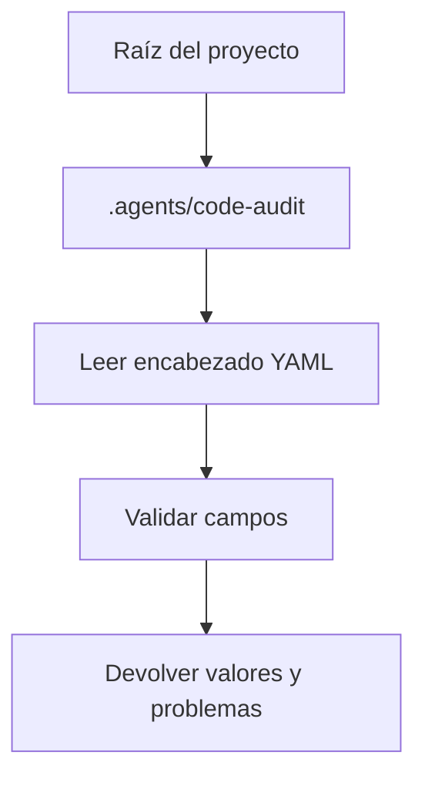

Parte 3 · Página 9 de 18 · Anterior: [Lector de frontmatter](040-config-frontmatter.md) · Siguiente: [Tipos de configuración](060-config-types.md) · [Índice](../README.md)
# Rutas de configuración

**Archivo:** `src/config/paths.ts` · 13 líneas · **Estado:** disponible

Este módulo nombra la carpeta de configuración del proyecto y relaciona las carpetas de reglas con sus tipos. Ambos cargadores lo usan para mantener consistentes las rutas y los tipos.

## Índice de la página

- ¿Qué es y para qué sirve?
- Antes de leer el código
- Cómo encaja
- El código completo, comentado
- Ejemplos con datos reales
- Resumen de comportamientos
- Dónde se usa
- Pruebas

## ¿Qué es y para qué sirve?

Este módulo nombra la carpeta de configuración del proyecto y relaciona las carpetas de reglas con sus tipos. Ambos cargadores lo usan para mantener consistentes las rutas y los tipos.

## Antes de leer el código

### Constante de carpeta

`CONFIG_DIR` es relativa a la raíz del repositorio.

```ts
// Mantiene una ruta canónica para archivos de configuración y diagnósticos.
/** Nombra la carpeta de configuración local del proyecto. */
export const CONFIG_DIR = '.agents/code-audit';

// Las carpetas usan plural; `Rule.kind` guarda el valor singular.
/** Relaciona carpetas de reglas con el tipo guardado en cada regla cargada. */
export const RULE_DIRS = {
  policies: 'policy',
  rules: 'rule',
  business: 'business',
  decisions: 'decision',
  templates: 'template',
} as const;
```

Mantiene alineadas la búsqueda de archivos y las rutas reportadas.

### Mapa de carpetas

`RULE_DIRS` relaciona la carpeta plural del disco con el tipo singular.

```ts
RULE_DIRS.policies
// → policy
```

`as const` conserva valores literales para TypeScript.

## Cómo encaja



El cargador de configuración importa `CONFIG_DIR`; el cargador de reglas importa ambos valores. El mapa aporta `Rule.kind`.

1. Resuelve las rutas de entrada.
2. Lee metadatos y contenido Markdown.
3. Valida cada valor y reúne diagnósticos.
4. Devuelve datos normalizados y diagnósticos.

## El código completo, comentado

```ts
/** Nombra la carpeta de configuración local del proyecto. */
export const CONFIG_DIR = '.agents/code-audit';

/** Relaciona las carpetas de reglas con el tipo guardado en cada regla cargada. */
export const RULE_DIRS = {
  policies: 'policy',
  rules: 'rule',
  business: 'business',
  decisions: 'decision',
  templates: 'template',
} as const;
```

## Ejemplos con datos reales

Las constantes no reciben datos en tiempo de ejecución. Este comando las importó del repositorio e imprimió sus valores:

```sh
bun -e 'import { CONFIG_DIR, RULE_DIRS } from "./src/config/paths.ts"; console.log(JSON.stringify({CONFIG_DIR, RULE_DIRS}, null, 2));'
```

```json
{
  "CONFIG_DIR": ".agents/code-audit",
  "RULE_DIRS": {
    "policies": "policy",
    "rules": "rule",
    "business": "business",
    "decisions": "decision",
    "templates": "template"
  }
}
```
## Resumen de comportamientos

- **Ubicación de configuración**: ambos cargadores usan `.agents/code-audit`.
- **Tipo de regla**: cada carpeta plural se relaciona con un tipo singular.
- **Carpeta ausente**: el cargador de reglas la trata como una colección vacía.

## Dónde se usa

- [070-config-config.md](070-config-config.md), el cargador de configuración importa esta constante en la línea 3.
- [080-config-rules.md](080-config-rules.md), el cargador de reglas importa estos valores en las líneas 3–4.

## Pruebas

- `src/config/config.test.ts`: valores predeterminados cuando falta el archivo.
Parte 3 · Página 9 de 18 · Anterior: [Lector de frontmatter](040-config-frontmatter.md) · Siguiente: [Tipos de configuración](060-config-types.md) · [Índice](../README.md)
