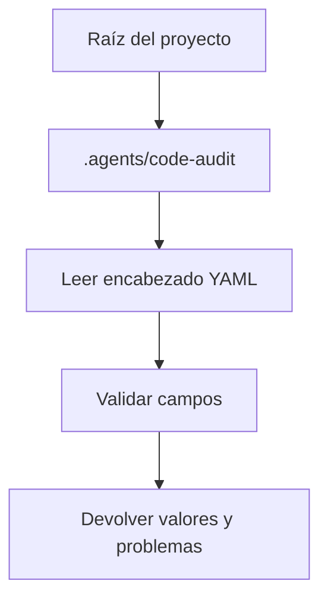

Parte 3 · Página 11 de 22 · Anterior: [Tipos de configuración](060-config-types.md) · Siguiente: [Cargador de reglas](080-config-rules.md) · [Índice](../README.md)
# Cargador de configuración del proyecto

**Archivo:** `src/config/config.ts` · 84 líneas · **Estado:** disponible

`loadConfig(root)` lee `.agents/code-audit/config.md`, interpreta el encabezado YAML y devuelve valores normalizados con diagnósticos.

## Índice de la página

- ¿Qué es y para qué sirve?
- Antes de leer el código
- Cómo encaja
- El código completo, comentado
- Ejemplos con datos reales
- Resumen de comportamientos
- Dónde se usa
- Pruebas

## ¿Qué es y para qué sirve?

`loadConfig(root)` lee `.agents/code-audit/config.md`, interpreta el encabezado YAML y devuelve valores normalizados con diagnósticos.

## Antes de leer el código

### Valores predeterminados

Los campos ausentes conservan sus valores predeterminados.

```yaml
language: (missing)
max_changed_lines: (missing)
# → language "en", maxChangedLines 1000
```

Las claves YAML usan `snake_case` (palabras separadas por guiones bajos) y se devuelven como propiedades `camelCase` (palabras unidas, con mayúscula desde la segunda).

### Diagnósticos

Los errores señalan valores inutilizables; las advertencias señalan nombres de campo desconocidos.

```yaml
langauge: es
# → warning: unknown field: langauge
```

Los campos conocidos se siguen procesando.

## Cómo encaja



`loadConfig` resuelve la ruta, lee texto en UTF-8 (codificación de caracteres), llama a `parseFrontmatter`, valida las claves conocidas sobre un objeto predeterminado y devuelve configuración y problemas.

1. Resuelve las rutas de entrada.
2. Lee metadatos y contenido Markdown.
3. Valida cada valor y reúne diagnósticos.
4. Devuelve los valores normalizados y sus diagnósticos.

## El código completo, comentado

```ts
import { readFile } from 'node:fs/promises';
import { join } from 'node:path';
import { CONFIG_DIR } from './paths.js';
import type { Config, Problem } from './types.js';
import { FrontmatterError, parseFrontmatter } from './frontmatter.js';

// Parte de valores predeterminados para que las claves omitidas sean previsibles.
const DEFAULT_CONFIG: Config = {
  structureVersion: 1,
  language: 'en',
  ignore: [],
  maxChangedLines: 1000,
};

const CONFIG_FIELDS = new Set(['structure_version', 'language', 'base_branch', 'ignore', 'max_changed_lines']);

/** Carga y valida el archivo config.md del proyecto. */
export async function loadConfig(root: string): Promise<{ config: Config; problems: Problem[] }> {
  // Mantiene relativas las rutas reportadas y resuelve lecturas desde la raíz recibida.
  const file = `${CONFIG_DIR}/config.md`;
  const path = join(root, CONFIG_DIR, 'config.md');
  let text: string;
  // El archivo ausente se reporta junto con valores predeterminados utilizables.
  try {
    text = await readFile(path, 'utf8');
  } catch {
    return { config: createDefaultConfig(), problems: [{ level: 'error', file, message: 'config.md not found' }] };
  }

  let data: Record<string, unknown>;
  // Reutiliza el lector YAML compartido y conserva el error con línea.
  try {
    data = parseFrontmatter(text).data;
  } catch (error) {
    const message = error instanceof FrontmatterError ? error.message : String(error);
    return { config: createDefaultConfig(), problems: [{ level: 'error', file, message }] };
  }

  const problems: Problem[] = [];
  /** Agrega un diagnóstico de configuración con ruta relativa al repositorio. */
  const add = (level: Problem['level'], message: string): void => { problems.push({ level, file, message }); };
  // Las claves desconocidas pueden revelar erratas sin ocultar valores válidos.
  for (const key of Object.keys(data)) {
    if (key === 'agent') add('error', 'agent must not be set: the agent that launches code-audit is always used');
    else if (!CONFIG_FIELDS.has(key)) add('warning', `unknown field: ${key}`);
  }

  // Valida cada clave por separado y conserva valores predeterminados ante errores.
  const config = createDefaultConfig();
  if (data.structure_version !== undefined) {
    if (data.structure_version !== 1) add('error', `structure_version must be 1; received ${String(data.structure_version)}`);
  }
  if (data.language !== undefined) {
    if (typeof data.language === 'string' && data.language.length > 0) config.language = data.language;
    else add('error', 'language must be a non-empty string');
  }
  if (data.base_branch !== undefined) {
    if (typeof data.base_branch === 'string') config.baseBranch = data.base_branch;
    else add('error', 'base_branch must be a string');
  }
  if (data.ignore !== undefined) {
    const ignore = normalizeStringList(data.ignore);
    if (ignore) config.ignore = ignore;
    else add('error', 'ignore must be a string or a list of strings');
  }
  if (data.max_changed_lines !== undefined) {
    if (typeof data.max_changed_lines === 'number' && Number.isInteger(data.max_changed_lines) && data.max_changed_lines > 0) {
      config.maxChangedLines = data.max_changed_lines;
    } else add('error', 'max_changed_lines must be a positive integer');
  }
  return { config, problems };
}

/** Devuelve valores predeterminados con una lista nueva por consumidor. */
function createDefaultConfig(): Config {
  return { ...DEFAULT_CONFIG, ignore: [...DEFAULT_CONFIG.ignore] };
}

/** Convierte un texto o una lista de textos en una lista nueva. */
function normalizeStringList(value: unknown): string[] | undefined {
  if (typeof value === 'string') return [value];
  if (Array.isArray(value) && value.every((item) => typeof item === 'string')) return value;
  return undefined;
}
```

## Ejemplos con datos reales

**Entrada completa (`config.md`):**

```yaml
---
structure_version: 1
language: es
base_branch: main
ignore: [vendor/**]
max_changed_lines: 250
---
```

**Salida observada de `loadConfig(root)`:**

```json
{
  "config": {
    "structureVersion": 1,
    "language": "es",
    "ignore": ["vendor/**"],
    "maxChangedLines": 250,
    "baseBranch": "main"
  },
  "problems": []
}
```

Sin el archivo, devuelve los valores predeterminados y `config.md not found`.

## Resumen de comportamientos

- **Falta el archivo**: devuelve valores predeterminados y `config.md not found`.
- **Versión de estructura incompatible**: informa el valor esperado, `1`.
- **Campo `agent`**: rechaza la clave e indica que se usa el agente que inició code-audit.
- **Campo desconocido**: devuelve una advertencia: `unknown field: X`.
- **Umbral inválido**: requiere un entero positivo.

## Dónde se usa

- [050-config-paths.md](050-config-paths.md), provee `CONFIG_DIR`.
- [040-config-frontmatter.md](040-config-frontmatter.md), provee `parseFrontmatter`, importado en la línea 5.

## Pruebas

- `src/config/config.test.ts`: valores predeterminados y archivo ausente.
- `src/config/config.test.ts`: versión de estructura incompatible.
- `src/config/config.test.ts`: error exacto de `agent`.
- `src/config/config.test.ts`: límites cero y no numéricos.
Parte 3 · Página 11 de 22 · Anterior: [Tipos de configuración](060-config-types.md) · Siguiente: [Cargador de reglas](080-config-rules.md) · [Índice](../README.md)
