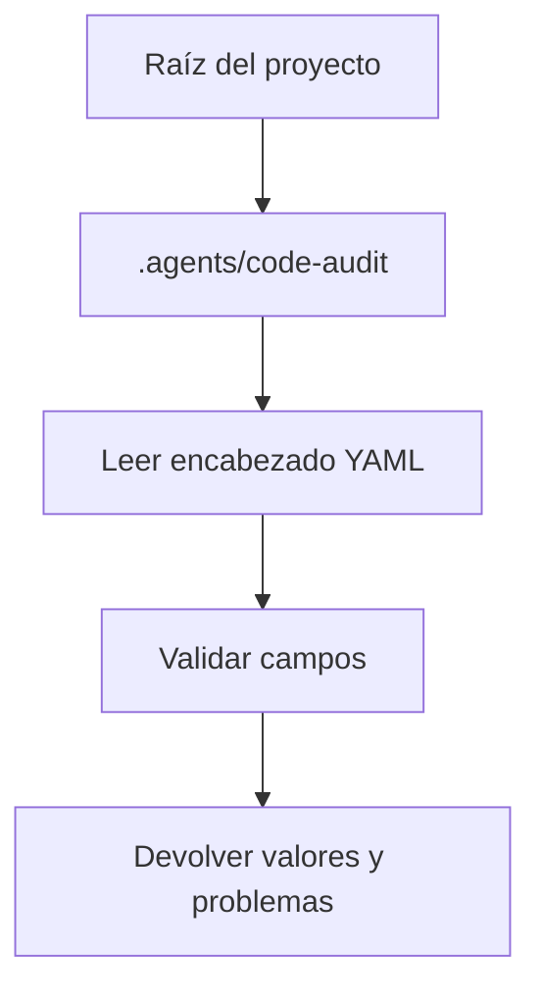

Parte 3 · Página 12 de 18 · Anterior: [Cargador de configuración del proyecto](070-config-config.md) · Siguiente: [Cargador de fichas de tarea](090-config-task.md) · [Índice](../README.md)
# Cargador de reglas

**Archivo:** `src/config/rules.ts` · 127 líneas · **Estado:** disponible

`loadRules(root)` recorre las cinco carpetas de reglas, interpreta cada encabezado Markdown, valida cada archivo por separado y devuelve reglas válidas en orden estable por ruta. Así devuelve reglas normalizadas sin exigir que quien la llama interprete YAML.

## Índice de la página

- ¿Qué es y para qué sirve?
- Antes de leer el código
- Cómo encaja
- El código completo, comentado
- Ejemplos con datos reales
- Resumen de comportamientos
- Dónde se usa
- Pruebas

## ¿Qué es y para qué sirve?

`loadRules(root)` recorre las cinco carpetas de reglas, interpreta cada encabezado Markdown, valida cada archivo por separado y devuelve reglas válidas en orden estable por ruta. Así devuelve reglas normalizadas sin exigir que quien la llama interprete YAML.

## Antes de leer el código

### Alias de gravedad

El cargador recorta los espacios externos e ignora mayúsculas en el valor de gravedad.

```yaml
severity: grave
# → critical
```

Solo se aceptan los seis valores definidos.

### Patrones de políticas

Las reglas de la carpeta `policies/` pueden omitir `applies_to` o usar una lista vacía para aplicarse a todo. Los demás tipos necesitan un patrón.

```yaml
applies_to: []
# policy → ["**"]
```

Los patrones y las palabras clave aceptan un texto o una lista.

## Cómo encaja



En cada carpeta configurada, el cargador recorre subcarpetas normales sin seguir enlaces simbólicos, selecciona archivos `.md` salvo `README.md`, interpreta cada bloque, valida campos y ordena reglas por ruta relativa al repositorio.

1. Resuelve las rutas de entrada.
2. Lee metadatos y contenido Markdown.
3. Valida cada valor y reúne diagnósticos.
4. Devuelve las reglas válidas y los diagnósticos.

## El código completo, comentado

```ts
import { readdir, readFile } from 'node:fs/promises';
import { join, relative, sep } from 'node:path';
import { CONFIG_DIR, RULE_DIRS } from './paths.js';
import type { Problem, Rule, RuleKind, Severity } from './types.js';
import { FrontmatterError, parseFrontmatter } from './frontmatter.js';

const RULE_FIELDS = new Set(['id', 'title', 'severity', 'applies_to', 'keywords']);
const SEVERITIES: Record<string, Severity> = {
  critical: 'critical', major: 'major', minor: 'minor',
  grave: 'critical', importante: 'major', menor: 'minor',
};

/** Carga reglas Markdown de forma recursiva desde las carpetas del proyecto. */
export async function loadRules(root: string): Promise<{ rules: Rule[]; problems: Problem[] }> {
  const rules: Rule[] = [];
  const problems: Problem[] = [];
  // Carga las categorías por separado para que un archivo roto no detenga el recorrido.
  for (const [directory, kind] of Object.entries(RULE_DIRS) as [keyof typeof RULE_DIRS, RuleKind][]) {
    const folder = join(root, CONFIG_DIR, directory);
    const files = await markdownFiles(folder);
    // Asocia cada diagnóstico con el archivo que lo produjo.
    for (const absolute of files) {
      const file = toRepoPath(relative(root, absolute));
      let parsed: { data: Record<string, unknown>; body: string };
      try {
        parsed = parseFrontmatter(await readFile(absolute, 'utf8'));
      } catch (error) {
        const message = error instanceof FrontmatterError ? error.message : String(error);
        problems.push({ level: 'error', file, message });
        continue;
      }

      const localProblems: Problem[] = [];
      /** Agrega un diagnóstico para el archivo de regla actual. */
      const add = (level: Problem['level'], message: string): void => { localProblems.push({ level, file, message }); };
      // Los metadatos desconocidos dan información útil, pero no invalidan la regla.
      for (const key of Object.keys(parsed.data)) {
        if (!RULE_FIELDS.has(key)) add('warning', `unknown field: ${key}`);
      }

      const id = requiredText(parsed.data, 'id', add);
      const title = requiredText(parsed.data, 'title', add);
      const severity = parseSeverity(parsed.data.severity, add);
      const appliesTo = parseAppliesTo(parsed.data.applies_to, directory === 'policies', add);
      const keywords = parsed.data.keywords === undefined ? [] : parseTextList(parsed.data.keywords, 'keywords', add);
      // Las advertencias conservan la regla; cualquier error de validación la excluye.
      const hasErrors = localProblems.some((problem) => problem.level === 'error');
      problems.push(...localProblems);
      if (!hasErrors && id !== undefined && title !== undefined && severity !== undefined && appliesTo !== undefined && keywords !== undefined) {
        rules.push({ id, title, severity, appliesTo, keywords, kind, file, body: parsed.body });
      }
    }
  }
  // La comparación por unidades de código conserva el orden entre configuraciones regionales.
  rules.sort((a, b) => compareText(a.file, b.file));
  // El ordenamiento estable conserva el orden de detección de los problemas de cada archivo.
  problems.sort((a, b) => compareText(a.file, b.file));
  return { rules, problems };
}

/** Enumera archivos Markdown de forma recursiva sin seguir enlaces simbólicos. */
async function markdownFiles(folder: string): Promise<string[]> {
  let entries;
  try { entries = await readdir(folder, { withFileTypes: true }); } catch { return []; }
  const files: string[] = [];
  // Las comprobaciones de Dirent evitan recorrer enlaces simbólicos.
  for (const entry of entries) {
    if (entry.isSymbolicLink()) continue;
    const path = join(folder, entry.name);
    if (entry.isDirectory()) files.push(...await markdownFiles(path));
    else if (entry.isFile() && entry.name.toLowerCase().endsWith('.md') && entry.name.toLowerCase() !== 'readme.md') files.push(path);
  }
  return files;
}

/** Agrega un campo de texto obligatorio o informa el error específico. */
function requiredText(data: Record<string, unknown>, field: string, add: (level: Problem['level'], message: string) => void): string | undefined {
  const value = data[field];
  if (typeof value === 'string' && value.length > 0) return value;
  add('error', value === undefined ? `${field} is required` : `${field} must be a non-empty string`);
  return undefined;
}

/** Resuelve una gravedad o alias después de quitar espacios e ignorar mayúsculas. */
function parseSeverity(value: unknown, add: (level: Problem['level'], message: string) => void): Severity | undefined {
  if (typeof value === 'string') {
    const severity = SEVERITIES[value.trim().toLowerCase()];
    if (severity) return severity;
  }
  add('error', 'severity must be one of: critical, major, minor, grave, importante, menor');
  return undefined;
}

/** Resuelve patrones de reglas y aplica el valor predeterminado de `policies/`. */
function parseAppliesTo(value: unknown, policy: boolean, add: (level: Problem['level'], message: string) => void): string[] | undefined {
  if (value === undefined && policy) return ['**'];
  if (value === undefined) {
    add('error', 'applies_to is required outside policies/');
    return undefined;
  }
  const values = parseTextList(value, 'applies_to', add);
  if (!values) return undefined;
  if (policy && (values.length === 0 || (values.length === 1 && values[0] === ''))) return ['**'];
  if (values.some((item) => item.length === 0)) {
    add('error', 'applies_to entries must not be empty');
    return undefined;
  }
  if (values.length === 0) {
    add('error', 'applies_to is required outside policies/');
    return undefined;
  }
  return values;
}

/** Convierte texto o una lista de textos en una lista e informa valores inválidos. */
function parseTextList(value: unknown, field: string, add: (level: Problem['level'], message: string) => void): string[] | undefined {
  if (typeof value === 'string') return [value];
  if (Array.isArray(value) && value.every((item) => typeof item === 'string')) return value;
  add('error', `${field} must be a string or a list of strings`);
  return undefined;
}

/** Convierte separadores de ruta nativos a barras del repositorio. */
function toRepoPath(path: string): string { return path.split(sep).join('/'); }

/** Compara cadenas por unidades Unicode con orden independiente de máquina. */
function compareText(a: string, b: string): number { return a < b ? -1 : a > b ? 1 : 0; }
```

## Ejemplos con datos reales

**Entradas completas (`config.md` y dos reglas):**

```yaml
# config.md
---
structure_version: 1
language: es
base_branch: main
ignore: [vendor/**]
max_changed_lines: 250
---

# policies/encoding.md
---
id: POL-001
title: Usar UTF-8
severity: grave
---
Los archivos se guardan en UTF-8.

# business/money.md
---
id: BIZ-003
title: Montos en centavos
severity: importante
applies_to: src/billing/**
keywords: [precio, total]
---
Representa montos en centavos.
```

**Salida observada de `loadRules(root)`:**

```json
{
  "rules": [
    {"id":"BIZ-003","title":"Montos en centavos","severity":"major","appliesTo":["src/billing/**"],"keywords":["precio","total"],"kind":"business","file":".agents/code-audit/business/money.md","body":"Representa montos en centavos.\n"},
    {"id":"POL-001","title":"Usar UTF-8","severity":"critical","appliesTo":["**"],"keywords":[],"kind":"policy","file":".agents/code-audit/policies/encoding.md","body":"Los archivos se guardan en UTF-8.\n"}
  ],
  "problems": []
}
```

El comando real produjo estos alias normalizados y reglas ordenadas por archivo.

## Resumen de comportamientos

- **Carpeta ausente**: no produce un problema.
- **README.md**: se omite en cualquier nivel.
- **Encabezado Markdown roto**: reporta un error de encabezado YAML, incluida la línea.
- **Campo desconocido**: agrega una advertencia: `unknown field: X`.
- **Regla con errores**: se informa y se excluye; las otras reglas se siguen cargando.
- **Ruta de regla**: es relativa al repositorio y usa `/`.

## Dónde se usa

- [050-config-paths.md](050-config-paths.md), provee `CONFIG_DIR` y `RULE_DIRS`.
- [060-config-types.md](060-config-types.md), declara `Rule` y `Problem`.
- [040-config-frontmatter.md](040-config-frontmatter.md), provee `parseFrontmatter`.

## Pruebas

- `src/config/rules.test.ts`: recorrido recursivo, orden y omisión de README.
- `src/config/rules.test.ts`: alias de gravedad, espacios alrededor y nombres españoles.
- `src/config/rules.test.ts`: campos obligatorios y patrones de `policies/`.
- `src/config/rules.test.ts`: orden determinista, encabezados rotos, valores inválidos y campos desconocidos.
Parte 3 · Página 12 de 18 · Anterior: [Cargador de configuración del proyecto](070-config-config.md) · Siguiente: [Cargador de fichas de tarea](090-config-task.md) · [Índice](../README.md)
