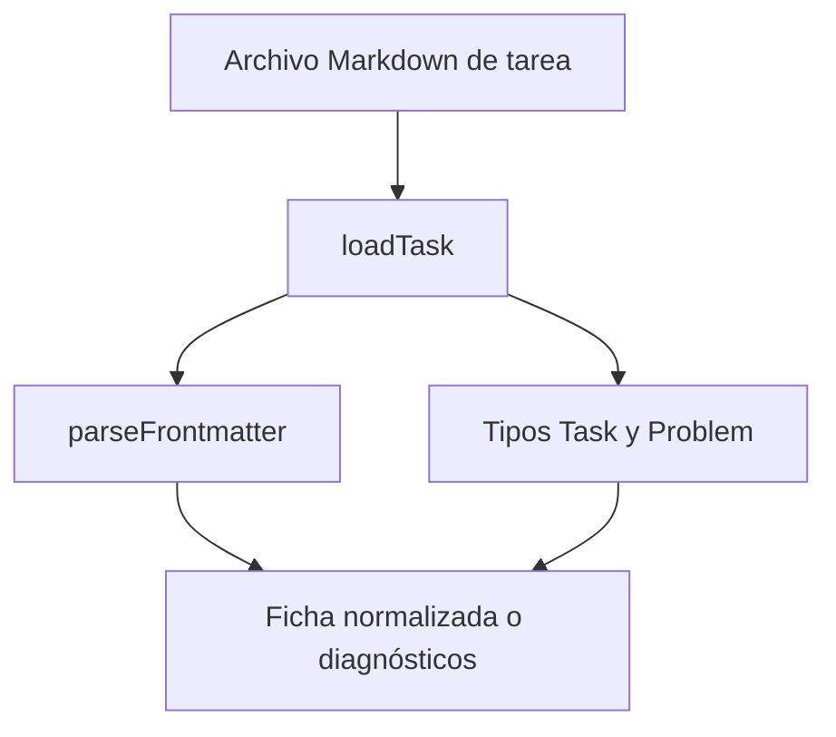

Parte 3 · Página 14 de 34 · Anterior: [Cargador de reglas](080-config-rules.md) · Siguiente: [Interfaz Git de solo lectura](100-git-git.md) · [Índice](../README.md)
# Cargador de fichas de tarea

**Archivo:** `src/config/task.ts` · 167 líneas · **Estado:** disponible

`loadTask(root, taskPath)` lee un archivo Markdown de tarea, normaliza sus secciones y criterios de aceptación, y devuelve una `Task` con diagnósticos. El encabezado YAML opcional puede contener `source`.

## Índice de la página

- ¿Qué es y para qué sirve?
- Antes de leer el código
- Cómo encaja
- El código completo, comentado
- Ejemplos con datos reales
- Resumen de comportamientos
- Dónde se usa
- Pruebas

## ¿Qué es y para qué sirve?

Una ficha de tarea es el archivo `.md` con lo que pedía una tarea, copiado por una persona desde Jira, GitHub o Notion. Este módulo lo lee, comprueba que tenga un objetivo y criterios numerados, y devuelve los datos o una lista de problemas.

## Antes de leer el código

### Frontmatter

Frontmatter es un bloque YAML opcional al inicio de un archivo Markdown. El cargador solo acepta el campo `source`; los demás campos producen advertencias.

```yaml
source: https://example.test/TASK-1
# → task.source contiene la URL
```

### Secciones y criterios

Las secciones usan encabezados Markdown de nivel dos. Los criterios comienzan con un número seguido de `.` o `)`. Las líneas con sangría continúan el criterio actual.

```markdown
## Criterios de aceptación
1. Primera línea
   continuación
```

El resultado contiene un criterio: `Primera línea continuación`.

## Encabezados aceptados

| Campo | Encabezado en español | Encabezado en inglés |
|---|---|---|
| objective | Objetivo | Objective |
| criteria | Criterios de aceptación | Acceptance criteria |
| out of scope | Fuera de alcance | Out of scope |
| expected areas | Áreas que se espera tocar | Expected areas |
| notes | Notas y decisiones; Notas | Notes; Notes and decisions |

La comparación ignora mayúsculas, acentos, espacios repetidos, notas entre paréntesis al final y los dos puntos finales.

## Cómo encaja



1. `loadTask` resuelve y lee la ruta solicitada.
2. Interpreta opcionalmente el frontmatter YAML y registra advertencias de metadatos.
3. Reconoce secciones de nivel dos fuera de bloques de código cercados.
4. Valida el objetivo y los criterios numerados; solo devuelve una ficha si no hay errores.

## El código completo, comentado

```ts
import { readFile } from 'node:fs/promises';
import { isAbsolute, relative, resolve, sep } from 'node:path';
import { FrontmatterError, parseFrontmatter } from './frontmatter.js';
import type { Problem } from './types.js';

/** Stores one normalized task specification. */
export interface Task {
  file: string;
  source?: string;
  objective: string;
  criteria: string[];
  outOfScope?: string;
  expectedAreas?: string;
  notes?: string;
}

const SECTION_FIELDS = new Map<string, keyof Pick<Task, 'objective' | 'criteria' | 'outOfScope' | 'expectedAreas' | 'notes'>>([
  ['objetivo', 'objective'], ['objective', 'objective'],
  ['criterios de aceptacion', 'criteria'], ['acceptance criteria', 'criteria'],
  ['fuera de alcance', 'outOfScope'], ['out of scope', 'outOfScope'],
  ['areas que se espera tocar', 'expectedAreas'], ['expected areas', 'expectedAreas'],
  ['notas y decisiones', 'notes'], ['notas', 'notes'], ['notes', 'notes'], ['notes and decisions', 'notes'],
]);

/** Loads and validates a Markdown task specification. */
export async function loadTask(root: string, taskPath: string): Promise<{ task?: Task; problems: Problem[] }> {
  const absolute = isAbsolute(taskPath) ? taskPath : resolve(root, taskPath);
  const file = toTaskPath(root, absolute);
  let text: string;
  try {
    text = await readFile(absolute, 'utf8');
  } catch (error) {
    const detail = error instanceof Error ? error.message : String(error);
    return { problems: [{ level: 'error', file, message: `could not read task file "${taskPath}": ${detail}` }] };
  }

  text = text.replace(/^\uFEFF/, '').replace(/\r\n/g, '\n');
  let data: Record<string, unknown> = {};
  let body = text;
  if (/^---[ \t]*(?:\n|$)/.test(text)) {
    try {
      ({ data, body } = parseFrontmatter(text));
    } catch (error) {
      const message = error instanceof FrontmatterError ? error.message : String(error);
      return { problems: [{ level: 'error', file, message }] };
    }
  }

  const problems: Problem[] = [];
  /** Adds a diagnostic tied to the current task file. */
  const add = (level: Problem['level'], message: string): void => { problems.push({ level, file, message }); };
  for (const key of Object.keys(data)) {
    if (key !== 'source') add('warning', `unknown field: ${key}`);
  }
  const source = data.source;
  if (source !== undefined && typeof source !== 'string') add('error', 'source must be a string');

  const sections = parseSections(body, add);
  const objective = sections.get('objective')?.text;
  if (!objective) add('error', 'objective is required');
  const criteriaText = sections.get('criteria')?.text;
  const criteria = parseCriteria(criteriaText);
  if (!criteria) add('error', 'acceptance criteria must be a numbered list');

  if (problems.some((problem) => problem.level === 'error') || objective === undefined || criteria === undefined) {
    return { problems };
  }

  const task: Task = { file, objective, criteria };
  if (typeof source === 'string') task.source = source;
  const outOfScope = sections.get('outOfScope')?.text;
  const expectedAreas = sections.get('expectedAreas')?.text;
  const notes = sections.get('notes')?.text;
  if (outOfScope) task.outOfScope = outOfScope;
  if (expectedAreas) task.expectedAreas = expectedAreas;
  if (notes) task.notes = notes;
  return { task, problems };
}

interface Section {
  title: string;
  text: string;
}

/** Extracts recognized level-two sections and reports unknown or repeated ones. */
function parseSections(body: string, add: (level: Problem['level'], message: string) => void): Map<string, Section> {
  const sections = new Map<string, Section>();
  const lines = body.split('\n');
  let currentField: string | undefined;
  let currentTitle = '';
  let currentLines: string[] = [];
  let fenceChar: string | undefined;
  let fenceLength = 0;

  /** Saves the active section after trimming its outer blank lines. */
  const save = (): void => {
    if (!currentField) return;
    const text = currentLines.join('\n').trim();
    sections.set(currentField, { title: currentTitle, text });
  };

  for (const line of lines) {
    const fence = line.match(/^\s*(`{3,}|~{3,})/);
    if (fence) {
      const token = fence[1]!;
      const char = token[0]!;
      if (!fenceChar) {
        fenceChar = char;
        fenceLength = token.length;
      } else if (char === fenceChar && token.length >= fenceLength) {
        fenceChar = undefined;
        fenceLength = 0;
      }
      if (currentField) currentLines.push(line);
      continue;
    }

    const heading = fenceChar ? undefined : line.match(/^##\s+(.+?)\s*#*\s*$/);
    if (heading) {
      save();
      currentLines = [];
      currentTitle = heading[1]!.trim();
      const field = SECTION_FIELDS.get(normalizeHeading(currentTitle));
      currentField = field;
      if (!field) add('warning', `unknown section: ${currentTitle}`);
      else if (sections.has(field)) add('error', `duplicate section: ${currentTitle}`);
      continue;
    }
    if (currentField) currentLines.push(line);
  }
  save();
  return sections;
}

/** Normalizes a heading for case, accents, spacing, and trailing parentheticals. */
function normalizeHeading(title: string): string {
  return title.replace(/\s*\([^)]*\)\s*$/, '').replace(/\s*:\s*$/, '').normalize('NFD').replace(/[\u0300-\u036f]/g, '')
    .replace(/\s+/g, ' ').trim().toLowerCase();
}

/** Parses numbered criteria and joins indented continuation lines. */
function parseCriteria(text: string | undefined): string[] | undefined {
  if (text === undefined || text.length === 0) return undefined;
  const criteria: string[] = [];
  for (const line of text.split('\n')) {
    if (!line.trim()) continue;
    const item = line.match(/^\s*\d+[.)]\s+(.+?)\s*$/);
    if (item) {
      criteria.push(item[1]!.trim());
      continue;
    }
    if (/^\s+\S/.test(line) && criteria.length > 0) {
      criteria[criteria.length - 1] += ` ${line.trim()}`;
      continue;
    }
    return undefined;
  }
  return criteria.length > 0 ? criteria : undefined;
}

/** Converts an absolute path to a repository-relative task path when possible. */
function toTaskPath(root: string, absolute: string): string {
  const path = relative(resolve(root), resolve(absolute));
  return path === '..' || path.startsWith(`..${sep}`) || isAbsolute(path)
    ? absolute.split(sep).join('/')
    : path.split(sep).join('/');
}
```

## Ejemplos con datos reales

### Caso normal

Esta es la plantilla completa de la sección 4.2 del diseño, incluidas sus secciones opcionales vacías. La entrada exacta produjo esta salida al ejecutarse con `loadTask`:

```ts
const input = `---
source: https://empresa.atlassian.net/browse/PAY-123
---
## Objetivo
Qué se quiere lograr y por qué.

## Criterios de aceptación
1. Botón «Pagar» visible en el checkout.
2. Total con IVA calculado en centavos.
3. Mensaje si el cobro falla, con opción de reintentar.

## Fuera de alcance

## Áreas que se espera tocar (opcional)

## Notas y decisiones (Figma, acuerdos)
`;
await writeFile(join(root, 'PAY-123.md'), input);
console.log(JSON.stringify(await loadTask(root, 'PAY-123.md'), null, 2));
```

```json
{
  "task": {
    "file": "PAY-123.md",
    "objective": "Qué se quiere lograr y por qué.",
    "criteria": [
      "Botón «Pagar» visible en el checkout.",
      "Total con IVA calculado en centavos.",
      "Mensaje si el cobro falla, con opción de reintentar."
    ],
    "source": "https://empresa.atlassian.net/browse/PAY-123"
  },
  "problems": []
}
```

### Caso límite

El primer carácter de `input` es un BOM visible (`'\uFEFF'`). Cada escape `\r\n` genera un final de línea CRLF. Esta salida se obtuvo ejecutando esa entrada exacta:

```ts
const input = '\uFEFF## Objetivo\r\nMeta CRLF.\r\n## Criterios de aceptación\r\n1. Acepta BOM y CRLF.';
await writeFile(join(root, 'edgeBomCrlf.md'), input);
console.log(JSON.stringify(await loadTask(root, 'edgeBomCrlf.md'), null, 2));
```

```json
{
  "task": {
    "file": "edgeBomCrlf.md",
    "objective": "Meta CRLF.",
    "criteria": [
      "Acepta BOM y CRLF."
    ]
  },
  "problems": []
}
```

### Sin la línea clave

Esta entrada tiene objetivo, pero no contiene la sección `## Criterios de aceptación`. El problema devuelto es completo:

```ts
const input = '## Objetivo\nMeta sin criterios.';
await writeFile(join(root, 'noCriteria.md'), input);
console.log(JSON.stringify(await loadTask(root, 'noCriteria.md'), null, 2));
```

```json
{
  "problems": [
    {
      "level": "error",
      "file": "noCriteria.md",
      "message": "acceptance criteria must be a numbered list"
    }
  ]
}
```

### Sección desconocida

El cargador ignora el texto de un encabezado desconocido e informa una advertencia:

```ts
const input = '## Objetivo\nMeta.\n## Criterios de aceptación\n1. Uno.\n## Contexto adicional\nIgnorado.';
await writeFile(join(root, 'unknownSection.md'), input);
console.log(JSON.stringify(await loadTask(root, 'unknownSection.md'), null, 2));
```

```json
{
  "task": {
    "file": "unknownSection.md",
    "objective": "Meta.",
    "criteria": [
      "Uno."
    ]
  },
  "problems": [
    {
      "level": "warning",
      "file": "unknownSection.md",
      "message": "unknown section: Contexto adicional"
    }
  ]
}
```

### Encabezado con dos puntos finales

Se reconoce el encabezado conocido `## Objetivo:` y no se devuelve ningún problema:

```ts
const input = '## Objetivo:\nMeta con dos puntos.\n## Criterios de aceptación\n1. Uno.';
await writeFile(join(root, 'colonHeading.md'), input);
console.log(JSON.stringify(await loadTask(root, 'colonHeading.md'), null, 2));
```

```json
{
  "task": {
    "file": "colonHeading.md",
    "objective": "Meta con dos puntos.",
    "criteria": [
      "Uno."
    ]
  },
  "problems": []
}
```

## Resumen de comportamientos

- **Campo YAML desconocido:** agrega una advertencia y puede devolver la ficha.
- **Sección desconocida:** agrega una advertencia e ignora su texto.
- **Sección repetida:** agrega un error y omite la ficha.
- **Sección opcional vacía:** no aparece en la ficha devuelta.
- **Notes and decisions:** se reconoce y se devuelve como `task.notes`.
- **Notes and decisions:** se devuelve como `task.notes`.
- **YAML roto o `source` inválido:** agrega un error y omite la ficha.
- **Ruta de ficha:** es relativa al repositorio y usa `/`, o es absoluta si está fuera de la raíz.
- **Archivo ausente:** informa un error que contiene la ruta recibida.

## Dónde se usa

### Usa

- [040-config-frontmatter.md](040-config-frontmatter.md), para interpretar frontmatter YAML.
- [060-config-types.md](060-config-types.md), para el tipo `Problem`.

### Lo usan

- [src/config/task.test.ts](../../../src/config/task.test.ts), que importa `loadTask` en la línea 5. Hoy ningún archivo de producción lo llama.

## Pruebas

- `src/config/task.test.ts`: encabezados en español e inglés, incluida la sección `Notes and decisions`, plantilla completa y secciones opcionales.
- `src/config/task.test.ts`: validación de objetivo y criterios numerados, incluidas continuaciones.
- `src/config/task.test.ts`: bloques cercados, secciones desconocidas o repetidas y YAML roto.
- `src/config/task.test.ts`: BOM, CRLF, rutas relativas y externas a la raíz, y archivos ausentes.

Parte 3 · Página 14 de 34 · Anterior: [Cargador de reglas](080-config-rules.md) · Siguiente: [Interfaz Git de solo lectura](100-git-git.md) · [Índice](../README.md)


