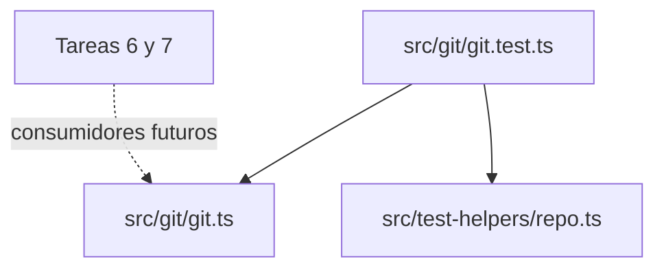

Parte 3 · Página 14 de 27 · Anterior: [Cargador de fichas de tarea](090-config-task.md) · Siguiente: [Ayudantes de prueba para repositorios temporales](110-test-helpers-repo.md) · [Índice](../README.md)
# Interfaz Git de solo lectura

**Archivo:** `src/git/git.ts` · 183 líneas · **Estado:** disponible

## Índice de la página

- ¿Qué es y para qué sirve?
- Antes de leer el código
- Cómo encaja
- El código completo, comentado
- Ejemplos con datos reales
- Resumen de comportamientos
- Dónde se usa
- Pruebas

## ¿Qué es y para qué sirve?

Este módulo ejecuta Git para las funciones futuras de code-audit. Acepta solo diez subcomandos de lectura y revisa todos los argumentos antes de iniciar Git. Sin estos controles, un comando permitido como `diff` podría escribir un archivo o `grep` podría iniciar un programa de paginación.

`runGit(root, args, options?)` devuelve stdout en UTF-8. Si el comando o alguna opción están prohibidos, lanza `GitForbiddenError` antes de ejecutar; si Git falla, lanza `GitError`, que conserva `exitCode`, `stderr` y un `reason` estable. El parámetro opcional `{ maxBuffer }` es solo para pruebas específicas; en producción se usa el límite predeterminado de 256 MiB. `findRepoRoot(cwd)` devuelve la ruta raíz de Git sin el salto de línea final o lanza `NotARepoError`.

Ningún archivo de producción llama todavía a las funciones exportadas. Las pruebas importan este módulo directamente; las tareas 6 y 7 serán consumidoras futuras.

## Antes de leer el código

### Lista permitida

Una lista permitida enumera cada comando aceptable. Los comandos que no aparecen se rechazan antes de iniciar Git.

```ts
['status'] // → permitido
['commit', '-m', 'x'] // → GitForbiddenError
```

### Abreviaturas de opciones

Git acepta prefijos únicos de algunas opciones largas. El módulo bloquea cada prefijo de una opción peligrosa, ya que las versiones y subcomandos de Git pueden variar.

```text
--open=programa // → se bloquea como abreviatura de --open-files-in-pager
--output-indicator-new=+ // → permitido; solo cambia los marcadores del diff
```

## Comandos permitidos

| Comando | Qué lee |
|---|---|
| `diff`, `log`, `show` | Cambios y detalles de commits |
| `status`, `rev-parse`, `merge-base` | Estado del árbol de trabajo y referencias |
| `ls-files`, `cat-file` | Rutas rastreadas y objetos almacenados |
| `grep`, `blame` | Texto rastreado e historial por línea |

## Opciones prohibidas

| Opción | Por qué se bloquea |
|---|---|
| `--output`, `-o` en diff/log/show | Escribe la salida del comando en un archivo |
| `-O`, `--open-files-in-pager` | Inicia un programa de paginación externo |
| `--ext-diff` | Inicia un programa externo de diff configurado |
| `--textconv`, `--filters` | Ejecuta programas configurados de conversión o filtros |
| `-c`, `--exec-path` | Cambia la configuración o la búsqueda de ejecutables de Git |
| `--git-dir`, `--work-tree` | Redirige Git a otro repositorio o árbol de trabajo |

Las opciones largas se bloquean completas y con cualquier prefijo más corto, en cualquier posición, incluso después de `--`. También se revisan los grupos de opciones cortas: cualquier argumento de un guion que contenga `O` se bloquea para `grep`; uno que contenga `o` minúscula se bloquea para `diff`, `log` y `show`. `--output-indicator-new` y opciones relacionadas siguen permitidas. `--text` se bloquea porque es prefijo de `--textconv`.

## Cómo encaja



1. `runGit` comprueba el subcomando exacto y analiza todos los argumentos.
2. Llama a `execFile` con un arreglo fijo de argumentos, la carpeta de trabajo, un entorno limpio y un límite de salida de 256 MiB.
3. Cierra stdin del proceso hijo de inmediato para que los comandos que esperan entrada no se queden esperando.
4. Agrega la opción de no usar paginador y ajustes estables de comillas y color antes del subcomando. Después agrega las opciones que desactivan la conversión de texto y el diff externo cuando corresponda.
5. Devuelve stdout, trata el código 1 de `grep` con stderr vacío como «sin coincidencias» o lanza un error tipado.
6. `findRepoRoot` usa el mismo ejecutor seguro para leer la ruta raíz y rechazar repositorios bare.

## El código completo, comentado

La lista contiene el módulo completo de 183 líneas. Los comentarios JSDoc describen cada API exportada y cada función con nombre; las secciones anteriores explican los controles y sus efectos.

```ts
import { execFile as execFileCallback } from 'node:child_process';
import { stat } from 'node:fs/promises';

/** Lists Git subcommands that this module permits. */
export const READ_ONLY_COMMANDS = [
  'diff', 'log', 'show', 'status', 'rev-parse', 'merge-base', 'ls-files', 'cat-file', 'grep', 'blame',
] as const;

const MAX_BUFFER = 256 * 1024 * 1024;
const DANGEROUS_LONG_OPTIONS = [
  'output', 'open-files-in-pager', 'ext-diff', 'textconv', 'exec-path', 'git-dir', 'work-tree', 'filters',
];

/** Reports a request to run a command or option outside the read-only policy. */
export class GitForbiddenError extends Error {
  constructor(message: string) {
    super(message);
    this.name = 'GitForbiddenError';
  }
}

/** Reports Git failures and keeps the process exit code and standard error. */
export class GitError extends Error {
  exitCode: number | null;
  stderr: string;
  reason: 'git-unavailable' | 'directory' | 'output-limit' | 'git-failed';

  constructor(
    message: string,
    exitCode: number | null,
    stderr: string,
    reason: 'git-unavailable' | 'directory' | 'output-limit' | 'git-failed' = 'git-failed',
  ) {
    super(message);
    this.name = 'GitError';
    this.exitCode = exitCode;
    this.stderr = stderr;
    this.reason = reason;
  }
}

/** Reports that a path is not inside a non-bare working repository. */
export class NotARepoError extends Error {
  constructor(message: string) {
    super(message);
    this.name = 'NotARepoError';
  }
}

/** Runs an allowlisted Git command; maxBuffer is exposed for focused tests. */
export async function runGit(
  root: string,
  args: string[],
  options: { maxBuffer?: number } = {},
): Promise<string> {
  validateArguments(args);
  await requireDirectory(root);
  const command = args[0]!;
  const commandArgs = args.slice(1);
  const safetyArgs = command === 'diff' || command === 'log' || command === 'show'
    ? ['--no-ext-diff', '--no-textconv']
    : command === 'blame' ? ['--no-textconv'] : [];
  const env = safeEnvironment();

  try {
    const result = await executeGit([
      '--no-pager', '-c', 'core.quotePath=false', '-c', 'color.ui=false', command,
      ...safetyArgs, ...commandArgs,
    ], root, env, options.maxBuffer ?? MAX_BUFFER);
    return result.stdout;
  } catch (error) {
    const failure = error as NodeJS.ErrnoException & { stdout?: string; stderr?: string; code?: number | string };
    if (failure.code === 'ENOENT') {
      if (!(await isDirectory(root))) throw directoryError(root);
      throw new GitError('git is not installed or not in PATH', null, failure.stderr ?? '', 'git-unavailable');
    }
    const stderr = failure.stderr ?? '';
    if (command === 'grep' && Number(failure.code) === 1 && stderr.length === 0) return '';
    if (failure.code === 'ENOBUFS' || failure.code === 'ERR_CHILD_PROCESS_STDIO_MAXBUFFER') {
      const limit = options.maxBuffer ?? MAX_BUFFER;
      const size = limit === MAX_BUFFER ? '256 MiB' : `${limit} bytes`;
      throw new GitError(`git output exceeded ${size}`, null, stderr, 'output-limit');
    }
    const exitCode = typeof failure.code === 'number' ? failure.code : null;
    const detail = stderr.trim();
    throw new GitError(detail || `git ${command} failed`, exitCode, stderr);
  }
}

/** Resolves the non-bare repository root containing the supplied path. */
export async function findRepoRoot(cwd: string): Promise<string> {
  try {
    const root = (await runGit(cwd, ['rev-parse', '--show-toplevel'])).replace(/\r?\n$/, '');
    const bare = (await runGit(cwd, ['rev-parse', '--is-bare-repository'])).trim();
    if (bare === 'true') throw new NotARepoError(`not a working Git repository: ${cwd}`);
    return root;
  } catch (error) {
    if (error instanceof NotARepoError) throw error;
    if (error instanceof GitError && error.reason === 'git-unavailable') {
      throw new NotARepoError('Git is not installed or not in PATH');
    }
    if (error instanceof GitError && error.reason === 'directory') throw new NotARepoError(error.message);
    throw new NotARepoError(`not a working Git repository: ${cwd}`);
  }
}

/** Rejects subcommands and dangerous options before starting a child process. */
function validateArguments(args: string[]): void {
  const command = args[0];
  if (!command || command.startsWith('-') || !(READ_ONLY_COMMANDS as readonly string[]).includes(command)) {
    throw new GitForbiddenError(`Git subcommand is not allowed: ${command ?? '(missing)'}`);
  }

  for (const argument of args.slice(1)) {
    if (isForbiddenArgument(command, argument)) {
      throw new GitForbiddenError(`Git option is not allowed for ${command}: ${argument}`);
    }
  }
}

/** Detects full options, their abbreviations, and dangerous short-option groups. */
function isForbiddenArgument(command: string, argument: string): boolean {
  if (argument.startsWith('--')) {
    const name = argument.slice(2).split('=', 1)[0]!;
    if (!name) return false;
    if (name.startsWith('output-indicator-')) return false;
    return DANGEROUS_LONG_OPTIONS.some((option) => option.startsWith(name));
  }

  if (!argument.startsWith('-') || argument.startsWith('--')) return false;
  if (argument === '-c' || argument.startsWith('-c')) return true;
  if (['diff', 'log', 'show'].includes(command) && argument.includes('o')) return true;
  if (command === 'grep' && argument.includes('O')) return true;
  return false;
}

/** Copies the process environment without inherited Git repository overrides. */
function safeEnvironment(): NodeJS.ProcessEnv {
  const env = Object.fromEntries(Object.entries(process.env).filter(([key]) => !key.toUpperCase().startsWith('GIT_')));
  return {
    ...env,
    GIT_OPTIONAL_LOCKS: '0',
    GIT_PAGER: 'cat',
    GIT_TERMINAL_PROMPT: '0',
  };
}

/** Verifies that a working directory exists before spawning Git. */
async function requireDirectory(path: string): Promise<void> {
  if (!(await isDirectory(path))) throw directoryError(path);
}

/** Checks whether a path exists and is a directory. */
async function isDirectory(path: string): Promise<boolean> {
  try { return (await stat(path)).isDirectory(); } catch { return false; }
}

/** Creates a GitError with the shared missing-directory message. */
function directoryError(path: string): GitError {
  return new GitError(`directory does not exist: ${path}`, null, '', 'directory');
}

/** Executes Git and closes its unused standard input immediately. */
function executeGit(
  args: string[],
  cwd: string,
  env: NodeJS.ProcessEnv,
  maxBuffer: number,
): Promise<{ stdout: string; stderr: string }> {
  return new Promise((resolve, reject) => {
    const child = execFileCallback('git', args, { cwd, env, encoding: 'utf8', maxBuffer }, (error, stdout, stderr) => {
      if (error) {
        const failure = error as NodeJS.ErrnoException & { stdout?: string; stderr?: string };
        failure.stdout = stdout;
        failure.stderr = stderr;
        reject(failure);
      } else {
        resolve({ stdout, stderr });
      }
    });
    child.stdin?.end();
  });
}
```

## Ejemplos con datos reales

### Caso normal

En el repositorio de prueba que contiene `años.txt`, `runGit(root, ['ls-files'])` devuelve:

```text
años.txt
```

La `ñ` aparece sin escapes porque se fija `core.quotePath=false`.

### Caso límite

Esta opción abreviada se rechaza antes de que Git inicie el paginador:

```ts
await runGit(root, ['grep', '--open=programa', 'a']);
// → GitForbiddenError: Git option is not allowed for grep: --open=programa
```

### Sin las opciones de seguridad clave

Las pruebas configuran un programa textconv que crea un archivo testigo. Ejecutar `diff`, `log -p`, `show` o `blame` por medio de `runGit` nunca lo crea porque el programa agrega `--no-textconv`; `diff`, `log` y `show` también reciben `--no-ext-diff`.

## Lo que esta barrera no cubre

La barrera valida los argumentos que recibe `runGit`; no limpia la configuración propia del repositorio. Git todavía puede ejecutar programas configurados por su propietario. Por ejemplo, los filtros `clean` de `.gitattributes` (incluido Git LFS) pueden intervenir en `status` o `diff`; `core.fsmonitor` puede iniciar un monitor; y `log.showSignature` puede activar la verificación de firmas.

## Opciones legítimas bloqueadas por prudencia

Algunos usos válidos coinciden con los controles conservadores y se rechazan. `--text` se parece a `--textconv`, `rev-parse --git-dir` coincide con el `--git-dir` bloqueado y `-c` tiene otros significados en `grep` y `diff`. En su lugar, usa `rev-parse --absolute-git-dir` o `--show-toplevel`; las pruebas confirman que ambas alternativas están permitidas.

## Resumen de comportamientos

- **Subcomando ausente o no permitido:** lanza `GitForbiddenError` antes de ejecutarse.
- **Opción peligrosa o abreviatura:** lanza `GitForbiddenError` en cualquier posición.
- **`grep` sin coincidencias:** devuelve una cadena vacía solo con código 1 y stderr vacío.
- **Falla de Git:** lanza `GitError` con código numérico cuando está disponible y stderr.
- **Carpeta de trabajo ausente o que no es una carpeta:** lanza `GitError` con `directory does not exist: <ruta>`; `findRepoRoot` informa el mismo texto con `NotARepoError`.
- **Git no está en PATH:** lanza `GitError` con `reason` `git-unavailable`; `findRepoRoot` usa esa marca, no el texto del mensaje.
- **Salida que supera el límite configurado:** traduce los errores `ENOBUFS` de Bun y `ERR_CHILD_PROCESS_STDIO_MAXBUFFER` de Node a un `GitError` de límite.
- **Nombres de variables en Windows:** quita variables `GIT_` sin distinguir mayúsculas.
- **Ruta fuera de un repo, repo bare o dentro de `.git`:** `findRepoRoot` lanza `NotARepoError`.
- **Ruta dentro de un repo:** `findRepoRoot` devuelve la ruta raíz de Git sin salto de línea final.

## Dónde se usa

### Usa

- [src/test-helpers/repo.ts](110-test-helpers-repo.md), que importan las pruebas de Git para crear repositorios aislados.

### Usado por

- [src/git/git.test.ts](../../../src/git/git.test.ts), que prueba cada API exportada. Hoy ningún archivo de producción importa este módulo.

## Pruebas

- `src/git/git.test.ts`: lista permitida, comandos prohibidos, opciones de salida y abreviaturas.
- `src/git/git.test.ts`: textconv, diff externo, entorno heredado y fecha del índice.
- `src/git/git.test.ts`: nombres UTF-8, `grep` sin coincidencias, errores y Git ausente.
- `src/git/git.test.ts`: raíz desde subcarpetas, carpetas fuera de repositorio, repos bare y rutas `.git`.
- `src/git/git.test.ts`: comandos que leen stdin, rutas de trabajo inválidas y límites de salida para pruebas.
- Una prueba temporal con Node confirma por separado que su error de maxBuffer se convierte en `GitError`.

Parte 3 · Página 14 de 27 · Anterior: [Cargador de fichas de tarea](090-config-task.md) · Siguiente: [Ayudantes de prueba para repositorios temporales](110-test-helpers-repo.md) · [Índice](../README.md)


