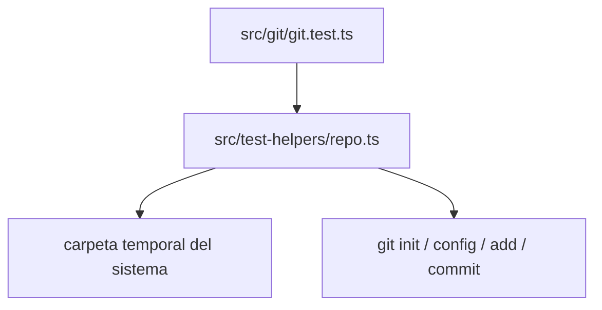

Parte 3 · Página 16 de 34 · Anterior: [Interfaz Git de solo lectura](100-git-git.md) · Siguiente: [Inicialización del proyecto](120-init-init.md) · [Índice](../README.md)
# Ayudantes de prueba para repositorios temporales

**Archivo:** `src/test-helpers/repo.ts` · 41 líneas · **Estado:** disponible

## Índice de la página

- ¿Qué es y para qué sirve?
- Antes de leer el código
- Cómo encaja
- El código completo, comentado
- Ejemplos con datos reales
- Resumen de comportamientos
- Dónde se usa
- Pruebas

## ¿Qué es y para qué sirve?

Este módulo, exclusivo de las pruebas, crea repositorios Git desechables, escribe archivos, guarda commits de prueba y elimina los repositorios. Mantiene las pruebas de integración de Git independientes del usuario y la rama predeterminada configurados globalmente en cada equipo.

Todos los commits que crea ocurren en la carpeta temporal. El código de producción no importa estos ayudantes y la compilación no los incluye.

## Antes de leer el código

### Identidad local al repositorio

Git necesita `user.name` y `user.email` para crear un commit. El ayudante guarda ambos valores en el `.git/config` local del repositorio temporal.

```text
createRepo() → inicializa main con la identidad local de prueba
commitRepo() → git add --all y git commit dentro del repositorio temporal
```

## Cómo encaja



1. `createRepo` crea una carpeta temporal nueva, inicializa la rama `main` y configura una identidad local.
2. `writeRepoFile` crea las carpetas necesarias y escribe el archivo de prueba.
3. `commitRepo` agrega y guarda los archivos de prueba dentro del repositorio temporal.
4. `removeRepo` elimina la carpeta recursivamente. `createBareRepo` crea un repo bare para las pruebas de rechazo.

## El código completo, comentado

Este es el código fuente completo de 41 líneas. Los comandos Git de este ayudante solo preparan pruebas aisladas y nunca llaman a `runGit`.

```ts
import { execFile as execFileCallback } from 'node:child_process';
import { mkdtemp, mkdir, rm, writeFile } from 'node:fs/promises';
import { tmpdir } from 'node:os';
import { dirname, join } from 'node:path';
import { promisify } from 'node:util';

const execFile = promisify(execFileCallback);

/** Creates and initializes an isolated Git repository for tests. */
export async function createRepo(prefix = 'code-audit-git-'): Promise<string> {
  const root = await mkdtemp(join(tmpdir(), prefix));
  await execFile('git', ['-c', 'init.defaultBranch=main', 'init'], { cwd: root });
  await execFile('git', ['config', 'user.name', 'Code Audit Tests'], { cwd: root });
  await execFile('git', ['config', 'user.email', 'tests@example.invalid'], { cwd: root });
  return root;
}

/** Writes a file, creating its parent folders inside a test repository. */
export async function writeRepoFile(root: string, file: string, content: string): Promise<void> {
  const path = join(root, file);
  await mkdir(dirname(path), { recursive: true });
  await writeFile(path, content);
}

/** Stages and commits all files in a test repository. */
export async function commitRepo(root: string, message = 'test commit'): Promise<void> {
  await execFile('git', ['add', '--all'], { cwd: root });
  await execFile('git', ['commit', '-m', message], { cwd: root });
}

/** Removes a temporary repository after a test. */
export async function removeRepo(root: string): Promise<void> {
  await rm(root, { recursive: true, force: true });
}

/** Creates a bare repository for root-discovery tests. */
export async function createBareRepo(prefix = 'code-audit-bare-'): Promise<string> {
  const root = await mkdtemp(join(tmpdir(), prefix));
  await execFile('git', ['init', '--bare'], { cwd: root });
  return root;
}
```

## Ejemplos con datos reales

### Caso normal

Las pruebas de Git usan esta secuencia para guardar un archivo en un commit:

```ts
const root = await createRepo();
await writeRepoFile(root, 'a.txt', 'hola\n');
await commitRepo(root, 'fixture inicial');
// → repo temporal en main, con identidad local de prueba y un commit
await removeRepo(root);
```

### Caso límite

`createBareRepo` inicializa un repo sin árbol de trabajo. Así `findRepoRoot` puede comprobar que lo rechaza.

### Sin una identidad local

El ayudante dependería del nombre y correo Git globales del equipo. Configurarlos en el repo temporal hace repetible la preparación y evita modificar la configuración global.

## Resumen de comportamientos

- **Creación del repo:** usa la carpeta temporal del sistema e inicializa `main`.
- **Identidad de los commits:** `user.name` y `user.email` solo se configuran en el fixture.
- **Rutas de fixtures:** crea las carpetas necesarias antes de escribir el archivo.
- **Limpieza:** elimina recursivamente el repo temporal y tolera que ya se haya eliminado.
- **Fixture bare:** crea un repositorio sin árbol de trabajo para las pruebas negativas.

## Dónde se usa

### Usa

- Los procesos de Node.js ejecutan Git con cada repositorio temporal como carpeta de trabajo.

### Usado por

- [src/git/git.test.ts](../../../src/git/git.test.ts), para las pruebas de comandos de solo lectura y descubrimiento de la raíz. Ningún archivo de producción importa este ayudante.

## Pruebas

- `src/git/git.test.ts`: cada prueba crea un repositorio temporal y lo elimina en `finally`.
- `src/git/git.test.ts`: identidad, commits, archivos anidados y repositorio bare.

Parte 3 · Página 16 de 34 · Anterior: [Interfaz Git de solo lectura](100-git-git.md) · Siguiente: [Inicialización del proyecto](120-init-init.md) · [Índice](../README.md)


