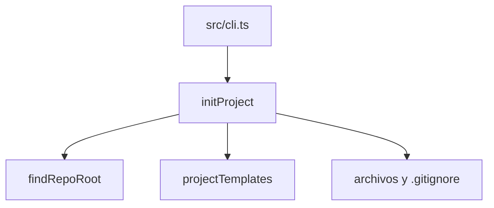

Parte 3 · Página 16 de 22 · Anterior: [Ayudantes de prueba para repositorios temporales](110-test-helpers-repo.md) · Siguiente: [Plantillas de inicialización](130-init-templates.md) · [Índice](../README.md)
# Inicialización del proyecto

**Archivo:** `src/init/init.ts` · 70 líneas · **Estado:** disponible

## Índice de la página

- ¿Qué es y para qué sirve?
- Antes de leer el código
- Cómo encaja
- El código completo, comentado
- Ejemplos con datos reales
- Resumen de comportamientos
- Dónde se usa
- Pruebas

## ¿Qué es y para qué sirve?

Sin este módulo, cada equipo tendría que crear a mano los archivos y carpetas de Code Audit. `init` encuentra el repositorio, crea `config.md` para el idioma y las opciones de revisión, `project.md` para el propósito y vocabulario, `structure.md` para ubicar el código, un README que explica las carpetas, una ficha de tarea y guías de reglas. También indica a Git que no incluya las tareas ni los resultados de revisión (`.gitignore`). El CLI le pasa la ruta del repositorio y el idioma; informa qué archivos creó y cuáles omitió, y nunca reemplaza archivos existentes.

## Antes de leer el código

Una opción de creación (`wx`) significa «crear solo si la ruta no existe». Si se intenta crear el mismo archivo otra vez, se produce `EEXIST`; `init` informa esa ruta en `skipped` y conserva su contenido.

## Cómo encaja



1. `findRepoRoot` encuentra el repositorio que contiene la ruta solicitada.
2. `projectTemplates` entrega los archivos y sus contenidos traducidos.
3. Se crean los archivos nuevos; las rutas existentes quedan en `skipped` y no cambian.
4. El archivo de exclusiones de Git (`.gitignore`) recibe solo las entradas faltantes y conserva su tipo de salto de línea.

## El código completo, comentado

El archivo fuente completo tiene 70 líneas.

```ts
import { mkdir, readFile, writeFile } from 'node:fs/promises';
import { join } from 'node:path';
import { CONFIG_DIR } from '../config/paths.js';
import { findRepoRoot } from '../git/git.js';
import { projectTemplates } from './templates.js';

/** Reports a language value that cannot be stored safely in config.md. */
export class InvalidLanguageError extends Error {
  /** Creates a diagnostic containing the rejected language value. */
  constructor(language: string) {
    super(`invalid language: ${language}`);
    this.name = 'InvalidLanguageError';
  }
}

/** Creates the project configuration without replacing existing files. */
export async function initProject(
  root: string,
  opts: { language: string },
): Promise<{ created: string[]; skipped: string[]; gitignoreUpdated: boolean }> {
  if (!/^[A-Za-z0-9]+(?:-[A-Za-z0-9]+)*$/.test(opts.language)) {
    throw new InvalidLanguageError(opts.language);
  }
  const repoRoot = await findRepoRoot(root);
  const created: string[] = [];
  const skipped: string[] = [];
  for (const [file, content] of projectTemplates(opts.language)) {
    const relative = `${CONFIG_DIR}/${file}`;
    const absolute = join(repoRoot, relative);
    await mkdir(join(absolute, '..'), { recursive: true });
    try {
      await writeFile(absolute, content, { flag: 'wx' });
      created.push(relative);
    } catch (error) {
      if ((error as NodeJS.ErrnoException).code !== 'EEXIST') throw error;
      skipped.push(relative);
    }
  }
  const gitignoreUpdated = await updateGitignore(repoRoot);
  return { created, skipped, gitignoreUpdated };
}

/** Ensures both generated runtime folders are ignored without duplicate entries. */
async function updateGitignore(root: string): Promise<boolean> {
  const path = join(root, '.gitignore');
  let content: string;
  let exists = true;
  try { content = await readFile(path, 'utf8'); }
  catch (error) {
    if ((error as NodeJS.ErrnoException).code !== 'ENOENT') throw error;
    exists = false;
    content = '';
  }
  const newline = content.includes('\r\n') ? '\r\n' : '\n';
  const existing = new Set(content.split(/\r?\n/).map(normalizeGitignoreLine));
  const missing = GITIGNORE_LINES.filter((line) => !existing.has(normalizeGitignoreLine(line)));
  if (missing.length === 0) return false;
  const prefix = content.length > 0 && !content.endsWith('\n') ? newline : '';
  const additions = `${prefix}${missing.join(newline)}${newline}`;
  await writeFile(path, additions, { flag: exists ? 'a' : 'wx' });
  return true;
}

/** Normalizes optional slashes around a generated ignore path. */
function normalizeGitignoreLine(line: string): string {
  return line.trim().replace(/^\/+|\/+$/g, '');
}

/** Paths added to a project's Git ignore file by init. */
export const GITIGNORE_LINES = ['.agents/code-audit/tasks/', '.agents/code-audit/runs/'];
```

## Ejemplos con datos reales

### Primera ejecución con salida JSON

En un repositorio temporal vacío, el CLI compilado devolvió:

```text
{"created":[".agents/code-audit/config.md",".agents/code-audit/project.md",".agents/code-audit/structure.md",".agents/code-audit/README.md",".agents/code-audit/task-template.md",".agents/code-audit/tasks/.gitkeep",".agents/code-audit/runs/.gitkeep",".agents/code-audit/policies/README.md",".agents/code-audit/rules/README.md",".agents/code-audit/business/README.md",".agents/code-audit/decisions/README.md",".agents/code-audit/templates/README.md"],"skipped":[],"gitignoreUpdated":true}
```

El `.gitignore` resultante contiene:

```text
.agents/code-audit/tasks/
.agents/code-audit/runs/
```

### Configuración propia existente

Con un `.agents/code-audit/config.md` existente cuyo contenido era `owner config`, `init` devolvió:

```text
Created 11 file(s).
Skipped 1 existing file(s).
Updated .gitignore.
```

El archivo existente conservó este contenido:

```text
owner config
```

### Idioma no válido

El CLI compilado rechazó `--language "es: x"` antes de crear archivos del proyecto:

```text
invalid language: es: x
1
.
..
```

El `1` es el código de salida impreso por la terminal; `ls -a` mostró solo las entradas del directorio actual y el superior, sin `.agents` ni `.gitignore`.

### Segunda ejecución

Al repetir la inicialización, los archivos generados se conservan y aparecen como omitidos:

```text
{"created":[],"skipped":[".agents/code-audit/config.md",".agents/code-audit/project.md",".agents/code-audit/structure.md",".agents/code-audit/README.md",".agents/code-audit/task-template.md",".agents/code-audit/tasks/.gitkeep",".agents/code-audit/runs/.gitkeep",".agents/code-audit/policies/README.md",".agents/code-audit/rules/README.md",".agents/code-audit/business/README.md",".agents/code-audit/decisions/README.md",".agents/code-audit/templates/README.md"],"gitignoreUpdated":false}
```

## Resumen de comportamientos

- **Ruta dentro de un repositorio:** la inicialización usa su raíz detectada.
- **Archivo existente:** se conserva y aparece en `skipped`.
- **Idioma:** los valores válidos se guardan tal como se escriben; `es` y sus variantes `es-` seleccionan español, los demás seleccionan inglés. Un valor no válido termina con código 1 antes de escribir.
- **Entrada faltante:** se agrega una vez y se conserva CRLF; si el archivo termina en un CR suelto, se agrega LF antes de las nuevas entradas.
- **Ruta fuera del repositorio:** `findRepoRoot` genera `NotARepoError`; el CLI lo traduce al código 3.

## Dónde se usa

### Usa

- [src/config/paths.ts](050-config-paths.md), línea 3, aporta `CONFIG_DIR`.
- [src/git/git.ts](100-git-git.md), línea 91, aporta `findRepoRoot`.
- [src/init/templates.ts](130-init-templates.md), línea 4, entrega los archivos generados.

### Lo usan

- [src/cli.ts](020-cli.md), línea 81, llama a `initProject`.
- [src/init/init.test.ts](../../../src/init/init.test.ts), línea 9, lo importa para probar la creación de archivos y los errores.

## Pruebas

`src/init/init.test.ts`: persistencia y selección del idioma, rechazo de valores no válidos antes de escribir, carga de fichas en ambos idiomas, repetición sin sobrescritura, CRLF y CR suelto, ejemplos de reglas README en ambos idiomas, normalización de rutas, CLI JSON y códigos de salida.

Parte 3 · Página 16 de 22 · Anterior: [Ayudantes de prueba para repositorios temporales](110-test-helpers-repo.md) · Siguiente: [Plantillas de inicialización](130-init-templates.md) · [Índice](../README.md)
