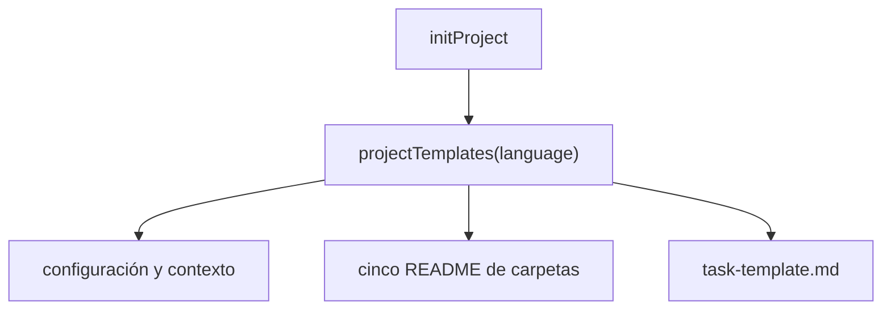

Parte 3 · Página 17 de 22 · Anterior: [Inicialización del proyecto](120-init-init.md) · Siguiente: [Desarrollo](../4-development/10-development.md) · [Índice](../README.md)
# Plantillas de inicialización

**Archivo:** `src/init/templates.ts` · 78 líneas · **Estado:** disponible

## Índice de la página

- ¿Qué es y para qué sirve?
- Antes de leer el código
- Cómo encaja
- El código completo, comentado
- Ejemplos con datos reales
- Resumen de comportamientos
- Dónde se usa
- Pruebas

## ¿Qué es y para qué sirve?

Sin este módulo, `init` no tendría los archivos de proyecto que crear. Entrega `config.md` para el idioma y las opciones de revisión, `project.md` para el propósito y vocabulario, `structure.md` para ubicar el código, la explicación de carpetas, una ficha reutilizable y guías de reglas. Devuelve los nombres relativos y el contenido a `initProject`; ese inicializador conserva los archivos existentes. El texto sale en español si el idioma es `es` o empieza por `es-` (sin distinguir mayúsculas), y en inglés para los demás valores válidos. Cada carpeta de reglas recibe una guía con un ejemplo completo; el cargador omite los README.

## Antes de leer el código

Un ejemplo cercado muestra una regla para que las personas puedan copiarla; no se aplica mientras siga dentro del README. La prueba la copia a un archivo Markdown temporal y la valida con `loadRules`.

## Cómo encaja



1. `projectTemplates` selecciona un paquete de idioma.
2. Asocia configuración, contexto, ficha de tarea y archivos keep.
3. Agrega un README localizado por cada clave de `RULE_DIRS`.
4. `ruleReadme` crea un ejemplo válido con campos adecuados a esa carpeta.

## El código completo, comentado

```ts
import { RULE_DIRS } from '../config/paths.js';

/** Lists project configuration files and their localized contents. */
export function projectTemplates(language: string): Map<string, string> {
  const spanish = /^es(?:-|$)/i.test(language);
  const text = spanish ? ES : EN;
  const files = new Map<string, string>([
    ['config.md', text.config.replace(/language: (?:en|es)/, `language: ${language}`)],
    ['project.md', text.project],
    ['structure.md', text.structure],
    ['README.md', text.overview],
    ['task-template.md', text.task],
    ['tasks/.gitkeep', ''],
    ['runs/.gitkeep', ''],
  ]);
  for (const folder of Object.keys(RULE_DIRS) as (keyof typeof RULE_DIRS)[]) {
    files.set(`${folder}/README.md`, ruleReadme(folder, spanish, text.ruleBody[folder]));
  }
  return files;
}

interface LocalizedTemplates {
  config: string;
  project: string;
  structure: string;
  overview: string;
  task: string;
  ruleBody: Record<keyof typeof RULE_DIRS, string>;
}

/** Builds the per-folder rule guide with a valid example in a code block. */
function ruleReadme(folder: keyof typeof RULE_DIRS, spanish: boolean, body: string): string {
  const labels = spanish
    ? { policies: 'Políticas', rules: 'Reglas técnicas', business: 'Reglas de negocio', decisions: 'Decisiones de arquitectura', templates: 'Plantillas' }
    : { policies: 'Policies', rules: 'Technical rules', business: 'Business rules', decisions: 'Architecture decisions', templates: 'Templates' };
  const descriptions = spanish
    ? { policies: 'Reglas para todo el proyecto; se leen siempre.', rules: 'Reglas sobre tecnologías y prácticas técnicas.', business: 'Reglas sobre términos y comportamiento del negocio.', decisions: 'Decisiones de arquitectura y sus consecuencias.', templates: 'Criterios para los componentes nuevos.' }
    : { policies: 'Rules for the whole project; always read.', rules: 'Rules about technologies and technical practices.', business: 'Rules about business terms and behavior.', decisions: 'Architecture decisions and their consequences.', templates: 'Criteria for new components.' };
  const id = `EXAMPLE-${folder.toUpperCase()}`;
  const applies = folder === 'policies' ? '' : 'applies_to:\n  - "src/**"\n';
  const title = spanish ? 'Ejemplo completo de regla' : 'Complete example rule';
  const example = `---\nid: ${id}\ntitle: ${title}\nseverity: minor\n${applies}keywords: [example]\n---\n${body}`;
  const heading = labels[folder];
  const instructions = spanish
    ? ['# ' + heading, '', descriptions[folder] + ' Guarda cada regla en un archivo Markdown con encabezado YAML y cuerpo Markdown.', '', 'Ejemplo completo de regla:', '', '```markdown', example, '```', ''].join('\n')
    : ['# ' + heading, '', descriptions[folder] + ' Store each rule in a Markdown file with a YAML header and Markdown body.', '', 'Complete rule example:', '', '```markdown', example, '```', ''].join('\n');
  return instructions;
}

const EN: LocalizedTemplates = {
  config: `---\nstructure_version: 1\nlanguage: en\nmax_changed_lines: 1000\n---\n`,
  project: `# Project\n\nDescribe the project, its technologies, and business vocabulary.\n`,
  structure: `# Project structure\n\nDescribe where components, services, and utilities live and the folder conventions.\n`,
  overview: `# Code Audit configuration\n\nThis folder contains the team's project context and review rules.\n\n- config.md: report language and review settings.\n- project.md: project purpose, technologies, and vocabulary.\n- structure.md: code locations and folder conventions.\n- policies/: rules for the whole project; always read.\n- rules/: technical rules.\n- business/: business rules.\n- decisions/: architecture decisions.\n- templates/: expectations for new components.\n- tasks/: task briefs, ignored by Git.\n- runs/: review results, ignored by Git.\n\nFolder and severity are separate: the folder gives the rule type; each rule declares severity. Rule headers use YAML with id, title, severity, optional applies_to, and optional keywords.\n\n## How to fill a task brief\n\nCopy task-template.md to tasks/PAY-123.md. Fill in the objective and numbered acceptance criteria; both are required. The tasks/ folder is ignored by Git, so task briefs are not committed to the repository.\n`,
  task: `---\nsource: https://example.invalid/task\n---\n## Objective\nDescribe the desired outcome and why it matters.\n\n## Acceptance criteria\n1. Describe one verifiable result.\n\n## Out of scope\nDescribe excluded work.\n\n## Expected areas (optional)\nList likely files or folders.\n\n## Notes and decisions\nAdd relevant agreements or design links.\n`,
  ruleBody: {
    policies: 'Apply this requirement to every part of the project.',
    rules: 'Keep this technical behavior consistent across the project.',
    business: 'Use this business term and behavior consistently.',
    decisions: 'Record the decision, its context, and its consequences.',
    templates: 'Use this structure and quality bar for new components.',
  },
};

const ES: LocalizedTemplates = {
  config: `---\nstructure_version: 1\nlanguage: es\nmax_changed_lines: 1000\n---\n`,
  project: `# Proyecto\n\nDescribe el proyecto, sus tecnologías y el vocabulario del negocio.\n`,
  structure: `# Estructura del proyecto\n\nDescribe dónde viven los componentes, servicios y utilidades, y las convenciones de carpetas.\n`,
  overview: `# Configuración de Code Audit\n\nEsta carpeta contiene el contexto del proyecto y las reglas de revisión del equipo.\n\n- config.md: idioma del informe y opciones de revisión.\n- project.md: propósito, tecnologías y vocabulario.\n- structure.md: ubicación del código y convenciones.\n- policies/: reglas para todo el proyecto; se leen siempre.\n- rules/: reglas técnicas.\n- business/: reglas de negocio.\n- decisions/: decisiones de arquitectura.\n- templates/: expectativas para componentes nuevos.\n- tasks/: fichas de tarea, ignoradas por Git.\n- runs/: resultados de revisión, ignorados por Git.\n\nLa carpeta y la gravedad son distintas: la carpeta indica el tipo de regla y cada regla declara su gravedad. El encabezado YAML usa id, title, severity, applies_to opcional y keywords opcional.\n\n## Cómo llenar una ficha de tarea\n\nCopia task-template.md a tasks/PAY-123.md. Llena el objetivo y los criterios de aceptación numerados; ambos son obligatorios. La carpeta tasks/ está excluida de Git, así que las fichas no se suben al repositorio.\n`,
  task: `---\nsource: https://example.invalid/tarea\n---\n## Objetivo\nDescribe el resultado deseado y por qué importa.\n\n## Criterios de aceptación\n1. Describe un resultado que se pueda comprobar.\n\n## Fuera de alcance\nDescribe el trabajo excluido.\n\n## Áreas que se espera tocar (opcional)\nEnumera archivos o carpetas probables.\n\n## Notas y decisiones\nAgrega acuerdos o enlaces de diseño relevantes.\n`,
  ruleBody: {
    policies: 'Aplica este requisito en todas las partes del proyecto.',
    rules: 'Mantén este comportamiento técnico consistente en el proyecto.',
    business: 'Usa este término y comportamiento de negocio de forma consistente.',
    decisions: 'Registra la decisión, su contexto y sus consecuencias.',
    templates: 'Usa esta estructura y nivel de calidad para componentes nuevos.',
  },
};
```

## Ejemplos con datos reales

### Valor de idioma francés

`projectTemplates("fr").get("config.md")` devuelve este archivo completo:

```text
---
structure_version: 1
language: fr
max_changed_lines: 1000
---
```

### Valor de idioma español

`projectTemplates("es").get("config.md")` devuelve este archivo completo:

```text
---
structure_version: 1
language: es
max_changed_lines: 1000
---
```

### README de reglas de negocio en español

`projectTemplates("es").get("business/README.md")` devuelve:

````markdown
# Reglas de negocio

Reglas sobre términos y comportamiento del negocio. Guarda cada regla en un archivo Markdown con encabezado YAML y cuerpo Markdown.

Ejemplo completo de regla:

```markdown
---
id: EXAMPLE-BUSINESS
title: Ejemplo completo de regla
severity: minor
applies_to:
  - "src/**"
keywords: [example]
---
Usa este término y comportamiento de negocio de forma consistente.
```
````

### Ejemplos de reglas

Cada README generado (`policies/README.md`, `rules/README.md`, `business/README.md`, `decisions/README.md` y `templates/README.md`) incluye un ejemplo completo que `loadRules` acepta al extraerlo.

## Resumen de comportamientos

- **Idioma `es` o prefijo `es-`, sin distinguir mayúsculas:** las instrucciones están en español y `config.md` conserva el valor escrito.
- **Cualquier otro idioma válido:** las instrucciones están en inglés y `config.md` conserva el valor escrito.
- **Carpeta de reglas:** su README explica el propósito e incluye un ejemplo completo válido.
- **Plantilla de tarea:** contiene el objetivo obligatorio y criterios numerados.

## Dónde se usa

### Usa

- [src/config/paths.ts](050-config-paths.md), línea 7, aporta los nombres de carpetas de reglas.

### Lo usan

- [src/init/init.ts](120-init-init.md), línea 5, importa `projectTemplates` y escribe sus archivos.
- [src/init/init.test.ts](../../../src/init/init.test.ts), línea 9, importa el inicializador para comprobar archivos traducidos, fichas y ejemplos de reglas.

## Pruebas

`src/init/init.test.ts`: persistencia exacta del idioma y selección del español para `ES` y `es-MX`; `loadRules` acepta los cinco ejemplos de README en inglés y español; `loadTask` acepta ambas plantillas de tarea con notas y sin problemas.

Parte 3 · Página 17 de 22 · Anterior: [Inicialización del proyecto](120-init-init.md) · Siguiente: [Desarrollo](../4-development/10-development.md) · [Índice](../README.md)
