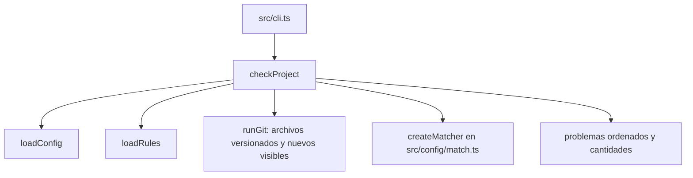

Parte 3 · Página 19 de 34 · Anterior: [Plantillas de inicialización](130-init-templates.md) · Siguiente: [Comparador de patrones](150-config-match.md) · [Índice](../README.md)
# Comprobador del proyecto

**Archivo:** `src/check/check.ts` · 67 líneas · **Estado:** disponible

## Índice de la página

- ¿Qué es y para qué sirve?
- Antes de leer el código
- Cómo encaja
- El código completo, comentado
- Ejemplos con datos reales
- Resumen de comportamientos
- Dónde se usa
- Pruebas

## ¿Qué es y para qué sirve?

Este archivo revisa las instrucciones guardadas para el proyecto. Comprueba que cada identificador (id) sea único y que las rutas descritas por cada regla (patrones) correspondan a algún archivo que Git pueda ver. Informa los problemas para que una persona los corrija. Devuelve los problemas, la cantidad de reglas válidas y la cantidad de políticas.

## Antes de leer el código

Un patrón de archivos describe rutas, por ejemplo `src/**`. [`src/config/match.ts`](150-config-match.md) crea una función con `createMatcher` que compara el patrón con cada ruta del repositorio usando `picomatch` y `{ dot: true }` para incluir archivos ocultos como `src/.env`.

La opción `-z` de Git separa los nombres con un byte cero. Así conserva los espacios, acentos y saltos de línea que forman parte de un nombre.

## Cómo encaja



1. El CLI encuentra la raíz del repositorio y llama a `checkProject`.
2. El comprobador carga la configuración y las reglas, y pide a Git los archivos versionados y los nuevos que no están ignorados.
3. Detecta ids repetidos sin distinguir mayúsculas y patrones sin coincidencias usando `createMatcher`.
4. Ordena los errores antes de los avisos y devuelve las cantidades.

## El código completo, comentado

```ts
import { createMatcher } from '../config/match.js';
import { CONFIG_DIR } from '../config/paths.js';
import { loadConfig } from '../config/config.js';
import { loadRules } from '../config/rules.js';
import type { Problem } from '../config/types.js';
import { runGit } from '../git/git.js';

/** Sets the maximum policy count before check reports a warning. */
export const POLICY_WARNING_THRESHOLD = 15;

/** Validates project configuration, rules, and their file patterns. */
export async function checkProject(root: string): Promise<{ problems: Problem[]; ruleCount: number; policyCount: number }> {
  const [{ problems: configProblems }, { rules, problems: ruleProblems }, fileOutput] = await Promise.all([
    loadConfig(root),
    loadRules(root),
    runGit(root, ['ls-files', '--cached', '--others', '--exclude-standard', '-z']),
  ]);
  const files = fileOutput.split('\0').filter(Boolean);
  const problems = [...configProblems, ...ruleProblems];
  const rulesById = new Map<string, { file: string; id: string }>();

  for (const rule of rules) {
    const normalizedId = rule.id.toLocaleLowerCase('en-US');
    const previous = rulesById.get(normalizedId);
    if (previous) {
      const duplicateMessage = rule.id === previous.id
        ? `duplicate rule id "${rule.id}" also appears in ${previous.file}`
        : `duplicate rule id "${rule.id}" also appears in ${previous.file} as "${previous.id}"`;
      problems.push({
        level: 'error',
        file: rule.file,
        message: duplicateMessage,
      });
    } else rulesById.set(normalizedId, { file: rule.file, id: rule.id });

    if (rule.kind === 'policy') continue;
    for (const pattern of rule.appliesTo) {
      const matcher = createMatcher([pattern]);
      const matches = files.some((file) => matcher(file) !== undefined);
      if (!matches) {
        problems.push({ level: 'warning', file: rule.file, message: `applies_to pattern matches no file: ${pattern}` });
      }
    }
  }

  const policyCount = rules.filter((rule) => rule.kind === 'policy').length;
  if (policyCount > POLICY_WARNING_THRESHOLD) {
    problems.push({
      level: 'warning',
      file: `${CONFIG_DIR}/policies`,
      message: `policies/ has ${policyCount} rules; they are read on every review, keep them few`,
    });
  }

  problems.sort((a, b) => compareProblems(a, b));
  return { problems, ruleCount: rules.length, policyCount };
}

/** Orders errors before warnings, then sorts each group by file and message. */
function compareProblems(a: Problem, b: Problem): number {
  const levelOrder = (a.level === 'error' ? 0 : 1) - (b.level === 'error' ? 0 : 1);
  if (levelOrder !== 0) return levelOrder;
  return compareText(a.file, b.file) || compareText(a.message, b.message);
}

/** Compares strings by Unicode code units for machine-independent ordering. */
function compareText(a: string, b: string): number { return a < b ? -1 : a > b ? 1 : 0; }
```

## Ejemplos con datos reales

Los ejemplos se ejecutaron con el programa compilado copiado a una carpeta sin `node_modules`; aquí se acortan las rutas temporales.

### Proyecto recién inicializado

```text
$ node <standalone .mjs> init --root <temporary Git repo> --language es
Created 12 file(s).
Skipped 0 existing file(s).
Updated .gitignore.
$ node <standalone .mjs> check --root <temporary Git repo>
0 rules (0 policies). 0 errors, 0 warnings.
$ echo $?
0
```

### Ids repetidos, severity ausente y versión de texto

Estas salidas se capturaron al ejecutar el compilado independiente, copiado a una carpeta sin `node_modules`, en un repositorio Git temporal recién inicializado. Las dos reglas de negocio usan `biz-003` y `BIZ-003`; una tercera regla omite `severity`.

```text
$ node <standalone .mjs> check --root .
error   .agents/code-audit/business/b.md: duplicate rule id "BIZ-003" also appears in .agents/code-audit/business/a.md as "biz-003"
error   .agents/code-audit/business/c.md: severity is required
2 rules (0 policies). 2 errors, 0 warnings.
$ echo $?
2
$ node <standalone .mjs> check --root .
error   .agents/code-audit/business/b.md: duplicate rule id "BIZ-003" also appears in .agents/code-audit/business/a.md as "biz-003"
error   .agents/code-audit/business/c.md: severity is required
error   .agents/code-audit/config.md: structure_version must be an integer; received "1"
2 rules (0 policies). 3 errors, 0 warnings.
$ echo $?
2
```

### Fuera de un repositorio

```text
$ node <standalone .mjs> check --root <temporary non-repository folder>
not a working Git repository: <temporary path>
$ echo $?
3
```

## Resumen de comportamientos

- **Configuración nueva:** devuelve cero errores y avisos.
- **Ids repetidos:** muestra ambas formas escritas si difieren y señala el archivo posterior; no distingue mayúsculas.
- **Patrón sin coincidencias:** avisa en el archivo de la regla e incluye el patrón.
- **Archivos revisados:** incluye archivos versionados y nuevos no ignorados, sin alterar sus nombres.
- **Políticas:** las cuenta entre todas las reglas y avisa al superar 15.
- **Código de salida:** 2 si hay errores, 0 si solo hay avisos o no hay problemas y 3 fuera de Git.
- **JSON:** devuelve el resultado completo y conserva el orden de los problemas de la salida normal.

## Dónde se usa

### Usa

- [`src/config/match.ts`](150-config-match.md), línea 1, crea el comparador de patrones.
- [`src/config/config.ts`](070-config-config.md), línea 13, carga la configuración del proyecto.
- [`src/config/rules.ts`](080-config-rules.md), línea 14, carga y valida las reglas.
- [`src/git/git.ts`](100-git-git.md), línea 16, ejecuta el comando Git protegido.

### Lo usan

- [`src/cli.ts`](020-cli.md), línea 4 la importa y línea 116 la llama.
- [`src/check/check.test.ts`](../../../src/check/check.test.ts), línea 7, comprueba sus resultados.

## Pruebas

`src/check/check.test.ts`: inicialización en ambos idiomas, ids repetidos, archivos versionados y nuevos, archivos ignorados, espacios y acentos, nombres con salto de línea, patrones sin coincidencias, umbral de políticas y errores combinados de los cargadores. `src/cli.test.ts`: salida normal y JSON, y códigos 0, 2 y 3.

Parte 3 · Página 19 de 34 · Anterior: [Plantillas de inicialización](130-init-templates.md) · Siguiente: [Comparador de patrones](150-config-match.md) · [Índice](../README.md)


