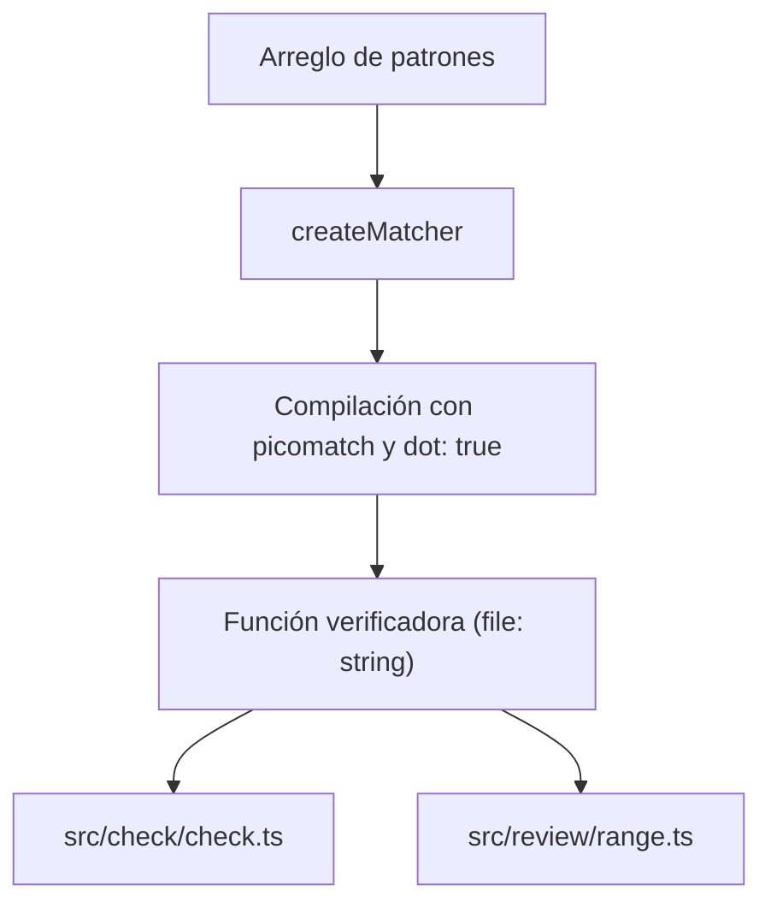

Parte 3 · Página 19 de 29 · Anterior: [Comprobador del proyecto](140-check-check.md) · Siguiente: [Tipos de revisión](160-review-types.md) · [Índice](../README.md)
# Comparador de patrones

**Archivo:** `src/config/match.ts` · 28 líneas · **Estado:** disponible

## Índice de la página

- ¿Qué es y para qué sirve?
- Antes de leer el código
- Cómo encaja
- El código completo, comentado
- Ejemplos con datos reales
- Resumen de comportamientos
- Dónde se usa
- Pruebas

## ¿Qué es y para qué sirve?

Este archivo recibe una lista de patrones de rutas y devuelve una función para comprobar si un archivo coincide con alguno de ellos. Si hay coincidencia, devuelve el primer patrón que coincidió; si no, devuelve un valor vacío (`undefined`). Los patrones mal formados nunca coinciden y no lanzan excepciones (errores que detienen el programa).

Sin este archivo, cada parte del sistema tendría que compilar expresiones regulares por su cuenta y gestionar los fallos de sintaxis en los patrones de configuración.

Recibe un arreglo de cadenas con patrones y devuelve una función que recibe una ruta de archivo y devuelve el patrón coincidente o `undefined`. Lo usan [`src/check/check.ts`](140-check-check.md) y [`src/review/range.ts`](170-review-range.md).

## Antes de leer el código

### Patrones de rutas (globs)

Un patrón describe una familia de nombres de archivo mediante comodines. Por ejemplo, `src/**` coincide con cualquier archivo dentro de la carpeta `src/`.

```ts
// entrada: 'src/**', archivo: 'src/main.ts'
// → 'src/**'
```

### Archivos con punto inicial

Por omisión, muchas herramientas ignoran archivos que empiezan con un punto, como `.env`. La opción `dot: true` asegura que esos archivos se comparen con normalidad.

```ts
// entrada: 'src/**', archivo: 'src/.env' con dot: true
// → 'src/**'
```

## Cómo encaja



1. `createMatcher` precompila cada patrón con `picomatch` activando la opción para archivos ocultos.
2. Si un patrón contiene sintaxis inválida, se sustituye por una función que siempre devuelve falso.
3. La función resultante recorre los patrones en orden y devuelve el primero que coincida con la ruta consultada.

## El código completo, comentado

```ts
import picomatch from 'picomatch';

/**
 * Creates a matcher function returning the first glob pattern that matches a given file path.
 *
 * Patterns are evaluated with dotfile support enabled. Malformed patterns never match.
 */
export function createMatcher(patterns: string[]): (file: string) => string | undefined {
  // Precompila cada patrón con soporte para archivos con punto; captura errores de sintaxis.
  const matchers = patterns.map((pattern) => {
    try {
      const match = picomatch(pattern, { dot: true });
      return { pattern, match };
    } catch {
      // Un patrón inválido produce una función que nunca coincide.
      return { pattern, match: () => false };
    }
  });

  // Devuelve la función que evalúa rutas de archivo contra los patrones compilados.
  return (file: string): string | undefined => {
    for (const { pattern, match } of matchers) {
      try {
        // Devuelve el primer patrón que coincida con la ruta.
        if (match(file)) return pattern;
      } catch {
        // Ignora fallos durante la evaluación para mantener estabilidad.
      }
    }
    // Ningún patrón coincidió con la ruta.
    return undefined;
  };
}
```

## Ejemplos con datos reales

### Caso normal

Compara una ruta que coincide con un patrón comodín:

```ts
const matcher = createMatcher(['src/**']);
matcher('src/.env');
// → 'src/**'
```

### Caso límite

Un patrón con cadena vacía falla al compilar en `picomatch`, pero no interrumpe el programa ni coincide con ningún archivo:

```ts
const matcher = createMatcher(['', '*.ts']);
matcher('test.js');
// → undefined
```

### Sin la línea clave

Sin `{ dot: true }`, los archivos ocultos como `src/.env` no coincidirían con patrones comodín como `src/**`, ignorando archivos de configuración importantes durante la revisión y comprobación de reglas.

## Resumen de comportamientos

- **Patrón coincide con archivo:** devuelve la cadena del primer patrón coincidente.
- **Varios patrones coinciden:** devuelve el primero según el orden en que se recibieron.
- **Ningún patrón coincide:** devuelve `undefined`.
- **Lista de patrones vacía:** la función resultante siempre devuelve `undefined`.
- **Patrón inválido o vacío:** se ignora de forma segura y nunca coincide con ningún archivo.

## Dónde se usa

### Usa

- `picomatch` para compilar y evaluar expresiones comodín.

### Lo usan

- [`src/check/check.ts`](140-check-check.md), línea 37, para validar patrones `applies_to` de las reglas.
- [`src/review/range.ts`](170-review-range.md), línea 203, para filtrar archivos excluidos en `config.ignore`.

## Pruebas

- `src/config/match.test.ts`: coincidencia con archivos ocultos usando comodines.
- `src/config/match.test.ts`: manejo seguro de patrones inválidos sin lanzar excepciones.
- `src/config/match.test.ts`: precedencia del primer patrón coincidente.
- `src/config/match.test.ts`: respuesta indefinida ante patrones vacíos o sin coincidencias.
Parte 3 · Página 19 de 29 · Anterior: [Comprobador del proyecto](140-check-check.md) · Siguiente: [Tipos de revisión](160-review-types.md) · [Índice](../README.md)


