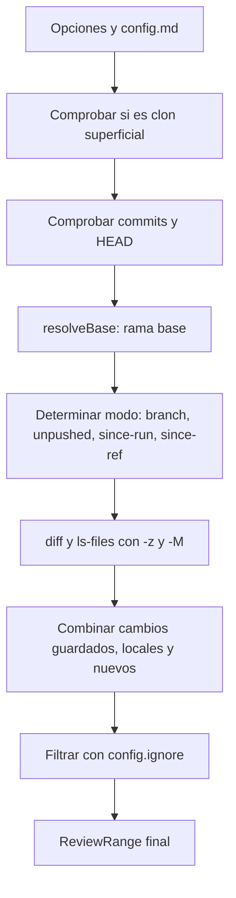

Parte 3 · Página 21 de 28 · Anterior: [Tipos de revisión](160-review-types.md) · Siguiente: [Líneas cambiadas](180-review-changes.md) · [Índice](../README.md)
# Rango a revisar

**Archivo:** `src/review/range.ts` · 380 líneas · **Estado:** disponible

## Índice de la página

- ¿Qué es y para qué sirve?
- Antes de leer el código
- Cómo encaja
- El código completo, comentado
- Ejemplos con datos reales
- Resumen de comportamientos
- Dónde se usa
- Pruebas

## ¿Qué es y para qué sirve?

Este archivo calcula exactamente qué archivos, líneas y confirmaciones de cambios (commits) entran en una revisión de código.

Sin este archivo, el sistema no sabría qué cambios revisar respecto a la rama principal (base), mezclaría modificaciones guardadas con cambios locales sin guardar, reportaría archivos ajenos del remoto como si hubieran sido borrados por el autor, o intentaría procesar repositorios incompletos.

Recibe la raíz del repositorio y las opciones de configuración, y devuelve un objeto de rango ([`ReviewRange`](160-review-types.md)) con la lista de archivos cambiados, líneas añadidas y eliminadas, y confirmaciones incluidas. Si no es posible calcular un rango válido, lanza un error con un motivo específico (`ReviewRangeError`). Hoy ningún comando de la línea de comandos lo usa todavía; formará la base de los comandos de revisión futuros.

## Antes de leer el código

### Tres puntos en comparaciones de Git (`diff A...B`)

En Git, comparar dos ramas con tres puntos encuentra el ancestro común (`merge-base`) y muestra únicamente las diferencias introducidas en el lado derecho respecto a ese punto de separación. Al usar tres puntos (`upstream...HEAD`), los commits que llegaron al remoto y que la persona aún no ha integrado no se muestran como archivos eliminados por error.

```text
git diff origin/main...HEAD
// → muestra solo los cambios propios de HEAD desde el ancestro común
```

En cambio, una comparación de dos puntos (`upstream..HEAD`) calcula la diferencia directa entre ambos árboles de archivos. Si el remoto avanzó con nuevos commits, un diff de dos puntos restaría esos archivos, haciéndolos aparecer erróneamente como archivos borrados en la rama local.

### Separador nulo (`-z`)

Git emite los nombres de archivo separados por un byte cero (`\0`) en vez de saltos de línea. Esto permite procesar de forma segura nombres de archivo con espacios, acentos, tabuladores o caracteres especiales.

```text
git diff --numstat -z HEAD
// → 1\t0\tnuevo ñ.ts\0
```

## Cómo encaja



### Reglas de resolución de la rama base

1. **Configuración explícita (`config.baseBranch`):** Si `config.md` especifica una rama base, se verifica su existencia en Git mediante `git rev-parse --verify <baseBranch>`. Si no existe o es un valor inválido, se lanza inmediatamente `ReviewRangeError('base-not-found')` con el mensaje `base_branch "<baseBranch>" from config.md does not exist`. En este caso **no** se intenta ninguna alternativa.
2. **Alternativas automáticas:** Solo cuando `config.baseBranch` está ausente o vacío, se intentan en orden:
   - `origin/HEAD`: rama predeterminada del repositorio remoto configurado.
   - `main`: rama principal local estándar.
   - `master`: rama principal local histórica.
3. Si ninguna de las ramas estándar existe, se lanza `ReviewRangeError('base-not-found')` indicando configurar `base_branch` en `config.md`.

### Reglas de los modos de cálculo

- **`since-ref`:** Cuando se especifica `--since <ref>`, se verifica que la referencia exista. La base de comparación (`baseSha`) es el `merge-base` entre la referencia y HEAD, el diff usa tres puntos (`<ref>...HEAD`), y los commits incluidos son `<ref>..HEAD`.
- **En la rama base (orden de decisión):**
  1. *Con upstream configurado con cambios:* Si hay commits sin subir (`unpushedCount > 0`) o cambios locales sin commit (`hasUncommitted`), el modo es `unpushed`. La base es el upstream (`baseLabel = upstreamRef`), `baseSha = merge-base(upstream, HEAD)`, el diff usa tres puntos (`upstream...HEAD`) para no restar cambios remotos, y los commits son `upstream..HEAD`.
  2. *Con última ejecución (`lastRunHead`):* Si no hay upstream con cambios pendientes pero se especifica `lastRunHead`, el modo es `since-run`. La base es `lastRunHead` (`baseLabel = opts.lastRunHead`), `baseSha = merge-base(lastRunHead, HEAD)`, el diff usa tres puntos (`lastRunHead...HEAD`), los commits son `lastRunHead..HEAD` y se suman también los cambios sin guardar del árbol de trabajo. Esto vale tanto con upstream al día como sin upstream.
  3. *Sin upstream configurado y con cambios sin commit:* Si no hay upstream ni `lastRunHead`, pero hay archivos modificados o sin seguimiento (`hasUncommitted`), el modo es `unpushed`. La base es HEAD (`baseLabel = 'HEAD'`, `baseSha = headSha`), con cero confirmaciones registradas (`commits = []`) y únicamente los cambios sin guardar del árbol de trabajo.
  4. *Sin cambios ni punto de inicio:* Si no hay upstream, no hay `lastRunHead` y no hay cambios sin commit, se lanza `ReviewRangeError('needs-start')` requiriendo especificar `--since <ref>`.
- **`branch`:** Al trabajar en cualquier otra rama o con HEAD desconectado, compara contra la base resuelta usando el `merge-base` y diff de tres puntos.

## El código completo, comentado

El archivo contiene 380 líneas y se presenta en bloques consecutivos sin omitir ninguna línea.

### Bloque 1: Importaciones, clase de error y resolución de la base

```ts
import { readFile } from 'node:fs/promises';
import { join } from 'node:path';
import { createMatcher } from '../config/match.js';
import type { Config } from '../config/types.js';
import { runGit } from '../git/git.js';
import type {
  ChangedFile,
  ReviewRange,
  ReviewRangeErrorReason,
} from './types.js';

/** Reports failures when computing the review range. */
export class ReviewRangeError extends Error {
  readonly reason: ReviewRangeErrorReason;

  constructor(reason: ReviewRangeErrorReason, message: string) {
    super(message);
    this.name = 'ReviewRangeError';
    this.reason = reason;
  }
}

/** Resolves the base Git reference using configuration and standard defaults. */
export async function resolveBase(
  root: string,
  config: Config,
): Promise<{ ref: string; source: 'config' | 'origin-head' | 'main' | 'master' }> {
  if (config.baseBranch) {
    try {
      await runGit(root, ['rev-parse', '--verify', config.baseBranch]);
      return { ref: config.baseBranch, source: 'config' };
    } catch {
      throw new ReviewRangeError(
        'base-not-found',
        `base_branch "${config.baseBranch}" from config.md does not exist`,
      );
    }
  }

  try {
    const originHead = (await runGit(root, ['rev-parse', '--abbrev-ref', 'origin/HEAD'])).trim();
    if (originHead && originHead !== 'origin/HEAD') {
      return { ref: originHead, source: 'origin-head' };
    }
  } catch {
    // origin/HEAD is not available or remote does not exist.
  }

  try {
    await runGit(root, ['rev-parse', '--verify', 'main']);
    return { ref: 'main', source: 'main' };
  } catch {
    // Local main branch does not exist.
  }

  try {
    await runGit(root, ['rev-parse', '--verify', 'master']);
    return { ref: 'master', source: 'master' };
  } catch {
    // Local master branch does not exist.
  }

  throw new ReviewRangeError(
    'base-not-found',
    'Cannot find a base branch (tried config, origin/HEAD, main, master). Set base_branch in config.md.',
  );
}
```

### Bloque 2: Comprobaciones iniciales y selección de modo en computeRange

```ts
/** Computes the changed files, commits, and lines for a code review range. */
export async function computeRange(
  root: string,
  opts: { config: Config; since?: string; lastRunHead?: string },
): Promise<ReviewRange> {
  const isShallow = (await runGit(root, ['rev-parse', '--is-shallow-repository'])).trim();
  if (isShallow === 'true') {
    throw new ReviewRangeError(
      'shallow',
      'Repository is a shallow clone; run git fetch --unshallow to review',
    );
  }

  let headSha: string;
  try {
    headSha = (await runGit(root, ['rev-parse', '--verify', 'HEAD'])).trim();
  } catch {
    throw new ReviewRangeError('no-commits', 'Repository has no commits');
  }

  const currentRef = (await runGit(root, ['rev-parse', '--abbrev-ref', 'HEAD'])).trim();
  const currentBranch = currentRef === 'HEAD' ? null : currentRef;

  const base = await resolveBase(root, opts.config);

  const isBase = currentBranch !== null && (
    currentBranch === base.ref
    || currentBranch === base.ref.replace(/^origin\//, '')
  );

  let mode: 'branch' | 'unpushed' | 'since-run' | 'since-ref';
  let baseLabel: string;
  let baseSha: string;
  let diffSpec: string | null = null;
  let commitsSpec: string | null = null;

  if (opts.since !== undefined) {
    let sinceSha: string;
    try {
      sinceSha = (await runGit(root, ['rev-parse', '--verify', `${opts.since}^{commit}`])).trim();
    } catch {
      throw new ReviewRangeError('bad-ref', `Reference "${opts.since}" does not exist`);
    }
    mode = 'since-ref';
    baseLabel = opts.since;
    baseSha = (await runGit(root, ['merge-base', sinceSha, 'HEAD'])).trim();
    diffSpec = `${sinceSha}...HEAD`;
    commitsSpec = `${sinceSha}..HEAD`;
  } else if (isBase) {
    let upstreamRef: string | undefined;
    let upstreamSha: string | undefined;
    try {
      upstreamRef = (await runGit(root, ['rev-parse', '--abbrev-ref', '--symbolic-full-name', '@{u}'])).trim();
      upstreamSha = (await runGit(root, ['rev-parse', '--verify', '@{u}'])).trim();
    } catch {
      // No upstream configured.
    }

    const numstatHead = await runGit(root, ['diff', '--numstat', '-z', 'HEAD']);
    const untracked = await runGit(root, ['ls-files', '--others', '--exclude-standard', '-z']);
    const hasUncommitted = numstatHead.trim().length > 0 || untracked.trim().length > 0;

    let unpushedCount = 0;
    if (upstreamRef && upstreamSha) {
      const unpushedCommitsRaw = await runGit(root, ['log', '--format=%H%x00%s', `${upstreamRef}..HEAD`]);
      unpushedCount = parseCommits(unpushedCommitsRaw).length;
    }

    if (upstreamRef && upstreamSha && (unpushedCount > 0 || hasUncommitted)) {
      mode = 'unpushed';
      baseLabel = upstreamRef;
      baseSha = (await runGit(root, ['merge-base', upstreamRef, 'HEAD'])).trim();
      diffSpec = `${upstreamRef}...HEAD`;
      commitsSpec = `${upstreamRef}..HEAD`;
    } else if (opts.lastRunHead !== undefined) {
      let lastRunSha: string;
      try {
        lastRunSha = (await runGit(root, ['rev-parse', '--verify', `${opts.lastRunHead}^{commit}`])).trim();
      } catch {
        throw new ReviewRangeError('bad-ref', `Reference "${opts.lastRunHead}" does not exist`);
      }
      mode = 'since-run';
      baseLabel = opts.lastRunHead;
      baseSha = (await runGit(root, ['merge-base', lastRunSha, 'HEAD'])).trim();
      diffSpec = `${lastRunSha}...HEAD`;
      commitsSpec = `${lastRunSha}..HEAD`;
    } else if (!upstreamRef && hasUncommitted) {
      mode = 'unpushed';
      baseLabel = 'HEAD';
      baseSha = headSha;
      diffSpec = null;
      commitsSpec = null;
    } else {
      throw new ReviewRangeError(
        'needs-start',
        'Working directly on base branch with no upstream changes; specify --since <ref> to choose a starting point',
      );
    }
  } else {
    mode = 'branch';
    baseLabel = base.ref;
    baseSha = (await runGit(root, ['merge-base', base.ref, 'HEAD'])).trim();
    diffSpec = `${base.ref}...HEAD`;
    commitsSpec = `${base.ref}..HEAD`;
  }
```

### Bloque 3: Recolección, fusión y filtrado de archivos cambiados

```ts
  const commits = commitsSpec !== null
    ? parseCommits(await runGit(root, ['log', '--format=%H%x00%s', commitsSpec]))
    : [];

  const [committedNumstat, committedNameStatus, uncommittedNumstat, uncommittedNameStatus, untrackedOutput] =
    await Promise.all([
      diffSpec !== null ? runGit(root, ['diff', '--numstat', '-z', '-M', diffSpec]) : Promise.resolve(''),
      diffSpec !== null ? runGit(root, ['diff', '--name-status', '-z', '-M', diffSpec]) : Promise.resolve(''),
      runGit(root, ['diff', '--numstat', '-z', '-M', 'HEAD']),
      runGit(root, ['diff', '--name-status', '-z', '-M', 'HEAD']),
      runGit(root, ['ls-files', '--others', '--exclude-standard', '-z']),
    ]);

  const filesMap = new Map<string, ChangedFile>();

  const committedEntries = parseNumstat(committedNumstat);
  const committedStatus = parseNameStatus(committedNameStatus);
  for (const entry of committedEntries) {
    const info = committedStatus.get(entry.path);
    filesMap.set(entry.path, {
      path: entry.path,
      oldPath: info?.oldPath ?? entry.oldPath,
      status: info?.status ?? (entry.oldPath ? 'renamed' : entry.added > 0 && entry.removed === 0 ? 'added' : 'modified'),
      added: entry.added,
      removed: entry.removed,
      binary: entry.binary,
      committed: true,
      uncommitted: false,
    });
  }

  const uncommittedEntries = parseNumstat(uncommittedNumstat);
  const uncommittedStatus = parseNameStatus(uncommittedNameStatus);
  for (const entry of uncommittedEntries) {
    const info = uncommittedStatus.get(entry.path);
    const existing = filesMap.get(entry.path);
    if (existing) {
      existing.uncommitted = true;
      existing.added += entry.added;
      existing.removed += entry.removed;
      if (entry.binary) existing.binary = true;
      if (info?.status === 'deleted') existing.status = 'deleted';
    } else {
      filesMap.set(entry.path, {
        path: entry.path,
        oldPath: info?.oldPath ?? entry.oldPath,
        status: info?.status ?? (entry.oldPath ? 'renamed' : entry.added > 0 && entry.removed === 0 ? 'added' : 'modified'),
        added: entry.added,
        removed: entry.removed,
        binary: entry.binary,
        committed: false,
        uncommitted: true,
      });
    }
  }

  const untrackedTokens = untrackedOutput.split('\0').filter(Boolean);
  for (const untrackedPath of untrackedTokens) {
    if (filesMap.has(untrackedPath)) continue;
    const fullPath = join(root, untrackedPath);
    let isBinary = false;
    let lines = 0;
    try {
      const buffer = await readFile(fullPath);
      isBinary = buffer.includes(0);
      lines = isBinary ? 0 : countFileLines(buffer.toString('utf8'));
    } catch {
      continue;
    }
    filesMap.set(untrackedPath, {
      path: untrackedPath,
      status: 'added',
      added: lines,
      removed: 0,
      binary: isBinary,
      committed: false,
      uncommitted: true,
    });
  }

  const ignoreMatcher = createMatcher(opts.config.ignore);
  const sortedCandidateFiles = Array.from(filesMap.values()).sort((a, b) => compareText(a.path, b.path));

  const files: ChangedFile[] = [];
  const ignoredByConfig: string[] = [];

  for (const file of sortedCandidateFiles) {
    if (ignoreMatcher(file.path) !== undefined) {
      ignoredByConfig.push(file.path);
    } else {
      files.push(file);
    }
  }

  if (files.length === 0) {
    throw new ReviewRangeError('empty', 'The review range has no changed files');
  }

  const totalAdded = files.reduce((sum, f) => sum + (f.binary ? 0 : f.added), 0);
  const totalRemoved = files.reduce((sum, f) => sum + (f.binary ? 0 : f.removed), 0);
  const large = (totalAdded + totalRemoved) > opts.config.maxChangedLines;

  return {
    mode,
    branch: currentBranch,
    baseLabel,
    baseSha,
    headSha,
    commits,
    files,
    ignoredByConfig,
    added: totalAdded,
    removed: totalRemoved,
    large,
  };
}
```

### Bloque 4: Funciones auxiliares de análisis de Git

```ts
/** Parses null-delimited numstat output from Git diff into structured change records. */
function parseNumstat(
  output: string,
): { path: string; oldPath?: string; added: number; removed: number; binary: boolean }[] {
  if (!output) return [];
  const tokens = output.split('\0');
  if (tokens.length > 0 && tokens[tokens.length - 1] === '') tokens.pop();
  const results: { path: string; oldPath?: string; added: number; removed: number; binary: boolean }[] = [];
  let index = 0;
  while (index < tokens.length) {
    const token = tokens[index++];
    if (!token) continue;
    const tabParts = token.split('\t');
    if (tabParts.length >= 3) {
      const addedStr = tabParts[0]!;
      const removedStr = tabParts[1]!;
      const binary = addedStr === '-' || removedStr === '-';
      const added = binary ? 0 : Number(addedStr);
      const removed = binary ? 0 : Number(removedStr);
      let path = tabParts.slice(2).join('\t');
      let oldPath: string | undefined;
      if (path === '') {
        oldPath = tokens[index++];
        path = tokens[index++] ?? '';
      }
      results.push({ path, oldPath, added, removed, binary });
    }
  }
  return results;
}

/** Parses null-delimited name-status output from Git diff into a path lookup map. */
function parseNameStatus(
  output: string,
): Map<string, { status: 'added' | 'modified' | 'deleted' | 'renamed'; oldPath?: string }> {
  const map = new Map<string, { status: 'added' | 'modified' | 'deleted' | 'renamed'; oldPath?: string }>();
  if (!output) return map;
  const tokens = output.split('\0');
  if (tokens.length > 0 && tokens[tokens.length - 1] === '') tokens.pop();
  let index = 0;
  while (index < tokens.length) {
    const code = tokens[index++];
    if (!code) break;
    if (code.startsWith('R') || code.startsWith('C')) {
      const oldPath = tokens[index++];
      const newPath = tokens[index++];
      if (newPath) {
        map.set(newPath, { status: 'renamed', oldPath });
      }
    } else {
      const path = tokens[index++];
      if (path) {
        const status = code === 'A' ? 'added' : code === 'D' ? 'deleted' : 'modified';
        map.set(path, { status });
      }
    }
  }
  return map;
}

/** Parses newline-separated commit log lines containing null-separated sha and subject. */
function parseCommits(output: string): { sha: string; subject: string }[] {
  const lines = output.split('\n').filter((line) => line.trim() !== '');
  return lines.map((line) => {
    const nullIdx = line.indexOf('\0');
    if (nullIdx === -1) {
      return { sha: line.trim(), subject: '' };
    }
    return {
      sha: line.slice(0, nullIdx),
      subject: line.slice(nullIdx + 1),
    };
  });
}

/** Counts all lines in text while ignoring a trailing newline. */
function countFileLines(content: string): number {
  if (content.length === 0) return 0;
  const lines = content.split(/\r?\n/);
  if (lines.length > 0 && lines[lines.length - 1] === '') {
    lines.pop();
  }
  return lines.length;
}

/** Compares strings by Unicode code units for deterministic ordering. */
function compareText(a: string, b: string): number {
  return a < b ? -1 : a > b ? 1 : 0;
}
```

## Ejemplos con datos reales

Los siguientes ejemplos ejecutan `computeRange` y `resolveBase` en repositorios temporales reales generados para esta prueba.

### 1. Commits remotos en upstream traídos con fetch sin archivos ajenos borrados

Un repositorio donde la rama `main` tiene un commit local sin subir (`local.ts`) y el remoto `origin/main` avanzó con otro commit (`remoto.ts`) que fue traído mediante `git fetch`. Gracias a la comparación con tres puntos (`upstream...HEAD`), el archivo remoto ajeno no se reporta como borrado:

Entrada: rama `main` con upstream `origin/main` divergente tras `git fetch origin main`.
Salida real:

```json
{
  "mode": "unpushed",
  "branch": "main",
  "baseLabel": "origin/main",
  "baseSha": "ffe40ea709cf1b921ec55e31aeb513525f09c61e",
  "headSha": "2dc46d76d135a45e45b968ded17633866d06273f",
  "commits": [
    {
      "sha": "2dc46d76d135a45e45b968ded17633866d06273f",
      "subject": "commit local de bob"
    }
  ],
  "files": [
    {
      "path": "local.ts",
      "status": "added",
      "added": 1,
      "removed": 0,
      "binary": false,
      "committed": true,
      "uncommitted": false
    }
  ],
  "ignoredByConfig": [],
  "added": 1,
  "removed": 0,
  "large": false
}
```

### 2. En la rama base sin upstream, con última revisión (`lastRunHead`) y cambios sin commit

Un repositorio que trabaja directamente en `main` sin servidor remoto configurado. Tras la última ejecución registrada en `lastRunHead`, se creó un commit que añade `a.ts` y posteriormente se editó `b.ts` en el árbol de trabajo sin hacer commit. El modo resultante es `since-run`, revisando tanto el commit intermedio como la modificación sin guardar:

Entrada: rama `main` sin upstream, `lastRunHead` = `20858b8eb3276c70254a40d193ad69c7d364d26f`, commit posterior que añade `a.ts` (`a8db1231b115ee40fab31b40a9d7773feec5d467`), y edición sin commit en `b.ts`.
Salida real:

```json
{
  "mode": "since-run",
  "branch": "main",
  "baseLabel": "20858b8eb3276c70254a40d193ad69c7d364d26f",
  "baseSha": "20858b8eb3276c70254a40d193ad69c7d364d26f",
  "headSha": "a8db1231b115ee40fab31b40a9d7773feec5d467",
  "commits": [
    {
      "sha": "a8db1231b115ee40fab31b40a9d7773feec5d467",
      "subject": "add a.ts"
    }
  ],
  "files": [
    {
      "path": "a.ts",
      "status": "added",
      "added": 1,
      "removed": 0,
      "binary": false,
      "committed": true,
      "uncommitted": false
    },
    {
      "path": "b.ts",
      "status": "added",
      "added": 1,
      "removed": 0,
      "binary": false,
      "committed": false,
      "uncommitted": true
    }
  ],
  "ignoredByConfig": [],
  "added": 2,
  "removed": 0,
  "large": false
}
```

### 3. En la rama base sin upstream y con cambios sin commit

Un repositorio que trabaja directamente en `main` sin servidor remoto configurado y sin `lastRunHead`, con un archivo existente modificado y un archivo nuevo sin seguimiento:

Entrada: rama `main` sin upstream, `existente.txt` modificado en el árbol de trabajo y `nuevo.ts` sin seguimiento.
Salida real:

```json
{
  "mode": "unpushed",
  "branch": "main",
  "baseLabel": "HEAD",
  "baseSha": "b9f5c2c997d824dabdba24b5c0ebd8fb59c1d7a9",
  "headSha": "b9f5c2c997d824dabdba24b5c0ebd8fb59c1d7a9",
  "commits": [],
  "files": [
    {
      "path": "existente.txt",
      "status": "modified",
      "added": 1,
      "removed": 0,
      "binary": false,
      "committed": false,
      "uncommitted": true
    },
    {
      "path": "nuevo.ts",
      "status": "added",
      "added": 1,
      "removed": 0,
      "binary": false,
      "committed": false,
      "uncommitted": true
    }
  ],
  "ignoredByConfig": [],
  "added": 2,
  "removed": 0,
  "large": false
}
```

### 4. Directo en la base con `--since`

Al trabajar directamente en la rama base indicando una referencia explícita mediante la opción `--since <ref>`, se seleccionan los commits desde esa referencia hasta HEAD junto con cualquier cambio sin guardar en el árbol de trabajo:

Entrada: rama `main` en la base, opción `since: 'HEAD~1'`, commit intermedio que añade `src/api.ts` y edición posterior sin commit en el árbol de trabajo.
Salida real:

```json
{
  "mode": "since-ref",
  "branch": "main",
  "baseLabel": "HEAD~1",
  "baseSha": "7a347c489d707f49d71933fc0f5de0f06020522a",
  "headSha": "662b80c5580e8fbe48ad52ed9160d9544063afe2",
  "commits": [
    {
      "sha": "662b80c5580e8fbe48ad52ed9160d9544063afe2",
      "subject": "agrega api"
    }
  ],
  "files": [
    {
      "path": "src/api.ts",
      "status": "added",
      "added": 2,
      "removed": 1,
      "binary": false,
      "committed": true,
      "uncommitted": true
    }
  ],
  "ignoredByConfig": [],
  "added": 2,
  "removed": 1,
  "large": false
}
```

### 5. Error cuando la rama base configurada no existe en Git

Cuando `config.md` especifica una rama que no existe en el repositorio (por ejemplo `base_branch: develop` o una opción inválida como `base_branch: -p`), el sistema se detiene de inmediato sin caer silenciosamente en alternativas:

Entrada: `resolveBase(root, { baseBranch: 'develop', ... })`
Salida:

```text
ReviewRangeError [base-not-found]: base_branch "develop" from config.md does not exist
```

Entrada: `resolveBase(root, { baseBranch: '-p', ... })`
Salida:

```text
ReviewRangeError [base-not-found]: base_branch "-p" from config.md does not exist
```

### 6. Rama normal con commits y cambios sin guardar

Una rama con un commit que añade `src/auth.ts` y una edición posterior sin guardar en commit:

Entrada: rama `feat/login` con base `main`.
Salida:

```json
{
  "mode": "branch",
  "branch": "feat/login",
  "baseLabel": "main",
  "baseSha": "959f7a7857d6bba245e565020b7522395788f809",
  "headSha": "cb00bdead6979ede322f899e4d642715485444a1",
  "commits": [
    {
      "sha": "cb00bdead6979ede322f899e4d642715485444a1",
      "subject": "agrega login"
    }
  ],
  "files": [
    {
      "path": "src/auth.ts",
      "status": "added",
      "added": 2,
      "removed": 0,
      "binary": false,
      "committed": true,
      "uncommitted": true
    }
  ],
  "ignoredByConfig": [],
  "added": 2,
  "removed": 0,
  "large": false
}
```

### 7. Archivo renombrado

Un archivo `antiguo.ts` renombrado a `nuevo.ts` con una línea añadida en la rama `feat/rename`:

Entrada: `git mv antiguo.ts nuevo.ts` y edición de una línea.
Salida:

```json
{
  "mode": "branch",
  "branch": "feat/rename",
  "baseLabel": "main",
  "baseSha": "273b65b4978bc5ae8b06a0b76b1c4d55118f7b9f",
  "headSha": "3014fb00ad1d36618f666029ffe636e6fd162362",
  "commits": [
    {
      "sha": "3014fb00ad1d36618f666029ffe636e6fd162362",
      "subject": "renombra y agrega linea"
    }
  ],
  "files": [
    {
      "path": "nuevo.ts",
      "oldPath": "antiguo.ts",
      "status": "renamed",
      "added": 1,
      "removed": 0,
      "binary": false,
      "committed": true,
      "uncommitted": false
    }
  ],
  "ignoredByConfig": [],
  "added": 1,
  "removed": 0,
  "large": false
}
```

### 8. Errores reales con sus mensajes

#### Error `needs-start`

Ocurre al ejecutar directamente en la base sin upstream, sin cambios sin commit y sin punto de inicio:

- **Motivo (`reason`):** `needs-start`
- **Mensaje:** `Working directly on base branch with no upstream changes; specify --since <ref> to choose a starting point`

#### Error `empty`

Ocurre cuando una rama no tiene ninguna modificación respecto a la base o todos los archivos fueron ignorados por configuración:

- **Motivo (`reason`):** `empty`
- **Mensaje:** `The review range has no changed files`

#### Error `shallow`

Ocurre cuando el repositorio fue clonado con un límite de profundidad (`git clone --depth`):

- **Motivo (`reason`):** `shallow`
- **Mensaje:** `Repository is a shallow clone; run git fetch --unshallow to review`

## Resumen de comportamientos

- **Rama normal:** calcula el rango contra el ancestro común (`merge-base`) de la base mediante tres puntos y suma cambios locales.
- **HEAD desconectado:** se procesa igual que una rama, dejando `branch` con valor `null`.
- **Directo en la base con upstream divergente:** selecciona modo `unpushed` con diff de tres puntos (`upstream...HEAD`), evitando que confirmaciones remotas nuevas aparezcan como archivos borrados ajenos.
- **Directo en la base con última corrida registrada (`lastRunHead`):** selecciona modo `since-run` con diff de tres puntos (`lastRunHead...HEAD`), `merge-base`, los commits intermedios y sumando los cambios sin guardar, incluso sin upstream configurado.
- **Directo en la base sin upstream y sin última corrida pero con cambios sin guardar:** selecciona modo `unpushed` con base en HEAD (`baseLabel: 'HEAD'`), cero confirmaciones y los cambios sin guardar.
- **Directo en la base con referencia explícita (`--since`):** selecciona modo `since-ref` con diff de tres puntos y `merge-base`.
- **Directo en la base sin cambios ni punto de inicio:** lanza `ReviewRangeError` con motivo `needs-start`.
- **Referencia inválida en `--since` o `lastRunHead`:** lanza `ReviewRangeError` con motivo `bad-ref`.
- **Rama base configurada inexistente:** lanza `ReviewRangeError` con motivo `base-not-found` sin probar alternativas.
- **Clon superficial:** detecta el repositorio superficial y lanza `ReviewRangeError` con motivo `shallow`.
- **Repositorio sin confirmaciones:** lanza `ReviewRangeError` con motivo `no-commits`.
- **Rango sin archivos modificados:** lanza `ReviewRangeError` con motivo `empty`.
- **Archivos ignorados en `config.md`:** se mueven a `ignoredByConfig` y no cuentan en el total de líneas.
- **Cambio grande:** marca `large: true` cuando el total de líneas añadidas y eliminadas supera `maxChangedLines`.

## Dónde se usa

### Usa

- [`src/git/git.ts`](100-git-git.md), mediante `runGit` para ejecutar operaciones de lectura en Git.
- [`src/config/match.ts`](150-config-match.md), para filtrar archivos según los patrones de exclusión de `config.ignore`.
- [`src/review/types.ts`](160-review-types.md), para las definiciones de tipos del rango de revisión.

### Lo usan

- [`src/review/range.test.ts`](../../../src/review/range.test.ts), que prueba exhaustivamente cada cálculo de rango, modos de base y condiciones de error.

## Pruebas

- `src/review/range.test.ts`: resolución de rama base con configuración, verificación de fallo estricto con rama inexistente, remoto y ramas locales.
- `src/review/range.test.ts`: cálculo de cambios en rama con confirmaciones registradas y modificaciones sin guardar.
- `src/review/range.test.ts`: exclusión de archivos borrados ajenos en modo `unpushed` cuando el upstream remoto diverge con fetch.
- `src/review/range.test.ts`: soporte del modo `unpushed` en la base sin upstream cuando existen cambios sin guardar.
- `src/review/range.test.ts`: renombramientos, eliminaciones y conteo exacto de líneas en archivos nuevos no binarios.
- `src/review/range.test.ts`: preservación de nombres complejos con espacios, acentos y corchetes.
- `src/review/range.test.ts`: exclusión por patrones en `config.ignore` y registro en `ignoredByConfig`.
- `src/review/range.test.ts`: modos `unpushed`, `since-run`, `since-ref` y HEAD desconectado.
- `src/review/range.test.ts`: detección de errores `needs-start`, `bad-ref`, `base-not-found`, `empty`, `no-commits` y `shallow`.
Parte 3 · Página 21 de 28 · Anterior: [Tipos de revisión](160-review-types.md) · Siguiente: [Líneas cambiadas](180-review-changes.md) · [Índice](../README.md)

