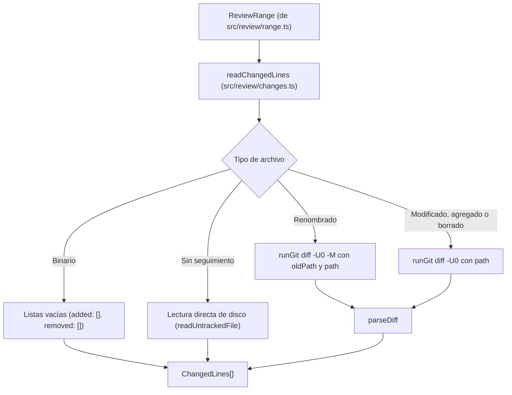

Parte 3 · Página 23 de 32 · Anterior: [Rango a revisar](170-review-range.md) · Siguiente: [Selección de reglas](190-review-select.md) · [Índice](../README.md)
# Líneas cambiadas

**Archivo:** `src/review/changes.ts` · 118 líneas · **Estado:** disponible

## Índice de la página

- ¿Qué es y para qué sirve?
- Antes de leer el código
- Cómo encaja
- El código completo, comentado
- Ejemplos con datos reales
- Resumen de comportamientos
- Dónde se usa
- Pruebas

## ¿Qué es y para qué sirve?

Este archivo lee exactamente qué líneas se agregaron y eliminaron en cada archivo dentro del alcance de una revisión de código.

Sin este archivo, el sistema sabría qué archivos fueron tocados respecto a la versión base, pero no qué renglones específicos cambiaron. Sería imposible verificar si una línea añadida incumple una regla del proyecto o citar el código modificado en los informes generados.

Recibe la carpeta raíz del repositorio y el objeto de rango calculado ([`ReviewRange`](160-review-types.md)), y devuelve una lista con las líneas cambiadas ([`ChangedLines`](#el-código-completo-comentado)) para cada archivo. Hoy ningún comando de la línea de comandos la usa todavía; formará la base de la selección de reglas y de los informes en las tareas siguientes.

## Antes de leer el código

### Un solo diff contra el árbol de trabajo en vez de dos

Si se calculasen dos diferencias separadas (una para los cambios guardados con confirmación entre la base y la punta de la rama con `base...HEAD`, y otra para los cambios locales sin guardar con `HEAD`), los números de línea quedarían desfasados cuando ambas partes interactúan.

Por ejemplo, si un archivo modifica la línea 5 en una confirmación guardada (commit), y después, en el archivo de trabajo sin guardar, se agrega una línea al principio de todo (antes de la línea 1):
- En la confirmación guardada el cambio ocurrió en la línea 5.
- Pero en el archivo de trabajo de hoy, ese mismo cambio se encuentra en la línea 6 debido al nuevo renglón introducido arriba.

Al ejecutar una sola diferencia desde el identificador base del rango (`range.baseSha`) directamente contra la carpeta de trabajo actual:

```text
git diff -U0 <baseSha> -- ':(literal)<ruta>'
// → entrega directamente los números de línea reales de la versión de hoy
```

### Formato de diff unificado sin contexto (`-U0`)

La opción `-U0` le pide a Git que emita solo las líneas añadidas y eliminadas sin renglones de contexto circundantes. Cada fragmento comienza con un encabezado de bloque delimitado por `@@`:

```text
@@ -2 +2 @@
-línea vieja
+línea nueva
// → en la versión actual, la línea 2 contiene "línea nueva"
```

El signo `+` indica una adición en la versión actual y avanza el contador de línea. El signo `-` indica que la línea existía en la base pero fue retirada.

### Encabezados de Git frente a contenido que parece encabezado

Antes del primer bloque `@@`, Git escribe metadatos como `diff --git`, `index`, `--- a/archivo` y `+++ b/archivo`. Estos encabezados iniciales deben descartarse.

En cambio, después del primer `@@`, una línea que comience con `---` o `+++` es contenido real del archivo. Por ejemplo, al borrar la línea `-- comentario` en un archivo SQL, Git le antepone el signo `-` de eliminación y emite `--- comentario`. Al retirar el prefijo del diff, el texto eliminado recuperado es `-- comentario`.

## Cómo encaja



1. `readChangedLines` recorre la lista `range.files`.
2. Si el archivo es binario, asigna listas vacías tanto en adiciones como en eliminaciones sin consultar a Git.
3. Si el archivo no tiene confirmación (`committed: false`) y Git no lo conoce en su índice, invoca `readUntrackedFile` para leer el archivo del disco y marcar cada una de sus líneas como agregada empezando en la línea 1.
4. Si fue renombrado, pasa la opción `-M` y las dos rutas literales (`oldPath` y `path`) a `runGit diff -U0`.
5. Si es un archivo rastreado ordinario, ejecuta `diff -U0` de `range.baseSha` contra su ruta de trabajo.
6. `parseDiff` descarta los encabezados previos al primer `@@`, actualiza el número de línea actual con cada bloque y recolecta las líneas añadidas y retiradas.
7. Devuelve el arreglo con los resultados de todos los archivos analizados.

## El código completo, comentado

```ts
import { readFile } from 'node:fs/promises';
import { join } from 'node:path';
import { runGit } from '../git/git.js';
import type { ReviewRange } from './types.js';

/** Detailed line-level additions and removals for a changed file. */
export interface ChangedLines {
  path: string;
  added: { line: number; text: string }[];
  removed: string[];
}

/** Parses raw unified diff output (-U0) into added and removed lines. */
function parseDiff(diffOutput: string): { added: { line: number; text: string }[]; removed: string[] } {
  const added: { line: number; text: string }[] = [];
  const removed: string[] = [];
  // Ignora diffs vacíos.
  if (!diffOutput) {
    return { added, removed };
  }

  const rawLines = diffOutput.split('\n');
  let inHunk = false;
  let seenHunk = false;
  let currentLine = 0;

  for (const raw of rawLines) {
    // Elimina el retorno de carro final si el archivo usa CRLF.
    const line = raw.replace(/\r$/, '');

    // Si el encabezado marca el archivo como binario antes del primer bloque @@, descarta las líneas.
    if (!seenHunk && line.startsWith('Binary files ')) {
      return { added: [], removed: [] };
    }

    // Al encontrar un nuevo archivo en el diff, reinicia la marca de bloque.
    if (line.startsWith('diff --git ')) {
      inHunk = false;
      continue;
    }

    // Detecta el inicio de un bloque y extrae el número de línea inicial en el archivo nuevo.
    if (line.startsWith('@@')) {
      seenHunk = true;
      inHunk = true;
      const match = line.match(/^@@\s+-[0-9]+(?:,[0-9]+)?\s+\+([0-9]+)(?:,[0-9]+)?\s+@@/);
      if (match) {
        currentLine = parseInt(match[1]!, 10);
      }
      continue;
    }

    // Descarta encabezados anteriores al primer bloque @@.
    if (!inHunk) {
      continue;
    }

    // Descarta advertencias de fin de archivo sin salto de línea.
    if (line.startsWith('\\')) {
      continue;
    }

    // Guarda la línea añadida con su número actual y avanza el contador.
    if (line.startsWith('+')) {
      added.push({ line: currentLine, text: line.slice(1) });
      currentLine++;
    // Guarda la línea retirada sin alterar el contador del archivo nuevo.
    } else if (line.startsWith('-')) {
      removed.push(line.slice(1));
    }
  }

  return { added, removed };
}

/** Reads all lines from an untracked file as newly added lines. */
async function readUntrackedFile(root: string, relativePath: string): Promise<ChangedLines> {
  const fullPath = join(root, relativePath);
  try {
    const content = await readFile(fullPath, 'utf8');
    if (content.length === 0) {
      return { path: relativePath, added: [], removed: [] };
    }
    const lines = content.split(/\r?\n/);
    // Descarta la entrada vacía producida por un salto de línea final.
    if (lines.length > 0 && lines[lines.length - 1] === '') {
      lines.pop();
    }
    // Numera cada línea comenzando desde 1 y retira retornos de carro.
    const added = lines.map((text, index) => ({
      line: index + 1,
      text: text.replace(/\r$/, ''),
    }));
    return { path: relativePath, added, removed: [] };
  } catch {
    return { path: relativePath, added: [], removed: [] };
  }
}

/** Reads changed lines for every file in a review range using unified diffs against the working tree. */
export async function readChangedLines(root: string, range: ReviewRange): Promise<ChangedLines[]> {
  const results: ChangedLines[] = [];

  for (const file of range.files) {
    // Los archivos binarios no aportan líneas añadidas ni eliminadas.
    if (file.binary) {
      results.push({ path: file.path, added: [], removed: [] });
      continue;
    }

    // Si no tiene commit y no está registrado en el índice de Git, léelo de disco.
    if (!file.committed && file.status !== 'deleted') {
      const tracked = await runGit(root, ['ls-files', '--', `:(literal)${file.path}`]);
      if (tracked.trim().length === 0) {
        const untracked = await readUntrackedFile(root, file.path);
        results.push(untracked);
        continue;
      }
    }

    // En renombrados pasa ambas rutas con -M; en los demás pasa solo la ruta actual.
    const args = file.status === 'renamed' && file.oldPath
      ? ['diff', '-U0', '-M', range.baseSha, '--', `:(literal)${file.oldPath}`, `:(literal)${file.path}`]
      : ['diff', '-U0', range.baseSha, '--', `:(literal)${file.path}`];

    const diffOutput = await runGit(root, args);
    const { added, removed } = parseDiff(diffOutput);
    results.push({ path: file.path, added, removed });
  }

  return results;
}
```

## Ejemplos con datos reales

### Mezcla de partes (línea 5 que pasa a 6)

El archivo base contenía los números del 1 al 10 en líneas separadas. En una confirmación guardada (commit) se cambió la línea 5 por `5 edited`. Después, en el archivo de trabajo sin guardar, se insertó la línea `0` antes de la línea 1.

Entrada en el archivo de trabajo actual:

```text
0
1
2
3
4
5 edited
6
7
8
9
10
```

Salida de `readChangedLines`:

```json
{
  "path": "mixed.ts",
  "added": [
    {
      "line": 1,
      "text": "0"
    },
    {
      "line": 6,
      "text": "5 edited"
    }
  ],
  "removed": [
    "5"
  ]
}
```

### Renombrado

El archivo base `original.ts` tenía seis líneas de texto (`line1` a `line6`). En la rama se renombró a `renamed.ts` y se editó la línea 3 para decir `line3 edited`.

Entrada en el archivo de trabajo actual:

```text
line1
line2
line3 edited
line4
line5
line6
```

Salida de `readChangedLines`:

```json
{
  "path": "renamed.ts",
  "added": [
    {
      "line": 3,
      "text": "line3 edited"
    }
  ],
  "removed": [
    "line3"
  ]
}
```

### Archivo sin seguimiento

Un archivo nuevo denominado `nuevo ñ.ts` creado en la carpeta de trabajo sin agregar al índice ni confirmar en Git, con tres renglones.

Entrada en el archivo de trabajo actual:

```text
primera
segunda
tercera
```

Salida de `readChangedLines`:

```json
{
  "path": "nuevo ñ.ts",
  "added": [
    {
      "line": 1,
      "text": "primera"
    },
    {
      "line": 2,
      "text": "segunda"
    },
    {
      "line": 3,
      "text": "tercera"
    }
  ],
  "removed": []
}
```

### Archivo SQL con comentario

El archivo base `query.sql` contenía una consulta con un comentario `-- comentario`. En la rama se reemplazó dicho comentario por la expresión `++c++`.

Entrada en el archivo de trabajo actual:

```sql
SELECT 1;
++c++
SELECT 2;
```

Salida de `readChangedLines`:

```json
{
  "path": "query.sql",
  "added": [
    {
      "line": 2,
      "text": "++c++"
    }
  ],
  "removed": [
    "-- comentario"
  ]
}
```

## Resumen de comportamientos

- **Archivo binario:** devuelve listas vacías de líneas añadidas y eliminadas sin ejecutar diff.
- **Archivo con texto que dice «Binary files»:** se procesa como contenido textual ordinario y conserva sus líneas añadidas, reconociendo el aviso binario de Git únicamente en el encabezado previo al primer bloque `@@`.
- **Archivo sin seguimiento:** lee el archivo en disco y numera todas sus líneas como agregadas comenzando en 1.
- **Archivo renombrado:** ejecuta `diff -U0 -M` pasando ambas rutas literales y reporta únicamente las líneas que cambiaron.
- **Archivo con cambios guardados y sin guardar:** ejecuta una sola comparación contra el commit base (`baseSha`) para obtener la numeración de línea exacta del archivo actual.
- **Línea eliminada que empieza con guiones:** preserva el contenido textual eliminando solo el prefijo `-` propio de la sintaxis diff.
- **Línea agregada que empieza con signos más:** preserva el contenido textual eliminando solo el prefijo `+` propio de la sintaxis diff.
- **Archivo con CRLF o sin salto de línea final:** elimina cualquier retorno de carro `\r` residual e incluye la última línea del archivo.
- **Archivo eliminado:** asigna una lista vacía a `added` y recolecta todas las líneas suprimidas en `removed`.

## Dónde se usa

- **Usa:**
  - [`src/git/git.ts`](100-git-git.md), línea 51 (`runGit`).
  - [`src/review/types.ts`](160-review-types.md), línea 23 (`ReviewRange`).
- **Lo usan:**
  - Hoy ningún comando de la línea de comandos la usa todavía.

## Pruebas

- `src/review/changes.test.ts`:
  - `single changed line on line 2 returns added line and removed text`
  - `mixture of committed change and uncommitted edit gives line numbers of current version`
  - `line endings: CRLF strips trailing \r and file without final newline counts last line`
  - `difficult filename: *.ts does not include lines from other .ts files`
  - `renamed file with one change returns only changed line not whole file`
  - `untracked file with non-ASCII name returns all lines as added with lines 1, 2, 3`
  - `deleted file has empty added and all lines in removed`
  - `binary file returns empty lists for added and removed`
  - `text file mentioning Binary files retains added line`
  - `SQL comment removal and line addition starting with ++ are parsed as content`
  - `unpushed mode on base branch with HEAD base only reflects uncommitted changes`

Parte 3 · Página 23 de 32 · Anterior: [Rango a revisar](170-review-range.md) · Siguiente: [Selección de reglas](190-review-select.md) · [Índice](../README.md)


