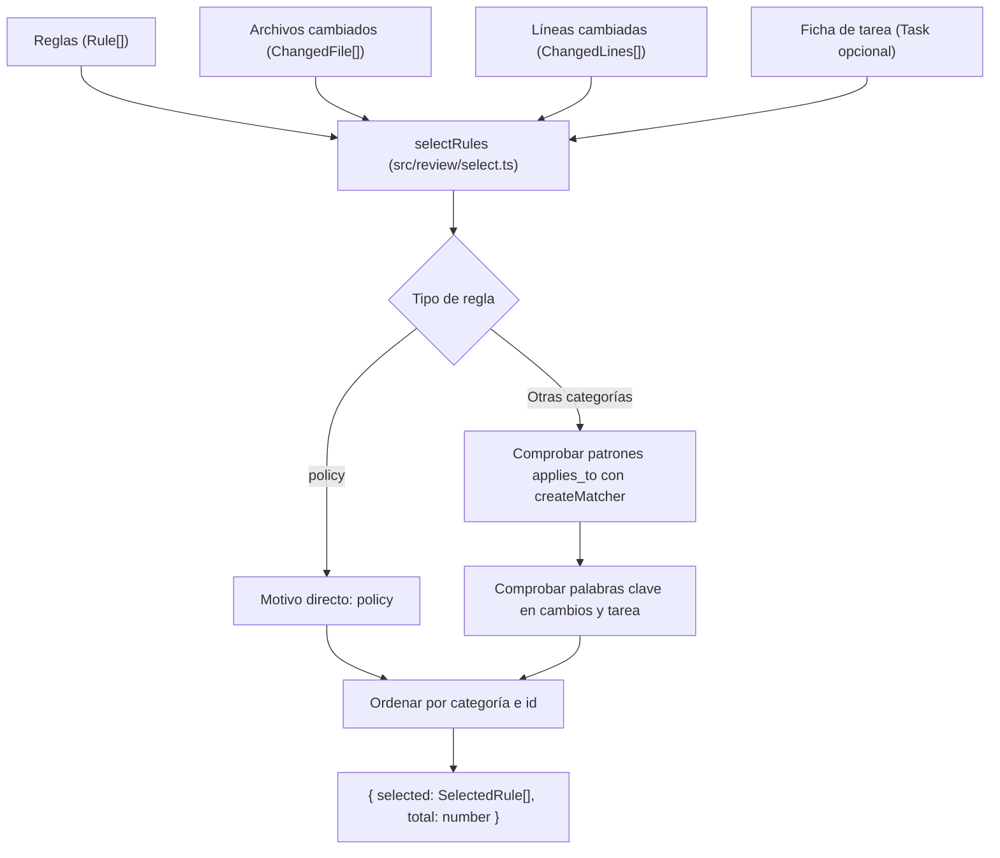

Parte 3 · Página 24 de 32 · Anterior: [Líneas cambiadas](180-review-changes.md) · Siguiente: [Foto del repositorio](200-review-snapshot.md) · [Índice](../README.md)
# Selección de reglas

**Archivo:** `src/review/select.ts` · 173 líneas · **Estado:** disponible

## Índice de la página

- ¿Qué es y para qué sirve?
- Antes de leer el código
- Cómo encaja
- El código completo, comentado
- Ejemplos con datos reales
- Resumen de comportamientos
- Dónde se usa
- Pruebas

## ¿Qué es y para qué sirve?

Este archivo selecciona qué reglas del proyecto deben aplicarse a una revisión de código según los archivos modificados, las líneas añadidas o quitadas y los objetivos de la tarea.

Sin este archivo, una auditoría tendría que evaluar todas las reglas del repositorio en cada cambio (lo que desperdiciaría recursos y tiempo de cómputo) o dependería del criterio impredecible de un modelo de inteligencia artificial. Con este selector determinista, un proyecto con cientos de reglas solo evalúa las pocas que realmente corresponden a las rutas o conceptos tocados.

Recibe la lista completa de reglas del proyecto, los archivos modificados ([`ChangedFile`](160-review-types.md)), las líneas cambiadas ([`ChangedLines`](180-review-changes.md)) y opcionalmente la ficha de la tarea ([`Task`](090-config-task.md)). Devuelve la lista de reglas elegidas ([`SelectedRule`](#el-código-completo-comentado)) con los motivos de su inclusión ([`SelectionReason`](#el-código-completo-comentado)) y el total de reglas examinadas. Hoy ningún comando de la línea de comandos la usa todavía; formará la base del comando de revisión en tareas futuras.

## Antes de leer el código

### Políticas frente a reglas condicionales

Una política es una regla global (`kind === 'policy'`) que rige para todo el repositorio sin importar qué archivos o textos se hayan modificado. En cambio, las reglas técnicas, de negocio, decisiones y plantillas solo se seleccionan si coinciden sus patrones de ruta o sus palabras clave.

```ts
// Regla con kind: 'policy' y sin patrones
// → Se incluye siempre con motivo { type: 'policy' }
```

Asegura que las directrices obligatorias del proyecto nunca se omitan, ahorrando además cómputo al no buscar patrones ni palabras clave en ellas.

### Coincidencia por patrones con archivos renombrados

Las reglas declaran patrones comodín en `applies_to`. Al evaluar si aplican, un archivo renombrado puede coincidir por su ruta previa o por su ruta actual.

```ts
// Archivo renombrado de 'src/billing/invoice.ts' a 'lib/billing/invoice.ts'
// → Coincide con 'src/billing/**' y registra en el motivo la ruta nueva 'lib/billing/invoice.ts'
```

Si un archivo se traslada de carpeta pero altera la lógica de un módulo regulado, la regla correspondiente sigue aplicándose, reportando siempre la ubicación actual del archivo.

### Coincidencia por palabras clave de término completo y sin acentos

Cada palabra clave se compara como término autónomo ignorando mayúsculas y acentos diacríticos (mediante descomposición NFD y eliminación de marcas Unicode), exigiendo que antes y después no existan letras ni números Unicode (`\p{L}` y `\p{N}`).

```ts
normalizeForKeywords('PRÉCIO');
// → 'precio' (coincide con 'precio', pero 'nin' no coincide con 'niño')
```

Evita falsos positivos como asociar la palabra clave `iva` al identificador `derivada`, permitiendo al mismo tiempo encontrar términos de negocio relevantes sin importar cómo fueron escritos.

### Orden determinista por tipo e identificador

El resultado ordena las reglas primero por categoría (`policy`, `rule`, `business`, `decision`, `template`) y luego por su identificador en orden alfabético de unidades de código Unicode.

```ts
// Reglas ['TMPL-001', 'POL-001', 'RULE-001']
// → ['POL-001', 'RULE-001', 'TMPL-001']
```

Garantiza que auditorías idénticas generen exactamente el mismo resultado y el mismo informe sin importar el orden en que se leyeron las reglas del disco.

## Cómo encaja



1. `selectRules` recibe las reglas cargadas, los archivos cambiados, las líneas cambiadas y opcionalmente la ficha de la tarea.
2. Normaliza previamente todas las líneas añadidas y eliminadas de los cambios, así como el objetivo y los criterios de aceptación de la tarea.
3. Para cada regla de tipo política (`policy`), añade el motivo `{ type: 'policy' }` directamente y no busca patrones ni palabras clave.
4. Para las demás reglas, evalúa cada patrón de `appliesTo` usando `createMatcher`. Si coincide la ruta actual o la ruta anterior de un archivo renombrado, añade un motivo `applies_to` con hasta cinco rutas coincidentes.
5. Evalúa cada término de `keywords` con límites de palabra Unicode. Si aparece en las líneas cambiadas, añade un motivo `keyword` con ubicación `changes`. Si aparece en el objetivo o criterios de la tarea, añade otro motivo `keyword` con ubicación `task`.
6. Si la regla acumuló al menos un motivo, se agrega a la lista de seleccionadas.
7. Ordena las reglas seleccionadas por categoría (`policy` < `rule` < `business` < `decision` < `template`) y por identificador determinista.
8. Retorna el objeto con las reglas seleccionadas y el total de reglas analizadas.

## El código completo, comentado

El archivo contiene 173 líneas y se presenta en bloques consecutivos sin omitir ninguna línea.

### Bloque 1: Importaciones, tipos y funciones auxiliares

```ts
import { createMatcher } from '../config/match.js';
import type { Task } from '../config/task.js';
import type { Rule, RuleKind } from '../config/types.js';
import type { ChangedLines } from './changes.js';
import type { ChangedFile } from './types.js';

/** Describes why a rule was selected for the review. */
export type SelectionReason =
  | { type: 'policy' }
  | { type: 'applies_to'; pattern: string; files: string[] }
  | { type: 'keyword'; keyword: string; where: 'changes' | 'task' };

/** Represents a selected rule and all reasons why it matched. */
export interface SelectedRule {
  rule: Rule;
  reasons: SelectionReason[];
}

// Fija la jerarquía de categorías para ordenar las reglas seleccionadas.
const KIND_ORDER: Record<RuleKind, number> = {
  policy: 0,
  rule: 1,
  business: 2,
  decision: 3,
  template: 4,
};

/** Compares strings by Unicode code units for deterministic ordering. */
function compareText(a: string, b: string): number {
  return a < b ? -1 : a > b ? 1 : 0;
}

/** Escapes regular expression special characters in a literal string. */
function escapeRegex(text: string): string {
  return text.replace(/[.*+?^${}()|[\]\\]/g, '\\$&');
}

/** Creates a Unicode word-bounded regular expression for a normalized keyword term. */
function createKeywordRegex(keyword: string): RegExp | undefined {
  // Limpia espacios en blanco exteriores del término normalizado.
  const normalized = normalizeForKeywords(keyword).trim();
  // Una palabra clave vacía o que solo tenía diacríticos nunca coincide.
  if (normalized === '') {
    return undefined;
  }
  // Divide en palabras individuales y escapa cada una para admitir espacios intermedios arbitrarios.
  const words = normalized.split(/\s+/);
  const pattern = words.map(escapeRegex).join('\\s+');
  // Exige que los límites no contengan letras ni números Unicode.
  return new RegExp(`(?<![\\p{L}\\p{N}])${pattern}(?![\\p{L}\\p{N}])`, 'u');
}

/** Normalizes text for keyword matching by converting to lowercase and stripping combining marks. */
export function normalizeForKeywords(text: string): string {
  // Convierte caracteres acentuados en letra base y marca separada, luego elimina las marcas.
  return text.normalize('NFD').replace(/\p{M}/gu, '').toLowerCase();
}
```

### Bloque 2: Función principal selectRules

```ts
/** Evaluates project rules against changed files, changed lines, and task definitions. */
export function selectRules(
  rules: Rule[],
  files: ChangedFile[],
  lines: ChangedLines[],
  task?: Task,
): { selected: SelectedRule[]; total: number } {
  // Pre-normaliza todas las líneas modificadas para agilizar las búsquedas de palabras clave.
  const normalizedChanges: string[] = [];
  for (const fileLines of lines) {
    for (const added of fileLines.added) {
      normalizedChanges.push(normalizeForKeywords(added.text));
    }
    for (const removed of fileLines.removed) {
      normalizedChanges.push(normalizeForKeywords(removed));
    }
  }

  // Pre-normaliza el objetivo y los criterios de aceptación de la tarea si fue provista.
  const normalizedTask: string[] = [];
  if (task) {
    normalizedTask.push(normalizeForKeywords(task.objective));
    for (const criterion of task.criteria) {
      normalizedTask.push(normalizeForKeywords(criterion));
    }
  }

  const selected: SelectedRule[] = [];

  for (const rule of rules) {
    // Las políticas aplican a todo el repositorio y no evalúan patrones ni palabras clave.
    if (rule.kind === 'policy') {
      selected.push({
        rule,
        reasons: [{ type: 'policy' }],
      });
      continue;
    }

    const reasons: SelectionReason[] = [];

    // Evalúa cada patrón de la regla deduplicando entradas idénticas.
    const seenPatterns = new Set<string>();
    for (const pattern of rule.appliesTo) {
      if (seenPatterns.has(pattern)) {
        continue;
      }
      seenPatterns.add(pattern);

      const matcher = createMatcher([pattern]);
      const matchedFiles: string[] = [];

      for (const file of files) {
        const matchesPath = matcher(file.path) !== undefined;
        const matchesOldPath = file.oldPath ? matcher(file.oldPath) !== undefined : false;
        // Si coincide la ruta actual o la ruta anterior de un renombrado, anota la ruta nueva.
        if (matchesPath || matchesOldPath) {
          if (!matchedFiles.includes(file.path)) {
            matchedFiles.push(file.path);
            // Cada patrón lista un máximo de cinco archivos coincidentes.
            if (matchedFiles.length === 5) {
              break;
            }
          }
        }
      }

      if (matchedFiles.length > 0) {
        reasons.push({
          type: 'applies_to',
          pattern,
          files: matchedFiles,
        });
      }
    }

    // Evalúa palabras clave como término completo en cambios y ficha de tarea.
    const seenKeywords = new Set<string>();
    for (const keyword of rule.keywords) {
      const norm = normalizeForKeywords(keyword).trim();
      if (norm === '' || seenKeywords.has(norm)) {
        continue;
      }
      seenKeywords.add(norm);

      const regex = createKeywordRegex(keyword);
      if (!regex) {
        continue;
      }

      // Añade motivo de cambios si el término completo aparece en líneas añadidas o eliminadas.
      if (normalizedChanges.some((line) => regex.test(line))) {
        reasons.push({
          type: 'keyword',
          keyword,
          where: 'changes',
        });
      }

      // Añade motivo de tarea si el término completo aparece en el objetivo o criterios.
      if (normalizedTask.some((text) => regex.test(text))) {
        reasons.push({
          type: 'keyword',
          keyword,
          where: 'task',
        });
      }
    }

    if (reasons.length > 0) {
      selected.push({
        rule,
        reasons,
      });
    }
  }

  // Ordena por jerarquía de categoría y desempata por identificador de regla.
  selected.sort((a, b) => {
    const kindDiff = KIND_ORDER[a.rule.kind] - KIND_ORDER[b.rule.kind];
    if (kindDiff !== 0) {
      return kindDiff;
    }
    return compareText(a.rule.id, b.rule.id);
  });

  return {
    selected,
    total: rules.length,
  };
}
```

## Ejemplos con datos reales

### Una política

Entrada para `selectRules`:

```json
{
  "rules": [
    {
      "id": "POL-001",
      "title": "Todas las llamadas a la API deben usar HTTPS",
      "severity": "critical",
      "appliesTo": [],
      "keywords": [],
      "kind": "policy",
      "file": "policies/POL-001.md",
      "body": "Todas las conexiones a servicios externos deben usar HTTPS."
    }
  ],
  "files": [
    {
      "path": "src/api/client.ts",
      "status": "added",
      "added": 1,
      "removed": 0,
      "binary": false,
      "committed": true,
      "uncommitted": false
    }
  ],
  "lines": [
    {
      "path": "src/api/client.ts",
      "added": [
        {
          "line": 1,
          "text": "export const apiUrl = \"https://api.example.com\";"
        }
      ],
      "removed": []
    }
  ]
}
```

Salida de `selectRules`:

```json
{
  "selected": [
    {
      "rule": {
        "id": "POL-001",
        "title": "Todas las llamadas a la API deben usar HTTPS",
        "severity": "critical",
        "appliesTo": [],
        "keywords": [],
        "kind": "policy",
        "file": "policies/POL-001.md",
        "body": "Todas las conexiones a servicios externos deben usar HTTPS."
      },
      "reasons": [
        {
          "type": "policy"
        }
      ]
    }
  ],
  "total": 1
}
```

### Regla por patrón con un renombrado

Entrada para `selectRules`:

```json
{
  "rules": [
    {
      "id": "RULE-002",
      "title": "Estructura modular de facturación",
      "severity": "major",
      "appliesTo": [
        "src/billing/**"
      ],
      "keywords": [],
      "kind": "rule",
      "file": "rules/RULE-002.md",
      "body": "Los módulos de facturación deben mantenerse desacoplados."
    }
  ],
  "files": [
    {
      "path": "lib/billing/invoice.ts",
      "oldPath": "src/billing/invoice.ts",
      "status": "renamed",
      "added": 1,
      "removed": 1,
      "binary": false,
      "committed": true,
      "uncommitted": false
    }
  ],
  "lines": [
    {
      "path": "lib/billing/invoice.ts",
      "added": [
        {
          "line": 5,
          "text": "export function generateInvoice() {"
        }
      ],
      "removed": [
        "export function makeInvoice() {"
      ]
    }
  ]
}
```

Salida de `selectRules`:

```json
{
  "selected": [
    {
      "rule": {
        "id": "RULE-002",
        "title": "Estructura modular de facturación",
        "severity": "major",
        "appliesTo": [
          "src/billing/**"
        ],
        "keywords": [],
        "kind": "rule",
        "file": "rules/RULE-002.md",
        "body": "Los módulos de facturación deben mantenerse desacoplados."
      },
      "reasons": [
        {
          "type": "applies_to",
          "pattern": "src/billing/**",
          "files": [
            "lib/billing/invoice.ts"
          ]
        }
      ]
    }
  ],
  "total": 1
}
```

### Regla por palabra clave con acento (`IVA` y `iva`)

Entrada para `selectRules`:

```json
{
  "rules": [
    {
      "id": "BIZ-003",
      "title": "Desglose obligatorio de IVA",
      "severity": "critical",
      "appliesTo": [
        "src/legacy/**"
      ],
      "keywords": [
        "IVA"
      ],
      "kind": "business",
      "file": "business/BIZ-003.md",
      "body": "Los cobros deben desglosar el IVA correspondiente."
    }
  ],
  "files": [
    {
      "path": "src/checkout/total.ts",
      "status": "modified",
      "added": 1,
      "removed": 0,
      "binary": false,
      "committed": true,
      "uncommitted": false
    }
  ],
  "lines": [
    {
      "path": "src/checkout/total.ts",
      "added": [
        {
          "line": 12,
          "text": "const iva = subtotal * 0.16;"
        }
      ],
      "removed": []
    }
  ]
}
```

Salida de `selectRules`:

```json
{
  "selected": [
    {
      "rule": {
        "id": "BIZ-003",
        "title": "Desglose obligatorio de IVA",
        "severity": "critical",
        "appliesTo": [
          "src/legacy/**"
        ],
        "keywords": [
          "IVA"
        ],
        "kind": "business",
        "file": "business/BIZ-003.md",
        "body": "Los cobros deben desglosar el IVA correspondiente."
      },
      "reasons": [
        {
          "type": "keyword",
          "keyword": "IVA",
          "where": "changes"
        }
      ]
    }
  ],
  "total": 1
}
```

### Regla que entra por dos motivos

Entrada para `selectRules`:

```json
{
  "rules": [
    {
      "id": "RULE-004",
      "title": "Gestión segura de tokens de autenticación",
      "severity": "critical",
      "appliesTo": [
        "src/auth/**"
      ],
      "keywords": [
        "token"
      ],
      "kind": "rule",
      "file": "rules/RULE-004.md",
      "body": "Los tokens nunca deben almacenarse en texto plano."
    }
  ],
  "files": [
    {
      "path": "src/auth/session.ts",
      "status": "modified",
      "added": 1,
      "removed": 0,
      "binary": false,
      "committed": true,
      "uncommitted": false
    }
  ],
  "lines": [
    {
      "path": "src/auth/session.ts",
      "added": [
        {
          "line": 8,
          "text": "const token = createSecureToken(user);"
        }
      ],
      "removed": []
    }
  ]
}
```

Salida de `selectRules`:

```json
{
  "selected": [
    {
      "rule": {
        "id": "RULE-004",
        "title": "Gestión segura de tokens de autenticación",
        "severity": "critical",
        "appliesTo": [
          "src/auth/**"
        ],
        "keywords": [
          "token"
        ],
        "kind": "rule",
        "file": "rules/RULE-004.md",
        "body": "Los tokens nunca deben almacenarse en texto plano."
      },
      "reasons": [
        {
          "type": "applies_to",
          "pattern": "src/auth/**",
          "files": [
            "src/auth/session.ts"
          ]
        },
        {
          "type": "keyword",
          "keyword": "token",
          "where": "changes"
        }
      ]
    }
  ],
  "total": 1
}
```

## Resumen de comportamientos

- **Regla con categoría política (`policy`):** se selecciona siempre de forma incondicional con motivo `{ type: 'policy' }`, omitiendo cualquier comprobación de patrones o palabras clave.
- **Regla con patrón coincidente:** evalúa cada patrón de `appliesTo` y añade un motivo `applies_to` independiente con hasta cinco rutas coincidentes en el orden de entrada.
- **Archivo renombrado:** evalúa el patrón contra la ruta previa (`oldPath`) y la ruta actual (`path`); si alguna coincide, anota en el motivo la ruta actual (`path`).
- **Palabra clave en líneas modificadas:** busca el término completo (sin distinguir mayúsculas ni acentos) en líneas añadidas o eliminadas y añade motivo con `where: 'changes'`.
- **Palabra clave en ficha de tarea:** busca el término completo únicamente en el objetivo y los criterios de aceptación, añadiendo motivo con `where: 'task'`.
- **Palabra clave en cambios y ficha simultáneamente:** genera dos motivos independientes en orden: primero `changes` y luego `task`.
- **Múltiples motivos en una regla:** lista primero todos los motivos por patrón `applies_to` y posteriormente todos los motivos por palabra clave `keyword`.
- **Palabra clave que normaliza a vacío:** se ignora y nunca genera coincidencia.
- **Caracteres especiales en palabra clave:** se escapan y comparan de forma literal, de modo que `c++` coincide en `usa c++ aquí` y `a.b` no coincide en `axb`.
- **Orden determinista final:** ordena por tipo de regla (`policy`, `rule`, `business`, `decision`, `template`) y desempata por identificador de regla mediante comparación de unidades de código Unicode.

## Dónde se usa

- **Usa:**
  - [`src/config/match.ts`](150-config-match.md), línea 8 (`createMatcher`).
  - [`src/config/types.ts`](060-config-types.md), líneas 7 y 29 (`RuleKind`, `Rule`).
  - [`src/config/task.ts`](090-config-task.md), línea 7 (`Task`).
  - [`src/review/types.ts`](160-review-types.md), línea 2 (`ChangedFile`).
  - [`src/review/changes.ts`](180-review-changes.md), línea 7 (`ChangedLines`).
- **Lo usan:**
  - Hoy ningún comando de la línea de comandos la usa todavía.

## Pruebas

- `src/review/select.test.ts`:
  - `patrones: una regla con src/billing/** entra si cambió src/billing/total.ts y queda fuera si solo cambió docs/x.md`
  - `políticas: una política entra sin cambios relacionados`
  - `acentos: la palabra clave IVA entra con la línea agregada const iva = 16; precio entra con Precio y con précio`
  - `palabra completa: la palabra clave iva no entra con derivada`
  - `varias palabras: la palabra clave forma de pago entra con forma  de pago`
  - `ficha: una palabra clave que solo está en la ficha entra con where: "task"`
  - `renombrado: si src/billing/a.ts pasó a lib/a.ts, la regla con src/billing/** entra`
  - `total es el número de reglas cargadas`
  - `varios motivos: una regla que entra por patrón y por palabra clave aparece una sola vez, con los dos motivos en orden`
  - `varios patrones que coinciden dan un motivo cada uno`
  - `el límite de 5: con 7 archivos que coinciden, el motivo lista los 5 primeros`
  - `caracteres especiales: c++ y a.b`
  - `la misma palabra en los cambios y en la ficha da dos motivos`
  - `nin no coincide con niño`
  - `líneas quitadas: una palabra que solo está en una línea quitada entra con where: "changes"`
  - `otras secciones de la ficha: una palabra que solo está en las notas no entra`
  - `orden final: con reglas de los cinco tipos, desordenadas, salen en el orden de la precisión 5`
  - `políticas: una política lleva solo motivo policy aunque tenga applies_to o keywords coincidentes`
  - `palabra clave vacía: una palabra clave vacía o con solo marcas al normalizarla nunca coincide`
  - `converts uppercase to lowercase and strips accents via NFD`
  - `preserves whitespace and punctuation unchanged`

Parte 3 · Página 24 de 32 · Anterior: [Líneas cambiadas](180-review-changes.md) · Siguiente: [Foto del repositorio](200-review-snapshot.md) · [Índice](../README.md)

