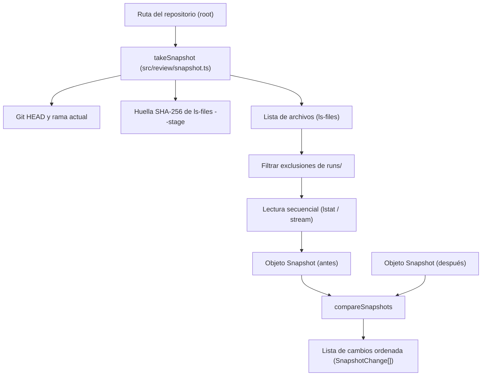

Parte 3 · Página 24 de 29 · Anterior: [Selección de reglas](190-review-select.md) · Siguiente: [Desarrollo](../4-development/10-development.md) · [Índice](../README.md)
# Foto del repositorio

**Archivo:** `src/review/snapshot.ts` · 154 líneas · **Estado:** disponible

## Índice de la página

- ¿Qué es y para qué sirve?
- Antes de leer el código
- Cómo encaja
- El código completo, comentado
- Ejemplos con datos reales
- Resumen de comportamientos
- Dónde se usa
- Pruebas

## ¿Qué es y para qué sirve?

Este archivo toma una «foto» (un registro del estado exacto) del repositorio de código antes de iniciar una revisión y permite compararla después para comprobar si algo cambió.

Sin este archivo, una auditoría automatizada no tendría forma de saber si los archivos analizados fueron alterados, si se agregaron cambios al área de preparación (`git add`) o si se realizaron confirmaciones (`commits`) mientras los modelos de inteligencia artificial trabajaban. Si el repositorio cambia durante el proceso, los hallazgos ya no coincidirían con el código real y el informe carecería de validez; gracias a esta foto comparativa, la revisión se anula de inmediato protegiendo la fiabilidad del resultado.

Recibe la ruta raíz del repositorio. Devuelve la foto estructurada ([`Snapshot`](#el-código-completo-comentado)) con la referencia al último commit (`head`), la rama activa (`branch`), la huella del índice de Git (`index`) y la huella digital de cada archivo rastreado o sin seguimiento ([`files`](#el-código-completo-comentado)). También ofrece la función comparadora ([`compareSnapshots`](#el-código-completo-comentado)) que contrasta dos fotos e identifica las diferencias ordenadas ([`SnapshotChange`](#el-código-completo-comentado)). Hoy ningún comando de la línea de comandos la usa todavía; formará la base de los pasos de preparación y cierre en tareas futuras.

## Antes de leer el código

### Huella digital del índice de Git

El índice (o área de preparación) guarda los cambios listos para confirmarse. Al calcular la huella digital (un código criptográfico SHA-256) sobre la salida de `git ls-files --stage -z`, cualquier operación `git add` altera la huella.

```ts
// Estado del índice antes y después de 'git add archivo.ts'
// → El valor de 'index' cambia, reportando { kind: 'index' }
```

Permite detectar si alguien preparó cambios en Git entre la toma de la primera foto y la comprobación final.

### Identificación de enlaces simbólicos sin seguirlos

Un enlace simbólico (un acceso directo del sistema operativo) apunta a otra ruta. Se inspecciona con `lstat` y se lee con `readlink` sin abrir el archivo de destino.

```ts
// Enlace 'sym.txt' apuntando a 'src/index.ts'
// → Se registra en files como 'link:src/index.ts'
```

Evita procesar o calcular huellas erróneas al seguir enlaces y detecta de inmediato si el destino del enlace fue modificado.

### Archivo versionado ausente

Un archivo que Git tiene registrado en su índice pero que fue borrado del disco mediante el sistema de archivos (sin usar `git rm`).

```ts
// Archivo 'eliminado.ts' borrado con unlink o rm
// → Se guarda en la foto con el valor 'missing' y compareSnapshots lo detecta como 'removed'
```

Asegura que el borrado de archivos no provoque errores de lectura en el programa y se clasifique limpiamente como una eliminación.

### Exclusión de la carpeta de ejecuciones

La carpeta `.agents/code-audit/runs/` almacena los informes y registros de la propia herramienta mientras trabaja.

```ts
// Escritura en '.agents/code-audit/runs/run-1/datos.json'
// → La ruta se ignora por completo y compareSnapshots devuelve []
```

La herramienta escribe sus propios archivos de trabajo durante la revisión sin alterar la foto ni anular el proceso.

## Cómo encaja



1. `takeSnapshot` obtiene el identificador de confirmación de `HEAD` y el nombre de la rama activa mediante Git. Si la cabeza está desacoplada (`detached`), asigna `null` a la rama.
2. Ejecuta `git ls-files --stage -z` y genera la huella digital SHA-256 de la salida completa para registrar el estado exacto del índice.
3. Lista los archivos versionados y no versionados (excluyendo los ignorados por `.gitignore`) mediante `git ls-files --cached --others --exclude-standard -z`.
4. Normaliza las rutas eliminando barras finales en repositorios anidados y descarta todas las rutas pertenecientes a `.agents/code-audit/runs/`.
5. Itera secuencialmente sobre las rutas ordenadas, consultando sus atributos con `lstat`. Los enlaces se registran con su destino (`link:<destino>`), los directorios como `dir`, los archivos inexistentes como `missing` y los archivos regulares con su huella SHA-256 calculada mediante lectura por fragmentos (*stream*).
6. Al finalizar la revisión, `compareSnapshots` recibe las dos fotos (`before` y `after`).
7. Compara `head`, `branch` e `index` emitiendo los cambios correspondientes si difieren.
8. Contrasta el mapa de archivos tratando `missing` como ausencia y agrupando las alteraciones en agregados (`added`), eliminados (`removed`) y modificados (`modified`).
9. Retorna la lista de diferencias en el orden estricto de categorías y ordenada alfabéticamente por ruta dentro de cada categoría.

## El código completo, comentado

El archivo contiene 154 líneas y se presenta en bloques consecutivos sin omitir ninguna línea.

### Bloque 1: Importaciones, tipos y función takeSnapshot

```ts
import { createHash } from 'node:crypto';
import { createReadStream } from 'node:fs';
import { lstat, readlink } from 'node:fs/promises';
import { join } from 'node:path';
import { CONFIG_DIR } from '../config/paths.js';
import { runGit } from '../git/git.js';

/** Represents a lightweight cryptographic and structural snapshot of a repository. */
export interface Snapshot {
  head: string;
  branch: string | null;
  index: string;
  files: Record<string, string>;
}

/** Represents a single detected difference between two repository snapshots. */
export type SnapshotChange =
  | { kind: 'head' | 'branch' | 'index' }
  | { kind: 'added' | 'removed' | 'modified'; path: string };

/** Takes a snapshot of Git HEAD, current branch, index state, and non-ignored files. */
export async function takeSnapshot(root: string): Promise<Snapshot> {
  // Obtiene el identificador SHA del commit actual en HEAD.
  const head = (await runGit(root, ['rev-parse', '--verify', 'HEAD'])).trim();

  // Determina la rama actual; si el HEAD está desacoplado toma el valor null.
  const currentRef = (await runGit(root, ['rev-parse', '--abbrev-ref', 'HEAD'])).trim();
  const branch = currentRef === 'HEAD' ? null : currentRef;

  // Calcula la huella digital del índice completo a partir de ls-files --stage.
  const stageOutput = await runGit(root, ['ls-files', '--stage', '-z']);
  const index = createHash('sha256').update(stageOutput).digest('hex');

  // Obtiene la lista delimitada por nulo de archivos en seguimiento y nuevos sin ignorar.
  const rawFiles = await runGit(root, ['ls-files', '--cached', '--others', '--exclude-standard', '-z']);
  const tokens = rawFiles.split('\0').filter((token) => token.length > 0);

  const runsPrefix = `${CONFIG_DIR}/runs/`;
  const uniquePaths = new Set<string>();

  // Normaliza las rutas eliminando barras finales y descartando carpetas de ejecuciones.
  for (const token of tokens) {
    const normalized = token.endsWith('/') ? token.slice(0, -1) : token;
    if (!normalized) continue;
    if (normalized === `${CONFIG_DIR}/runs` || normalized.startsWith(runsPrefix)) continue;
    uniquePaths.add(normalized);
  }

  // Ordena las rutas para garantizar inserción determinista en el registro.
  const sortedPaths = Array.from(uniquePaths).sort(compareText);
  const files: Record<string, string> = {};

  // Inspecciona cada archivo secuencialmente para evitar agotar descriptores de archivo.
  for (const path of sortedPaths) {
    const fullPath = join(root, path);
    try {
      const stat = await lstat(fullPath);
      if (stat.isSymbolicLink()) {
        try {
          // Lee el destino del enlace simbólico sin resolver su contenido.
          const target = await readlink(fullPath);
          files[path] = `link:${target}`;
        } catch (error) {
          const code = (error as NodeJS.ErrnoException).code;
          if (code === 'ENOENT' || code === 'ENOTDIR') {
            files[path] = 'missing';
          } else {
            throw error;
          }
        }
      } else if (stat.isDirectory()) {
        // Registra repositorios anidados o submódulos como directorios.
        files[path] = 'dir';
      } else {
        try {
          // Calcula el SHA-256 del contenido leyendo por fragmentos en memoria controlada.
          files[path] = await hashFileStream(fullPath);
        } catch (error) {
          const code = (error as NodeJS.ErrnoException).code;
          if (code === 'ENOENT' || code === 'ENOTDIR') {
            files[path] = 'missing';
          } else {
            throw error;
          }
        }
      }
    } catch (error) {
      // Registra como missing si la ruta no existe o un componente intermedio no es directorio.
      const code = (error as NodeJS.ErrnoException).code;
      if (code === 'ENOENT' || code === 'ENOTDIR') {
        files[path] = 'missing';
      } else {
        throw error;
      }
    }
  }

  return { head, branch, index, files };
}
```

### Bloque 2: Función compareSnapshots y funciones auxiliares

```ts
/** Compares two snapshots and returns ordered differences in Git and file states. */
export function compareSnapshots(before: Snapshot, after: Snapshot): SnapshotChange[] {
  const changes: SnapshotChange[] = [];

  // Emite cambio si el commit de HEAD difiere entre ambas fotos.
  if (before.head !== after.head) {
    changes.push({ kind: 'head' });
  }

  // Emite cambio si la rama activa cambió o pasó a estado desacoplado.
  if (before.branch !== after.branch) {
    changes.push({ kind: 'branch' });
  }

  // Emite cambio si la huella del área de preparación (índice) se alteró.
  if (before.index !== after.index) {
    changes.push({ kind: 'index' });
  }

  // Reúne todas las rutas de ambas fotos para comparar estados de archivos.
  const allPaths = new Set<string>([
    ...Object.keys(before.files),
    ...Object.keys(after.files),
  ]);
  const sortedPaths = Array.from(allPaths).sort(compareText);

  const added: SnapshotChange[] = [];
  const removed: SnapshotChange[] = [];
  const modified: SnapshotChange[] = [];

  // Clasifica los cambios considerando que el valor missing cuenta como inexistente.
  for (const path of sortedPaths) {
    const valBefore = before.files[path];
    const valAfter = after.files[path];

    const existsBefore = valBefore !== undefined && valBefore !== 'missing';
    const existsAfter = valAfter !== undefined && valAfter !== 'missing';

    if (!existsBefore && existsAfter) {
      added.push({ kind: 'added', path });
    } else if (existsBefore && !existsAfter) {
      removed.push({ kind: 'removed', path });
    } else if (existsBefore && existsAfter && valBefore !== valAfter) {
      modified.push({ kind: 'modified', path });
    }
  }

  // Devuelve los cambios en orden estricto: head, branch, index, added, removed y modified.
  return [
    ...changes,
    ...added,
    ...removed,
    ...modified,
  ];
}

/** Computes the SHA-256 hexadecimal hash of a file by streaming its content in chunks. */
async function hashFileStream(filePath: string): Promise<string> {
  // Transmite el archivo hacia el calculador de resumen criptográfico.
  return new Promise((resolve, reject) => {
    const hash = createHash('sha256');
    const stream = createReadStream(filePath);
    stream.on('data', (chunk) => hash.update(chunk));
    stream.on('end', () => resolve(hash.digest('hex')));
    stream.on('error', (err) => reject(err));
  });
}

/** Compares strings by Unicode code units for deterministic ordering. */
function compareText(a: string, b: string): number {
  // Ordena cadenas mediante comparación de unidades de código Unicode.
  return a < b ? -1 : a > b ? 1 : 0;
}
```

## Ejemplos con datos reales

### Foto de un repositorio pequeño con enlace y archivo en runs/

Un repositorio pequeño con un enlace simbólico (`link.txt`) apuntando a `src/index.ts` y un archivo temporal dentro de `.agents/code-audit/runs/run-1/temp.json`.

Salida completa de `takeSnapshot`:

```json
{
  "head": "db55baae00321503c1c24434be97144f5d174835",
  "branch": "main",
  "index": "ffe54b0374734a604f47baaeabe13ce7d09fc24c6905a6ec6dba20d797841497",
  "files": {
    "link.txt": "link:src/index.ts",
    "src/index.ts": "6f31f78fd8f03d186c9953c0c3b400042a520b268673e3647bfbcd028920e972"
  }
}
```

El archivo en `.agents/code-audit/runs/` queda completamente excluido de la foto y el enlace simbólico registra su destino textual sin resolver el contenido.

### Editar, crear y borrar archivos

Partiendo de la foto anterior, se edita `src/index.ts`, se crea `src/utils.ts` y se elimina `link.txt`.

Salida completa de `compareSnapshots`:

```json
[
  {
    "kind": "added",
    "path": "src/utils.ts"
  },
  {
    "kind": "removed",
    "path": "link.txt"
  },
  {
    "kind": "modified",
    "path": "src/index.ts"
  }
]
```

### Preparar cambios con git add y confirmar con commit

Tras confirmar los cambios anteriores mediante `git add --all` y `git commit`, se toma una nueva foto y se compara con la anterior.

Salida completa de `compareSnapshots`:

```json
[
  {
    "kind": "head"
  },
  {
    "kind": "index"
  }
]
```

### Cambio de fecha de modificación (touch) y escritura en runs/

Se modifica la fecha de modificación (`touch`) de `src/index.ts` sin alterar su contenido y se escribe un archivo de informe en `.agents/code-audit/runs/run-2/data.json`.

Salida completa de `compareSnapshots`:

```json
[]
```

## Resumen de comportamientos

- **Dos fotos idénticas:** devuelve lista vacía `[]`.
- **Edición de archivo:** registra `{ kind: 'modified', path: '...' }`.
- **Creación de archivo nuevo:** registra `{ kind: 'added', path: '...' }`.
- **Borrado de archivo:** registra `{ kind: 'removed', path: '...' }` y en la foto se guarda como `'missing'`.
- **Carpeta reemplazada por archivo con el mismo nombre:** el archivo nuevo figura como añadido (`added`) y los archivos previos de la carpeta figuran como eliminados (`removed`) con valor `'missing'` en la foto.
- **Preparación de cambios (`git add`):** cambia la huella del índice y registra `{ kind: 'index' }`.
- **Nueva confirmación (`commit`):** registra `{ kind: 'head' }` (y `{ kind: 'index' }` o archivo modificado si correspondiera).
- **Cambio de fecha (`touch`) sin modificar contenido:** no altera la foto y compareSnapshots devuelve `[]`.
- **Escritura en `.agents/code-audit/runs/`:** se excluye de la lista de archivos y compareSnapshots devuelve `[]`.
- **Enlace simbólico:** se almacena como `link:<destino>`; modificar su destino genera `{ kind: 'modified', path: '...' }`.
- **Repositorio anidado no rastreado:** se almacena con la clave sin barra final y valor `'dir'`.
- **Archivo ignorado por `.gitignore`:** no se incluye en la foto y su edición produce `[]`.
- **Cambio de rama en el mismo commit:** reporta únicamente `{ kind: 'branch' }`; con HEAD desacoplado la rama es `null`.
- **Orden de múltiples diferencias:** reporta en orden estricto `head`, `branch`, `index`, `added`, `removed`, `modified`, ordenando por ruta alfabéticamente dentro de cada tipo de archivo.

## Dónde se usa

- **Usa:**
  - [`src/config/paths.ts`](050-config-paths.md), línea 3 (`CONFIG_DIR`).
  - [`src/git/git.ts`](100-git-git.md), línea 51 (`runGit`).
- **Lo usan:**
  - Hoy ningún comando de la línea de comandos la usa todavía.

## Pruebas

- `src/review/snapshot.test.ts`:
  - `two consecutive snapshots without changes return an empty list`
  - `editing a file returns modified`
  - `creating a new file returns added`
  - `deleting a tracked file returns removed and records missing in the snapshot`
  - `git add of a file already edited before the first snapshot returns only index`
  - `a commit returns head`
  - `touch without changing content returns an empty list`
  - `writing in CONFIG_DIR/runs returns an empty list and is excluded from files`
  - `replacing a tracked folder with a file with the same name reports added and removed`
  - `symlink is recorded as link:<target> and changing target returns modified`
  - `untracked nested git repository is stored with key nested and value dir`
  - `editing a file ignored by .gitignore returns an empty list`
  - `switching branch on same commit yields only branch; detached HEAD yields branch: null`
  - `difficult filenames *.ts, [x].ts, tab names, and spaces with accents are preserved exactly`
  - `multiple simultaneous changes are ordered by head, branch, index, added, removed, modified with paths sorted`

Parte 3 · Página 24 de 29 · Anterior: [Selección de reglas](190-review-select.md) · Siguiente: [Desarrollo](../4-development/10-development.md) · [Índice](../README.md)
