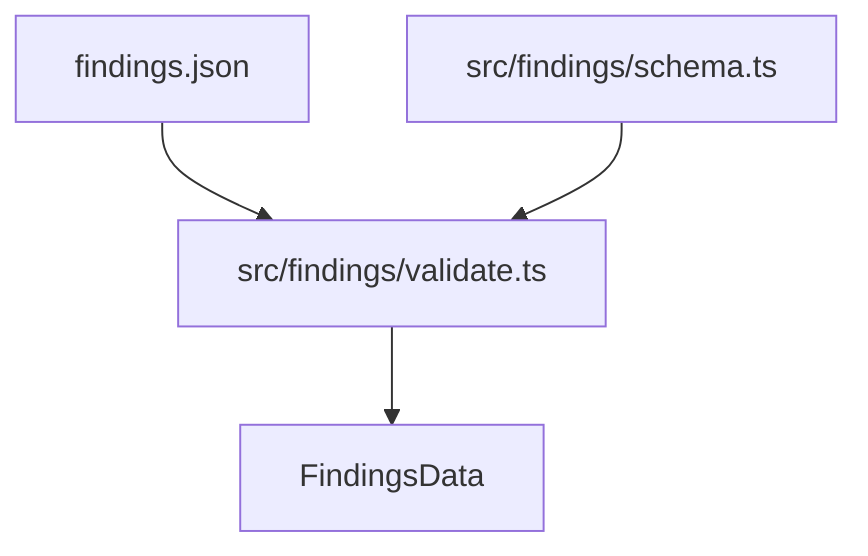

Parte 3 · Página 26 de 32 · Anterior: [Foto del repositorio](200-review-snapshot.md) · Siguiente: [Validador de hallazgos](220-findings-validate.md) · [Índice](../README.md)
# Esquema de hallazgos

**Archivo:** `src/findings/schema.ts` · 65 líneas · **Estado:** disponible

## Índice de la página

- ¿Qué es y para qué sirve?
- Antes de leer el código
- Cómo encaja
- El código completo, comentado
- Ejemplos con datos reales
- Resumen de comportamientos
- Dónde se usa
- Pruebas

## ¿Qué es y para qué sirve?

Define la versión del esquema y las estructuras de datos normalizadas para los hallazgos de una revisión.

Sin este archivo, cada parte del programa interpretaría los nombres de campos de forma dispar, aumentando el riesgo de errores en la comunicación entre módulos.

Recibe tipos base como la gravedad de una regla y devuelve tipos tipados en formato estándar (camelCase) para su consumo en la validación y los reportes.

Hoy ningún comando lo usa directamente en el flujo de ejecución principal; únicamente lo consumen el módulo de validación y sus pruebas asociadas.

## Antes de leer el código

### Conversión de snake_case a camelCase

Las sesiones de revisión escriben sus archivos usando palabras separadas por guiones bajos (snake_case), mientras que el código interno utiliza mayúsculas intercaladas (camelCase).

```ts
// entrada externa: schema_version
// → propiedad tipada: schemaVersion
```

Esta distinción aísla el formato de intercambio del código TypeScript interno.

### Campos opcionales frente a listas vacías

En las estructuras normalizadas, colecciones como los hallazgos relacionados siempre se inicializan como listas para evitar comprobaciones de valores nulos o indefinidos.

```ts
// sin hallazgos relacionados
// → relatedFindings: []
```

Facilita las iteraciones directas en el generador de reportes.

## Cómo encaja



1. Las sesiones de revisión generan el archivo de hallazgos.
2. El validador utiliza las definiciones de este archivo para estructurar los datos analizados.
3. El resultado normalizado alimenta la construcción del informe final.

## El código completo, comentado

```ts
// Importa la definición de gravedad compartida con la configuración de reglas.
import type { Severity } from '../config/types.js';

// Define la versión fija del esquema admitida por esta versión del programa.
/** Expected schema version for findings files. */
export const FINDINGS_SCHEMA_VERSION = 1;

// Modela un hallazgo individual validado y clasificado.
/** Represents a single validated and normalized review finding. */
export interface Finding {
  id: string;
  title: string;
  severity: Severity;
  file: string;
  quote: string;
  impact: string;
  verified: boolean;
  wholeFile: boolean;
  line?: number;
  endLine?: number;
  suggestion?: { startLine: number; code: string };
  ruleId?: string;
  relatedFindings: string[];
  relatedCriteria: number[];
  relatedNote?: string;
  existing?: { file: string; line?: number; note: string };
}

// Representa el dictamen de cumplimiento para un criterio de la ficha de tarea.
/** Describes the evaluation status and reason for one task criterion. */
export interface CriterionResult {
  number: number;
  text: string;
  status: 'met' | 'partial' | 'not_met' | 'not_evaluated';
  reason?: string;
}

// Registra modificaciones observadas fuera del alcance de la tarea revisada.
/** Identifies an unrequested modification considered out of scope. */
export interface OutOfScope {
  file: string;
  line?: number;
  note: string;
}

// Describe una sugerencia de nueva regla derivada del análisis de código.
/** Describes a suggested new rule proposed by a review session. */
export interface SuggestedRule {
  text: string;
  fromFinding?: string;
}

// Almacena un hallazgo descartado junto con la causa de su descarte.
/** Records an unverified or discarded finding and the reason for rejection. */
export interface DiscardedFinding {
  id: string;
  title: string;
  reason: string;
}

// Agrupa la totalidad de datos estructurados resultantes de la validación.
/** Normalized and validated findings dataset produced from findings input. */
export interface FindingsData {
  schemaVersion: 1;
  summary: string;
  criteria: CriterionResult[];
  findings: Finding[];
  outOfScope: OutOfScope[];
  ideas: string[];
  suggestedRules: SuggestedRule[];
  impact: string[];
  discarded: DiscardedFinding[];
}
```

## Ejemplos con datos reales

### Caso normal

Un hallazgo validado contiene sus coordenadas precisas, gravedad y confirmación:

```ts
const finding: Finding = {
  id: 'F1',
  title: 'El total se calcula con decimales y puede cobrar mal',
  severity: 'critical',
  file: 'src/billing/total.ts',
  quote: 'const total = price * 1.16',
  impact: 'Qué pasaría en la práctica.',
  verified: true,
  wholeFile: false,
  line: 41,
  endLine: 41,
  suggestion: { startLine: 40, code: 'const priceCents = item.priceCents\n…' },
  ruleId: 'BIZ-003',
  relatedFindings: [],
  relatedCriteria: [2],
  relatedNote: 'Se resuelve también con el problema 3.',
  existing: { file: 'src/ui/Button.tsx', line: 1, note: 'Botón con estado «cargando».' },
};
```

### Caso límite

Un hallazgo de archivo completo prescinde de números de línea específicos:

```ts
const wholeFileFinding: Finding = {
  id: 'F2',
  title: 'Archivo sin encabezado de licencia',
  severity: 'minor',
  file: 'src/legacy.ts',
  quote: '// legacy code',
  impact: 'Incumple estándar de autoría',
  verified: false,
  wholeFile: true,
  relatedFindings: [],
  relatedCriteria: [],
};
```

### Sin la línea clave

Sin `export const FINDINGS_SCHEMA_VERSION = 1`, la validación no dispondría de una constante compartida para verificar compatibilidad de versiones.

## Resumen de comportamientos

- **Versión de esquema:** Fija en 1 mediante constante numérica.
- **Identificadores de hallazgos:** Normalizados a cadenas no vacías.
- **Relaciones:** Se garantizan como listas no nulas en la interfaz `Finding`.
- **Criterios sin evaluar:** Admiten el estado `'not_evaluated'`.

## Dónde se usa

- Usa: `src/config/types.ts:3` (`Severity`).
- Lo usan: `src/findings/validate.ts:10-18`.
- Hoy ningún comando de la línea de comandos lo usa directamente.

## Pruebas

- `src/findings/validate.test.ts`: verifica que `FINDINGS_SCHEMA_VERSION` coincida con la versión validada.

Parte 3 · Página 26 de 32 · Anterior: [Foto del repositorio](200-review-snapshot.md) · Siguiente: [Validador de hallazgos](220-findings-validate.md) · [Índice](../README.md)

