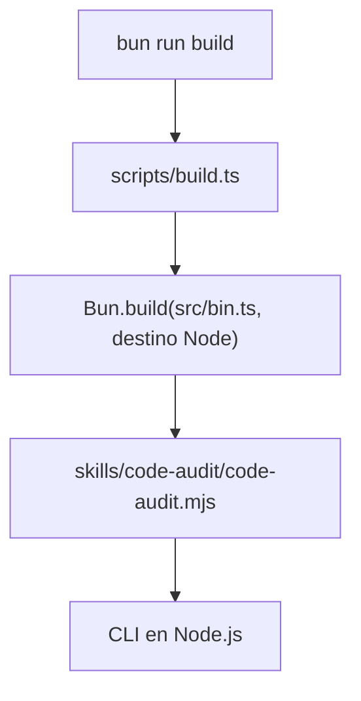

Parte 4 · Página 15 de 18 · Anterior: [Desarrollo](10-development.md) · Siguiente: [Comprobador de documentación](17-docs-check.md) · [Índice](../README.md)
# Script de compilación

**Archivo:** `scripts/build.ts` · 40 líneas · **Estado:** disponible

## Índice de la página

- ¿Qué es y para qué sirve?
- Antes de leer el código
- Cómo encaja
- El código completo, comentado
- Ejemplos con datos reales
- Resumen de comportamientos
- Dónde se usa
- Pruebas

## ¿Qué es y para qué sirve?

`scripts/build.ts` crea el archivo independiente `skills/code-audit/code-audit.mjs`. Sin él, el equipo no tendría el programa compilado que puede ejecutar con Node.js. `buildArtifact` acepta un directorio de salida opcional y devuelve la ruta del archivo compilado; el script también ejecuta la compilación predeterminada al iniciarse directamente. Bun ejecuta este script de desarrollo.

## Antes de leer el código


### Punto de entrada y carpeta de salida

Un punto de entrada es el archivo fuente desde el que comienza una compilación. Aquí es `src/bin.ts`; la carpeta de salida predeterminada es `skills/code-audit`. El comando real `bun run build` terminó con código `0` y el CLI generado imprimió:

```text
// → 0.1.0
```

### Restaurar el estado del proceso

`process.chdir(root)` hace que las rutas de entrada relativas se resuelvan desde la raíz del repositorio. El bloque `finally` restaura el directorio original aunque falle la compilación. Esto importa cuando otro script importa `buildArtifact`.

## Cómo encaja



1. Resuelve la raíz del proyecto a partir de la ubicación del script de compilación.
2. Crea la carpeta de salida si falta.
3. Compila `src/bin.ts` como ESM para Node y añade una primera línea especial (`#!/usr/bin/env node`) que indica al sistema que debe ejecutar el archivo con Node.
4. Falla si Bun informa errores, fija el permiso ejecutable y restaura el directorio de trabajo.

## El código completo, comentado

```ts
import { chmod, mkdir } from 'node:fs/promises';
import { dirname, resolve } from 'node:path';
import { fileURLToPath } from 'node:url';

// Resuelve la raíz de esta copia local desde el archivo para funcionar en cualquier ruta.
const root = resolve(dirname(fileURLToPath(import.meta.url)), '..');

/** Compila el CLI independiente de Node.js en el directorio de salida. */
export async function buildArtifact(
  outputDirectory = resolve(root, 'skills/code-audit'),
): Promise<string> {
  // Guarda el directorio del llamador porque esta función lo cambiará un momento.
  const originalDirectory = process.cwd();
  const outdir = resolve(outputDirectory);
  const outfile = resolve(outdir, 'code-audit.mjs');

  // Bun necesita que exista el destino antes de escribir el archivo compilado.
  await mkdir(dirname(outfile), { recursive: true });
  try {
    // Resuelve el punto de entrada desde la raíz de esta copia local del repositorio.
    process.chdir(root);
    const result = await Bun.build({
      entrypoints: ['src/bin.ts'],
      target: 'node',
      format: 'esm',
      banner: '#!/usr/bin/env node',
      outdir,
      naming: { entry: 'code-audit.mjs' },
    });

    // Expone los diagnósticos de Bun para no ocultar una compilación incompleta.
    if (!result.success) {
      throw new AggregateError(result.logs, 'Failed to build code-audit');
    }

    // Permite iniciar el archivo generado como programa ejecutable.
    await chmod(outfile, 0o755);
    return outfile;
  } finally {
    // Restaura el estado del proceso para quienes continúen tras compilar.
    process.chdir(originalDirectory);
  }
}

// Compila solo cuando Bun ejecuta este módulo como script principal.
if (import.meta.main) {
  await buildArtifact();
}
```

## Ejemplos con datos reales

Estos ejemplos muestran el comando compilado y el resultado de su prueba.

### Caso normal

`bun run build` imprimió `$ bun scripts/build.ts`, terminó con código `0` y el archivo compilado imprimió:

```text
// → 0.1.0
```

### Caso límite

`buildArtifact` acepta otro directorio de salida y crea sus carpetas superiores. La prueba real `does not contain absolute local paths` lo llama con una carpeta temporal y lee el archivo compilado.

### Sin la línea clave

Sin el bloque `finally`, quien importe `buildArtifact` permanecería en la raíz del repositorio después de que la función regrese o lance un error. `src/build.test.ts` verifica el archivo compilado; la restauración del directorio aparece en `scripts/build.ts:33–34`.

## Resumen de comportamientos

- **No se indica directorio de salida:** compila en `skills/code-audit`.
- **No existe la carpeta de salida:** la crea de forma recursiva.
- **Bun informa un error:** lanza `AggregateError` con sus registros.
- **La compilación tiene éxito:** permite ejecutar el `.mjs` y devuelve su ruta.
- **La compilación termina o falla:** restaura el directorio de trabajo original.

## Dónde se usa

- `package.json` ejecuta este script para `bun run build`.
- Agrupa [`src/bin.ts`](../3-code/010-bin.md), que delega en [`src/cli.ts`](../3-code/020-cli.md).
- El archivo compilado queda en `skills/code-audit/code-audit.mjs`.

## Pruebas

La prueba del script comprueba que el archivo compilado no incluya rutas locales absolutas.
Parte 4 · Página 15 de 18 · Anterior: [Desarrollo](10-development.md) · Siguiente: [Comprobador de documentación](17-docs-check.md) · [Índice](../README.md)
