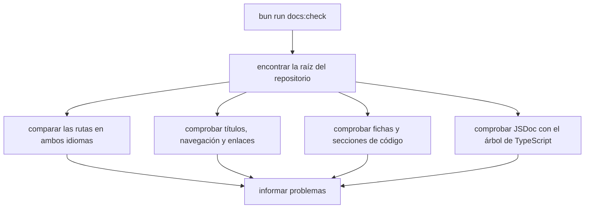

Parte 4 · Página 30 de 32 · Anterior: [Script de compilación](15-build-script.md) · Siguiente: [Estándar de documentación](20-documentation-standard.md) · [Índice](../README.md)
# Comprobador de documentación

**Archivo:** `scripts/check-docs.ts` · 483 líneas · **Estado:** disponible


`scripts/check-docs.ts` valida los índices en inglés y español, las páginas, las fichas de archivos fuente, los encabezados con contenido, los comentarios de código, los bloques cercados y los caracteres BOM en cualquier parte de los archivos Markdown. Devuelve una lista de problemas `{ file, message }`.

## Índice de la página

- ¿Qué es y para qué sirve?
- Antes de leer el código
- Cómo encaja
- El código completo, comentado
- Ejemplos con datos reales
- Resumen de comportamientos
- Dónde se usa
- Pruebas

## ¿Qué es y para qué sirve?

El comprobador recibe la raíz de un repositorio e informa problemas de documentación. Sin él, podrían pasar inadvertidos enlaces rotos, rutas de lectura diferentes, páginas fuente faltantes o conteos desactualizados. El comando `docs:check` del paquete lo ejecuta y termina con error si encuentra un problema.

## Antes de leer el código

Un encabezado tiene contenido si el siguiente es más profundo. Los archivos que solo declaran tipos usan la plantilla específica de tipos.


### Enlaces y títulos Markdown

Markdown es el formato de texto sencillo de estas páginas. El comprobador sigue los enlaces de cada índice para conocer el orden de lectura y compara títulos y rótulos de navegación con el título de la página destino.

### JSDoc y árbol de sintaxis de TypeScript

JSDoc es un comentario breve justo antes de una declaración TypeScript. Un árbol de sintaxis es la representación estructurada del código que crea TypeScript; el comprobador lo usa para encontrar declaraciones exportadas y funciones con nombre que necesitan JSDoc.

### Ficha de archivo fuente

La ficha de un archivo fuente indica un archivo `.ts` existente y su número de líneas. El comprobador compara ese número con el archivo para mantener la guía actualizada.

## Cómo encaja



1. Lee ambos índices y reúne los enlaces de páginas en orden.
2. Comprueba que existan las páginas, tengan título y que la navegación use los títulos de destino.
3. Comprueba enlaces locales, fichas, archivos fuente, conteos y secciones de páginas de código.
4. Interpreta las declaraciones TypeScript e informa los JSDoc faltantes.
5. Muestra cada problema y termina con código `1`, o muestra éxito y termina con código `0`.

## El código completo, comentado

Los siguientes cinco bloques consecutivos contienen las 483 líneas de `scripts/check-docs.ts`, en orden.

Bloque 1 de 5:

```ts
import { readdir, readFile, stat } from 'node:fs/promises';
import { dirname, join, relative, resolve, sep } from 'node:path';
import { fileURLToPath } from 'node:url';
import ts from 'typescript';

/** Describe una infracción de las reglas documentales. */
export interface DocProblem {
  file: string;
  message: string;
}

type Page = { path: string; part: number; number: number };

const LANGUAGES = ['en', 'es'] as const;
const PARTS = ['1-overview', '2-architecture', '3-code', '4-development'];

/** Comprueba estructura bilingüe y cobertura de código bajo la raíz. */
export async function checkDocs(root: string): Promise<DocProblem[]> {
  const base = resolve(root);
  const problems: DocProblem[] = [];
  /** Agrega un problema al informe. */
  const add = (file: string, message: string): void => { problems.push({ file, message }); };
  const docsRoot = join(base, 'docs');
  const sequences = new Map<string, string[]>();
  const documentationFiles = await listMarkdown(docsRoot);
  await checkEmptyHeadings([join(base, 'README.md'), ...documentationFiles], base, add);
  await checkFencedCodeBlocks(documentationFiles, base, add);
  await checkBOMCharacters(documentationFiles, base, add);

  for (const lang of LANGUAGES) {
    const langRoot = join(docsRoot, lang);
    const indexPath = join(langRoot, 'README.md');
    const index = await readText(indexPath);
    if (index === undefined) {
      add(toPosix(relative(base, indexPath)), 'language index is missing');
      continue;
    }
    const sequence = [...index.matchAll(/^\s*\d+\.\s+\[[^\]]+\]\(([^)]+\.md)(?:#[^)]*)?\)/gm)]
      .map((match) => resolveLink(indexPath, match[1]));
    sequences.set(lang, sequence);

    const markdown = await listMarkdown(langRoot);
    const pages = new Map<string, Page>();
    for (const file of markdown.filter((path) => path !== indexPath)) {
      const rel = toPosix(relative(langRoot, file));
      const parsed = parsePage(rel);
      if (!parsed) {
        add(toPosix(relative(base, file)), 'page filename must start with a numeric order');
        continue;
      }
      pages.set(rel, parsed);
    }
    for (const target of sequence) {
      if (!(await exists(target))) add(toPosix(relative(base, indexPath)), `linked page is missing: ${target}`);
    }
    const listed = new Set(sequence.map((path) => toPosix(relative(langRoot, path))));
    for (const page of pages.keys()) {
      if (!listed.has(page)) add(toPosix(relative(base, langRoot)), `orphan page: ${page}`);
    }
    checkSequenceOrder(sequence, langRoot, add, toPosix(relative(base, indexPath)));
    const uniquePageIds = new Set<string>();
    for (const page of pages.values()) {
      const key = `${page.part}:${page.number}`;
      if (uniquePageIds.has(key)) add(toPosix(relative(base, langRoot)), `duplicate page number ${key}`);
      uniquePageIds.add(key);
    }
    await checkNavigation(sequence, indexPath, lang, add, base);
    await checkLocalLinks([...(lang === 'en' ? [join(base, 'README.md')] : []), indexPath, ...markdown], docsRoot, base, add);
  }

  const english = (sequences.get('en') ?? []).map((path) => toPosix(relative(join(docsRoot, 'en'), path)));
  const spanish = (sequences.get('es') ?? []).map((path) => toPosix(relative(join(docsRoot, 'es'), path)));
  if (JSON.stringify(english) !== JSON.stringify(spanish)) {
    add('docs', 'English and Spanish page sequences must have identical paths and order');
  }

  await checkSourcePages(base, sequences, add);
  await checkJSDoc(base, add);
  return problems;
}

/** Encuentra encabezados sin cuerpo antes del siguiente encabezado o del final. */
async function checkEmptyHeadings(
  files: string[], root: string, add: (file: string, message: string) => void,
): Promise<void> {
  for (const file of files) {
    const content = await readText(file);
    if (content === undefined) continue;
    const lines = content.split(/\r?\n/);
    let heading: string | undefined;
    let hasContent = false;
    let fence: string | undefined;
    /** Informa un encabezado que no tiene texto de cuerpo. */
    const reportEmpty = (): void => {
      if (heading && !hasContent) {
        add(toPosix(relative(root, file)), `heading has no content: ${heading}`);
      }
```

Bloque 2 de 5:

```ts
    };
    for (const line of lines) {
      const marker = line.match(/^\s*(```+|~~~+)/)?.[1];
      if (fence) {
        if (marker?.[0] === fence) fence = undefined;
        else if (line.trim() !== '') hasContent = true;
        continue;
      }
      if (marker) {
        fence = marker[0];
        continue;
      }
      if (/^(?:Part \d+ · Page \d+ of \d+|Parte \d+ · Página \d+ de \d+)/.test(line)) continue;
      const match = line.match(/^(#{2,6})\s+.+$/);
      if (match) {
        const previousDepth = heading?.match(/^#+/)?.[0].length ?? 0;
        if (heading && match[1].length > previousDepth) hasContent = true;
        reportEmpty();
        heading = line;
        hasContent = false;
      } else if (heading && line.trim() !== '') {
        hasContent = true;
      }
    }
    reportEmpty();
  }
}

/** Informa bloques de código Markdown mal cerrados o sin cierre. */
async function checkFencedCodeBlocks(
  files: string[], root: string, add: (file: string, message: string) => void,
): Promise<void> {
  for (const file of files) {
    const content = await readText(file);
    if (content === undefined) continue;
    const lines = content.split(/\r?\n/);
    let fenceChar: string | undefined;
    let fenceLength = 0;
    for (let index = 0; index < lines.length; index += 1) {
      const line = lines[index]!;
      const marker = line.match(/^\s*(`{3,}|~{3,})/);
      if (!fenceChar) {
        if (marker) {
          fenceChar = marker[1]![0]!;
          fenceLength = marker[1]!.length;
        }
        continue;
      }

      const candidates = [
        line.match(/^\s*([`~]{3,})/)?.[1],
        line.match(/([`~]{3,})\s*$/)?.[1],
      ].filter((run): run is string => run !== undefined && run[0] === fenceChar && run.length >= fenceLength);
      if (candidates.length === 0) continue;
      const trimmed = line.trim();
      if ([...trimmed].every((char) => char === fenceChar)) {
        fenceChar = undefined;
        fenceLength = 0;
      } else {
        add(toPosix(relative(root, file)), `closing fence must be alone on its line at line ${index + 1}`);
      }
    }
    if (fenceChar) add(toPosix(relative(root, file)), 'fenced code block is not closed');
  }
}

/** Informa si una página documental contiene un carácter BOM UTF-8. */
async function checkBOMCharacters(
  files: string[], root: string, add: (file: string, message: string) => void,
): Promise<void> {
  for (const file of files) {
    const content = await readText(file);
    const index = content?.indexOf('\uFEFF') ?? -1;
    if (index < 0) continue;
    const line = content!.slice(0, index).split(/\r?\n/).length;
    add(toPosix(relative(root, file)), `documentation contains a BOM character at line ${line}`);
  }
}

/** Interpreta la parte y el orden numérico de la ruta de una página. */
function parsePage(path: string): Page | undefined {
  const match = path.match(/^([1-4]-[^/]+)\/(\d+)-[^/]+\.md$/);
  if (!match) return undefined;
  const part = Number(match[1][0]);
  if (match[1] !== PARTS[part - 1]) return undefined;
  return {
    path,
    part,
    number: Number(match[2]),
  };
}

/** Informa errores de numeración y orden de partes en el índice. */
function checkSequenceOrder(
  sequence: string[], langRoot: string, add: (file: string, message: string) => void, reportFile: string,
): void {
  let lastPart = 0;
```

Bloque 3 de 5:

```ts
  const numbers = new Map<string, number>();
  for (const absolute of sequence) {
    const rel = toPosix(relative(langRoot, absolute));
    const parsed = parsePage(rel);
    if (!parsed) continue;
    if (parsed.part < lastPart) add(reportFile, 'parts must appear in order 1 through 4');
    lastPart = parsed.part;
    const folder = dirname(rel);
    const previous = numbers.get(folder) ?? 0;
    if (parsed.number <= previous) add(reportFile, `page numbers must increase within ${folder}`);
    numbers.set(folder, parsed.number);
  }
}

/** Valida la navegación de cada página en la secuencia de lectura. */
async function checkNavigation(
  sequence: string[], indexPath: string, lang: string,
  add: (file: string, message: string) => void, root: string,
): Promise<void> {
  const total = sequence.length;
  for (let i = 0; i < total; i += 1) {
    const file = sequence[i];
    const text = await readText(file);
    if (text === undefined) continue;
    const first = text.split(/\r?\n/, 1)[0];
    const lines = text.split(/\r?\n/);
    const titleLine = lines.slice(1).find((line) => line.trim() !== '');
    if (!titleLine?.startsWith('# ')) {
      add(toPosix(relative(root, file)), 'page title must follow the navigation bar');
    }
    const last = text.trimEnd().split(/\r?\n/).at(-1) ?? '';
    const navPattern = lang === 'es' ? /Parte (\d+) · Página (\d+) de (\d+)/ : /Part (\d+) · Page (\d+) of (\d+)/;
    for (const [position, line] of [['first', first], ['last', last]] as const) {
      const match = line.match(navPattern);
      const report = toPosix(relative(root, file));
      if (!match || Number(match[2]) !== i + 1 || Number(match[3]) !== total) {
        add(report, `${position} navigation line must show page ${i + 1} of ${total}`);
        continue;
      }
      const links = [...line.matchAll(/\[([^\]]+)\]\(([^)]+)\)/g)];
      const previous = links.find((link) => /Anterior:|Previous:/i.test(line.slice(0, link.index)));
      const nextLabel = lang === 'es' ? 'Siguiente:' : 'Next:';
      const prevLabel = lang === 'es' ? 'Anterior:' : 'Previous:';
      const next = links.find((link) => line.slice(0, link.index).includes(nextLabel));
      const index = links.find((link) => /Índice|Index/i.test(link[1]));
      if (i > 0) {
        if (!previous || resolveLink(file, previous[2]) !== sequence[i - 1]) add(report, `${position} previous link must point to the prior page`);
        else if (previous[1] !== await pageTitle(sequence[i - 1])) add(report, `${position} previous link label must match destination title`);
      }
      if (i === 0 && line.includes(prevLabel)) add(report, `${position} first page must omit the previous link`);
      if (i < total - 1) {
        if (!next || resolveLink(file, next[2]) !== sequence[i + 1]) add(report, `${position} next link must point to the next page`);
        else if (next[1] !== await pageTitle(sequence[i + 1])) add(report, `${position} next link label must match destination title`);
      }
      if (i === total - 1 && !/\((?:última|last)\)/i.test(line)) add(report, `${position} last page must be marked last`);
      if (!index || resolveLink(file, index[2]) !== indexPath) add(report, `${position} index link must point to the language README`);
    }
  }
}

/** Comprueba enlaces Markdown relativos en la documentación pública. */
async function checkLocalLinks(
  markdownFiles: string[], docsRoot: string, root: string,
  add: (file: string, message: string) => void,
): Promise<void> {
  for (const file of markdownFiles) {
    const content = await readText(file);
    if (!content) continue;
    for (const match of stripCodeFences(content).matchAll(/\[[^\]]*\]\(([^)]+)\)/g)) {
      const href = match[1];
      if (/^(?:https?:|mailto:|#)/i.test(href)) continue;
      const target = resolveLink(file, href);
      if ((file.startsWith(docsRoot) || file === join(root, 'README.md')) && !(await exists(target))) {
        add(toPosix(relative(root, file)), `relative link target does not exist: ${href}`);
      }
    }
  }
}

/** Omite ejemplos cercados para no tratar sus enlaces como enlaces de página. */
function stripCodeFences(content: string): string {
  let fence: string | undefined;
  return content.split(/\r?\n/).filter((line) => {
    const marker = line.match(/^\s*(```+|~~~+)/)?.[1];
    if (!marker && !fence) return true;
    if (marker) {
      if (!fence) fence = marker[0];
      else if (marker[0] === fence) fence = undefined;
    }
    return false;
  }).join('\n');
}

/** Comprueba que cada archivo TypeScript tenga una ficha documental correcta. */
async function checkSourcePages(
  root: string, sequences: Map<string, string[]>, add: (file: string, message: string) => void,
): Promise<void> {
```

Bloque 4 de 5:

```ts
  const sourceFiles = (await Promise.all(['src', 'scripts'].map((folder) => listTypeScript(join(root, folder)))))
    .flat().filter((file) => !file.endsWith('.test.ts'));
  for (const lang of LANGUAGES) {
    const seq = sequences.get(lang) ?? [];
    const declarations = new Map<string, string[]>();
    for (const pagePath of seq) {
      const text = await readText(pagePath);
      if (!text) continue;
      const langRoot = join(root, 'docs', lang);
      const pageRel = toPosix(relative(langRoot, pagePath));
      const card = text.match(/\*\*(?:File|Archivo):\*\*\s*`([^`]+)`(?:\s*,\s*`([^`]+)`)?\s*·\s*(\d+)\s+(?:lines|líneas)\s*·\s*\*\*(?:Status|Estado):\*\*\s*(available|disponible)/i);
      const hasFileCard = text.split(/\r?\n/).slice(0, 6)
        .some((line) => /^\*\*(?:File|Archivo):\*\*/i.test(line));
      const isCodePage = pageRel.startsWith('3-code/')
        || (pageRel.startsWith('4-development/') && hasFileCard);
      if (!isCodePage) continue;
      if (!card) {
        add(toPosix(relative(root, pagePath)), 'code page must declare its file, line count, and available status');
        continue;
      }
      const declaredFiles = [card[1], card[2]].filter(Boolean) as string[];
      for (const declared of declaredFiles) {
        declarations.set(declared, [...(declarations.get(declared) ?? []), pagePath]);
        const source = join(root, declared);
        if (!(await exists(source))) add(toPosix(relative(root, pagePath)), `available source file is missing: ${declared}`);
      }
      const sourceExists = await Promise.all(declaredFiles.map((declared) => exists(join(root, declared))));
      const reportFile = toPosix(relative(root, pagePath));
      const typePage = sourceExists.every(Boolean) && await areTypeFiles(root, declaredFiles);
      if (typePage) checkTypeSections(text, lang, reportFile, add);
      else checkCodeSections(text, lang, reportFile, add);
      if (sourceExists.every(Boolean)) {
        const actualLines = (await Promise.all(declaredFiles.map(async (declared) => lineCount((await readText(join(root, declared)))!))))
          .reduce((sum, count) => sum + count, 0);
        if (Number(card[3]) !== actualLines) add(toPosix(relative(root, pagePath)), `declared line count does not match ${declaredFiles.join(', ')}`);
      }
    }
    for (const source of sourceFiles) {
      const rel = toPosix(relative(root, source));
      const matching = declarations.get(rel) ?? [];
      if (matching.length !== 1) add(`docs/${lang}/3-code`, `${rel} must appear in exactly one code page; found ${matching.length}`);
    }
  }
}

/** Comprueba si los archivos declarados contienen solo declaraciones de tipos. */
async function areTypeFiles(root: string, files: string[]): Promise<boolean> {
  for (const file of files) {
    const path = join(root, file);
    const source = ts.createSourceFile(path, (await readText(path)) ?? '', ts.ScriptTarget.Latest, true, ts.ScriptKind.TS);
    if (source.statements.length === 0 || source.statements.some((statement) =>
      !ts.isInterfaceDeclaration(statement) && !ts.isTypeAliasDeclaration(statement))) return false;
  }
  return true;
}

/** Comprueba las secciones requeridas para páginas que documentan tipos. */
function checkTypeSections(
  content: string, lang: string, file: string, add: (file: string, message: string) => void,
): void {
  const sections = lang === 'es'
    ? ['## Índice de la página', '## ¿Qué es y para qué sirve?', '## Tipos', '## Dónde se usa', '## Pruebas']
    : ['## Page index', '## What is it and what is it for?', '## Types', '## Where it is used', '## Tests'];
  const headings = [...content.matchAll(/^## .+$/gm)].map((match) => match[0]);
  let cursor = -1;
  for (const section of sections) {
    const position = headings.indexOf(section);
    if (position === -1) add(file, `missing type-page section: ${section}`);
    else if (position <= cursor) add(file, `type-page sections are out of order at: ${section}`);
    else cursor = position;
  }
}

/** Comprueba que declaraciones exportadas y funciones nombradas tengan JSDoc. */
async function checkJSDoc(root: string, add: (file: string, message: string) => void): Promise<void> {
  const sourceFiles = (await Promise.all(['src', 'scripts'].map((folder) => listTypeScript(join(root, folder)))))
    .flat().filter((file) => !file.endsWith('.test.ts'));
  for (const file of sourceFiles) {
    const source = ts.createSourceFile(file, (await readText(file)) ?? '', ts.ScriptTarget.Latest, true, ts.ScriptKind.TS);
    /** Informa una declaración que no tiene comentario JSDoc. */
    const check = (node: ts.Node, label: string): void => {
      const docs = (node as ts.Node & { jsDoc?: ts.JSDoc[] }).jsDoc;
      if (!docs?.length) add(toPosix(relative(root, file)), `${label} is missing JSDoc`);
    };
    /** Comprueba si una declaración se exporta desde su módulo. */
    const exported = (node: ts.Node): boolean => ts.canHaveModifiers(node)
      && !!ts.getModifiers(node)?.some((modifier) => modifier.kind === ts.SyntaxKind.ExportKeyword);
    /** Recorre declaraciones de forma recursiva y comprueba sus comentarios. */
    const visit = (node: ts.Node): void => {
      if (ts.isFunctionDeclaration(node) && node.name) check(node, `function ${node.name.text}`);
      if (ts.isClassDeclaration(node) && node.name && exported(node)) check(node, `class ${node.name.text}`);
      if (ts.isInterfaceDeclaration(node) && exported(node)) check(node, `interface ${node.name.text}`);
      if (ts.isTypeAliasDeclaration(node) && exported(node)) check(node, `type ${node.name.text}`);
      if (ts.isVariableStatement(node)) {
        for (const declaration of node.declarationList.declarations) {
          if (!ts.isIdentifier(declaration.name)) continue;
          if (exported(node)) check(node, `constant ${declaration.name.text}`);
```

Bloque 5 de 5:

```ts
          else if (declaration.initializer && (ts.isArrowFunction(declaration.initializer)
            || ts.isFunctionExpression(declaration.initializer))) {
            check(node, `function ${declaration.name.text}`);
          }
        }
      }
      ts.forEachChild(node, visit);
    };
    visit(source);
  }
}

/** Comprueba el orden de encabezados en páginas de código disponibles. */
function checkCodeSections(
  content: string, lang: string, file: string, add: (file: string, message: string) => void,
): void {
  const sections = lang === 'es'
    ? [
      '## Índice de la página', '## ¿Qué es y para qué sirve?', '## Antes de leer el código',
      '## Cómo encaja', '## El código completo, comentado', '## Ejemplos con datos reales',
      '## Resumen de comportamientos', '## Dónde se usa', '## Pruebas',
    ]
    : [
      '## Page index', '## What is it and what is it for?', '## Before reading the code',
      '## How it fits', '## The complete, commented code', '## Examples with real data',
      '## Behavior summary', '## Where it is used', '## Tests',
    ];
  const headings = [...content.matchAll(/^## .+$/gm)].map((match) => match[0]);
  let cursor = -1;
  for (const section of sections) {
    const position = headings.indexOf(section);
    if (position === -1) add(file, `available code page is missing section: ${section}`);
    else if (position <= cursor) add(file, `code page sections are out of order at: ${section}`);
    else cursor = position;
  }
}

/** Enumera archivos Markdown bajo un directorio. */
async function listMarkdown(folder: string): Promise<string[]> {
  return (await walk(folder)).filter((file) => file.endsWith('.md'));
}

/** Enumera archivos TypeScript bajo un directorio. */
async function listTypeScript(folder: string): Promise<string[]> {
  return (await walk(folder)).filter((file) => file.endsWith('.ts'));
}

/** Enumera recursivamente los archivos de un directorio. */
async function walk(folder: string): Promise<string[]> {
  if (!(await exists(folder))) return [];
  const result: string[] = [];
  for (const entry of await readdir(folder, { withFileTypes: true })) {
    const path = join(folder, entry.name);
    if (entry.isDirectory()) result.push(...await walk(path));
    else if (entry.isFile()) result.push(path);
  }
  return result;
}

/** Lee un archivo UTF-8 y devuelve undefined si no puede leerlo. */
async function readText(path: string): Promise<string | undefined> {
  try { return await readFile(path, 'utf8'); } catch { return undefined; }
}

/** Lee el primer encabezado de nivel uno para revisar la navegación. */
async function pageTitle(path: string): Promise<string | undefined> {
  const text = await readText(path);
  return text?.match(/^# (.+)$/m)?.[1];
}

/** Informa si existe una ruta del sistema de archivos. */
async function exists(path: string): Promise<boolean> {
  try { await stat(path); return true; } catch { return false; }
}

/** Resuelve un enlace Markdown desde la ruta del archivo que lo contiene. */
function resolveLink(from: string, href: string): string {
  return resolve(dirname(from), decodeURIComponent(href.split('#')[0]));
}

/** Convierte una ruta del sistema a separadores de barra. */
function toPosix(path: string): string { return path.split(sep).join('/'); }

/** Cuenta líneas sin considerar el terminador final como una línea adicional. */
function lineCount(text: string): number {
  return text.split(/\r?\n/).length - (text.endsWith('\n') || text.endsWith('\r') ? 1 : 0);
}

if (import.meta.main) {
  const root = resolve(dirname(fileURLToPath(import.meta.url)), '..');
  const problems = await checkDocs(root);
  for (const problem of problems) process.stderr.write(`${problem.file}: ${problem.message}\n`);
  if (problems.length === 0) process.stdout.write('Documentation check passed: 0 problems.\n');
  else process.exitCode = 1;
}
```

## Ejemplos con datos reales

Estos ejemplos muestran salidas reales de éxito y error del comprobador.

### Caso normal

Desde la raíz de la copia local, `bun run docs:check` mostró:

```text
// → Documentation check passed: 0 problems.
```

### Caso límite

Esta entrada temporal crea índices iguales en inglés y español que enlazan a una página inexistente:

```ts
const root = '/tmp/code-audit-d2r2-checker-example';
await rm(root, { recursive: true, force: true });
for (const lang of ['en', 'es']) {
  await mkdir(join(root, 'docs', lang), { recursive: true });
  await writeFile(join(root, 'docs', lang, 'README.md'),
    '# Index\n\n1. [Missing](3-code/020-missing.md)\n');
}
const [problem] = await checkDocs(root);
console.log(`${problem.file}: ${problem.message}`);
// → docs/en/README.md: linked page is missing: /tmp/code-audit-d2r2-checker-example/docs/en/3-code/020-missing.md
await rm(root, { recursive: true, force: true });
```

### Sin la línea clave

Si el punto de entrada usara `process.cwd()`, al ejecutar el comprobador desde `/tmp` buscaría allí en vez de revisar este repositorio. El punto de entrada calcula la raíz desde su propia URL de archivo.

## Resumen de comportamientos

- **Las rutas de ambos idiomas coinciden:** continúa con páginas, enlaces y fuentes.
- **Un título o rótulo de navegación es incorrecto:** informa la página y el desacuerdo.
- **Un encabezado de nivel dos a seis no tiene contenido:** informa la página y el encabezado.
- **Un bloque cercado no se cierra o el cierre comparte línea con texto:** informa el archivo y la línea.
- **Una página Markdown contiene U+FEFF en cualquier posición, incluso al inicio:** informa el archivo y la línea.
- **Falta el archivo fuente o cambia su conteo:** informa la ficha correspondiente.
- **Una declaración requiere JSDoc:** informa su archivo y nombre.
- **No hay problemas:** muestra el mensaje de éxito y termina con código `0`.

## Dónde se usa

- `package.json` ejecuta el comprobador con `bun run docs:check`.
- Revisa las páginas públicas enlazadas desde los índices de ambos idiomas.

## Pruebas

- `scripts/check-docs.test.ts`: `accepts the real repository with no documentation problems`, `rejects BOM characters at the start or within documentation files`, `rejects different English and Spanish reading sequences`, `does not count the start-here link as another index page`, `rejects missing linked pages and orphan Markdown pages`, `rejects duplicate numbers and decreasing page numbers within a folder`, `rejects incorrect page counts and navigation neighbors`, `requires a page title immediately after its navigation bar`, `requires previous and next navigation labels to match destination titles`, `rejects broken relative links in docs and the root README`, `ignores Markdown links shown inside fenced examples`, `rejects a missing source page and an incorrect available line count`, `rejects documentation cards with an unsupported status`, `rejects source files declared more than once or missing from disk`, `rejects undocumented declarations and named functions using the TypeScript AST`, `rejects missing or out-of-order code page sections`, `checks any development page that contains a file card`, `validates type-only source pages against the type-page template`, `rejects headings with no content before the next heading or page end`, `accepts a section heading followed directly by a deeper subheading`, `rejects a fenced code closing marker that shares a line with text`, `rejects a fenced code marker with trailing text`, `rejects a fenced code block that is never closed`, `finds the repository root from its own file when run outside the repository`.
Parte 4 · Página 30 de 32 · Anterior: [Script de compilación](15-build-script.md) · Siguiente: [Estándar de documentación](20-documentation-standard.md) · [Índice](../README.md)


