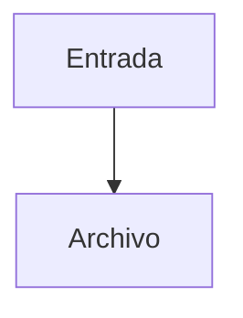

Parte 4 · Página 33 de 34 · Anterior: [Comprobador de documentación](17-docs-check.md) · Siguiente: [Hoja de ruta](30-roadmap.md) · [Índice](../README.md)
# Estándar de documentación

Las reglas y plantillas para mantener esta documentación.

## Índice de la página

1. Propósito y capas de lectura
2. Verdad y evidencia
3. Página por archivo de código
4. Página de tipos
5. Estado actual e historia
6. Enlaces, diagramas y tablas
7. Comentarios JSDoc en el código
8. Actualización conjunta
9. Plantillas

## 1. Propósito y capas de lectura

La documentación guía desde una explicación sencilla hasta los detalles necesarios para mantener el programa. Cada párrafo pertenece a una sola capa: lenguaje llano para cualquier lector o detalle técnico para desarrolladores. Un término técnico se explica en una frase la primera vez que aparece.

## 2. Verdad y evidencia

Cada afirmación sobre el comportamiento debe salir del código actual e indicar rutas, nombres, líneas y valores exactos cuando corresponda. Los ejemplos usan datos reales del repositorio; no se inventan entradas, salidas ni capacidades. Solo se documenta lo que ya existe. Lo pendiente vive únicamente en la hoja de ruta; una tarea futura agrega las páginas cuando construya esa función.

## 3. Una página por archivo de código

Cada archivo de código tiene su propia página en `3-code/`, en el orden en que se ejecuta. La página incluye estas secciones en este orden:

1. Barra de navegación.
2. Ficha con archivo, número de líneas y estado.
3. Índice de la página.
4. **¿Qué es y para qué sirve?** Explica qué fallaría sin el archivo, qué recibe, qué devuelve y quién lo usa.
5. **Antes de leer el código.** Para cada concepto: qué es, un ejemplo mínimo con el resultado en comentario `// →` y por qué importa aquí.
6. **Cómo encaja.** Diagrama Mermaid y recorrido numerado.
7. **El código completo, comentado.** Incluye el archivo entero; explica con comentarios qué hace cada línea con lógica y por qué. Omite importaciones y líneas obvias. Cada comentario tiene menos de 100 caracteres. Si el archivo supera unas 150 líneas, se divide en bloques consecutivos y no se omite ninguna línea.
8. **Ejemplos con datos reales.** Incluye caso normal, caso límite y qué ocurriría sin la línea clave.
9. **Resumen de comportamientos.** Cada situación va en negrita, seguida de su resultado.
10. **Dónde se usa.** Cita archivo y línea.
11. **Pruebas.** Indica el archivo de pruebas y cada nombre de prueba relevante.

## 4. Página de tipos

La página de tipos contiene una sección por tipo. Para cada campo hay un bloque con su tipo, si es obligatorio o su valor por defecto, propósito, efecto de cada valor, quién lo llena, quién lo lee y un ejemplo.

## 5. Estado actual e historia

La página describe el archivo tal como existe hoy. No narra tareas ni cambios históricos. La historia del proyecto se conserva en `CHANGELOG.md`; lo pendiente se describe solo en la hoja de ruta.

## 6. Enlaces, diagramas y tablas

Cada archivo mencionado enlaza a su página de documentación. Los diagramas usan Mermaid, una sintaxis de texto para dibujar diagramas de flujo. Todo encabezado de nivel dos a seis tiene contenido antes del siguiente encabezado o del final de la página. Las tablas tienen como máximo tres columnas, una línea por celda y no contienen código.

## 7. Comentarios JSDoc en el código

En el código del repositorio, cada función, clase y constante exportada lleva un JSDoc breve en inglés, de una o dos frases. También lo lleva cada función con nombre aunque no se exporte. Las explicaciones largas pertenecen a `docs/`, no al código.

## 8. Actualización conjunta

Solo se documenta lo que ya existe; lo pendiente vive únicamente en la hoja de ruta; cada tarea agrega o actualiza en la misma rama las páginas de lo que construye, en inglés y español.

## 9. Plantillas

Usa estos modelos como punto de partida para una página de código o de tipos.

### Plantilla: página de código

````markdown
Parte N · Página X de M · Anterior: [Título](../README.md) · Siguiente: [Título](../README.md) · [Índice](../README.md)


**Archivo:** `src/ruta/archivo.ts` · N líneas · **Estado:** disponible

## Índice de la página

## ¿Qué es y para qué sirve?

## Antes de leer el código

### Concepto

Qué es. Ejemplo mínimo:

```ts
// entrada
// → resultado
```

Por qué importa en este archivo.

## Cómo encaja



1. Recorrido del flujo.

## El código completo, comentado

```ts
// Código completo con explicaciones breves.
```

## Ejemplos con datos reales

### Caso normal

### Caso límite

### Sin la línea clave

## Resumen de comportamientos

- **Situación:** resultado.

## Dónde se usa

- [src/cli.ts](../3-code/020-cli.md), línea N.

## Pruebas

- `src/archivo.test.ts`: nombre de la prueba.
````

### Plantilla: página de tipos

```markdown
Parte N · Página X de M · Anterior: [Título](../README.md) · Siguiente: [Título](../README.md) · [Índice](../README.md)


**Archivo:** `src/ruta/types.ts` · N líneas · **Estado:** disponible

## Índice de la página

## ¿Qué es y para qué sirve?

## Tipos

### `NombreDelTipo`

#### `campo` — `Tipo`

- **Obligatorio o predeterminado:** condición.
- **Propósito:** efecto del campo.
- **Valores:** efecto de cada valor válido.
- **Lo llena:** archivo y línea.
- **Lo lee:** archivo y línea.
- **Ejemplo:** `{ campo: valor }`.

## Dónde se usa

## Pruebas
```
Parte 4 · Página 33 de 34 · Anterior: [Comprobador de documentación](17-docs-check.md) · Siguiente: [Hoja de ruta](30-roadmap.md) · [Índice](../README.md)


