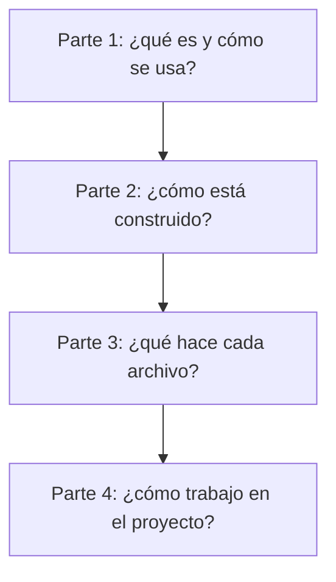

# Documentación de code-audit

Empieza aquí: [página 1](1-overview/10-what-is-code-audit.md).

code-audit revisa cambios de una rama contra las reglas del proyecto y presenta el resultado.

## Parte 1: Descripción general

1. [Qué es code-audit](1-overview/10-what-is-code-audit.md) — El propósito y las herramientas que existen hoy.
2. [Uso de code-audit hoy](1-overview/20-usage.md) — Compilar y ejecutar el programa de línea de comandos.

Al terminar esta parte sabrás qué contiene el proyecto y cómo ejecutar su programa actual de línea de comandos.

## Parte 2: Arquitectura

3. [Arquitectura](2-architecture/10-architecture.md) — Los módulos actuales y sus conexiones reales.
4. [Línea de comandos](2-architecture/20-cli.md) — Los comandos, opciones y códigos de salida actuales.

Al terminar esta parte entenderás cómo colaboran los módulos existentes y qué hace el CLI hoy.

## Parte 3: Código

5. [Entrada del programa](3-code/010-bin.md) — Inicia el CLI y fija el código de salida del proceso.
6. [Línea de comandos](3-code/020-cli.md) — Interpreta argumentos y escribe resultados.
7. [Códigos de salida y versión](3-code/030-exit-codes-and-version.md) — Define los códigos y lee la versión del paquete.
8. [Lector de frontmatter](3-code/040-config-frontmatter.md) — Interpreta un encabezado YAML y el cuerpo Markdown.
9. [Rutas de configuración](3-code/050-config-paths.md) — Nombra carpetas y tipos de configuración.
10. [Tipos de configuración](3-code/060-config-types.md) — Define las formas de configuración, regla y problema.
11. [Cargador de configuración del proyecto](3-code/070-config-config.md) — Lee y valida config.md.
12. [Cargador de reglas](3-code/080-config-rules.md) — Carga y valida reglas Markdown.
13. [Cargador de fichas de tarea](3-code/090-config-task.md) — Carga y valida fichas de tareas en Markdown.
14. [Interfaz Git de solo lectura](3-code/100-git-git.md) — Protege los comandos Git y sus opciones permitidos.
15. [Ayudantes de prueba para repositorios temporales](3-code/110-test-helpers-repo.md) — Crea repositorios Git aislados para las pruebas.
16. [Inicialización del proyecto](3-code/120-init-init.md) — Crea la configuración sin reemplazar archivos existentes.
17. [Plantillas de inicialización](3-code/130-init-templates.md) — Define los archivos generados en inglés y español.
18. [Comprobador del proyecto](3-code/140-check-check.md) — Valida la configuración, las reglas y los patrones de archivos.
19. [Comparador de patrones](3-code/150-config-match.md) — Evalúa rutas de archivos contra patrones comodín.
20. [Tipos de revisión](3-code/160-review-types.md) — Define los tipos de archivos cambiados y alcance de revisión.
21. [Rango a revisar](3-code/170-review-range.md) — Determina los commits, archivos y líneas que entran en la revisión.
22. [Líneas cambiadas](3-code/180-review-changes.md) — Lee las líneas agregadas y eliminadas de cada archivo cambiado.

Al terminar esta parte podrás seguir cada archivo fuente actual y sus pruebas.

## Parte 4: Desarrollo

23. [Desarrollo](4-development/10-development.md) — Requisitos, comprobaciones y flujo de solicitud de integración.
24. [Script de compilación](4-development/15-build-script.md) — Crea el CLI independiente para Node.js.
25. [Comprobador de documentación](4-development/17-docs-check.md) — Valida la documentación pública y sus referencias al código.
26. [Estándar de documentación](4-development/20-documentation-standard.md) — Reglas para mantener estas páginas.
27. [Hoja de ruta](4-development/30-roadmap.md) — El trabajo que falta en el proyecto.

Al terminar esta parte sabrás compilar, comprobar y mantener el proyecto actual.
